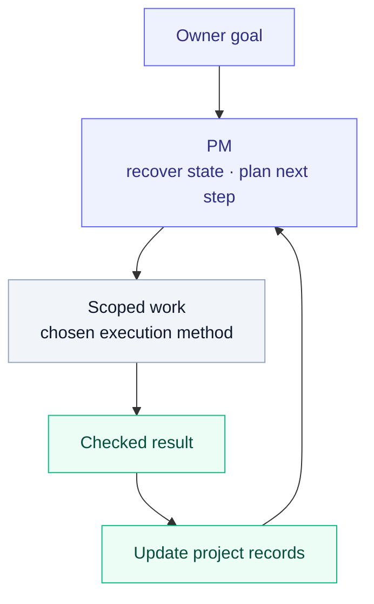
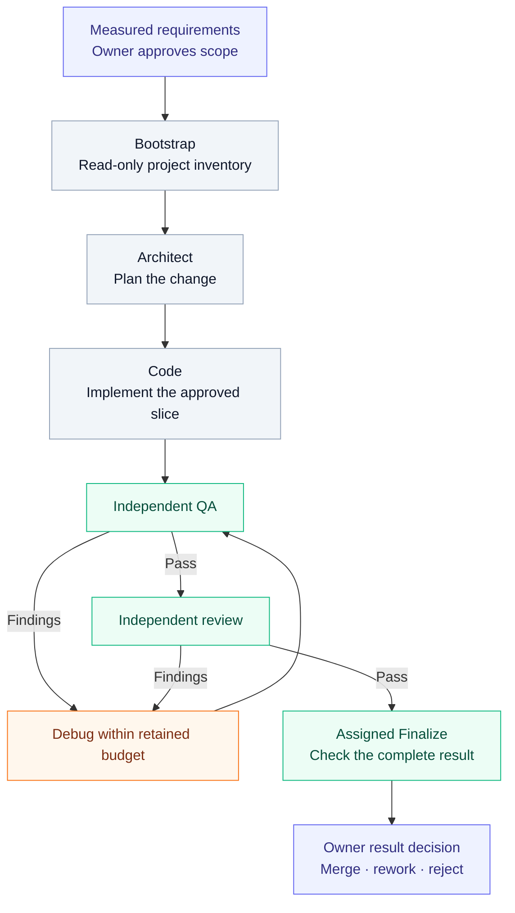

# agent-methodology

**Keep AI-agent work connected to the goal, the evidence and the next session.**

A harness-neutral methodology for managing projects and delivering software with AI agents. Shared rules live in Markdown; native adaptations bring them to Codex and Claude Code.

Version: `3.2.0` · License: [MIT](LICENSE)

**Installing for personal use in Codex? Install the `methodology-codex` plugin.** Start with the [new-machine installation steps](implementations/codex/README.md#personal-plugin-installation). Cloning this repository alone does not install it.

[Get started](#get-started) · [How it works](#how-it-works) · [Project memory](#project-memory) · [Validation](#validation) · [Maintainers](#maintainers)

> **Preview status.** The methodology and its adaptations are under development. Source checks and local loading have been exercised; full behavioral parity and operational effectiveness remain unproven. See [scope and evidence](#scope-and-evidence) before relying on a capability.

## Why use it?

- **Keep direction visible.** Connect the owner's goal to a route, a bounded task and its finish condition.
- **Continue across sessions.** Recover decisions, progress and the next permitted action from project records.
- **Separate responsibilities.** Give planning, implementation and independent verification clear boundaries.
- **Close against evidence.** Distinguish a proposed action, an executed action, a checked result and the owner's acceptance.

Use the PM layer for research, documents and software projects. New features and substantial bug fixes use the development flow; ordinary document work uses bounded edits and relevant checks.

## How it works

The PM layer keeps an initiative moving from the owner’s goal to bounded work and recoverable evidence:



The parent agent keeps the goal, current state and granted scope connected. Shared rules are adapted to the actual tools and permissions of Codex or Claude Code. The host supplies model execution and tools; this repository supplies instructions, contracts and checkers. Reserved direction and integration choices stay with the owner.

For an approved software change, the normal flow is:



The diagram shows the normal path; blocked, exhausted and failed work keeps its history. Finalize cannot silently repair source, and a passing check does not itself authorize integration. [Full flow](flow/phases.md) · [Gates](process/gates.md) · [Run state](flow/run-state.md)

## Project memory

Each role has one actual document home. Existing project names and rules are preserved.

| Record | What it owns |
|---|---|
| **AGENTS** | Entry instructions, reading order, document paths and writer boundaries |
| **VISION** | Intended outcome, users, constraints and non-goals |
| **ROADMAP** | Outcome route, dependencies, current focus and deliberate deferrals |
| **TASKS** | Current work, granted scope, finish conditions and evidence |
| **HANDOFF** | Present state, blockers and the next authorized action |

Update affected records after material changes, grouped progress and before planned handoff. Keep detailed evidence in linked notes. A fresh agent should be able to continue without the previous chat.

Bootstrap creates missing entries from the [templates](documents/templates/INDEX.md). For existing entries it compares duties by meaning and adds only missing nonconflicting clauses within the grant—without replacing project rules or inventing missing decisions. [Document conventions](documents/conventions.md) · [Session continuity](process/session.md)

## Get started

Keep a **complete checkout**: both native packages depend on the shared rules beside them. Select the adaptation for your host.

### Codex

For persistent personal use, [install the `methodology-codex` plugin](implementations/codex/README.md#personal-plugin-installation). The instructions cover a complete snapshot, local marketplace registration, installation and discovery checks.

You can give a Codex agent this request:

> Install this repository as my personal Codex plugin, `methodology-codex`, following `implementations/codex/README.md#personal-plugin-installation`. Preserve existing plugins and configuration, keep the complete repository snapshot, and verify that the installed skills are available in a fresh session. Report the installed version and source. The target projects where I will use it are separate from this methodology repository.

For a one-session source trial instead, ask Codex to read the checkout's `implementations/codex/skills/pm/SKILL.md` and required references, naming the actual target project separately. This does not install the plugin. Copying only the skill folder or installing only `implementations/codex/` loses required shared rules and is unsupported.

| Starting point | Entry |
|---|---|
| Resume a project | [`pm`](implementations/codex/skills/pm/SKILL.md) |
| Prepare project records | [`pm-bootstrap`](implementations/codex/skills/pm-bootstrap/SKILL.md) |
| Plan the next bounded packet | [`pm-plan-batch`](implementations/codex/skills/pm-plan-batch/SKILL.md) |
| Implement an approved specification | [`feature-dev`](implementations/codex/skills/feature-dev/SKILL.md) |

### Claude Code

Load the [Claude package](implementations/claude/README.md) in place for a session:

```sh
claude --plugin-dir /absolute/path/to/checkout/implementations/claude
```

Use `/methodology-claude:pm` to start from the package's [PM entry](implementations/claude/skills/pm/SKILL.md), or its [bootstrap](implementations/claude/skills/pm-bootstrap/SKILL.md) when project preparation is requested. Keep the package and shared rules together. [Persistent local configuration](#local-use)

### Another harness

A JSON adapter accounts for each shared file, declares its capabilities and sets its parameters. The **four ways** to adopt a file are:

| Mode | Meaning |
|---|---|
| By reference | Point to an instruction carrier that names the shared file |
| Vendored with a hash | Keep a copy and record its source SHA-256 |
| Vendored with overrides | Record each changed section, reason, owner and expiry condition |
| Not applied | State the reason for excluding the file |

Start from [`examples/adapter.example.json`](examples/adapter.example.json), setting `harness`, `owner`, `spec_version` and `spec_root`. Resolve paths from the adapter directory. [Adapter contract](runtime/adapters.md) · [Capabilities](runtime/capabilities.md) · [Parameters](runtime/parameters.md)

## Validation

The `conform` checker uses Python 3 and the standard library:

```sh
bin/conform adapter examples/adapter.example.json
bin/conform self --deny-list /absolute/path/to/private-deny-list.txt
```

The self check covers neutral format, registries, calls, version consistency and its defined privacy patterns. Supply your deny list outside the repository. It does not certify all Git history or operational behavior. Adapter checks validate declared coverage and bindings; native behavior has separate tests.

`--json` returns a structured report; `--log-level` controls diagnostics. See the [checker reference](checks/conform.md) for all rules and options.

| Exit | Meaning |
|---|---|
| 0 | No failure; inspect any warnings |
| 1 | At least one check failed |
| 2 | A required input was unavailable; check did not run |

For development, use the [root test guide](tests/test_guide.md) and the selected package's guide:

```sh
python3 -m pytest tests -s -v
python3 -m pytest -c implementations/codex/pytest.ini implementations/codex/tests -s -v
python3 -m pytest -c implementations/claude/pytest.ini implementations/claude/tests -s -v
doxygen Doxyfile
```

Run each package's Doxygen map from its own directory when applicable. Commands above are instructions, not claims that a check ran on your checkout.

## Repository map

| Area | Read it for |
|---|---|
| `concepts/`, `roles/`, `flow/` | Shared principles, role contracts and execution phases |
| `process/`, `documents/`, `protocols/` | PM, durable records, templates and specification formats |
| `prompting/`, `policies/`, `code/` | Prompt design, operating policies and code conventions |
| `runtime/`, `implementations/` | Adapter interfaces and native packages |
| `checks/`, `bin/`, `tools/`, `tests/` | Checker contracts, implementation and verification |
| `examples/` | Adapter and workflow examples; fictional examples grant no authority |

[FORMAT.md](FORMAT.md) defines neutral cards, anchors and norms. [SPEC_VERSION](SPEC_VERSION) and [CHANGELOG.md](CHANGELOG.md) track the methodology as a unit: changed norm meaning raises **MAJOR**, a new norm or file raises **MINOR**, and meaning-preserving wording raises **PATCH**.

## Scope and evidence

The current source contains **69 drafts and 2 stubs**. Native packages are versioned separately: Codex **3.2.0**, Claude **2.3.0**, over neutral **3.2.0**.

Current limitations include deferred native Claude behavioral acceptance, broader consumer/autonomy proof and systematic comparative evaluation. The unaccepted safeguard work is outside the integrated source. Installation and source-test results do not establish whole-methodology effectiveness. [Current maintainer state](examples/pm-project/HANDOFF.md) · [Acceptance and test evidence](tests/test_guide.md)

<details>
<summary>Responsibility boundaries, detailed coverage and deferred subjects</summary>

The methodology allocates five concerns through existing subject contracts; this overview locates their responsibilities and supplies no competing norms.

- **Intelligence** — Intelligence selects appropriate models and reasoning through the current model policy and assigned role contracts. Inference and model execution engines are supplied by runtimes outside this repository. Interfaces: [model policy](policies/models.md) and [role contracts](roles/_base.md).
- **Memory/Context** — Memory/Context supplies relevant instructions, durable state and verified knowledge pointers to planning, execution and evaluation. Storage, retrieval and curation engines remain external; detailed memory and learning bodies remain deferred. Interfaces: [PM](roles/pm.md), [reconnaissance](process/reconnaissance.md) and [external knowledge pointers](runtime/capabilities.md).
- **Process/Orchestration** — Process/Orchestration assigns scoped work, preserves evidence and coordinates the existing owner decisions. Current role, phase, delegation, state, finalization and gate subjects provide the process interfaces. Interfaces: [phases](flow/phases.md), [delegation](flow/delegation.md), [run state](flow/run-state.md), [finalization](flow/finalize.md) and [gates](process/gates.md).
- **Goal/Specification/Vision** — Goal/Specification/Vision carries original human intent into measured specifications, planning and result judgment. Current PM, reconnaissance and plan interfaces use dictated durable carriers; detailed specification and document bodies are current F4 drafts. Interfaces: [PM](roles/pm.md), [Bootstrap](process/bootstrap.md), [reconnaissance](process/reconnaissance.md) and [development plan](protocols/dev-plan.md).
- **Feedback/Evaluation** — Feedback/Evaluation checks the actual result and feeds evidenced causes into improvement. Current QA, Reviewer, scan and conform interfaces provide independent evidenced checking; learning bodies remain deferred. Interfaces: [QA](roles/qa.md), [Reviewer](roles/reviewer.md), [scans](checks/qa-scans.md) and [conform](checks/conform.md).

The deferred bodies in these overview interfaces are the remaining detailed memory and learning-transfer responsibilities. General PM document management, confirmed residual lifecycle/batch/session procedures and five project forms are drafted in this release; contextual experience retains its existing contract. Runtime engines and broader original-source completion remain unproven.

The delivery loop connects original intent, measured preparation, approved specification, assigned design and work, independent evaluation and the resulting evidence. The delivery loop retains a separate owner decision for the concrete result before integration.

The methodology-learning loop connects observed failures and outcomes, causal analysis, source-backed candidates, independent verification and an owning decision. Unverified hypotheses and candidates never become policy or curated verified guidance automatically. External knowledge transfer follows its separately authorized source and curation contract.

Current F2 interfaces define bounded responsibilities without implementing their runtime engines. The exoskeleton, navigation, Doxygen, LDD, tests, AX, data and lints bodies are current F3 bodies; document and greenfield/brownfield specification protocols plus shared specification validation are current F4 bodies; general decision lifecycle (DEC01) and full graph are current F4 bodies; confirmed conventions, lifecycle, batch and session procedures and five project forms are current bounded F4 drafts; eight prompting F5 and three autonomy/credentials/language policy bodies are current bounded drafts; six neutral readiness contracts for principles, glossary, Orient, preflight, run audit and conditional safety/recovery are current bounded drafts; wider F4 duties, learning F8, source completeness, operational adoption and publication remain explicit later or unresolved homes. A stub or link never proves its detailed body completed.

One or multiple agents preserve existing authority, isolation and independent judgment. Existing safety and observability constraints apply to either topology. Existing time, economy and human-control constraints remain in force.

Runtime adoption and propagated enforcement remain unproven. Comparable real runs, measured savings and reduced owner coordination effort remain unproven. Operational F6–F9 work and publication remain pending their own evidence and authorization.

Current F2 interface bodies include role contracts, measured reconnaissance and planning, minimum preparation, flow/state/returns and owner decisions. Current F3 bodies are [exoskeleton](code/exoskeleton.md), [navigation](code/navigation.md), [documentation](code/doxygen.md), [LDD](code/ldd.md), [tests](code/tests.md), [AX](code/ax-ui.md), [data](code/data.md) and [lints](checks/lints.md). Current F4 bodies are [document](protocols/document.md), [greenfield specification](protocols/spec-greenfield.md), [brownfield specification](protocols/spec-brownfield.md) and [shared specification validation](process/specification.md). General decision lifecycle (DEC01) at [decisions](process/decisions.md) and [full graph](protocols/graph.md) are current F4 bodies; [specification](process/specification.md) retains its validation contract. Confirmed [document conventions](documents/conventions.md), [lifecycle](process/lifecycle.md), [batches](process/batch.md) and [session](process/session.md) procedures and [five project forms](documents/templates/INDEX.md) are current bounded F4 drafts, with full editable forms and fictional filled examples. Current bounded F5 prompting bodies are [agent design](prompting/agent-prompt-design.md), [GRACE](prompting/grace.md), [brainstorm](prompting/brainstorm.md), [decomposition](prompting/decomposition.md), [prompt markup](prompting/prompt-markup.md), [solution design](prompting/solution-design.md), [superposition and collapse](prompting/superposition-collapse.md) and [verification](prompting/verification.md). Current remaining policy bodies are [autonomy](policies/autonomy.md), [credentials](policies/credentials.md) and [language](policies/language.md); [model policy](policies/models.md) retains all eighteen current norms. Current bounded readiness contracts are [principles](concepts/principles.md), [glossary](concepts/glossary.md), [Orient](checks/orient.md), [preflight](checks/preflight.md), [particular-run audit](checks/run-audit.md) and [conditional safety/recovery](process/safety.md), with complete reusable forms and fictional cases. These bounded drafts do not complete all F5 or wider F4, source completeness, learning/evaluation, adoption or publication duties. Detailed F8 learning homes are [improvement](process/learning.md) and [knowledge](process/learning.md). The remaining subjects have deferred bodies; an interface or link invokes a subject without proving its body complete, including the eight completed F3 bodies. The remaining subjects that are still marked stub retain their earlier interface status. This combined release preserves accepted PM/M14 and the six inspected readiness contracts; C1 additionally completes the run-review and code-review owners and the native Codex one-shot/loop external-agent route. It does not complete all F5 or source duties of the wider document/learning system. Two stubs remain at process/git.md and process/publication.md; wider uninspected F4 duties remain. Adapter mechanisms supply runtime operation under actual scope and existing permission contracts.

The owner currently retains lightweight error recording in existing notes; systematic learning, improvement experiments and comparative measurement are deferred. Completed bounded document duties do not change that scope.
</details>

## Maintainers

Created and maintained by [Danis Valitov](https://www.linkedin.com/in/valitov-danis-ildusovich/).

Start at [AGENTS.md](AGENTS.md), then the sole current [VISION](examples/pm-project/VISION.md), [ROADMAP](examples/pm-project/ROADMAP.md), [TASKS](examples/pm-project/TASKS.md) and [HANDOFF](examples/pm-project/HANDOFF.md). Preserve current grants and foreign work; develop in an isolated worktree and deliver a reviewed branch/PR. Local integration, installed activation and public publication retain their matching owner decisions.

## Local use

<details>
<summary>Persistent package configuration and safe checkout practices</summary>

The packages read neutral owners and package files from disk. Claude loads the canonical checkout in place; an installed Codex transport loads a complete snapshot of an accepted release. Whatever lies in the checkout a harness is pointed at is therefore what every session on that machine follows. The rules below keep that checkout equal to accepted `main` for every agent that works in this repository.

1. Point each harness at its package in the main checkout of this repository. Claude Code: set `CLAUDE_CODE_PLUGIN_DIRS` to `<checkout>/implementations/claude` in the `env` of the user settings (Claude Code 2.1.280 or later; it also applies to desktop sessions, which take no command-line flags). For Codex, install the complete release snapshot with its generated root transport manifest; keep the nested package and neutral owners together.
2. Keep the main checkout on `main`. Do not check out another branch there and do not leave uncommitted edits to neutral or package files in it; develop on a branch in a separate worktree and merge into `main`. Accepted changes reach new in-place sessions as soon as `main` holds them; `git pull` or a merge updates Claude. Rebuild/reinstall the complete snapshot to update cached Codex installations.
3. Try unmerged package changes in one session only, with `claude --plugin-dir <worktree>/implementations/claude`.
4. Do not link a package into a discovered skills directory: a symlinked plugin keeps the link path in `${CLAUDE_PLUGIN_ROOT}`, so `../../` resolves outside the repository and every neutral reference misses.
5. Before switching a user-level configuration to a package, save the previous configuration and the links it replaces, so the switch can be undone in one step.

</details>
