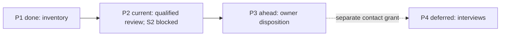

# ROADMAP project form

<!-- anchor: documents.templates.roadmap.form -->

## Project record form

The following fenced text is a drafting form, not live neutral metadata or consent. Use actual project instructions, evidence and vocabulary.

````markdown
---
type: Roadmap
title: "<Project route>"
status: active
generated: { by: "<author>", at: "<actual UTC time>" }
---

# Route

Goal/readiness: <vision pointer>. Stable step scheme: <scheme>. Current marker belongs to exactly one step. Use outcomes and dependencies, not fabricated calendar commitments.

- <P1> — done: <outcome and result pointer>.
- <P2> — current: <observable next outcome>. <<< WE ARE HERE
- <P3> — ahead: <outcome and dependency>.

# Deferred

<Stable ID, reason, return condition and retained work pointer; none if empty.>

# Replan basis

<Decision/instruction pointer for material priority changes; history lives in decisions/results.>

# Route operating fields

<Per checkpoint: stable ID, outcome, observable exit, dependencies, start grant/input link, actual proof/limits and current state. One focus marker follows the project's declared notation. Separate backlog/snapshot pointers; task mechanics remain in TASKS/plan.>

# Dependency view


<Text/diagram statuses and edges agree; rename these example node IDs to the declared stable IDs, and add every deferred/blocked checkpoint with its actual dependency. Non-obvious sequence rationale: reason and record pointer.>

# Retained replan record

<What changed/why, authority, prior packet/result, preserved completed/failed/held IDs, changed dependencies, cancellation/deferral return conditions and before/after view. Read-only status does not edit this record.>

````

<!-- anchor: documents.templates.roadmap.example -->

## Complete fictional filled example

Every person, approval, revision, source, result and observation below is invented for **Meadow document review**. This is a complete illustrative record, never actual consent or project evidence. Paths name the five imagined records; evidence bodies are embedded in them.

````markdown
---
type: Roadmap
title: "Meadow document review — route"
status: active
generated: { by: "fictional coordinator", at: "2026-01-12T10:00:00Z" }
---

# Route

Goal and arrival criterion: VISION.md. Stable IDs P1–P4 are never renumbered. Root single-layer route, coordinator-written on approved start, verified close or replan; owner and next session read it. Current focus is P2; action mechanics are in TASKS.md.

- [x] P1 — done: source inventory retained; result TASKS.md#retained-records. Exit: available/absent source identities explicitly listed.
- [ ] P2 — current: qualified review of S1 and S2; exit: both dispositions independently assessed, or a specifically authorized reduced result accepted. B-002/T-202 is active; T-203 blocked on missing S2. <<< WE ARE HERE
- [ ] P3 — ahead: owner disposition of the actual review; depends on P2 result and reserved approval. No publication is authorized by this route.
- [ ] P4 — deferred: reader interviews, held under T-204; return after contact grant and prepared questions.

Inventory precedes review because absent evidence cannot support a verdict. Review precedes owner disposition because the owner needs a concrete result. P4 is no dependency of B-002: contact consent remains unresolved outside its grant.

# Dependency view



# Deferred and retained history

P4/T-204 held because contact is unapproved; return only on contact grant and prepared questions. The failed B-001/T-101 remains in TASKS.md#retained-records. It is neither marked done nor erased by the replan. Existing idea pool and source snapshot retain their distinct roles at VISION.md#idea-pool and VISION.md#source-snapshot.

# Replan basis

Before: P2 was planned to review both passages directly after P1; T-203 depended only on inventory. After the fictional inventory found S2 absent, T-203 additionally depends on obtaining a verified S2 body. B-002 review of available S1 continues within its original grant; complete readiness is blocked. The complete local finding/decision is retained in TASKS.md#retained-records. IDs, B-001 failure, T-204 hold and grant provenance remain intact. No changed purpose or new contact authority is inferred.

# Read-only status and boundary

A status request reports P1 done, P2 current with T-203 blocked, P3 dependent and P4 held; it edits nothing. If a later edit removes failed T-101, restore its retained packet and result before proceeding; a dependency change does not authorize history deletion. If P2's diagram says done while text says current, reconcile both to actual evidence before closure; a successful syntax check cannot establish readiness.
````
