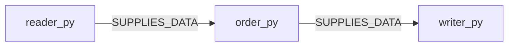

# Generic greenfield plan

$START_DEV_PLAN

METHODOLOGY_VERSION: 0.5.0 (loaded public methodology fixture)
PURPOSE: Illustrate a complete plan contract for ordering generic records.
SCOPE: Generic hypothetical product; plan/XML fixtures only, no executable product or adopted harness.
RATIONALE: An in-memory stable sort preserves tie order and keeps pure transformation tests simple, but holds all records in memory. A streaming merge reduces peak storage for large input and supports chunked I/O; it needs persisted intermediate files and more failure-path validation. For the approved bounded record population choose stable sort because predictable order and directly exercised return values matter more than scale. Scores for realism/impact/risk/cost/debt (one to ten, estimated): stable sort 9/8/2/2/2; streaming merge 8/6/5/6/5. These are scenario assumptions, not measured runtime evidence.
VERIFICATION CONTRACT: PLAN-101–104, PLAN-201–203, PLAN-301–308, PLAN-401–404, GRAPH-101–303 and the exact finite checks documented in README.md.
Classification: GREENFIELD; task type: code and tests; approved scenario population: at most 100 records.
Original scenario requirements remain authority alongside reconnaissance: BR-1 preserve record values; BR-2 stable order by key; BR-3 deliver ordered result file. Scenario AC-1 exactly preserves input records; AC-2 ties retain input order; AC-3 output/result.json decodes to the ordered records. Reconnaissance fixture inspected the scenario population and existing-map identity; no live-system conclusion is claimed.

$START_DOCUMENT_PLAN
1. Draft Code Graph and scoped patterns.
2. Step-by-step Data Flow.
3. Visual Verification and applicability.
4. Acceptance Criteria.
5. Delivery Contract.
6. Runtime Commands and verification commitments.
$END_DOCUMENT_PLAN

### 1. Draft Code Graph

MAY EDIT in the hypothetical scenario: src/reader.py, src/order.py, src/writer.py and their tests. DO NOT TOUCH: stable store lookup/API and other source. File boundaries isolate transformation from file presentation; direct imported operations supply reader -> order -> writer. Backend outcome/trace tests are required; UI pattern is N/A because this scenario has no UI. Every slice has purpose (preserve/order/deliver), rationale (independent operations) and verification (scenario AC-1/2/3 respectively).

Source-map registry: none; there is no prior architecture for bilateral comparison.

```xml
<DraftCodeGraph>
  <RecordOrder_1_0_Info TYPE="PROJECT_INFO">
    <keywords>records, ordering</keywords><terms>plan, fixture</terms><annotation>Illustrate a bounded generic record-ordering design.</annotation>
    <BusinessScenarios><Scenario NAME="OrderRecords">Operator -> order records -> receive ordered records.</Scenario></BusinessScenarios>
  </RecordOrder_1_0_Info>
  <reader_py FILE="src/reader.py" TYPE="BUSINESS_LOGIC" satisfies="BR-1">
    <keywords>records, order</keywords><terms>deterministic, fixture</terms><annotation>Keep the approved record ordering behavior.</annotation>
    <CrossLinks><Link TARGET="order_py" TYPE="SUPPLIES_DATA"/></CrossLinks>
  </reader_py>
  <order_py FILE="src/order.py" TYPE="BUSINESS_LOGIC" satisfies="BR-2">
    <keywords>records, order</keywords><terms>deterministic, fixture</terms><annotation>Keep the approved record ordering behavior.</annotation>
    <CrossLinks><Link TARGET="writer_py" TYPE="SUPPLIES_DATA"/></CrossLinks>
  </order_py>
  <writer_py FILE="src/writer.py" TYPE="BUSINESS_LOGIC" satisfies="BR-3">
    <keywords>records, order</keywords><terms>deterministic, fixture</terms><annotation>Keep the approved record ordering behavior.</annotation>
    
  </writer_py>
</DraftCodeGraph>
```

### 2. Step-by-step Data Flow

1. Read actual records, validating the bounded population and preserving field values; brownfield lookup retains the existing store signature.
2. Stable sort by key; simulate equal keys to preserve input-relative tie order.
3. Write ordered records to output/result.json; surface actual I/O failure and validate decoded bytes through the actual writer operation.

### 3. Visual Verification

Changed module definitions: 3; metadata and existing references excluded. Tests-only: false. The visual gate is active at three. The scenario commands below are planned, NOT RUN on a real product; this fixture supplies no mechanical PASS.
GREENFIELD_WEAK applies only to unavailable prior-architecture comparison. Orphan, unknown and uncovered checks remain mandatory.
Trace projection from actual satisfaction: reader_py -> BR-1; order_py -> BR-2; writer_py -> BR-3.
Structural projection: reader_py -> order_py -> writer_py; every edge comes from XML. Sequence is applicable because operations exchange records; read -> stable sort -> write follows section 2. Lifecycle is N/A (no entity with three statuses); schema/class diagrams are N/A (no schema/hierarchy change). Per-file structure diagrams retain their separate purpose.


The active greenfield traceability projection follows exact satisfaction values.

```mermaid
requirementDiagram
    requirement BR_1 {
        id: BR-1
        text: Preserve record values
        risk: low
        verifymethod: test
    }
    requirement BR_2 {
        id: BR-2
        text: Preserve stable ordering by key
        risk: low
        verifymethod: test
    }
    requirement BR_3 {
        id: BR-3
        text: Deliver the ordered result file
        risk: low
        verifymethod: test
    }
    element reader_py {
        type: module
    }
    element order_py {
        type: module
    }
    element writer_py {
        type: module
    }
    reader_py - satisfies -> BR_1
    order_py - satisfies -> BR_2
    writer_py - satisfies -> BR_3
```

Structural relationships below follow the XML; unchanged references remain distinct from changed definitions.



Primary-scenario temporal projection from section 2:

```mermaid
sequenceDiagram
    participant reader_py
    participant order_py
    participant writer_py
    reader_py->>reader_py: Read and validate records
    reader_py->>order_py: Supply records with original values
    order_py->>order_py: Stable sort; retain relative tie order
    order_py->>writer_py: Supply ordered records
    writer_py->>writer_py: Open/write/close output/result.json
    Note over writer_py: Surface I/O errors; compare decoded actual result bytes
```

These are actual diagram source bytes for independent structural/temporal review, not a claim that a product ran or that unsupported syntax passed a mechanical linter.

### 4. Acceptance Criteria

- Scenario AC-1 / BR-1: test_record_values -> reader operation -> compare exactly the actual input/output records.
- Scenario AC-2 / BR-2: test_stable_order -> order operation -> compare ordered keys and tie-relative order for at most 100 records.
- Scenario AC-3 / BR-3: test_written_result -> writer operation -> read and decode output/result.json and compare actual ordered values; real-operation proof required.
These future product tests are commitments, not supplied implementation or claims of executed success. Current finite fixture checks read the actual graph/map bytes and real XML parser only.

### 5. Delivery Contract

Scenario sink: output/result.json. Mechanism: the real writer's explicit file open/write/close path with errors surfaced; no capture/mock supplies its success evidence. Success evidence: after running the writer, read actual file bytes and decode/compare the ordered records under scenario AC-3. Pure reader/order return values add no external delivery channel. Current fixture test diagnostics use pytest process stdout through print and -s.

### 6. Runtime Commands

Actual checks for these shipped fixture files, from repository root: `python3 -m pytest tests/test_design_contract.py -s -v`. Scenario product test/dependency/run/probe/lint tooling is not present and remains NOT RUN until its target manifest supplies actual allowed commands; do not invent a forbidden fallback or a service. No service/container/UI is delivered; dependency install, health and UI commands are N/A here. The active greenfield scenario's actual visual command/output/nonzero node evidence would be required before real Code.
Verification commitments for shipped examples: test_plan_xml_definitions -> XML.fromstring on actual plan XML -> nesting/fields/local targets; test_brownfield_reference_identity -> actual existing-map/source bytes -> hash and declared lookup. A dropped or replaced scenario production test commitment must be reported as a deviation; fake-only existence checks cannot satisfy it.

$END_DEV_PLAN
