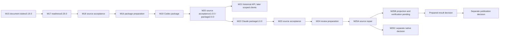

# Methodology project route

## Current checkpoint: M25B source preparation

The standalone-public-repository strategy and exact 247 COPY / 14 REPLACE / 65 OMIT selection are approved. Prepare 261 selected source files from the 326-file baseline without internal Git history. The unpublished projection remains subject to independent export verification and prepared-result approval; publication is a separate decision.

## Stable route and dependencies

Historical checkpoint IDs remain stable. Original private grants, acceptance receipts, failed/held runs and consumer evidence are unavailable in this tree; this route neither resets them nor creates current authority.

| Checkpoints | Original source delivery / continuing boundary |
|---|---|
| M1–M3 | PM preparation, integration and exact-result acceptance: owning homes, five forms, root entry and release/consumer/scanner reconciliation. |
| M4–M6 | Direction correction, bounded code-layer continuation and combined-result acceptance: held source successes plus AX/data/checker bodies, retaining accepted PM and terminal failed histories. |
| M7–M8 | Four document/specification bodies and exact-result acceptance, 0.16.0; wider F4 remained residual. |
| M9–M10 | Conditional decision/full graph and exact-result acceptance, 0.17.0; full nine-section DOMAIN and planned CODE duties retained. |
| M11–M12 | Eleven prompting/policy bodies, eight skill cards and exact-result acceptance, 0.18.0; target-agent evaluation not established by authoring. |
| M13 | Lightweight contextual error recording; systematic learning/improvement experiments/comparative measurement deferred. |
| M14–M15 | Confirmed conventions/lifecycle/batch/session procedures, five full forms and exact-result acceptance, 0.19.0. |
| M16 | Co-located implementation-package preparation; separate package/adapter/check/profile boundaries. |
| M17–M18 | Six readiness contracts and exact-result acceptance, 0.20.0; six-core constitution and forty-term glossary, remaining four stubs. |
| M19–M20 | First 47-member Codex package and exact-result acceptance, neutral1.0.0/package2.0.0/schema2; historical [technical specification](specs/m19-codex-package.md). Co-located explicit-source profile only. |
| M21 | Historical bounded Python/FastAPI/SQLite API/database consumer A1; frontend → Telegram → MCP are later separately scoped stages, not activated here. |
| M22–M23 | 59-member Claude Code package and source acceptance, package1.0.0; historical [technical specification](specs/m22-claude-package.md). In-place loading and MIT source licence retained. |
| M24 | Original source release-review preparation; review-only snapshot did not establish a public projection. |
| M25A | Full MIT/no-remote-observation and safe Codex Gitignore-aware inventory/baseline repair; [source result](notes/m25a-result.md), original594/101/526 evidence only. |
| M25B | Current unpublished projection preparation. Fourteen export-only Markdown edits, exact source/COPY/mode preservation, semantic/link/privacy/regression/map checks, independent QA/Review/assigned Finalize and archive readback are required. NOT_RUN at preparation baseline. |
| M25C | Held for a separate native consumer decision; no native exercise inferred from M25B tooling checks. |

README Local use and original Claude source are frozen; only the approved exported Markdown contexts change. Preserve all software roles/flow/gates/schema/registries and previous failed/held histories. Four process stubs and wider F4/source accounting remain incomplete; broader source transfer, propagated enforcement and model effectiveness remain unproven. M13 remains lightweight recording; learning/comparable measurement is deferred. Main integration, publication, installation, detached/automatic discovery and later consumer stages retain their matching scope, decisions and evidence.
