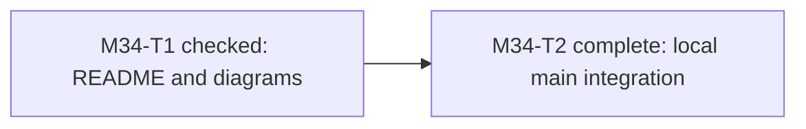
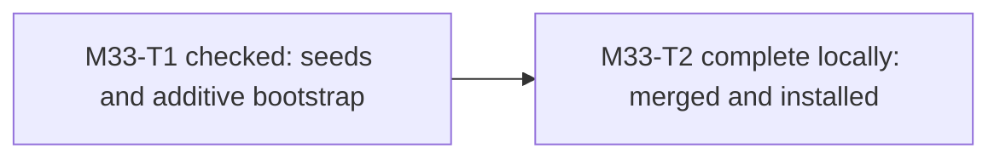
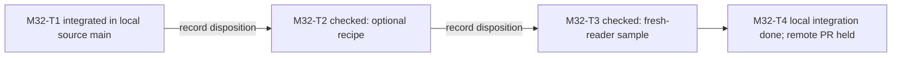

# Methodology project route

## Current: M34 README presentation; earlier delivery and proof gaps retained

One canonical checkout is the development source; preparation repositories are archival. Canonical main now includes M30 source through owner-approved PR6, neutral2.0/Codex2.4/Claude1.1; accepted C2/bafec417 is its foundation. C3 is not ready for merge. [Current C3 history/result](notes/m28-c3-result.md).

| Checkpoint | Current disposition |
|---|---|
| M1–M20 | Historical PM/code/document/decision/prompting/readiness work and first Codex package; contracts remain in source. |
| M21 | Historical Python/FastAPI/SQLite consumer; frontend → Telegram → MCP remain later scoped stages. |
| M22–M23 | Complete Claude in-place package and MIT adoption. |
| M24 | Historical release preparation, not another development source. |
| M25A | Complete MIT/no-query and Gitignore-aware inventory repair. |
| M25B | Checked261-file projection, owner acceptance and verified private release complete. |
| M25C | Held: separate native consumer decision. |
| M26 | Permanent canonical checkout, verified onboarding and integrated PR1 complete. |
| M27 | Coverage preparation/matrix and C1–C6 route integrated through cumulative PR3; whole behavioral parity remains owed. |
| M28-C1 | Integrated through PR3: required owners, native prompt route and neutral1.1/source2.1 bridge. |
| M28-C2 | Owner-accepted and integrated through PR4: source2.2 consumer profile and commands; original failed history/spend retained. |
| M28-C3 | Unaccepted source2.3; A3 terminal ESCALATED/review, protected-read defect remains after green QA2. Cumulative Debug4/4 exhausted; no fifth repair. |
| M28-C4 | SDK/import/candidate capacity owed/held after the selected practical consumer trial. |
| M29/C5–C6 | Autonomy/resume/isolation proof and actual source-loader handover owed/held after matching decisions. |
| M30 | Source integrated through PR6; BLOCKED/qa Debug1/4 retained; native Claude required/deferred, Review/Finalize/full acceptance pending. |
| M31 | Lightweight PM merged, released and installed; actual completion is in the decision receipt below. |
| M32 | Current: findings retained; T1 source candidate and T2/T3 bounded checks complete locally; optional practices retained within observed scope. Owner accepted and local main integration completed; prompting0.6.0 installed locally by subsequent explicit grant; remote PR delivery/release remain unfulfilled. |
| M33 | Checked locally: early entry duties and additive bootstrap; synthetic forward/preservation checks and source review retained. Owner-authorized local merge/install complete: neutral/Codex3.0.1, Claude2.0.1; actual discovery/binding evidence retained. Remote delivery remains unfulfilled. |
| M34 | Checked locally: reader-oriented README and two diagrams, preserved contracts and local visual checks. Owner-approved local main integration complete; remote/public delivery still unfulfilled. |
| Public visibility | Held; repository remains private. |

## M34 — README presentation

Owner-selected polish of the public-facing entry, not permission to publish. [Result and retained review/check evidence](notes/m34-readme.md); [TASKS](TASKS.md).

## M33 — PM entry continuity

[Authority, reconnaissance, implementation and result](notes/m33-pm-entry.md); [current tasks](TASKS.md). Owner selected the short entry obligations and safe existing-project supplementation. No bulk consumer rewrite or new executable checker is implied.

## M32 — incremental improvement route

The owner selected this route on 2026-10-15: record all book-derived findings, verify incrementally and adopt useful results. [Findings, original authority, source identities and limits](notes/m32-book-findings.md); runnable work stays in [TASKS](TASKS.md).

1. **Checked locally — carrier consistency:** source candidate53b62f0 reconciles the carriers at draft0.6.0; independent document review, structural checks and actual authoring proof support retaining it for review. Owner-approved local source merge is complete; prompting0.6.0 subsequently installed locally; remote delivery/release and target readiness remain separate.
2. **Checked locally — document extraction:** retained the optional recipe after seven synthetic sources, simulated truncation/staleness and actual bounded book extraction. No new mandatory carrier/helper.
3. **Checked locally — fresh-reader usefulness:** reader recovered authority/holds, caught a synthetic contract contradiction and stale M31 wording; narrow record corrections made. This is a read-only sample, not the full consumer trial.
4. **Integrated locally — remote delivery held:** the owner accepted the concrete package and both local main merges completed. Canonical PR delivery is still unfulfilled because API/browser access is unavailable; prompting installation was subsequently authorized/completed locally; source push and remote release remain separately bounded actions.

This is the dependency view for M32 only; older checkpoint rows retain their original states and evidence:

Carrier consistency comes first because contradictory active instructions can undermine either later check. Each stage records its question, candidate, actual result, benefit/friction, retain/revise/drop/hold disposition and next action. Findings alone do not approve a new compulsory procedure. Main integration, release and activation remain separate decisions over concrete results.

Replan basis: previously the next proposed practical route was a smaller safeguard followed by the API/database trial. The owner now selects M32's bounded instruction/document checks first. The full trial's original safeguard prerequisite remains; C3 exhaustion, M30 Claude deferral and C4–C6 obligations are preserved. No new safety design or failed-run continuation is authorized by this reordering.

## Retained C3 escalation

Stop C3 implementation. Whole Review2 confirmed that lexical parent normalization hides a symlink traversal and can allow a protected read. Current QA2's597/158/526 passes do not override the defect. No accepted Review/Finalize exists. Native AC7 is HELD/UNFULFILLED, not waived by the approved partial source stage.

Recommended next activity: read-only reconnaissance and a bounded revised design/specification for a smaller safeguard surface, considering exact parent-pinned check recipes rather than generic shell interpretation. No new design or Code is approved by this route note. Preserve cumulative spend and failed terminals; do not rename/reset the run to acquire another repair.

## Retained route and gates

Accepted C2 profile/check/map/migration → genuinely accepted minimal safeguards → bounded single-stream Python API/database trial → separately scoped optional C4 infrastructure → C5 native autonomy/resume/isolation → C6 loader handover. The practical trial precedes optional infrastructure; C4–C6 remain obligations, not waived work or current Code grants.

The owner-approved exact46b7ccc push/private draft PR5 update is complete. Subsequent A3 source and root record closure remain local review work. Main merge, new remote delivery, install/activation, native proof and public visibility need their matching decisions. Other agents start at root AGENTS, use scoped branches and preserve foreign work/clean canonical main. Error recording stays lightweight; systematic learning/measurement and concurrent feature writers remain deferred.

## M30 — independent-decision rule; proof held

Shared owner/PM/Architect/both-carrier source delivered from accepted C2 and independently checked after counted Debug1. Actual Codex important/two-generators/HOLD/evaluator/root-decision/task and trivial/settled controls supported;600/146/526ordinary tests and privacy/adapters/maps pass. [Current result](notes/m30-result.md), [operative plan](plans/m30-independent-decisions-i2.md).

Terminal BLOCKED/qa retains Debug1/4. The owner deferred native Claude; AC4/ClaudeAC5 remain unfulfilled, no auth/retry/waiver. Resume those current-source proofs after that deferral changes, then renew independent QA, whole Review and assigned Finalize before full checkpoint acceptance; owner-authorized source integration through PR6 is complete. INTAKE-01 stays separately scoped; accepted smaller safeguard → single-stream API/database trial → optional C4 → C5/C6 route remains. [Integration record](notes/m30-integration.md). No C3 budget reset, installation or public visibility change.

## M31 — lightweight PM state and development boundary

The owner settled the direction after the PM reflection: state for agents, QA for features/substantial bug fixes, no QA for documentation/small corrections, and affected-record synchronization on material change/grouped progress/before planned compaction. [Decision and scope](notes/pm-lightweight-direction.md). The initial local amendment preceded release; the owner subsequently authorized merge, reissue and installation, completed in the receipt below. Existing M30 Claude deferral, C3 exhausted history and later trial/C4–C6 route remain retained.

M31 release update: the owner authorized merge, reissue and installation of the accepted lightweight PM direction (neutral3.0.0 / Codex3.0.0 / Claude2.0.0). Actual completion is recorded in [the decision receipt](notes/pm-lightweight-direction.md); deferred native Claude acceptance and C3 remain separate.
