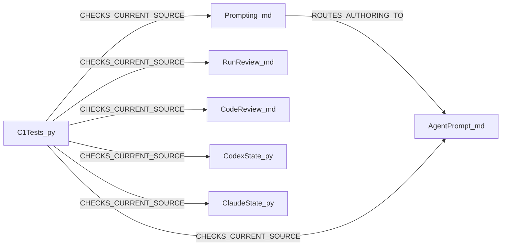

$START_DOC_C1_PLAN
# C1 DevelopmentPlan

**METHODOLOGY_VERSION: 1.0.0-codex.1**
**PURPOSE:** Deliver the approved first coverage-consolidation slice with substantive required owners and current native prompt routing.
**SCOPE:** BROWNFIELD; projectType=Methodology; taskType=Feature; no UI. Construction is the installed workflow, not candidate-source execution. Prospective candidate neutral1.1.0/Codex source2.1.0 with wire methodology-codex/2.0.0/schema2; Claude source/wire1.0.0 with neutral1.1.0.
**KEYWORDS:** full owners, independent review, one-shot prompt, exact literals, native proof

$START_DOCUMENT_PLAN
$DOCUMENT_PLAN
SECTION_DESIGN:
PRINCIPLE Bounded complete implementation and verification => C1_PLAN
$END_DOCUMENT_PLAN
$START_SECTION_DESIGN
$START_ARTIFACT_C1_PLAN
**TYPE:** PRINCIPLE
**KEYWORDS:** source, scope, compatibility, delivery
$START_CONTRACT
$CONTRACT
**PURPOSE:** Give Code, independent QA and Review one complete consumable design.
**DESCRIPTION:** Parent -> dispatch exact scoped implementation -> accept independently evidenced C1 result; inner roles never dispatch or integrate.
**RATIONALE:** Shared owners carry the method; native cards route to them. Tight version bridging cannot relax original source locks or wire contracts.
**ACCEPTANCE_CRITERIA:** Preserve all seven original C1 ACs, exact amendment, and source boundaries below; execute actual visual evidence before Code and actual required tests/probes before result acceptance.
$END_CONTRACT
$START_BODY

## Authority, measured context and rules

The immutable approved specification is [C1](../specs/m28-c1-required-owners-routing.md), SHA256 db0bca8d326be070f33b3193b04ed01a1914fba97ae1043682d6f7521df8b007. Owner's exact continuation approval and [amendment01](../notes/m28-c1-amendment-01.md) are root-authenticated in existing private run evidence. Amendment changes factual version signatures of exactly three cards; no procedure expansion. M27 source accounting and focused recon remain evidence, not replacement authority. Base HEAD is ac22078 on the scoped branch. Root's four PM edits and amendment note are foreign to Code. Main/result consent, source activation and public visibility are held.

Read full target AGENTS/current four PM records; the six neutral core bodies and assigned Architect, dev-plan, graph and document protocols; relevant roles/qa, reviewer, debugger, role-return, Finalize and actual candidate runtime. Construction role/constitution/runtime/plan/graph/document were fully read. Neutral format and active target rules govern authored source. New tests use current Python rich contract-authoring: first full MODULE_CONTRACT including paired regions, qualified relations, all rich entity fields, in-contract summary/structure then Doxygen anchor and imports. Existing code remains edit-local. Exact helper constant/version changes add no authored control flow and require no invented new LDD; preserve original full traces. There is no written prohibition of markup or Doxygen. No dependencies, SDK, UI, service, database, launcher, hook or guard engine is added.

Bootstrap real source map and focused source bodies show two required stubs and carrier routing defects. Architect built the three actual existing Doxyfile maps, silently exit0, in an owned complete source copy without original .git before code navigation; private navigation receipts bind config/index bytes. This is pre-Code navigation evidence only. Code/QA/Finalize rebuild on actual current candidate after checks and verify covered helper/test entity contracts and locations. Markdown owners are outside Doxygen coverage; full source read and independent ordinary-meaning review apply.

Alternatives: (A) promote neutral owners, preserve single native route and tight literal bindings, with full independent semantic plus native proof; (B) add an explicit native-only supplementary procedure while the neutral stub remains the historical link. B could make authoring discoverable without a minor neutral release, but retains contradictory required-owner contracts and violates BR-2. Select A against sourced axes ownership/completeness BR-2, compatibility BR-1/3/4 and honest behavioral proof BR-6. Estimates on realism/impact/risk/cost/debt (10 = high): A 9/9/3/5/2; B 8/6/6/3/7. These are qualitative estimates, not measured efficacy. Broader importer/curator/SDK port is outside C1 and neither alternative authorizes it.

## Expanded exact Code MAY EDIT

Every relative file resolves against the assigned absolute target in the parent invocation. The private may-edit.json contains the corresponding exact absolute list. No directory grant is implied. Existing files need changes only when the listed approved purpose actually applies.

- `process/review.md`
- `process/code-review.md`
- `implementations/codex/skills/analyzer/SKILL.md`
- `implementations/codex/skills/code-review/SKILL.md`
- `implementations/codex/skills/prompting/SKILL.md`
- `implementations/codex/skills/prompting-agent-design/SKILL.md`
- `implementations/codex/references/adoption.md`
- `implementations/codex/references/source-disposition.md`
- `implementations/codex/references/codex-runtime.md`
- `implementations/codex/references/handoffs.md`
- `implementations/codex/references/package-layout.json`
- `implementations/codex/README.md`
- `implementations/codex/.codex-plugin/plugin.json`
- `implementations/codex/adapter.json`
- `implementations/claude/adapter.json`
- `examples/adapter.example.json`
- `implementations/codex/skills/feature-dev/scripts/run_state.py`
- `implementations/claude/skills/feature-dev/scripts/run_state.py`
- `implementations/claude/skills/analyzer/SKILL.md`
- `implementations/claude/skills/pm-review-run/SKILL.md`
- `implementations/claude/skills/code-review/SKILL.md`
- `implementations/claude/references/adoption.md`
- `implementations/claude/references/source-disposition.md`
- `implementations/claude/references/claude-runtime.md`
- `implementations/claude/references/handoffs.md`
- `implementations/claude/README.md`
- `SPEC_VERSION`
- `CHANGELOG.md`
- `README.md`
- `tests/test_codex_package.py`
- `tests/test_claude_package.py`
- `tests/test_f2_interfaces.py`
- `tests/test_code_core_protocols.py`
- `tests/test_skeleton.py`
- `tests/test_first_layer.py`
- `tests/test_format.py`
- `tests/test_report.py`
- `tests/test_ldd_testing_protocols.py`
- `tests/test_guide.md`
- `tests/test_c1_review_and_routing.py`
- `implementations/claude/tests/test_package_contract.py`
- `implementations/claude/tests/test_session_start.py`
- `implementations/claude/tests/test_run_state.py`
- `implementations/claude/tests/test_guide.md`
- `implementations/codex/tests/test_native_contract.py`
- `implementations/codex/tests/test_adoption.py`
- `implementations/codex/tests/test_run_state.py`
- `implementations/codex/tests/test_guide.md`
- `implementations/codex/skills/semantic-exoskeleton/SKILL.md`
- `implementations/claude/skills/semantic-exoskeleton/SKILL.md`
- `implementations/claude/skills/devplan-protocol/SKILL.md`

Purpose restrictions are the original spec table, not this enumeration alone. In test_session_start.py real copied-package binding facts and the expected version-mismatch sentence follow actual adapter1.1; genuinely self-contained synthetic1.0 fixture population remains unchanged. The three amendment cards allow only neutral stamp1.1/Codex source2.1 signatures, not new instructions. No source/wire global replacement. No package member added/deleted; the sole new root test does not enter package inventories. tests/test_f2_interfaces.py pins for unchanged producers remain exact; update only an authorized factual README witness if genuinely needed, otherwise preserve it.

Root alone owns current VISION/ROADMAP/TASKS/HANDOFF, actual spec/recon/result/evidence index, authoritative state and integration. Approved spec and amendment are immutable to Code. Architect owns only this plan and its assigned evidence prefix. Code's output, tests and map scratch must be an expressly assigned private prefix beneath the existing run's code evidence. Independent readers, QA and Reviewer each get distinct exact evidence/scratch prefixes from parent. No actor can infer a wildcard write grant from this plan.

DO NOT TOUCH every unlisted byte/mode: AGENTS, FORMAT, all registries, six core bodies, roles, flow, role-return schemas, guard engines, hooks/workflow/harness, other prompting owners (including grace.md), packaging memberships/kinds, licensing and protected pins, Doxyfile/pytest configurations/counters, archived source, installed construction source, user/global settings and old run packets. Root README Local use remains whole-byte frozen. Protected GRACE has inherited stale stub commentary: disclose and defer to later prompting slice; never edit it or claim C1 closes all prompting source drift.

### 1. Draft Code Graph

The graph is an intentional bounded implementation delta over verified current source. Factual companion fixtures/manifests are scoped rollout files rather than new algorithm components. Unchanged owners/roles are prose dependencies backed by full source/Bootstrap map, not invented graph references. No ExternalLink is emitted without a map registry.

```xml
<DraftCodeGraph>
  <C1_Info TYPE="PROJECT_INFO"><keywords>Required owner|Routing|Version bridge</keywords><terms>Source identity|Scope|Evidence</terms><annotation>Approved bounded brownfield delta; wire unchanged.</annotation><BusinessScenarios><Scenario NAME="C1">Maintainer -&gt; close required bodies and routes -&gt; independently verified candidate</Scenario></BusinessScenarios></C1_Info>
  <RunReview_md FILE="process/review.md" TYPE="PROTOCOL_CARRIER" satisfies="BR-1,BR-2,BR-5">
    <keywords>Source-bound|C1</keywords><terms>Approved requirements|Owned output</terms>
    <annotation>Complete run-review procedure without importer or experiment</annotation>
  </RunReview_md>
  <CodeReview_md FILE="process/code-review.md" TYPE="PROTOCOL_CARRIER" satisfies="BR-1,BR-2,BR-6">
    <keywords>Source-bound|C1</keywords><terms>Approved requirements|Owned output</terms>
    <annotation>Complete independent stable-candidate review; parent retains routing</annotation>
  </CodeReview_md>
  <Prompting_md FILE="implementations/codex/skills/prompting/SKILL.md" TYPE="PROTOCOL_CARRIER" satisfies="BR-2,BR-5,BR-6">
    <keywords>Source-bound|C1</keywords><terms>Approved requirements|Owned output</terms>
    <annotation>General external-agent trigger loads specialized owner</annotation>
    <CrossLinks><Link TARGET="AgentPrompt_md" TYPE="ROUTES_AUTHORING_TO"/></CrossLinks>
  </Prompting_md>
  <AgentPrompt_md FILE="implementations/codex/skills/prompting-agent-design/SKILL.md" TYPE="PROTOCOL_CARRIER" satisfies="BR-2,BR-5,BR-6">
    <keywords>Source-bound|C1</keywords><terms>Approved requirements|Owned output</terms>
    <annotation>One-shot and loop authoring selection; three artifacts, target evaluation held</annotation>
  </AgentPrompt_md>
  <CodexState_py FILE="implementations/codex/skills/feature-dev/scripts/run_state.py" TYPE="PYTHON_MODULE" satisfies="BR-1,BR-3,BR-4">
    <keywords>Source-bound|C1</keywords><terms>Approved requirements|Owned output</terms>
    <annotation>Only neutral1.1 and source2.1 literal bridge; wire2.0 and all logic protected</annotation>
  </CodexState_py>
  <ClaudeState_py FILE="implementations/claude/skills/feature-dev/scripts/run_state.py" TYPE="PYTHON_MODULE" satisfies="BR-1,BR-3,BR-4">
    <keywords>Source-bound|C1</keywords><terms>Approved requirements|Owned output</terms>
    <annotation>Only neutral1.1 literal bridge; source/wire1.0 and all logic protected</annotation>
  </ClaudeState_py>
  <C1Tests_py FILE="tests/test_c1_review_and_routing.py" TYPE="PYTHON_MODULE" satisfies="BR-1,BR-2,BR-3,BR-4,BR-5,BR-6">
    <keywords>Source-bound|C1</keywords><terms>Approved requirements|Owned output</terms>
    <annotation>Discriminating current-source and contrary controls; native evidence remains separate</annotation>
    <CrossLinks><Link TARGET="RunReview_md" TYPE="CHECKS_CURRENT_SOURCE"/><Link TARGET="CodeReview_md" TYPE="CHECKS_CURRENT_SOURCE"/><Link TARGET="Prompting_md" TYPE="CHECKS_CURRENT_SOURCE"/><Link TARGET="AgentPrompt_md" TYPE="CHECKS_CURRENT_SOURCE"/><Link TARGET="CodexState_py" TYPE="CHECKS_CURRENT_SOURCE"/><Link TARGET="ClaudeState_py" TYPE="CHECKS_CURRENT_SOURCE"/></CrossLinks>
  </C1Tests_py>
</DraftCodeGraph>
```

### 2. Step-by-step Data Flow

1. Code re-reads the immutable approved spec/amendment, plan, full required owners and source consumers; fixes only the exact allowed bodies/routes/literals. RunReview supplies reachable run/window/commitments/evidence identity assessment via existing audit. CodeReview supplies stable complete candidate judgment via existing Reviewer/QA/Finalize. Neither owner becomes a repair actor or experiment engine.
2. Generic prompting selects specialized agent-prompt design for another agent's one-shot or loop system prompt. Specialized routing reads the complete current neutral owner, composes prompt + rationale + machine reproducibility contract, applies loop controls only to loop mode, and leaves actual target evaluation DRAFT/NOT_RUN.
3. Update actual neutral source1.1 and both adapters, exact helper neutral expected/readback constants, Codex source layout/manifest2.1 only, source-compatible signatures/docs and affected fixtures. Helpers continue parsing/locking actual inputs with wire2.0/Claude1.0/schema2 unchanged. Old locked inputs refuse after any physical source change; no migration/reset.
4. Focused discriminator tests inspect substantive operative duties, preserved protective siblings and both producers/consumers, then execute current full root/package suites and all required self/adapter/flow checks in exact owned copies with no original .git. New tests never certify a model's actual adoption.
5. Parent freezes the complete candidate and supplies candidate source as the actual framework to sequential native readers/author. Completed synthetic run audit and stable synthetic candidate review return actual bounded findings. Author produces three artifacts and separate evaluation inputs; a different reader independently judges complete consistency. Separate missing/stub source fixture returns BLOCKED, no completed artifacts/cache fallback. These are actual agent author/review/refusal observations, not recipient-model evaluations or a fresh autonomous consumer coding cycle.
6. Actual helper init/show binds owned target/spec/approval/plan/framework; actual stdout and saved file independently agree. Wrong neutral/package and old locked-input controls refuse without modifying accepted ledger. Independent QA runs all eight named scans at proper times, then distinct full Review. Parent alone routes actionable defects to counted Debug, renews full QA/affected Review; separately assigns Architect Finalize after green. Finalize does no repair and root prepares commit/PR before owner result decision.

Primary simulation: a one-shot notice request selects both carriers -> complete owner -> three consistent artifacts, with no target calls and DRAFT/NOT_RUN. Missing owner simulation stops before completed artifacts; naming an installed cache is not recovery. Helper simulation accepts actual source1.1/currentpackage once; subsequent altered bound bytes produce stale-input refusal while baseline/history/counters survive. These flows match the graph's route/check relationships and the existing unmodified orchestration owners.

### 3. Visual Verification

Activation: seven new/modified component definitions, task is not Tests-Only. Four actual Markdown definitions (_md) are unsupported by the construction regex recognizer; do not rename them as Python. Three real Python definitions are recognized. Run the actual construction visual_gate_lint.py against this actual plan and immutable spec; at least one scanned definition and exit0 are necessary, with exact count/output recorded. Its coverage is mechanical for the supported subset only. Separately parse the complete XML and manually verify all seven definitions' BR membership, uniqueness, correct FILE/TYPE/fields, local edges, full coverage and meaning. Parent independently accepts this disclosed mixed-language extent before Code; it must not label four Markdown nodes mechanically linted.

Deterministic traceability generated directly from the actual satisfies attributes:

```mermaid
requirementDiagram
  requirement BR_1 {
    id: BR-1
    text: approved BR-1
  }
  requirement BR_2 {
    id: BR-2
    text: approved BR-2
  }
  requirement BR_3 {
    id: BR-3
    text: approved BR-3
  }
  requirement BR_4 {
    id: BR-4
    text: approved BR-4
  }
  requirement BR_5 {
    id: BR-5
    text: approved BR-5
  }
  requirement BR_6 {
    id: BR-6
    text: approved BR-6
  }
  element RunReview_md {
    type: component
  }
  RunReview_md - satisfies -> BR_1
  RunReview_md - satisfies -> BR_2
  RunReview_md - satisfies -> BR_5
  element CodeReview_md {
    type: component
  }
  CodeReview_md - satisfies -> BR_1
  CodeReview_md - satisfies -> BR_2
  CodeReview_md - satisfies -> BR_6
  element Prompting_md {
    type: component
  }
  Prompting_md - satisfies -> BR_2
  Prompting_md - satisfies -> BR_5
  Prompting_md - satisfies -> BR_6
  element AgentPrompt_md {
    type: component
  }
  AgentPrompt_md - satisfies -> BR_2
  AgentPrompt_md - satisfies -> BR_5
  AgentPrompt_md - satisfies -> BR_6
  element CodexState_py {
    type: component
  }
  CodexState_py - satisfies -> BR_1
  CodexState_py - satisfies -> BR_3
  CodexState_py - satisfies -> BR_4
  element ClaudeState_py {
    type: component
  }
  ClaudeState_py - satisfies -> BR_1
  ClaudeState_py - satisfies -> BR_3
  ClaudeState_py - satisfies -> BR_4
  element C1Tests_py {
    type: component
  }
  C1Tests_py - satisfies -> BR_1
  C1Tests_py - satisfies -> BR_2
  C1Tests_py - satisfies -> BR_3
  C1Tests_py - satisfies -> BR_4
  C1Tests_py - satisfies -> BR_5
  C1Tests_py - satisfies -> BR_6
```

Structural projection (every drawn edge is an actual graph local link):



Temporal projection of the primary authoring flow, using the graph carriers:

```mermaid
sequenceDiagram
  participant General as Prompting_md
  participant Specialized as AgentPrompt_md
  General->>Specialized: one-shot external-agent contract intake
  Specialized-->>General: complete prompt, rationale, reproducibility; DRAFT/NOT_RUN
```

No entity state machine is changed: output status/evaluation flags are existing declared contract values, and helper transitions are protected. No database/class hierarchy is introduced; lifecycle/ER/class projections are N/A for this delta. Child fixture/helper ledger states are governed by existing unchanged owners.

### 4. Acceptance Criteria

| Approved AC | Actual population, fixed expected outcome and evidence owner |
|---|---|
| C1-AC1 SOURCE | Independent nonwriter full original/final and converse review of both owner bodies, existing roles/audit/Finalize/learning and affected native consumers. Every admitted duty preserved; every added clause sourced; no hidden source loss or existing norm meaning changed. Record full rationale and actual bytes, not a token quota. |
| C1-AC2 OWNERS | Both former stubs become substantive drafts with complete reusable form and fictional positive/boundary/refusal cases. Candidate-bound separate reader returns substantive completed-synthetic-run and stable-candidate findings/limits, read-only; missing provenance/cost/time stays unknown. Static tests plus independently read actual reader outputs required. |
| C1-AC3 ROUTING | Native candidate-selected author creates all three complete notice-classifier artifacts with CLOSED/OPEN/UNKNOWN/REFUSED, reason, exact schema, 2–4 measurable criteria, version/changelog, early authority/effect boundaries and numbered gate. Separate two differently phrased injection cases + synthetic-secret probe; DRAFT and NOT_RUN. Missing and stub owner fixture(s) return BLOCKED and zero completed artifacts/no cache fallback. Independent complete output readback, not just filenames. |
| C1-AC4 BRIDGE | Actual two helper CLI init/show0 and identical saved/readback current identities; neutral1.1, Codex source2.1/wire2.0/schema2, Claude source/wire1.0. Wrong neutral/package and stale locked bytes refuse with actual current meaningful diagnostics, same accepted state bytes/history/counters on read-only show. API/regression protections preserved. |
| C1-AC5 CHECKS | Current full root and both package suites, no unexplained skip; both unchanged private self lists, three adapters, finite flow cases; three silent maps after tests/docs and full own changed entity/source/XML associations. Eight public scan identities and actual preflight/runtime timing. Historical594/101/526 and old maps never treated as fresh thresholds/results. |
| C1-AC6 BOUNDS | Full changed/new/deleted bytes/modes vs exact scope; all unlisted source and Local use preserved. Membership71/47/59, capabilities28/parameters7, six core/eight scans unchanged; drafts69/stubs2 measured. Final norm/anchor totals derived from real source, no guessed additions or pin rebasing. Distinct writers/owned generation/foreign preservation and failures retained. |
| C1-AC7 RESULT | Full independent QA, different Review, assigned Finalize and root current result/commit/PR evidence; C2–C6, SDK/source activation/public visibility limits named. Overall C1 acceptance still is not parity, recipient eval, new consumer cycle, install or main integration. |

Functional slices: owner completion + substantive cases (two existing bodies); route correction + source-selected author/refusal; tight mechanical bridge + existing complete regressions; independent source/scope/runtime verification. Each shares the single approved C1 source identity and closes only its corresponding ACs. No frontend slice applies. Importable helper APIs and shipped CLI remain exact; no new entrypoint or inheritance.

### 5. Delivery Contract

Actual authored files: sink is each assigned author's owned evidence/output prefix; Path.write_text or supported patch/file tool creates complete UTF8 artifacts, followed by independent full file/hash/readback. Three artifacts and separate evaluation input population are durable authoring deliverables; file presence does not certify substantive schema/example agreement. No external messages, prompt recipient run, credential/config read or production environment is granted.

Actual helper process: sink1 child stdout parseable JSON; sink2 child stderr safe actual LDD diagnostics; sink3 owned target/.methodology/runs/fixture-id/state.json complete UTF8 atomic checkpoint. Shipped main initializes stderr logging and emits JSON; save writes temporary sibling then replace. Parent captures full argv/cwd/streams/exit, independently reads state and compares exact current bindings/counters/history. Negative show must exit2 without ledger writes, restore complete mutated fixture bytes/numeric modes, then show0 again. These real child/file crossings trigger side-effect and infra evidence; caplog alone cannot satisfy them. No network/container/database service is a deliverable.

For all tests actual relevant IMP7–10/results appear before assertions with -s -v; full produced streams are independently audited for unexpected errors, and deliberate negative paths must have their exact owning error population. Test-session counters run only inside owned copies and are retained honestly; no manual reset or refund of parent Debug spend.

### 6. Runtime Commands

Parent supplies exact private COPY_ROOT and fresh absent COMMON_TEMP/CODEX_TEMP/CLAUDE_TEMP leaves inside each assigned actor's authorized prefix. The commands below use those bound variables only after validating absolute owned roots; receipts record expanded argv/cwd. Python is the measured /opt/homebrew/bin/python3.12. Complete copied source excludes original Git metadata and private run-state/generated output artifacts; all actual canonical source member bytes/modes remain present. No source scanner exemption is created by copying.

| Concern | Actual command / cwd and applicability |
|---|---|
| Focused C1 checks | `PYTHONDONTWRITEBYTECODE=1 /opt/homebrew/bin/python3.12 -m pytest tests/test_c1_review_and_routing.py tests/test_codex_package.py tests/test_claude_package.py tests/test_f2_interfaces.py -p no:cacheprovider -s -v --basetemp "$FOCUSED_TEMP"` / COPY_ROOT; focused iteration, not full gate. |
| Full common | `PYTHONDONTWRITEBYTECODE=1 /opt/homebrew/bin/python3.12 -m pytest tests -p no:cacheprovider -s -v --basetemp "$COMMON_TEMP"` / COPY_ROOT. |
| Full Codex | `PYTHONDONTWRITEBYTECODE=1 /opt/homebrew/bin/python3.12 -m pytest -c implementations/codex/pytest.ini implementations/codex/tests -p no:cacheprovider -s -v --basetemp "$CODEX_TEMP"` / COPY_ROOT. |
| Full Claude | `PYTHONDONTWRITEBYTECODE=1 /opt/homebrew/bin/python3.12 -m pytest -c implementations/claude/pytest.ini implementations/claude/tests -p no:cacheprovider -s -v --basetemp "$CLAUDE_TEMP"` / COPY_ROOT. |
| Source self | `PYTHONDONTWRITEBYTECODE=1 bin/conform self --deny-list "$PRIVATE_DENY_LIST"` / COPY_ROOT; repeat for each of the two original fixed private lists. Record file hash/nonempty presence, never token content in public source. |
| Three adapters | `bin/conform adapter examples/adapter.example.json`; `bin/conform adapter implementations/codex/adapter.json`; `bin/conform adapter implementations/claude/adapter.json` / COPY_ROOT. |
| Finite flow | `PYTHONDONTWRITEBYTECODE=1 /opt/homebrew/bin/python3.12 tests/flow_contract_probe.py --root . --cases examples/flow-contract/cases.json` / COPY_ROOT. |
| Root map | `/opt/homebrew/bin/doxygen Doxyfile` / COPY_ROOT, after required tests/docs; both streams empty/exit0 plus actual XML/source association. |
| Codex/Claude maps | `/opt/homebrew/bin/doxygen Doxyfile` / COPY_ROOT/implementations/codex then COPY_ROOT/implementations/claude; independent actual config/covered sources/current XML. |
| Actual CLI init | `/opt/homebrew/bin/python3.12 "$CANDIDATE_FRAMEWORK/skills/feature-dev/scripts/run_state.py" init --project "$PROBE_TARGET" --spec "$PROBE_SPEC" --approval "$PROBE_APPROVAL" --framework "$CANDIDATE_FRAMEWORK" --adapter "$CANDIDATE_FRAMEWORK/adapter.json" --plan "$PROBE_PLAN" --run-id "$PROBE_ID" --max-debug 0` / PROBE_TARGET; perform separately for each real candidate package with owned complete resources/valid actual helper approval shape. |
| Actual CLI show | `/opt/homebrew/bin/python3.12 "$CANDIDATE_FRAMEWORK/skills/feature-dev/scripts/run_state.py" show --state "$PROBE_STATE"` / PROBE_TARGET; positive/refusal/restored positive with exact receipts. |
| Native probes | Parent's exposed native collaboration assignment, explicit candidate FRAMEWORK_ROOT/adapter/owners/task, no global skill installation. Actual calls and output files are retained by the parent; this command row is no fabricated shell runner. |
| Dependency / service / health | No dependency change, service startup or HTTP readiness required. Probe health means actual CLI stdout/state0/expected refusal2 and author/reader artifact readback above. No pip install, SDK bootstrap, credential lookup or actual recipient-model evaluation. |
| Visual gate | Actual construction visual_gate_lint.py command against this plan/spec, private expanded argv/output/exit. Independent XML/manual mixed-language judgment remains separate. |

Literal verification commitments (implementation chooses these named new behavioral test functions in the approved new root test):

- `test_required_review_owners_have_operating_forms_and_boundaries` -> shipped process/review.md and process/code-review.md complete procedure and owning interfaces -> substantive-source fixtures and meaningful contrary deletion/stub cases fail, protected siblings restored. Finite text predicate does not certify every duty; independent source/converse judge is mandatory.
- `test_external_agent_route_requires_full_current_owner` -> both actual Codex prompting cards/adoption -> one-shot and loop direct route is present and owner absence/stub cannot be represented as completed source adoption; genuine native refusal remains separate.
- `test_release_bridge_keeps_wire_and_helper_algorithms` -> actual SPEC_VERSION/adapters/layout/plugin and two helpers -> exact current source/literals/wire/schema and permitted delta checked against fixed baseline. Compare AST after normalizing only approved constants, plus full physical bytes outside approved literal/comment spans, not a blanket AST exemption or self-generated oracle. Original parameterized source/refusal assertions remain.
- Existing `test_actual_layout_and_adapter_contract`, `test_actual_adoption_dependency_refusals`, `test_real_package_binds_and_states_duty`, root census/format/report and both state suites -> real source/layout/owner/CLI and complete guards -> current positive facts + wrong/stale/missing controls retained. Do not guess final suite totals.
- Parent native author/readers and separately assigned independent output judge -> actual selected candidate owners, three artifacts, run/candidate report and BLOCKED fixture -> C1-AC2/3 closure only after full receipts/content judgment. Exact actor identity/settings unknowns remain honest.
- Real subprocess CLI init/show plus saved-file readback -> shipped helper main/initialize/save/validate_state -> correct bound profile and original stale refusal, actual delivery and state preservation. Existing helper tests are regressions, not substitute native adoption.
- Independent scope/source and map judge -> original spec/amendment/full source/candidate/three XML maps -> unchanged unlisted bytes/modes/Local use/whole norm meanings and current own associations. Root makes named commit only after accepted current evidence.

Eight scans preserve exact identities: green-test-trap, quantitative-ac, semantic-trace, infra-dod, side-effect-channel, secret-leak, real-path-shape, discriminating-test. Text/shape/secret preflight occurs before suite trust; current runtime channels/logs/actual readback afterward. N/A must give real trigger reason and never waive C1's required proof. Source/QA/Review actors do not repair. Genuine defects use parent counted Debug (default4; max0 fixture is separate), full renewed QA and affected Review; Finalize after QA/Review is assigned design-only finalization with no source repair. Late repair uses existing ESCALATED_FINALIZE route. No unit-green result, installed construction bookkeeping, source-count or overall phase token certifies self-contained parity.

All commands outside the design visual/navigation checks remain NOT_RUN in this plan until their producing actor records actual evidence. C2–C6, SDK carriers, comparative/systematic learning, broader native consumer cycle, loader/global source activation and public visibility remain held or later exact scopes. Construction and candidate proof are always labeled separately.

$END_BODY
$START_LINKS
**IMPLEMENTS:** C1-GOAL in the approved C1 specification
**IMPACTS:** (none)
**REQUIRES:** [approved C1 contract](../specs/m28-c1-required-owners-routing.md)
$END_LINKS
$END_ARTIFACT_C1_PLAN
$END_SECTION_DESIGN
$END_DOC_C1_PLAN
