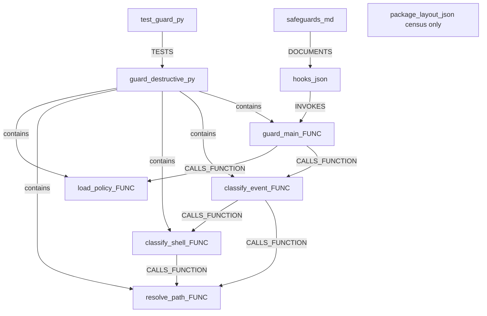
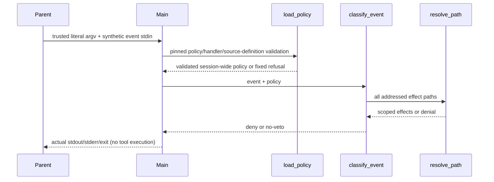

# M28-C3 safeguards DevelopmentPlan
$START_C3_PLAN
PURPOSE: Deliver the approved bounded safeguard source stage.
SCOPE: Exact C3 software grant; native AC7 held.
KEYWORDS: safeguards, policy, source binding, partial capacity
$START_DOCUMENT_PLAN
$DOCUMENT_PLAN
TOOL Ready single-slice technical plan => C3_PLAN
$END_DOCUMENT_PLAN
$START_SECTION_PLAN
$START_ARTIFACT_C3_PLAN
TYPE: TOOL
KEYWORDS: deterministic guard, compatibility
$START_CONTRACT
$CONTRACT
PURPOSE: Give Code and judges complete bounded inputs.
DESCRIPTION: One functional source slice with tests and coupled census.
RATIONALE: Useful executable tripwire with explicit host limitations.
ACCEPTANCE_CRITERIA: Ready graph, scope, AC1–AC8, delivery and commands.
$END_CONTRACT
$START_BODY

METHODOLOGY_VERSION: neutral1.1.0 (SPEC_VERSION and fully loaded six-member constitution); construction source Codex2.2.0, wire methodology-codex/2.0.0/schema2. Target proposed source2.3.0 is not the construction engine.
Classification: BROWNFIELD; projectType Plugin; taskType Feature; UI false. Actual source/tests/package manifests exist. Hardest step is authority-aware parser design and independent verification; model/effort overrides unset, observations/cost unknown, four host slots, one source writer. Parent-selected design-only behavior applies because no plan-mode tool is exposed. The role cannot implement, delegate, commit, integrate or write state.
Authority: exact owner approval2026-10-14 “Утверждаю этот частичный этап C3, запускаем Code”, spec SHA0ef5cf14b56f2504cc584b3d752fe806274dd6ae2ec9c0f0d519cecb590440f9. Actual approval/preflight is under .methodology/c3-execution-preflight; original frozen M27 and C3 RECON remain authority/evidence. Stale draft/pending prose in the frozen specification is superseded for this exact action by the authentic approval, not edited or used to invent another gate. Input474ed4efbbc6d855238827d50a4242b4b5eafa584ed159fb2e5536ad3092f9dd; initial candidatec07fd255542b4c738cc4764dd76070391baed316a3b7789bf92199c6309e1e4d. First plan binding is parent-owned after semantic acceptance. The Architect return uses the current pre-binding inputIdentity and the actual full target candidateIdentity after permitted plan creation; the helper binds that resulting candidate and plan once. Original run identities above are historical context; a continuation derives current identities from its actual state and source inventory.
Proposed scope amendment: add only tests/test_c1_review_and_routing.py current version/member oracle constants as described in the scope row. Original exact C3 specification remains immutable; this addendum requires the owner decision before applying either test or plan change. Preserve all failed ledgers and spent resources through a supported linked continuation; no other source/native/install/merge authority.
Purpose/rationale/verification: provide a small executable tripwire, synchronous source adapter and discriminating evidence without pretending it is a confinement platform. One independently implementable functional slice C3-GUARD owns the four new files plus exact20 census/doc/oracle couplings; splitting parser, policy and binding would leave unusable partial slices. Verification is AC1–AC6/AC8 source-stage and complete regressions/maps; AC7 stays HELD/UNFULFILLED, not N/A/PASS or full C3/M27 completion.

### Alternatives and collapse
Criteria from BR2–6/AC1–6: trusted binding, conservative effects, ordinary authorized use, available stdlib/Python3.9, inspectable failure behavior. Owner simplicity direction adds a design preference, not a new AC.
A: explicit JSON policy + finite shlex-based conservative recognizer in one module, direct pure decision functions plus shipped main. Exact argv checks may be parent-bound; unknown semantics deny. Realism9/impact8/risk6/cost8/debt7 (higher scores favorable; estimates). Small interface and honest deny boundaries; limits require contrary controls.
B: import donor parser/classifier and correct authority/environment/error gaps. Realism8/impact8/risk4/cost5/debt4. Reuses measured parser families, but imports a large permissive legacy surface, silent errors and scratch assumptions; correcting them is harder to review than preserving a small supported grammar. No donor source is a runtime dependency.
C: exact parent-authenticated command/effect recipes only, rejecting all unlisted shell/patch operations. Realism9/impact5/risk8/cost9/debt8. Useful for tightly fixed checks, but insufficient alone for ordinary quoted path edits, shell chains and apply_patch required by BR3–5. Reuse recipes only for opaque approved checks; select A for recognizable shell/patch effects.
Collapse A with the bounded recipe seam from C. No general shell interpreter, custom DSL, service, launcher, provider or dependency. The testable promises below preserve every approved AC rather than substitute score totals.

### Cardinal rules and pattern applicability
Python stdlib only, floor3.9.6 with3.12.13 pytest8.3.3 available. Full rich Python contract-authoring profile: paired module/entity regions; full purpose/scope/input/output/links/invariants/rationale/changes/LAST_CHANGE/weighted modulemap/usecases/GREP_SUMMARY/STRUCTURE and configured anchor; each authored entity own rich contract and paired logical blocks. Every significant authored validation/branch/I/O/error owns safe stdlib stderr LDD [IMP:n][function][block], success9/failure10; no raw command/path/patch/secret/fingerprint logging. Existing files remain edit-local; census-only constants add no invented control branches.
Layer Isolation: importable kernel has no host/model/installation/state authority; main owns bounded stdin/stdout/stderr only; JSON binding owns native declaration. No UI/database layer is invented.
Plugin API + Direct Integration: real tests load the shipped module through importlib.util.spec_from_file_location/module_from_spec/exec_module, never mutate sys.path or substitute a process wrapper for logic. classify_event and classify_shell return fixed typed no-veto/deny decisions; main translates denial to native envelope.
Backend Tests + LDD: native pytest atomic logic plus real CLI process fixtures, trace presence/order/cardinality/key population and expected-only errors; complete produced relevant logs audited. Direct tests and process probes serve distinct channels.
Headless UI Testing: N/A by actual source-only UI=false scope; no browser/server/AX work. Doxygen remains mandatory for root/Codex/Claude configurations at Code and again Finalize.

### Verbatim scope for the eventual Code briefing
The following complete Scope is transported as authoritative text. Parent-only rows are never assigned to Code; Code receives only24 software paths and explicitly granted outside-source evidence/scratch resources. Purpose restrictions are as binding as paths.

MAY EDIT, exactly these new package paths:
- implementations/codex/hooks/guard_destructive.py — bounded deterministic policy/parser/native entrypoint, no model or installation.
- implementations/codex/hooks/hooks.json — synchronous PreToolUse binding; missing policy refuses, no async/approval/trust automation.
- implementations/codex/references/safeguards.md — full policy/interface/commands/limits/opt-in and criterion-to-proof account.
- implementations/codex/tests/test_guard.py — owned fixture, real standalone process and discriminating source-stage controls; no native model execution.

MAY EDIT, exactly these existing paths and purposes:
- implementations/codex/.codex-plugin/plugin.json —2.3.0 and hook source declaration only, retain name/skills/interface.
- implementations/codex/Doxyfile — include hooks in existing source map; no weakening exclusions/documentation checks.
- implementations/codex/adapter.json — exact pre-tool capability mechanism/fallback describing conditional hook plus current host permissions; no registry/parameter/file ownership changes.
- implementations/codex/README.md — current composition, safeguard commands/limits and held native activation.
- implementations/codex/references/adoption.md — precise supported guard adoption, source2.3 census and unchanged neutral binding.
- implementations/codex/references/codex-runtime.md — conditional guard route/limits and current composition; role/flow algorithms unchanged.
- implementations/codex/references/handoffs.md — current source identity and held guard proof only; wire/schema/counters unchanged.
- implementations/codex/references/package-layout.json — exact77-member sorted inventory/kinds and source2.3, no new kind or embedded selfhash.
- implementations/codex/references/source-disposition.md — source-to-duty and converse safeguard accounting, retained defects/partial proof.
- implementations/codex/references/consumer-pm-profile.md — exact current source census/guard cross-reference only;75 duties/22 checks/13 templates and CLI grammar unchanged.
- implementations/codex/skills/semantic-exoskeleton/SKILL.md — source2.3 binding label only; neutral stamp1.1 and rules unchanged.
- implementations/codex/skills/feature-dev/scripts/run_state.py — only current package version/member constants and edit-local explanatory metadata; algorithms/KINDS/wire/schema/guards unchanged.
- implementations/codex/tests/test_adoption.py — exact current member count and edit-local metadata only; all refusal controls retained.
- implementations/codex/tests/test_native_contract.py — exact current source/member/helper checks and edit-local metadata only; independent guards retained.
- implementations/codex/tests/test_run_state.py — exact current corpus explanatory metadata only; cases/algorithm expectations unchanged.
- implementations/codex/tests/test_guide.md — new criteria/commands/limitations and current census, retained historical tables.
- tests/test_codex_package.py — independently enumerated four new members/kinds, current version77 oracle and edit-local metadata; all previous boundary controls retained.
- tests/test_c1_review_and_routing.py — exact current Codex source2.3/member77 normalization constants and edit-local explanatory metadata only; retain PINS, normalization target47, Claude, wire/schema and all assertions/contrary controls.
- README.md — current source/census and safeguard capability/limits; retain complete Local use section.
- CHANGELOG.md — bounded Codex2.3 source entry, neutral version remains1.1.0.

Parent-only project paths:
- examples/pm-project/plans/m28-c3-safeguards.md — assigned Architect technical plan after approval, never overwrite C1/C2 plans.
- examples/pm-project/notes/m28-c3-recon.md; examples/pm-project/specs/m28-c3-safeguards.md — authoritative input frozen at approval; later amendment via matching decision.
- examples/pm-project/notes/m28-c3-result.md — honest source/native criterion outcomes, failures/remaining proof and authentic result gate.
- examples/pm-project/VISION.md; examples/pm-project/ROADMAP.md; examples/pm-project/TASKS.md; examples/pm-project/HANDOFF.md — root current state reconciliation.

DO NOT TOUCH: all paths not listed above; especially implementations/claude/**, neutral owners/SPEC_VERSION/FORMAT/registries/schema/checker algorithms, C1/C2 plans/specs/results/input locks/evidence, other Codex roles/cards/helpers/tests/templates, user settings/caches/credentials/trust and clean permanent main. All older map mismatches remain outside this scope. Ignored run-owned evidence/map/test resources require explicit assigned outside-source directories; generated output is never authored as source.


## 1 Draft Code Graph
New functions are planned public direct seams, not changes to existing helper interfaces. Existing run_state.advance/_payload and root _package_assembly remain unchanged algorithm dependencies, verified by cached index/own XML and matching copied/live source in architect/maps.json; maps are bounded existing navigation evidence, not new complete builds. Source registry SOURCE codex/root resolves to actual absolute index and hash in that readable evidence. Own entity locations and descriptions are included there. No currently contracted post-code KnowledgeGraph is introduced.
```xml
<DraftCodeGraph>
 <C3_Info TYPE="PROJECT_INFO"><keywords>Safeguards|Source binding</keywords><terms>Policy|Partial capacity</terms><annotation>Approved source-stage delta; native AC7 held.</annotation><BusinessScenarios><Scenario NAME="BoundedDecision">Parent binds policy -&gt; supported event evaluated -&gt; deny or no added veto</Scenario></BusinessScenarios></C3_Info>
 <guard_destructive_py FILE="implementations/codex/hooks/guard_destructive.py" TYPE="GUARD_MODULE" satisfies="BR-2 BR-3 BR-4 BR-5 BR-6"><keywords>Guard:9</keywords><terms>Policy|Event|Decision</terms><annotation>Single stdlib module, no authority expansion or target command execution.</annotation>
  <load_policy_FUNC NAME="load_policy" TYPE="BINDING_VALIDATION" satisfies="BR-2"><keywords>Identity:9</keywords><terms>Digest|Protected entry</terms><annotation>Validate explicit trusted policy/handler/source-definition binding and shape.</annotation></load_policy_FUNC>
  <resolve_path_FUNC NAME="resolve_path" TYPE="RESOURCE_VALIDATION" satisfies="BR-2 BR-3"><keywords>Containment:9</keywords><terms>Path|Parent|Git home</terms><annotation>Reject links, unresolved identity and protected entry effects.</annotation></resolve_path_FUNC>
  <classify_shell_FUNC NAME="classify_shell" TYPE="EFFECT_CLASSIFIER" satisfies="BR-3 BR-4 BR-5"><keywords>Shell:9</keywords><terms>Chain|Redirect|Heredoc|Effect</terms><annotation>Finite supported grammar; unknown effects deny.</annotation><CrossLinks><Link TARGET="resolve_path_FUNC" TYPE="CALLS_FUNCTION"/></CrossLinks></classify_shell_FUNC>
  <classify_event_FUNC NAME="classify_event" TYPE="DECISION_KERNEL" satisfies="BR-2 BR-3 BR-4 BR-5"><keywords>Decision:9</keywords><terms>Bash|Patch|Unsupported tool</terms><annotation>Validate untrusted shapes then dispatch supported effects.</annotation><CrossLinks><Link TARGET="classify_shell_FUNC" TYPE="CALLS_FUNCTION"/><Link TARGET="resolve_path_FUNC" TYPE="CALLS_FUNCTION"/></CrossLinks></classify_event_FUNC>
  <guard_main_FUNC NAME="main" TYPE="PROCESS_BOUNDARY" satisfies="BR-2 BR-6"><keywords>Delivery:9</keywords><terms>stdin|Deny|No veto</terms><annotation>Explicit CLI pins, bounded UTF8 event; deny envelope/exit2 or empty stdout/exit0.</annotation><CrossLinks><Link TARGET="load_policy_FUNC" TYPE="CALLS_FUNCTION"/><Link TARGET="classify_event_FUNC" TYPE="CALLS_FUNCTION"/></CrossLinks></guard_main_FUNC>
 </guard_destructive_py>
 <test_guard_py FILE="implementations/codex/tests/test_guard.py" TYPE="TEST_MODULE" satisfies="BR-1 BR-2 BR-3 BR-4 BR-5 BR-6 BR-7"><keywords>Contrary controls:9</keywords><terms>Owned fixture|Actual process|Regression</terms><annotation>Direct logic and real command/config/file probes; never native events.</annotation><CrossLinks><Link TARGET="guard_destructive_py" TYPE="TESTS"/></CrossLinks></test_guard_py>
 <hooks_json FILE="implementations/codex/hooks/hooks.json" TYPE="NATIVE_CONFIG" satisfies="BR-6"><keywords>Sync:9</keywords><terms>PreToolUse|Trust</terms><annotation>Parseable catch-all synchronous source binding; unbound source refuses. Actual activation held.</annotation><CrossLinks><Link TARGET="guard_main_FUNC" TYPE="INVOKES"/></CrossLinks></hooks_json>
 <safeguards_md FILE="implementations/codex/references/safeguards.md" TYPE="INTERFACE_DOCUMENTATION" satisfies="BR-2 BR-6 BR-7"><keywords>Coverage:9</keywords><terms>Policy grammar|Limits</terms><annotation>Exact standalone/native preparation and unfulfilled channels.</annotation><CrossLinks><Link TARGET="hooks_json" TYPE="DOCUMENTS"/></CrossLinks></safeguards_md>
 <package_layout_json FILE="implementations/codex/references/package-layout.json" TYPE="CENSUS_METADATA" satisfies="BR-1"><keywords>Census:8</keywords><terms>77 members|2.3 source</terms><annotation>Only four-member insertion/version; coupled exact20 consumers enumerated in scope.</annotation></package_layout_json>
 <ExistingNodeRef NAME="run_state.advance" SOURCE="codex"/>
 <ExistingNodeRef NAME="run_state._payload" SOURCE="codex"/>
 <ExistingNodeRef NAME="test_codex_package._package_assembly" SOURCE="root"/>
</DraftCodeGraph>
```
Full graph population10 changed definitions: guard module +five functions +test module +three config/document/census components. Mechanical suffix recognizer scans7 Python definitions; hooks_json/safeguards_md/package_layout_json require explicit manual XML/BR/fidelity review, never fake suffix renaming. Changed existing census/comments/prose are covered by purpose-bound scope and invariant analysis, not falsely represented as changed algorithms.

## 2 Step-by-step Data Flow
1. Trusted parent pins invocation argv outside worker authority: --policy absolute regular read-only file, --policy-sha256 lowercase64hex, --handler-sha256 lowercase64hex. No environment policy/hash/role/defaults. Missing pins reach handler denial; argparse errors must use safe fixed diagnostics. Read at most65537 stdin bytes; reject over65536, nonUTF8, duplicate keys, nonobject/trailing data and malformed event.
2. load_policy validates actual policy and handler hashes before decisions, nonlinked regular file and parent entries, exact mode/type/path declaration and source hooks definition identity. Policy size is bounded65536 too (implementation limit, not tightened AC threshold). Parent-authenticated SHA pins and fixture/invocation provenance establish authority; the helper does not authenticate a human from a grant string or filesystem permissions. Roots cannot overlap protected binding entries; parent replacement is protected at that directory entry, not a false claim that protecting / recursively forbids all work.
3. Policy grammar is plain JSON, version1 exact fields: version integer1; profile readonly or writable; grant nonempty parent reference; session_id nonempty string; source_roots/protected_roots/git_roots arrays of absolute canonical paths; worker_write_roots array; effects array of {path,operations,recursive} where operations are fixed create/write/delete/mode/read tokens and recursive plain bool; scratch_roots/evidence_roots arrays; binding {policy_path,policy_mode,handler_path,handler_mode,definition_path,definition_mode,definition_sha256,entries}; checks array of {command,cwd,files,effects} where files are {path,sha256,mode} and effects refer to already-granted exact paths. binding.entries records every protected binding file and resolved entry parent as {path,type,mode,device,inode}; compare actual lstat metadata without following links before decisions and preserve replacement attempts. Entry-parent protection forbids replacement/chmod of that entry while permitting unrelated descendants. No worker-provided identity/role/approval/root fields. Missing/unknown/duplicate fields or overlapping/inconsistent security facts deny. Path arrays are unique; boolean never coerces to integer. Schema records are module constants, not a new schema registry. Do not read credential/config/transcript stores; transcript_path is ignored metadata only. Entire protected actual Git home supplied by parent is reserved, including worktree pointer/common home, and verified against bounded Git read probes if a Git command addresses it. No .git anywhere under claimed git-free scratch, including pointer/link parents.
4. Event required fields: hook_event_name exactly PreToolUse, session_id matches policy, cwd absolute nonlinked existing directory, tool_name supported canonical name and tool_input object. Supported Bash/apply_patch require tool_input.command string; accepted optional Bash fields only documented descriptive/timeout/workdir fields with strict types; workdir overrides cwd only when canonical/resolved. Top-level optional turn_id/tool_use_id/model/permission_mode/transcript_path are typed metadata with no authority. Unknown fields or unsupported function/MCP/resource/role/approval arguments deny. Event names are data; session-wide profile never claims authenticated QA identity.
5. A checks recipe is accepted only for byte-for-byte command and canonical cwd equality, current pinned regular interpreter/script/source files and modes, and its complete fixed effects intersecting the existing grant; unknown or changed recipe inputs deny. It is explicit parent authentication of an opaque ordinary check, not inference from python/pytest executable prefixes or a sandbox claim. No candidate command runs inside the guard. For other commands, classify_shell uses shlex and small explicit lexical ownership for heredocs/redirects/separators. Evaluate every chain branch conservatively; uncertain cd branches cannot select one favorable cwd. Literal assignments can set local known tokens only, never policy/env authority. Literal cd updates resolved cwd; unknown expansion, glob, tilde, substitution, process substitution, subshell/control-flow/functions/loops/interpreter scripts and malformed quoting deny. Nested sh/bash -c is recursively classified with bounded depth2 and no execution; unsupported flags/depth deny. Quoted paths remain one operand. Heredoc bodies belong solely to their consuming simple command; never scan them as standalone shell commands. Unsupported pipelines/xargs/scripts/SQL pipes deny.
6. Recognized read commands cat/ls/stat/rg and Git status/diff/log/rev-parse/show use closed safe option/operand grammars, complete resource/read checks, no output-file/metadata-write options. printf/echo without effect redirect can be no-veto. File touch/mkdir/cp/mv/tee/static output redirects/mode changes/rm and finite find -delete or -exec rm account for every source/destination/delete/effective root; cache name/temp prefix confers no grant. Positive owned regenerations and ordinary exact writes use same checks as denials. Unknown options deny. Preserve directories/parents when a rename/delete targets a binding ancestor. Git force/ref/config/index/object/fetch/commit/checkout/restore/reset/clean/worktree mutation is denied against readonly/protected actual stores, even clean state; writable mutation requires explicit matching effects and reliable bounded resource/state proof, otherwise deny. Resolve --git-dir/--work-tree/-C, GIT_* assignments are rejected rather than guessed; probe failure/timeout/unresolved store deny. Read-only probes use fixed argv, sanitized controlled environment/no inherited Git config authority, timeout3, bounded output; they never execute the candidate command. No all-ref/object purity claim from status alone.
7. SQL client commands/scripts are not executed. Recognize destructive SQL in its own client/heredoc as denial; unsupported resource identity/SQL semantics deny. A cat-owned quoted heredoc containing SQL text is data and can no-veto if it has no ungranted redirect. No live database or production resource. Resource records never grant shell fallback for unknown SQL/interpreter/MCP.
8. apply_patch supports actual *** Begin Patch/End Patch, Add/Delete/Update and Move to headers, with every old/new addressed path checked. Unknown path/header shape or link/escape denies; content is data. No argument rewrite. Fixed typed decision {decision: deny|no-veto, reason: fixed class} is importable return, not wire/state extension. main outputs only native deny object with hookSpecificOutput/hookEventName PreToolUse/permissionDecision deny/fixed reason (exit0) or safe stderr/exit2 for malformed/binding/internal failures; no-veto exits0 with empty stdout. No native allow/ask, PermissionRequest approval or host sandbox escalation.
9. Critical scenario: parent-bound writable policy + actual same-byte handler/source definition → quoted granted touch/patch destination → complete effects permit → empty stdout, exit0. Contrary: same command to foreign sibling → deny envelope, no candidate command executed; malicious roots/session/unknown syntax/invalid binding → fixed deny/error class, no effects or secrets. The guard never runs a command to test a claimed write.

### Native source definition and real opt-in prerequisite
Shipped hooks/hooks.json has hooks.PreToolUse catch-all matcher and one command handler, async false/omitted, timeout10. Command invokes python3 -B "$PLUGIN_ROOT/hooks/guard_destructive.py" with no policy pins: actual loaded but unbound source denies. Manifest adds only hooks:"./hooks/hooks.json" and source2.3 version. PLUGIN_ROOT is documented host locator, never trusted policy selection; malicious/unbound handler identity cannot earn readiness.
For source-stage tests the parent-owned fixture constructs a rendered copy of that exact definition with literal quoted absolute handler path and the three explicit policy/hash arguments. No rendering CLI is added. Its path/bytes/hash/argv and shipped source-definition hash are independently pinned in the invocation receipt, outside worker effects. Policy binding.definition fields validate the immutable shipped definition source; effective rendered definition trust is separate, never circular selfhash or invented trusted env. Every no-veto process case includes that independent rendered-definition receipt. Source-stage tests run its command locally with synthetic stdin, not a native host.
Trusted invocation provenance is a parent/native-source prerequisite, not something the kernel derives from self-reported worker_write_roots or grant text. Worker stdin/environment cannot replace literal argv; independently invoking this helper with self-chosen policy/argv outside the reviewed route proves no host guard authority. That unhooked route remains outside native proof. Native activation later must select a vetted exported/bound definition instead of concurrently loading the shipped unbound-deny definition. Adding another hook/config is not replacement: multiple matching sources run concurrently. Exact selection/replacement/export scope, actual source identities and hash-specific host trust must be approved under AC7/C6; no install/settings/native process here. No fabricated run_condition field, automatic SessionStart, trust flag or bypass. Official source inspected2026-10-14: https://learn.chatgpt.com/docs/hooks (config, plugin source, event/deny, concurrency/coverage); version0.160.0 local help is not ABI conformance.

## 3 Visual Verification
Active:10 changed definitions, testsOnly false; seven suffix-recognized Python definitions, three explicitly unsupported JSON/Markdown definitions manually reviewed. Actual linter invocation/streams/exit are recorded in architect/visual.* and visual-receipt.json after this plan is written. Mechanical coverage checks every recognized definition for orphan/unknown/uncovered BR; manual review performs those same checks for three unsupported definitions and XML fields/order/unique IDs/local targets/references. Root independently accepts both. No silent zero-node PASS.
```mermaid
requirementDiagram
 requirement BR_1 {
  id: BR-1
  text: Approved BR-1
  risk: high
  verifymethod: test
 }
 requirement BR_2 {
  id: BR-2
  text: Approved BR-2
  risk: high
  verifymethod: test
 }
 requirement BR_3 {
  id: BR-3
  text: Approved BR-3
  risk: high
  verifymethod: test
 }
 requirement BR_4 {
  id: BR-4
  text: Approved BR-4
  risk: high
  verifymethod: test
 }
 requirement BR_5 {
  id: BR-5
  text: Approved BR-5
  risk: high
  verifymethod: test
 }
 requirement BR_6 {
  id: BR-6
  text: Approved BR-6
  risk: high
  verifymethod: test
 }
 requirement BR_7 {
  id: BR-7
  text: Approved BR-7
  risk: high
  verifymethod: test
 }
 element guard_destructive_py {
  type: "GUARD_MODULE"
 }
 element load_policy_FUNC {
  type: "BINDING_VALIDATION"
 }
 element resolve_path_FUNC {
  type: "RESOURCE_VALIDATION"
 }
 element classify_shell_FUNC {
  type: "EFFECT_CLASSIFIER"
 }
 element classify_event_FUNC {
  type: "DECISION_KERNEL"
 }
 element guard_main_FUNC {
  type: "PROCESS_BOUNDARY"
 }
 element test_guard_py {
  type: "TEST_MODULE"
 }
 element hooks_json {
  type: "NATIVE_CONFIG"
 }
 element safeguards_md {
  type: "INTERFACE_DOCUMENTATION"
 }
 element package_layout_json {
  type: "CENSUS_METADATA"
 }
 guard_destructive_py - satisfies -> BR_2
 guard_destructive_py - satisfies -> BR_3
 guard_destructive_py - satisfies -> BR_4
 guard_destructive_py - satisfies -> BR_5
 guard_destructive_py - satisfies -> BR_6
 load_policy_FUNC - satisfies -> BR_2
 resolve_path_FUNC - satisfies -> BR_2
 resolve_path_FUNC - satisfies -> BR_3
 classify_shell_FUNC - satisfies -> BR_3
 classify_shell_FUNC - satisfies -> BR_4
 classify_shell_FUNC - satisfies -> BR_5
 classify_event_FUNC - satisfies -> BR_2
 classify_event_FUNC - satisfies -> BR_3
 classify_event_FUNC - satisfies -> BR_4
 classify_event_FUNC - satisfies -> BR_5
 guard_main_FUNC - satisfies -> BR_2
 guard_main_FUNC - satisfies -> BR_6
 test_guard_py - satisfies -> BR_1
 test_guard_py - satisfies -> BR_2
 test_guard_py - satisfies -> BR_3
 test_guard_py - satisfies -> BR_4
 test_guard_py - satisfies -> BR_5
 test_guard_py - satisfies -> BR_6
 test_guard_py - satisfies -> BR_7
 hooks_json - satisfies -> BR_6
 safeguards_md - satisfies -> BR_2
 safeguards_md - satisfies -> BR_6
 safeguards_md - satisfies -> BR_7
 package_layout_json - satisfies -> BR_1
```
Traceability diagram is deterministically derived from exact satisfies values, every changed definition to every declared BR1–7. Graph-to-flow mapping follows the five owning calls plus test/invocation/document edges. The invariant architecture comparison retains unchanged Neutral→Adapter/adoption→existing Binder, Layout→Binder, Runtime→Binder and Assembly→Layout; proposed only Tool/Policy→Guard→native permissions/tool. Guard has no write edge to source, policy, run_state or approval. Existing BR1 census updates do not move those relationships.



No database schema, hierarchy/inheritance or persisted3+state entity changes: er/class/state diagrams are N/A with these actual reasons; the transient decision is two outcomes. Native host execution is a separate AC7 scenario, not this sequence's endpoint.

## 4 Acceptance Criteria
The exact specification criteria below remain authoritative, including every condition. All current implementation measurements are NOT_RUN at design time; future Code/QA record actual values against the approved thresholds. No old597/146/526 count is a permanent quota.

AC1 Authority/shape: real entrypoint denies absent/invalid policy, duplicate or malformed security fields, unknown tool/shape, oversized input and worker attempts to supply role/roots/approval. Safe synthetic secret inputs produce no payload/path/fingerprint leak. Every allow control binds actual immutable policy/handler/definition identities. Changed bytes/type/mode/path, unpinned or worker-chosen hashes, replace/link attempts and environment fallbacks refuse; read-only path alone cannot pass.
AC2 Effects: owned fixtures distinguish granted versus foreign rm/find/cache, explicit Git-dir/work-tree, dirty source/index/untracked/ignored state, force/ref/config/object mutation, unresolved links/parents/spaced paths, redirects/patch multi-path and SQL/heredoc ownership. Protected original source/Git reject in readonly policy; permitted owned scratch without .git works. Unknown shell effects/probe failure deny. No destructive production operation is executed.
AC3 REAL-PATH/REAL-SHAPE: `python3 -B implementations/codex/hooks/guard_destructive.py --policy POLICY --policy-sha256 POLICY_SHA --handler-sha256 HANDLER_SHA` with stdin events executes actual handler processes. Inspect exit, parsed denial/no-veto output and safe stderr; use real committed hooks/manifest/layout/adapter and real owned temporary repository/candidate copies. JSON fixtures are labelled synthetic, never native.
AC4 Regression: run complete root, Codex and Claude suites under actual documented Python prerequisites; preserve all existing cases and exact census-only exceptions. Run self with both unchanged private deny lists and all three adapters on a complete public-source copy. No required skips or error-as-success. Compare protected source algorithms independently beyond equal test totals.
AC5 Scope/maps: complete before/after byte/type/mode/path inventories, every write/purpose and graph invariant comparison; all other baseline files remain exact. Regenerate actual root/Codex/Claude maps from their real Doxyfiles using owned outputs; inspect changed guard/test entities/contracts and meaningful references. Report pre-existing map defects separately, never claim status proves Git-object purity.
AC6 Native binding source: actual hooks/manifest are parseable, synchronous, contained and invoke the current guard; no `|| true`, automatic grant, rewrite, async or trust bypass. Missing policy is explicit deny at handler; stopped/untrusted/missing/runtime-failed hooks do not earn guarded-session readiness. Documentation maps every supported/proposed/unverified/unsupported channel.
AC7 NATIVE, UNFULFILLED/HELD: separately approved disposable runtime/trust probe must capture actual events and actual unchanged/changed benign sentinels for Bash/apply_patch/nested calls and claimed channels, positive authorized mutation and denied foreign/readonly mutation. Independently compare original source and the Git metadata population actually claimed. Probe identity/continuation/fault gaps without turning bypass into successful prevention. Standalone AC3 fulfills none of this criterion. Unsupported prevention stays BLOCKED, never N/A or PASS.
AC8 Closure: independent QA with existing scans, whole-result Review and assigned Architect Finalize judge the same current candidate; root records source-stage partial and every unmet native duty, authentic approvals and recoverable private evidence. No install/publication/main merge occurs without matching decisions.


### Measurement and literal verification commitments
All new tests live in test_guard.py, with direct imports and owned tmp_path fixtures. Tokens are intended actual identifiers to be checked after Code; replacement/drop is a Deviation, never silently changed proof.
| AC | Literal token → real production operation → measured expectation |
|---|---|
| AC1 | test_policy_binding_refuses_tampering → load_policy/current main → all invalid/missing/duplicate/oversize/worker-authority cases deny; zero synthetic payload/path/fingerprint leaks; all no-veto controls verify actual policy/handler/source-definition and rendered-receipt binding. |
| AC2 | test_effects_preserve_foreign_state → classify_event/classify_shell/resolve_path → complete positive/negative fixture matrix, all foreign/protected/unknown decisions deny, all declared ordinary positives no-veto; zero candidate operations executed by classifier. |
| AC2 | test_shell_ownership_and_unknown_effects → classify_shell → quoted/cwd/chains/redirects/depth/heredoc/client ownership cases, probe failure denies; dirty/index/untracked/ignored and explicit store cases preserve metadata. |
| AC3 | test_real_handler_process → main via actual documented CLI/rendered definition command → real argv/cwd/streams/exits and policy/handler/definition byte identities; deny/no-veto output parsed; original sentinels bytes/modes/types/absence unchanged. |
| AC4 | test_complete_source_guard_binding → actual shipped hooks/manifest/layout/adapter plus independent root _package_assembly → source2.3/77/27/7/6, neutral1.1/wire2/schema2, preserved complete regression populations; zero required skips/failures. |
| AC5 | test_git_free_scratch_and_protected_parents → resolve_path → .git-free owned scratch positive; copied/linked/pointer Git and binding-parent mutation refusal. Root independently compares every before/after path byte/type/mode and protected algorithm AST, allowing only named census constants. Three real map builds exit0; every new/edited own entity has complete XML fields/source location; old mismatches separately retained. |
| AC6 | test_source_definition_is_synchronous_and_bound → real hooks/manifest/rendered copy and main → no async/trust/approval/rewrite/bypass/error-swallow path, unbound invocation denies; every supported/proposed/unverified/unsupported channel accounted. |
| AC7 | TEST_DEFERRED native host event/sentinel probe → held actual host → captured events0 now, remains UNFULFILLED/HELD. Exact command/config will be candidate-bound after source files and independent vetting, requiring separately approved disposable runtime/trust/account scope; no speculative executable native command here. |
| AC8 | current independent QA eight scans, whole Review, assigned Architect Finalize and root result record → same candidate verified source-stage partial, retained failures/history/AC7 limits, no unapproved install/publication/main merge. |
All trace tests assert owned critical operations in order/cardinality and no unrelated ERROR/CRITICAL; deliberate failures require expected own failure10. They expose importance7–10 before assertions with -s -v and separately audit whole produced relevant logs. Parser tests do not execute destructive strings/SQL, native model or production resources. CLI process crossing is real standalone evidence only.

## 5 Delivery Contract
Source-stage actual sinks: child stdout (native deny JSON or empty no-veto), safe diagnostic stderr, parent-owned invocation receipts, owned fixture files and generated three-map XML. Mechanism: real shipped main and literal reviewed rendered source-definition command; direct logic alone cannot substitute actual process streams/exits. Test receipt pins argv/cwd/input/source/policy/definition identities and before/after benign fixture state; synthetic event JSON is labelled synthetic. Complete public source copies retain all members/bytes/modes and omit .git/.methodology/generated output; original source/Git remains read-only for judges. Parent authenticates policy authority and readonly protected fixture root; no fixture grants the Code actor permission to write the current authoritative policy.
Native sink is the actual host tool and target sentinel, unproven: no callback invocation/interception/launch-timeout/trust/continuation guarantee from local green tests. Session-wide policy is neither per-subagent authentication nor full OS confinement. write_stdin, hosted and specialized opt-outs remain gaps; guard cannot repair host fail-open faults. Same-process direct return tests have no external sink. No service/container/health endpoint, accounts/network/model/deployment is created.
Evidence/scratch resources for Code must be explicitly granted by parent: .methodology/runs/M28-C3-20261014/code/ including source-copy, distinct absent basetemp roots and maps; QA/Review/Finalize each own separate resources assigned later, never share .git. Architect owns only this plan and architect/ evidence. Parent-only records/state and all C1/C2 histories remain protected.

## 6 Runtime Commands
Observed2026-10-14: /usr/bin/python3 is3.9.6; /opt/homebrew/bin/python3.12 is3.12.13; pytest8.3.3 available there; doxygen /opt/homebrew/bin/doxygen. No dependency installation. Definitions below are shell assignments by the authorized Code actor only, with absolute unique run-owned paths and complete source-copy verified before use. The table is runnable proposals, NOT_RUN, except the separately recorded Architect visual gate.
```
W=/private/tmp/methodology-m28-c3-20261014/worktree
R=/private/tmp/methodology-m28-c3-20261014/worktree/.methodology/runs/M28-C3-20261014
C=$R/code/source-copy
```
| Operation | cwd | Actual argv/prerequisite and expected result |
|---|---|---|
| dependency identity | W | /usr/bin/python3 --version; /opt/homebrew/bin/python3.12 --version; /opt/homebrew/bin/python3.12 -B -c 'import pytest; print(pytest.__version__)'; /opt/homebrew/bin/doxygen --version. Read-only lookups only. |
| guard covering | W | PYTHONDONTWRITEBYTECODE=1 /opt/homebrew/bin/python3.12 -m pytest -c implementations/codex/pytest.ini implementations/codex/tests/test_guard.py -p no:cacheprovider -s -v --basetemp "$R/code/guard-basetemp". Parent-authenticated outside-worker fixture policies and actual CLI cases required; exit0/no required skips. |
| guard Python floor | W | /usr/bin/python3 -B implementations/codex/hooks/guard_destructive.py --policy "$R/code/parent-binding/policy.json" --policy-sha256 "$(/usr/bin/shasum -a 256 "$R/code/parent-binding/policy.json" | cut -d ' ' -f1)" --handler-sha256 "$(/usr/bin/shasum -a 256 implementations/codex/hooks/guard_destructive.py | cut -d ' ' -f1)" < "$R/code/parent-binding/event.json". Resolve/pin argv as literal from authenticated receipt before invocation; parent-binding root must be outside all fixture worker write roots. Positive/denial fixtures on3.9 and3.12; identity capture separately. |
| complete root | C | PYTHONDONTWRITEBYTECODE=1 /opt/homebrew/bin/python3.12 -m pytest tests -p no:cacheprovider -s -v --basetemp "$R/code/root-basetemp". Complete public copy; exit0, no lost baseline cases or required skips. |
| complete Codex | C | PYTHONDONTWRITEBYTECODE=1 /opt/homebrew/bin/python3.12 -m pytest -c implementations/codex/pytest.ini implementations/codex/tests -p no:cacheprovider -s -v --basetemp "$R/code/codex-basetemp". Same candidate bytes. |
| complete Claude | C | PYTHONDONTWRITEBYTECODE=1 /opt/homebrew/bin/python3.12 -m pytest -c implementations/claude/pytest.ini implementations/claude/tests -p no:cacheprovider -s -v --basetemp "$R/code/claude-basetemp". All59 source members exact. |
| self/private guard | C | /usr/bin/python3 -B bin/conform self --deny-list "$PRIVATE_DENY_LIST_0" --json and the same with "$PRIVATE_DENY_LIST_1". Exact two existing private paths/hashes/argv are bound in architect/private-runtime-binding.json and supplied at dispatch, never published here. Both unchanged files are verified; do not create/weaken lists. Exit0 and full warnings retained. |
| adapters | C | /usr/bin/python3 -B bin/conform adapter examples/adapter.example.json --json; /usr/bin/python3 -B bin/conform adapter implementations/codex/adapter.json --json; /usr/bin/python3 -B bin/conform adapter implementations/claude/adapter.json --json. Three exact exits0. |
| root map | C | /opt/homebrew/bin/doxygen Doxyfile. Output C/doxygen_output/xml; source-copy generated output only. |
| Codex map | C/implementations/codex | /opt/homebrew/bin/doxygen Doxyfile. Real configuration includes hooks via allowed INPUT append only. Output C/implementations/codex/doxygen_output/xml. |
| Claude map | C/implementations/claude | /opt/homebrew/bin/doxygen Doxyfile. Output owned copy only; real source Doxyfile unchanged. |
| visual gate | W | /usr/bin/python3 -B /private/tmp/methodology-m28-c3-20261014/construction-framework/implementations/codex/skills/devplan-protocol/scripts/visual_gate_lint.py examples/pm-project/plans/m28-c3-safeguards.md --spec examples/pm-project/specs/m28-c3-safeguards.md. Actual Architect receipt required. |
| run/health | W | Actual standalone handler command above and test_real_handler_process serve run/readiness. Native readiness HELD AC7, no native command or activation. |
| lint/typecheck | W | No project lint/typecheck command is documented; no new tooling install. Python3.9/3.12 parse/direct/CLI checks, full regressions, XML/entity review and protected AST comparison provide actual checks without claiming a lint tool ran. |
Inventory kinds: guard_destructive.py helper, hooks.json config, safeguards.md documentation, test_guard.py test. Existing KINDS and every run_state algorithm/signature remain exact. Root independent EXPECTED_PATHS/KINDS adds only these four named entries; no broad filename heuristic exemption. Source binding version/member constants change only2.2→2.3 and73→77.
All source-changing repairs invalidate relevant evidence. Inner iteration uses failed/covering nodes; one final complete relevant suite after changes, then actual Code map builds as final Code check. Finalize independently rebuilds all3 maps after QA/Review; old11 mismatches plus launcher association ambiguity remain separate limits, never repaired here. Command substitutions shown only for a measured parent-owned source fixture are not worker environment authority; actual execution uses pre-pinned literal values/receipt and no dangerous shell strings interpolated into commands.

### Full deficiency transport and remaining commitments

SPEC_DEFICIENCY_C3_NATIVE: M27 requires executable and actual behavioral safeguards, while available hook evidence lacks authenticated per-tool role identity and complete interception/fault confinement. Proposed choice: implement the bounded source stage as PARTIAL; preserve AC7 and full duty-level proof as unfulfilled. Rationale: useful executable capacity can be delivered without falsely claiming the platform closes these gaps. Owner approval must name this partial disposition; otherwise Code is SPEC_BLOCKED. Carry this entire block and complete scope verbatim to Code. No approved original duty is waived.
SPEC_DEFICIENCY_C3_DONOR: The donor guard diagnostic permits copied/linked Git scratch while its QA source forbids shared Git metadata. Choice: use the corrected .git-free owned-scratch invariant and negative regression; do not port the unsafe allowed test as truth. Rationale: preserve original source/Git read-only duty rather than the contradictory message. Carry this entire block and scope verbatim to Code.

Code must enumerate the two received interpretations and every later narrowing/replacement in Deviations, or explicit none for additional deviations. Parent compares exact complete blocks and scope in receiving briefing. Source-stage QA/Review/Finalize can accept useful PARTIAL capacity only within authentic approved staging; AC7/wholeM27 remain unfulfilled. No source-only guard result upgrades S2.tool.guard/S2.QA/S1-OP-7 to full native prevention. Every actual out-of-scope write is reported, never automatically reverted. Parent owns state/Debug cap4 spent0 and integration; C1/C2 exhausted history stays unchanged.
$END_BODY
$START_LINKS
IMPLEMENTS: (none)
IMPACTS: (none)
REQUIRES: (none)
$END_LINKS
$END_ARTIFACT_C3_PLAN
$END_SECTION_PLAN
$END_C3_PLAN
