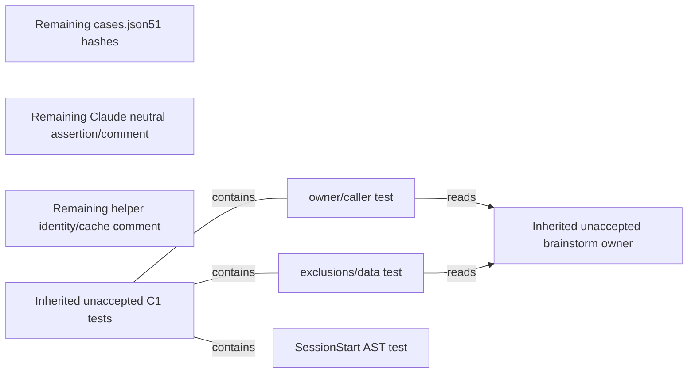

# M30 I2 — technical delta plan
$START_M30_I2_PLAN
PURPOSE: Complete the measured input-coupling defects without reopening the approved decision behavior.
SCOPE: Three remaining edit surfaces below; inherited M30 source remains unaccepted and receives whole-feature verification. Exact65-path maximum is bound in section4, not65 new components.
KEYWORDS: read receipts, current neutral version, preserved AST, source/XML fidelity
METHODOLOGY_VERSION: 1.1.0 (actual frozen construction); target neutral2.0.0 / Codex source2.4.0 / Claude source1.1.0. Existing Codex wire2.0 / Claude wire1.0 / schema2 remain unchanged.

W=`/private/tmp/methodology-m30-decisions-20261014/worktree`; F=`/private/tmp/methodology-m30-decisions-20261014/construction-framework/implementations/codex`; R=`W/.methodology/runs/M30-I2-20261014`. Dictated plan is `examples/pm-project/plans/m30-independent-decisions-i2.md`. Revised spec SHA256 `d732bab4ad4a4a12273e1d4221d8b5823f983bae588697cfab3cc046834327a2`; [RECON](../notes/RECON_2026-10-14_m30-independent-decisions.md); [correction](../notes/m30-input-correction.md). Entry/current records read; accepted Bootstrap input `988ad9ca40c7a8a7a60e1553fc51441706c6c53a38dbbb295bd2fdcb36698793`, candidate `82b4fc80de5af76a575427de7d64e50f29c351d513bccab103f31566f6c40561`/319. Parent alone binds this pending plan.

BROWNFIELD; Plugin/methodology; FEATURE; UI=false. Existing Python rich contract-authoring and edit-local LDD remain applicable. The original [M30 plan](m30-independent-decisions.md) SHA256 `31d275bb0457d7f9c18841ef26f815fd94ae77ff1b98f8d01ffe269700f04805` is retained unchanged: its technical preservation selectors, approved shared procedure, call-site flow, native persistence mechanism and full original scope remain inherited design references. This compact plan supersedes only its now-measured continuation/input closure. No new product/architecture fork exists, so no new brainstorm or concept gate is introduced. Exact receipt refresh beats weakening activation verification; exact version truth beats loosening assertions; local code spans beat broader comment rewriting, by approved preservation criteria.

Initial M30 remains BLOCKED/code with58 unaccepted source paths, root588passed/12failed, Codex146passed, Claude525passed/1failed and private self1 refusal. Original inputs/raw source/streams are retained under the correction record; no earlier Code SUCCESS/QA/Review/Finalize is inferred. Same-task cumulative Debug0/4, no reset; C3 remains separate exhausted4/4. The owner-approved behavior is settled. “Пока продолжай без живого прогона Claude” continues to defer live Claude: required AC4 and Claude partAC5 are UNFULFILLED/NOT_RUN, never waived. Codex native proof remains owed. No native engine/auth/settings/install operation occurs in this Architect phase.

$START_DOCUMENT_PLAN
$DOCUMENT_PLAN
SECTION_1 Draft Code Graph => I2_GRAPH
SECTION_2 Step-by-step Data Flow => I2_FLOW
SECTION_3 Visual Verification => I2_VISUAL
SECTION_4 Acceptance Criteria => I2_AC
SECTION_5 Delivery Contract => I2_DELIVERY
SECTION_6 Runtime Commands => I2_COMMANDS
$END_DOCUMENT_PLAN
$START_CONTRACT
$CONTRACT
PURPOSE: An implementer can complete exact corrections and judges can assess the entire current feature.
DESCRIPTION: Preserve original requirements, authority, cases, pins, algorithms and raw failures while renewing evidence.
RATIONALE: Green partial checks and metadata substitutions alone do not establish acceptance.
ACCEPTANCE_CRITERIA: BR1–6 and AC1–8 remain exactly those of the revised approved spec; native deferral is reported separately.
$END_CONTRACT
$START_BODY

$START_SECTION_1
## 1 Draft Code Graph
Purpose: distinguish three remaining corrections from inherited whole-feature policy. Rationale: a65-path grant is not65 required edits. Verification: current source/map bindings in `R/architect/source-bindings.json` and `map-current-readback.json`; XML/diagram/ordinary-meaning review and real finite visual gate.

```xml
<DraftCodeGraph>
 <M30_I2_Info TYPE="PROJECT_INFO"><keywords>Input closure|Preservation</keywords><terms>Inherited unaccepted source|I2 delta</terms><annotation>Whole pending M30 feature plus exactly three remaining edit surfaces. Inherited definitions below are actual earlier M30 changes, not new I2 writes or accepted behavior.</annotation><BusinessScenarios><Scenario NAME="CloseCoupling">Coder -&gt; correct measured input bindings -&gt; renewed whole-feature evidence</Scenario></BusinessScenarios></M30_I2_Info>
 <flow_cases_json FILE="examples/flow-contract/cases.json" TYPE="REMAINING_FIXTURE_DELTA" satisfies="BR-1"><keywords>Read receipt</keywords><terms>51 hashes|50 cases</terms><annotation>Only path-bound current Architect read hashes; preserve every case, event and expected result.</annotation></flow_cases_json>
 <claude_test_run_state_py FILE="implementations/claude/tests/test_run_state.py" TYPE="REMAINING_TEST_DELTA" satisfies="BR-1 BR-6"><keywords>Neutral source binding</keywords><terms>Current version</terms><annotation>Exact neutral_version assertion and associated contract comment only; all assertions preserved.</annotation></claude_test_run_state_py>
 <claude_run_state_py FILE="implementations/claude/skills/feature-dev/scripts/run_state.py" TYPE="REMAINING_COMMENT_DELTA" satisfies="BR-1 BR-6"><keywords>Source identity|XML</keywords><terms>Comment fidelity</terms><annotation>Only source identity comment and two existing cache-literal code spans. No executable AST change.</annotation></claude_run_state_py>
 <brainstorm_md FILE="prompting/brainstorm.md" TYPE="INHERITED_UNACCEPTED_M30_OWNER" satisfies="BR-2 BR-3 BR-4 BR-5 BR-6"><keywords>Consequential decision</keywords><terms>Two generators|HOLD|Separate evaluation</terms><annotation>Actual inherited BRAIN104–110 shared procedure and caller duty; no planned I2 rewrite. Whole source/native judgment remains owed.</annotation></brainstorm_md>
 <c1_tests_py FILE="tests/test_c1_review_and_routing.py" TYPE="INHERITED_UNACCEPTED_M30_TESTS" satisfies="BR-1 BR-6"><keywords>Finite source controls</keywords><terms>Original pins|Not native proof</terms><annotation>Actual inherited module and three M30 tests below remain pending whole QA, not new I2 edits.</annotation>
  <owner_callers_FUNC NAME="test_consequential_owner_and_call_sites" TYPE="INHERITED_NEW_M30_TEST" satisfies="BR-2 BR-3 BR-4 BR-5 BR-6"><keywords>Owner and caller</keywords><terms>Finite omission controls</terms><annotation>Actual function line266 checks current duty clauses/callers and contrary omissions; proves no native independence.</annotation><CrossLinks><Link TARGET="brainstorm_md" TYPE="READS_DATA_FROM"/></CrossLinks></owner_callers_FUNC>
  <exclusions_FUNC NAME="test_consequential_exclusions_and_untrusted_packets" TYPE="INHERITED_NEW_M30_TEST" satisfies="BR-2 BR-4 BR-5"><keywords>Proportionality|Authority</keywords><terms>Settled exclusions</terms><annotation>Actual function line331 reads exclusions/data-boundary clauses; actual fresh sessions remain separate.</annotation><CrossLinks><Link TARGET="brainstorm_md" TYPE="READS_DATA_FROM"/></CrossLinks></exclusions_FUNC>
  <session_bridge_FUNC NAME="test_session_start_source_bridge_preserves_ast" TYPE="INHERITED_NEW_M30_TEST" satisfies="BR-1 BR-6"><keywords>Whole AST</keywords><terms>Original pin</terms><annotation>Actual function line364 preserves original Python3.9 pin, only empty parser-added type_params serialization differences admitted; nonempty and unrelated controls retained.</annotation></session_bridge_FUNC>
 </c1_tests_py>
</DraftCodeGraph>
```
Source registry: actual current three Bootstrap Doxyfiles/indexes and retained source SHA/config/index identities are in `R/bootstrap/{root,codex,claude}-doxygen.json`; current readback rechecks actual index hashes and own Claude module text. Root XML `namespacetest__c1__review__and__routing.xml` maps the current C1 module/_algorithm_identity; current source lines266/331/364 bind the three actual test bodies. Source SHA for all five definitions is in `R/architect/source-bindings.json`; Markdown/JSON are directly read sources, not claimed Doxygen code coverage. The graph has5 files and3 nested inherited functions, including3 remaining I2 surfaces. Other58 inherited source deltas are assessed through the frozen old design/spec and whole candidate diff; the small graph does not erase them.

One slice I2-CLOSE (UI=false): exact3 corrections with preservation/readback checks and one renewed final full relevant suite set. Layer Isolation keeps policy at the inherited single owner and metadata at its consumer; Plugin API/Direct Integration uses existing direct helper/tests; Backend Tests+LDD preserves existing own trajectory/assertions, no invented logs for comment-only changes; Headless UI Testing N/A, no UI. No new module/helper/role/schema/spine/node or dependency.
$END_SECTION_1

$START_SECTION_2
## 2 Step-by-step Data Flow
Purpose: exact edits with no hidden broadening. Rationale: data coupling is causal failure, not a reason to loosen source verification. Verification: independently compare full before/after artifacts at the stated selectors, then renewed whole suites/logs/native evidence where permitted.

1. Read actual `roles/architect.md` bytes and compute SHA256: current44763ab7afa836e5533e45075a66decc8a55b5ac9caddd8c2ff85b26678a8d61. In cases.json select only objects within receipt.readEvidence with `path == "roles/architect.md"` and existing sha256 equal authentic oldd7ecb56452d6c20ca04938fcf16a8b786a0ac851762e27e0ac860d97b6035d23. Exactly51 matches across50 existing cases. Replace only those sha256 scalar values with the actual current owner hash. Preserve every case_id/order/event/expected verdict/other receipt field and every protective sibling. Structural comparison masks only those exact51 locations; every other ordered JSON value must remain equal. Do not assign matching worker text authority or weaken stale-receipt guards.
2. In Claude `test_layout_driven_count_and_identity`, change only the RHS Constant of `state['bindings']['neutral_version'] == '1.1.0'` to2.0.0 at currentline574, plus its associated I/O contract comment currentline555. Keep len(neutral)==71, schema2, contract methodology-claude/1.0.0, layout deletion/count/core assertions and all other tests. Compare ASTs allowing exactly this one literal site, not every1.1 occurrence or historical LAST_CHANGE. Existing function logic/logging order is unchanged.
3. In Claude helper MODULE_CONTRACT, make the package source identity comment1.0.0→1.1.0 while preserving run contract methodology-claude/1.0.0. Actual current own XML renders both header `__pycache__` mentions as bare `pycache`: source count2/XML exact-literal count0, readback recorded. Protect only those two existing comment literals with standard code spans, then verify regenerated own XML preserves literal underscores and all other paragraphs. No semantic wording, function/global AST, PINS or broad markup retrofit change. Initial38/39 coverage/rendering limit remains historical; current improved match must be measured rather than asserted.
4. Inherited exact release bridges remain unchanged: Codex _bindings source2.4→canonical2.0 once, neutral2.0→canonical1.0 at exact chained predicate and result dictionary; Claude same two neutral sites plus unique module PACKAGE_VERSION1.1→canonical1.0; existing exactCodex73→47 only. ORIGINAL C1 PINS remain codexf3a3773f070e8be24c669ee85ba75e4e37ab512efe415c82431926b97193fd4c / claudeb43c0dae8c085391ff3613557fcdfc4b9f150343a092bca0949753a797bf6c85. SessionStart original pin4ee9d7d15655f3a05622ecf0902f0afb8a9b2e9b84d95fc5819b54c2298c1e25 is retained: only empty Python3.12 type_params fields (baseline19) may be omitted for original3.9 serialization; nonempty/unrelated mutations remain visible. No pin regeneration, test healing or executable helper change. Full root Local use remains byte-equal to C2.
5. Freeze current source; verify I2 delta exactly3 surfaces and whole pending feature against accepted C2. Renew three full suites, original private self checks, three adapters, all three maps, full logs/eight scans and actual Codex important/trivial/settled proof under root. Live Claude stays deferred/unfulfilled; no command now. Current QA/whole Review/assigned Finalize cannot inherit green flags from the blocked initial run or only three edits. Parent alone updates current records afterward as separately checked record-only delta.

Inherited consequential mechanism remains source→actual root→two uncontaminated fresh generators→durably saved unranked HOLD→distinct evaluator→authorized durable decision/plan/task links. Inner roles request only; no new canonical fields. For future authorized restricted Claude proof, outer root captures full raw process streams, flushes/fsyncs and reads back the generator/HOLD artifact before a separate evaluator stage; current deferral forbids attempting that live proof. Actual native evidence remains separate from finite source checks.
$END_SECTION_2

$START_SECTION_3
## 3 Visual Verification
Purpose: show actual delta and inherited evidence without false BR attribution. Rationale: three metadata edits do not implement BR2–5. Verification: current complete feature requirement membership comes from the accurately labelled inherited owner/test definitions; I2 edits claim only BR1/6. Active componentNodes8/testsOnly=false; the finite helper recognizes genuine Python/function definitions, while Markdown/JSON receive explicit manual source review. Actual command/streams/exit/scanned count are in `R/architect/visual.json`. No unsupported definition is renamed to fake coverage.

Only containment/read edges above are XML relationships; isolated remaining leaves are deliberate, not invented coupling calls. Ordered correction flow: read actual owner→select51 receipt slots→change scalars→compare all other JSON; read real neutral binding→change one assertion literal→AST compare; inspect own XML→protect2 source literals→map readback. The existing multi-actor sequence/state projections are unchanged in original plan sections2–3 and explicitly inherited, not recopied or claimed executed. No new state-bearing entity, hierarchy or database schema: new state/class/ER diagrams N/A.
$END_SECTION_3

$START_SECTION_4
## 4 Acceptance Criteria
Purpose: preserve complete original acceptance. Rationale: necessary input correction and live deferral do not narrow the finish line. Verification: exact revised spec BR/AC bodies, actual source/test/actor evidence and independent whole-feature judges.

BR1–6 are the unchanged full Business requirements section of [revised approved spec](../specs/m30-independent-decisions.md), bound by its SHA above and Bootstrap `businessRequirementsByteEqual=true`. They remain authoritative alongside this plan: preserve roles/algorithms; meaningful consequential trigger; independent generation/HOLD; distinct evaluation/authority; single owner/real callers; both native carriers with actual evidence. No BR is deleted, relaxed or replaced by this summary.

Acceptance criteria verbatim:
AC1: Independent source/converse review finds the complete consequential predicate, meaningful routine/settled/forced exclusions, two fresh noncontaminated generators, persisted HOLD, distinct evaluator, criteria/reasons/uncertainty/authority and missing-capability handling in the single owner; every actual PM/Architect/entry/native caller loads that owner at the trigger without a contradictory universal single-actor permission.
AC2: Actual binding/scope proof reports neutral2.0.0, Codexsource2.4.0/member73 and Claudesource1.1.0/member59, same six software roles/registries/wire/schema. C1 whole-AST ORIGINAL PINS remain equal after ONLY exact named version/census normalization; all contrary algorithm/schema mutations still fail. Claude SessionStart whole AST changes only PACKAGE_VERSION. Root Local use is byte-equal to baseline.
AC3 REAL-PATH Codex: a fresh native session reading the current candidate receives an important open architectural/product fixture WITHOUT a user command to brainstorm. It identifies the trigger; actual parent dispatch obtains two distinct uncontaminated native generator contexts, durably holds results before a distinct evaluator, then retains an authorized decision and plan/task link. Capture actual tool/session/source identities and full outputs, not role-label simulation. No consumer code execution or installation.
AC4 REAL-PATH Claude: the actual discovered `/opt/homebrew/bin/claude` fresh headless session with explicit current co-located plugin and restricted read/native-agent tools receives the same important fixture without a brainstorm instruction. Actual distinct Agent calls and ordered HOLD/evaluation/decision/source evidence satisfy the same duty. Use documented no-persistence/restricted/strict-MCP/session-only plugin controls; leave model settings inherited. No credential-store inspection, global customization/install or unrelated tools. CLI presence/help alone is not proof; unavailable auth/required tool means this AC is BLOCKED.
AC5 discrimination: fresh trivial and already-settled fixtures under BOTH native carriers do not spawn methodology exploration/evaluation or reopen the accepted choice; retain why. Source/actor outputs cannot become owner authority. Preserve negative input/pin/schema checks; a declared mock/persona/skill-presence test cannot replace AC3/AC4. Native fixtures are synthetic project data; engine/tool interactions are actual, not native C3 guard proof.
AC6 regression/privacy/adapters: once final source is frozen, full existing root/Codex/Claude suites plus new meaningful duty tests pass, preserving prior cases/assertions and only declared factual exceptions. Both ORIGINAL hash-verified private deny-list self checks and all three current adapters pass over complete candidate files. Actual current counts are measured, not quotas. Preflight tests/log/shape scans precede trusting suites, all eight QA scans accounted at real triggers; full streams and owning negative paths inspected.
AC7 maps: all three actual configured Doxyfiles build exit0 on exact owned source copy; current XML covers changed/new Python entities, full authored contracts and correct source associations. Declared scope and plan graph/flows match actual changes, not merely lint coverage. Ignored outputs remain outside commit.
AC8 closure: independent full QA, whole Review and separately assigned Architect Finalize verify one current source and actual complete file/effect population, durable input/approval/evidence and limits; current maintainer records reconciled afterward as a separately verified record-only delta. All C3 failed history/foreign work retained, no additional C3 repair, no install/main merge/publication. No missing required native evidence may be labeled PASS.


I2 verification mapping: AC1 inherited owner+caller source/converse review and current finite C1 controls; AC2 exact51slots/one-neutral-assertion/helper-comment comparisons, original pins/Local use/census; AC3 actual fresh Codex important session, two real generators/HOLD/evaluator and links (owed); AC4 liveClaudeUNFULFILLED/NOT_RUN; AC5 actual fresh Codex trivial/settled controls owed and Claude portionUNFULFILLED/NOT_RUN; AC6 whole three suites+original two private lists+three adapters/eight scans, measured totals (not old quotas); AC7 current three maps/own paragraphs including two exact cache names; AC8 independent full QA/whole Review/assigned Finalize then separate parent record closure. No skip/mock/persona/source-count claim substitutes for native proof.

Exact scope authority: [revised specification](../specs/m30-independent-decisions.md), Scope section, all65 existing leaves and their purposes; independently extracted `preparation/source-scope-i2.json` SHA256 `0296c3ed2ad15f461bd14bcbeb43f69591701b4c92e152ed7afeccd9f1877f93` (absolute `/private/tmp/methodology-m30-decisions-20261014/preparation/source-scope-i2.json`). The source spec is authoritative; the JSON is evidence, not approval. Canonical Architect return carries all65 paths. This is a maximum: only the three remaining surfaces above are planned I2 edits; inherited58 paths remain pending whole judgment. Old plan/spec/RECON/current records/state, every unlisted source, C3history, adapter schema/capability/parameter registries, executable helper/spine algorithms, original pins/negative controls, LICENSE and complete Local use remain protected. This new plan alone is Architect's source write.
$END_SECTION_4

$START_SECTION_5
## 5 Delivery Contract
Purpose: verify actual consumer artifacts/channels. Rationale: a current scalar or a green assertion is not full source/native delivery. Verification: preserve raw streams and real endpoint/file observations.

| Surface | Real mechanism/sink | Required evidence |
|---|---|---|
| Flow fixtures | Actual50case JSON consumed by existing flow probe/root tests | Exact51scalar diff, all other ordered values equal, actual original failure plus renewed full root suite |
| Claude version contract | Direct existing helper initialize test in owned Git-free copy | One literal/contract-comment diff, all sibling assertions, full actual Claude suite/log |
| Helper contracts/maps | Current configured Doxygen from owned complete copy | Actual exit/streams and own XML source association/full paragraphs; literal `__pycache__` count2 restored without losing other text |
| Inherited M30 duty | Full actual shared owner/callers and native root tools | Source/converse review plus actual fresh Codex actor/source/order/files; liveClaudeunfulfilled retained |
| Preservation | Whole source/AST/member/registry/wire/Local use comparison against accepted C2 and retained initial input | Original fixed pins and every contrary guard retained; no rederived expectations |

Eight scans remain: pre-suite green-test-trap and secret files; quantitative per AC; semantic own traces and full produced-log audit; infra-dod N/A absent service/container promise; side-effect-channel real CLI/files/actor boundaries, no unavailable Claude PASS; postexecution secret streams; real-path-shape actual shipped inputs/source loading; one discriminating question per AC. Expected intentional errors remain explicitly declared; green totals alone do not pass these checks.

No new package member/role/helper/phase/schema/dependency/provider/feature flag/install/global loader/merge/publication is delivered. Foreign and failed evidence retained. Behavioral shared host limits are not OS isolation; actual model/cost only when exposed, otherwise unknown. Owner's concrete-result decision remains separate.
$END_SECTION_5

$START_SECTION_6
## 6 Runtime Commands
Purpose: reproduce only permitted checks with current identities. Rationale: proposed commands are NOT_RUN until executed and cannot reuse blocked evidence. Verification: phase custodian stores structured argv/cwd/env/full streams/exit plus before/after scope.

`OWNED_ROOT` is explicitly granted to the acting phase. `ROOT_COPY`, `CODEX_COPY`, `CLAUDE_COPY` are distinct full current source copies without.git/.methodology, verified for complete bytes/modes/path/type before effects; basetemps separate. Environment PYTHONDONTWRITEBYTECODE=1 and Python -B. No mutable probes/tests/maps run in original W. Original private lists are parent-authenticated by hash, never contents printed. This Architect performs only the actual visual gate; no suites/native engines.

| Check | cwd and literal argv | Dependency |
|---|---|---|
| Architect visual | W; `/opt/homebrew/bin/python3.12 -B F/skills/devplan-protocol/scripts/visual_gate_lint.py W/examples/pm-project/plans/m30-independent-decisions-i2.md --spec W/examples/pm-project/specs/m30-independent-decisions.md` | Actual plan/spec, exit0 and scanned>=1; manual mixed-kind/full graph fidelity separate |
| Targeted root failures | ROOT_COPY; `/opt/homebrew/bin/python3.12 -B -m pytest tests/test_flow_contract.py -p no:cacheprovider -s -v --basetemp OWNED_ROOT/target-root` | Verify actual existing module/name from collected original failing node IDs before invocation; use exact original failure subset if module differs; no new source test module |
| Targeted Claude | CLAUDE_COPY; `/opt/homebrew/bin/python3.12 -B -m pytest implementations/claude/tests/test_run_state.py::test_layout_driven_count_and_identity -p no:cacheprovider -s -v --basetemp OWNED_ROOT/target-claude` | Explicit fixture resource grant; then one full relevant suite set after all edits |
| Full root | ROOT_COPY; `/opt/homebrew/bin/python3.12 -B -m pytest tests -p no:cacheprovider -s -v --basetemp OWNED_ROOT/root-basetemp` | Current freeze, selected preflight scans, all original cases |
| Full Codex | CODEX_COPY; `/opt/homebrew/bin/python3.12 -B -m pytest implementations/codex/tests -p no:cacheprovider -s -v --basetemp OWNED_ROOT/codex-basetemp` | Exact separate copy/resources |
| Full Claude | CLAUDE_COPY; `/opt/homebrew/bin/python3.12 -B -m pytest implementations/claude/tests -p no:cacheprovider -s -v --basetemp OWNED_ROOT/claude-basetemp` | Prospective per-invocation grant/telemetry for actual newly returned m22-scratch fixtures; transparent wrapper if granted records actual argv change and unchanged protected semantics |
| Private self1/self2 | Complete COPY; `/opt/homebrew/bin/python3.12 -B bin/conform self --deny-list ORIGINAL_1 --json` and same with ORIGINAL_2 | Two ORIGINAL hash-verified private lists, no synthetic substitution; retain whole current population |
| Three adapters | Complete COPY; `/opt/homebrew/bin/python3.12 -B bin/conform adapter examples/adapter.example.json --json`; same with `implementations/codex/adapter.json`; same with `implementations/claude/adapter.json` | Actual complete current sources, all warnings retained |
| Three final maps | COPY, COPY/implementations/codex, COPY/implementations/claude; `/opt/homebrew/bin/doxygen Doxyfile` | After tests/docs; full own XML/current sources; ignored output. Assigned Finalize rebuild separately |
| Actual Codex proof | Authorized parent uses actual exposed native collaboration with current-source important/trivial/settled fixtures | Raw actual context/tool/source IDs; no favored/peer output; save/readback HOLD before distinct evaluator; then authorized durable decision links |
| Live Claude | NOT_RUN: owner deferred, auth unavailable | AC4/ClaudeAC5 unfulfilled; do not run/auth/configure/install. Future command/mechanism remains original plan section6 under matching authority |
| Dependency/run/health/typecheck | N/A: no new dependency/service/UI/database or separate documented checker | No incidental tooling installation |

Literal commitments: existing real root flow tests→actual updated cases→fresh authentic-role receipt preservation; `test_layout_driven_count_and_identity`→real initialize binding→current2.0 assertion with siblings unchanged; `test_release_bridge_keeps_wire_and_helper_algorithms`→whole real helper AST→ORIGINALPINS after only exact selectors; `test_session_start_source_bridge_preserves_ast`→actual AST empty-field compatibility→original4ee9pin, nonempty/unrelated mutations fail. Real native probes→actual actor calls/HOLD saved ordering→AC3/5 only when observed, never source fixtures. Full suites/private/adapters/maps/currentQA/Review/Finalize→whole feature obligations, with liveClaude gaps explicitly preventing full acceptance.
$END_SECTION_6
$END_BODY
$START_LINKS
IMPLEMENTS: GOAL_M30 in revised spec
IMPACTS: exact65 maximum source authority; three actual I2 edits
REQUIRES: retained original plan, current correctionnote and accepted currentBootstrap evidence
$END_LINKS
$END_M30_I2_PLAN
