# M30 development plan — independent consequential decisions
$START_M30_PLAN
PURPOSE: Implement the approved shared decision duty in existing owners and native call sites, with preserved executable algorithms and honest runtime evidence.
SCOPE: The exact 63 existing source leaves in Appendix A; this dictated plan is Architect-owned. No C3 repair, new shipped role/helper/schema, installation or integration.
KEYWORDS: consequential fork, independent generators, HOLD, separate evaluation, original AST pins
METHODOLOGY_VERSION: 1.1.0 — actually loaded immutable construction constitution. Planned target: neutral2.0.0; Codex source2.4.0; Claude source1.1.0. Existing Codex wire2.0/Claude wire1.0/schema2 stay fixed.

Binding: target `/private/tmp/methodology-m30-decisions-20261014/worktree`; constructor `/private/tmp/methodology-m30-decisions-20261014/construction-framework/implementations/codex`; spec `../specs/m30-independent-decisions.md` SHA256 `13680a1ac92313736482cfd07b8804cba9b3433be0db861ea9a90d95fe5dc118`; input RECON `../notes/RECON_2026-10-14_m30-independent-decisions.md`. Accepted Bootstrap candidate `92709884122964fcbef445d3630c8d907914b0e146fc6182ba8507320df1c81b`; original accepted C2 baseline `bafec41701486a6df87b02f1e6be5008fd3ea858`. Parent owns actual state/input transition when this pending plan is bound.

Classification: BROWNFIELD, Plugin/methodology maintenance, FEATURE, UI=false: existing neutral/native source and tests; no application UI, service or database schema. Python rich contract-authoring profile on edited functions/tests, existing logging idiom `[IMP:n][function][block]`, edit-local own trajectory; no wholesale markup retrofit. Parent and exact target rules govern permissions.

The owner approved the concrete design with “Давай так сделаем.”; no product fork remains to explore. Comparison of technical carriage within that settled choice: direct inner-Architect delegation would violate existing role authority and is rejected; a root-prepared packet through existing evidence references preserves six roles/schema and is selected. A new orchestrator/spine phase would add protected algorithm/schema scope and is rejected. Criteria are approved boundary preservation, reviewable actual actor evidence and bounded implementation cost; these alternatives resolve carriage, not a new owner decision or another brainstorm round.

Owner steering “Пока продолжай без живого прогона Claude” permits source/check work. Parent reports `/opt/homebrew/bin/claude` tool-disabled health probes twice returned `Not logged in`. Required AC4 and Claude portion of AC5 remain UNFULFILLED/NOT_RUN; no current live Claude retry or auth/config/install action is planned. Technical readiness permits implementation; complete M30 acceptance remains blocked until every required native proof is actually fulfilled under matching later authority. Codex AC3/AC5 proof also remains NOT_RUN until performed.

$START_DOCUMENT_PLAN
$DOCUMENT_PLAN
SECTION_1 Draft Code Graph => M30_GRAPH
SECTION_2 Step-by-step Data Flow => M30_FLOW
SECTION_3 Visual Verification => M30_VISUAL
SECTION_4 Acceptance Criteria => M30_AC
SECTION_5 Delivery Contract => M30_DELIVERY
SECTION_6 Runtime Commands => M30_COMMANDS
APPENDIX_A Exact Scope => M30_SCOPE
$END_DOCUMENT_PLAN
$START_CONTRACT
$CONTRACT
PURPOSE: Give Code and independent judges an implementable bounded delta.
DESCRIPTION: Shared procedure plus actual callers, exact release bridges, preserved original checks, real actor evidence when available.
RATIONALE: Native skill presence and one actor scoring itself do not implement independence.
ACCEPTANCE_CRITERIA: All BR-1–6 and AC1–8 verbatim below; technical readiness and incomplete runtime completion remain distinct.
$END_CONTRACT
$START_BODY

$START_SECTION_1
## 1 Draft Code Graph
Purpose: show the complete approved file closure and real caller→owner direction. Rationale: avoid a copied competing procedure. Verification: actual XML parse/uniqueness/target resolution plus mechanical supported-suffix coverage and independent intent review. Definitions with `_md`, `_json`, `_noext` preserve actual file kinds; the finite visual linter does not recognize them and they require manual semantic review. Python definitions remain genuine `_py` nodes. The 63-file maximum is conservative scope, not a mandate to edit unused leaves or a measured final Code count.

```xml
<DraftCodeGraph>
<M30_Info TYPE="PROJECT_INFO"><keywords>Independent decisions|Native carriers</keywords><terms>Consequential fork|HOLD|Decision evidence</terms><annotation>Approved M30 delta from accepted C2; each file definition is an allowed planned change or conditional release/test closure, never proof of runtime behavior.</annotation><BusinessScenarios><Scenario NAME="ImportantFork">Owner goal -&gt; root obtains independent packet -&gt; authorized durable decision</Scenario></BusinessScenarios></M30_Info>
  
<f1_brainstorm_md FILE="prompting/brainstorm.md" TYPE="PLANNED_ARTIFACT_DELTA" satisfies="BR-2 BR-3 BR-4 BR-5 BR-6"><keywords>Decision duty</keywords><terms>Bounded evidence</terms><annotation>Own full consequential procedure.</annotation></f1_brainstorm_md>
  
<f2_superposition_collapse_md FILE="prompting/superposition-collapse.md" TYPE="PLANNED_ARTIFACT_DELTA" satisfies="BR-1 BR-5 BR-6"><keywords>Decision duty</keywords><terms>Bounded evidence</terms><annotation>Exact approved path purpose; see Appendix A.</annotation><CrossLinks><Link TARGET="f1_brainstorm_md" TYPE="LOADS_OWNER" /></CrossLinks></f2_superposition_collapse_md>
  
<f3_pm_md FILE="roles/pm.md" TYPE="PLANNED_ARTIFACT_DELTA" satisfies="BR-1 BR-5 BR-6"><keywords>Decision duty</keywords><terms>Bounded evidence</terms><annotation>Exact approved path purpose; see Appendix A.</annotation><CrossLinks><Link TARGET="f1_brainstorm_md" TYPE="LOADS_OWNER" /></CrossLinks></f3_pm_md>
  
<f4_architect_md FILE="roles/architect.md" TYPE="PLANNED_ARTIFACT_DELTA" satisfies="BR-1 BR-5 BR-6"><keywords>Decision duty</keywords><terms>Bounded evidence</terms><annotation>Exact approved path purpose; see Appendix A.</annotation><CrossLinks><Link TARGET="f1_brainstorm_md" TYPE="LOADS_OWNER" /></CrossLinks></f4_architect_md>
  
<f5_dev_plan_md FILE="protocols/dev-plan.md" TYPE="PLANNED_ARTIFACT_DELTA" satisfies="BR-1 BR-5 BR-6"><keywords>Decision duty</keywords><terms>Bounded evidence</terms><annotation>Exact approved path purpose; see Appendix A.</annotation><CrossLinks><Link TARGET="f1_brainstorm_md" TYPE="LOADS_OWNER" /></CrossLinks></f5_dev_plan_md>
  
<f6_decisions_md FILE="process/decisions.md" TYPE="PLANNED_ARTIFACT_DELTA" satisfies="BR-1 BR-5 BR-6"><keywords>Decision duty</keywords><terms>Bounded evidence</terms><annotation>Exact approved path purpose; see Appendix A.</annotation><CrossLinks><Link TARGET="f1_brainstorm_md" TYPE="LOADS_OWNER" /></CrossLinks></f6_decisions_md>
  
<f7_AGENTS_md FILE="AGENTS.md" TYPE="PLANNED_ARTIFACT_DELTA" satisfies="BR-1 BR-5 BR-6"><keywords>Decision duty</keywords><terms>Bounded evidence</terms><annotation>Exact approved path purpose; see Appendix A.</annotation><CrossLinks><Link TARGET="f1_brainstorm_md" TYPE="LOADS_OWNER" /></CrossLinks></f7_AGENTS_md>
  
<f8_AGENTS_md FILE="documents/templates/AGENTS.md" TYPE="PLANNED_ARTIFACT_DELTA" satisfies="BR-1 BR-5 BR-6"><keywords>Decision duty</keywords><terms>Bounded evidence</terms><annotation>Exact approved path purpose; see Appendix A.</annotation><CrossLinks><Link TARGET="f1_brainstorm_md" TYPE="LOADS_OWNER" /></CrossLinks></f8_AGENTS_md>
  
<f9_codex_brainstorm_skill_md FILE="implementations/codex/skills/brainstorm/SKILL.md" TYPE="PLANNED_ARTIFACT_DELTA" satisfies="BR-1 BR-5 BR-6"><keywords>Decision duty</keywords><terms>Bounded evidence</terms><annotation>Exact approved path purpose; see Appendix A.</annotation><CrossLinks><Link TARGET="f1_brainstorm_md" TYPE="LOADS_OWNER" /></CrossLinks></f9_codex_brainstorm_skill_md>
  
<f10_codex_pm_skill_md FILE="implementations/codex/skills/pm/SKILL.md" TYPE="PLANNED_ARTIFACT_DELTA" satisfies="BR-1 BR-5 BR-6"><keywords>Decision duty</keywords><terms>Bounded evidence</terms><annotation>Exact approved path purpose; see Appendix A.</annotation><CrossLinks><Link TARGET="f1_brainstorm_md" TYPE="LOADS_OWNER" /></CrossLinks></f10_codex_pm_skill_md>
  
<f11_codex_architect_md FILE="implementations/codex/roles/architect.md" TYPE="PLANNED_ARTIFACT_DELTA" satisfies="BR-1 BR-5 BR-6"><keywords>Decision duty</keywords><terms>Bounded evidence</terms><annotation>Exact approved path purpose; see Appendix A.</annotation><CrossLinks><Link TARGET="f1_brainstorm_md" TYPE="LOADS_OWNER" /></CrossLinks></f11_codex_architect_md>
  
<f12_codex_devplan_protocol_skill_md FILE="implementations/codex/skills/devplan-protocol/SKILL.md" TYPE="PLANNED_ARTIFACT_DELTA" satisfies="BR-1 BR-5 BR-6"><keywords>Decision duty</keywords><terms>Bounded evidence</terms><annotation>Exact approved path purpose; see Appendix A.</annotation><CrossLinks><Link TARGET="f1_brainstorm_md" TYPE="LOADS_OWNER" /></CrossLinks></f12_codex_devplan_protocol_skill_md>
  
<f13_codex_codex_runtime_md FILE="implementations/codex/references/codex-runtime.md" TYPE="PLANNED_ARTIFACT_DELTA" satisfies="BR-1 BR-5 BR-6"><keywords>Decision duty</keywords><terms>Bounded evidence</terms><annotation>Exact approved path purpose; see Appendix A.</annotation></f13_codex_codex_runtime_md>
  
<f14_codex_adoption_md FILE="implementations/codex/references/adoption.md" TYPE="PLANNED_ARTIFACT_DELTA" satisfies="BR-1 BR-5 BR-6"><keywords>Decision duty</keywords><terms>Bounded evidence</terms><annotation>Exact approved path purpose; see Appendix A.</annotation></f14_codex_adoption_md>
  
<f15_codex_handoffs_md FILE="implementations/codex/references/handoffs.md" TYPE="PLANNED_ARTIFACT_DELTA" satisfies="BR-1 BR-5 BR-6"><keywords>Decision duty</keywords><terms>Bounded evidence</terms><annotation>Exact approved path purpose; see Appendix A.</annotation></f15_codex_handoffs_md>
  
<f16_codex_feature_dev_skill_md FILE="implementations/codex/skills/feature-dev/SKILL.md" TYPE="PLANNED_ARTIFACT_DELTA" satisfies="BR-1 BR-5 BR-6"><keywords>Decision duty</keywords><terms>Bounded evidence</terms><annotation>Exact approved path purpose; see Appendix A.</annotation><CrossLinks><Link TARGET="f1_brainstorm_md" TYPE="LOADS_OWNER" /></CrossLinks></f16_codex_feature_dev_skill_md>
  
<f17_codex_AGENTS_md FILE="implementations/codex/skills/pm/templates/AGENTS.md" TYPE="PLANNED_ARTIFACT_DELTA" satisfies="BR-1 BR-5 BR-6"><keywords>Decision duty</keywords><terms>Bounded evidence</terms><annotation>Exact approved path purpose; see Appendix A.</annotation></f17_codex_AGENTS_md>
  
<f18_claude_brainstorm_skill_md FILE="implementations/claude/skills/brainstorm/SKILL.md" TYPE="PLANNED_ARTIFACT_DELTA" satisfies="BR-1 BR-5 BR-6"><keywords>Decision duty</keywords><terms>Bounded evidence</terms><annotation>Exact approved path purpose; see Appendix A.</annotation><CrossLinks><Link TARGET="f1_brainstorm_md" TYPE="LOADS_OWNER" /></CrossLinks></f18_claude_brainstorm_skill_md>
  
<f19_claude_pm_skill_md FILE="implementations/claude/skills/pm/SKILL.md" TYPE="PLANNED_ARTIFACT_DELTA" satisfies="BR-1 BR-5 BR-6"><keywords>Decision duty</keywords><terms>Bounded evidence</terms><annotation>Exact approved path purpose; see Appendix A.</annotation><CrossLinks><Link TARGET="f1_brainstorm_md" TYPE="LOADS_OWNER" /></CrossLinks></f19_claude_pm_skill_md>
  
<f20_claude_architect_md FILE="implementations/claude/agents/architect.md" TYPE="PLANNED_ARTIFACT_DELTA" satisfies="BR-1 BR-5 BR-6"><keywords>Decision duty</keywords><terms>Bounded evidence</terms><annotation>Exact approved path purpose; see Appendix A.</annotation><CrossLinks><Link TARGET="f1_brainstorm_md" TYPE="LOADS_OWNER" /></CrossLinks></f20_claude_architect_md>
  
<f21_claude_devplan_protocol_skill_md FILE="implementations/claude/skills/devplan-protocol/SKILL.md" TYPE="PLANNED_ARTIFACT_DELTA" satisfies="BR-1 BR-5 BR-6"><keywords>Decision duty</keywords><terms>Bounded evidence</terms><annotation>Exact approved path purpose; see Appendix A.</annotation><CrossLinks><Link TARGET="f1_brainstorm_md" TYPE="LOADS_OWNER" /></CrossLinks></f21_claude_devplan_protocol_skill_md>
  
<f22_claude_claude_runtime_md FILE="implementations/claude/references/claude-runtime.md" TYPE="PLANNED_ARTIFACT_DELTA" satisfies="BR-1 BR-5 BR-6"><keywords>Decision duty</keywords><terms>Bounded evidence</terms><annotation>Exact approved path purpose; see Appendix A.</annotation></f22_claude_claude_runtime_md>
  
<f23_claude_adoption_md FILE="implementations/claude/references/adoption.md" TYPE="PLANNED_ARTIFACT_DELTA" satisfies="BR-1 BR-5 BR-6"><keywords>Decision duty</keywords><terms>Bounded evidence</terms><annotation>Exact approved path purpose; see Appendix A.</annotation></f23_claude_adoption_md>
  
<f24_claude_handoffs_md FILE="implementations/claude/references/handoffs.md" TYPE="PLANNED_ARTIFACT_DELTA" satisfies="BR-1 BR-5 BR-6"><keywords>Decision duty</keywords><terms>Bounded evidence</terms><annotation>Exact approved path purpose; see Appendix A.</annotation></f24_claude_handoffs_md>
  
<f25_claude_feature_dev_skill_md FILE="implementations/claude/skills/feature-dev/SKILL.md" TYPE="PLANNED_ARTIFACT_DELTA" satisfies="BR-1 BR-5 BR-6"><keywords>Decision duty</keywords><terms>Bounded evidence</terms><annotation>Exact approved path purpose; see Appendix A.</annotation><CrossLinks><Link TARGET="f1_brainstorm_md" TYPE="LOADS_OWNER" /></CrossLinks></f25_claude_feature_dev_skill_md>
  
<f26_SPEC_VERSION_noext FILE="SPEC_VERSION" TYPE="PLANNED_ARTIFACT_DELTA" satisfies="BR-1 BR-6"><keywords>Decision duty</keywords><terms>Bounded evidence</terms><annotation>Exact approved path purpose; see Appendix A.</annotation></f26_SPEC_VERSION_noext>
  
<f27_CHANGELOG_md FILE="CHANGELOG.md" TYPE="PLANNED_ARTIFACT_DELTA" satisfies="BR-1 BR-6"><keywords>Decision duty</keywords><terms>Bounded evidence</terms><annotation>Exact approved path purpose; see Appendix A.</annotation></f27_CHANGELOG_md>
  
<f28_README_md FILE="README.md" TYPE="PLANNED_ARTIFACT_DELTA" satisfies="BR-1 BR-6"><keywords>Decision duty</keywords><terms>Bounded evidence</terms><annotation>Exact approved path purpose; see Appendix A.</annotation></f28_README_md>
  
<f29_adapter_example_json FILE="examples/adapter.example.json" TYPE="PLANNED_ARTIFACT_DELTA" satisfies="BR-1 BR-5 BR-6"><keywords>Decision duty</keywords><terms>Bounded evidence</terms><annotation>Exact approved path purpose; see Appendix A.</annotation></f29_adapter_example_json>
  
<f30_codex_adapter_json FILE="implementations/codex/adapter.json" TYPE="PLANNED_ARTIFACT_DELTA" satisfies="BR-1 BR-6"><keywords>Decision duty</keywords><terms>Bounded evidence</terms><annotation>Exact approved path purpose; see Appendix A.</annotation></f30_codex_adapter_json>
  
<f31_codex_package_layout_json FILE="implementations/codex/references/package-layout.json" TYPE="PLANNED_ARTIFACT_DELTA" satisfies="BR-1 BR-6"><keywords>Decision duty</keywords><terms>Bounded evidence</terms><annotation>Exact approved path purpose; see Appendix A.</annotation></f31_codex_package_layout_json>
  
<f32_codex_README_md FILE="implementations/codex/README.md" TYPE="PLANNED_ARTIFACT_DELTA" satisfies="BR-1 BR-5 BR-6"><keywords>Decision duty</keywords><terms>Bounded evidence</terms><annotation>Exact approved path purpose; see Appendix A.</annotation></f32_codex_README_md>
  
<f33_codex_semantic_exoskeleton_skill_md FILE="implementations/codex/skills/semantic-exoskeleton/SKILL.md" TYPE="PLANNED_ARTIFACT_DELTA" satisfies="BR-1 BR-5 BR-6"><keywords>Decision duty</keywords><terms>Bounded evidence</terms><annotation>Exact approved path purpose; see Appendix A.</annotation></f33_codex_semantic_exoskeleton_skill_md>
  
<f34_codex_test_guide_md FILE="implementations/codex/tests/test_guide.md" TYPE="PLANNED_ARTIFACT_DELTA" satisfies="BR-1 BR-5 BR-6"><keywords>Decision duty</keywords><terms>Bounded evidence</terms><annotation>Exact approved path purpose; see Appendix A.</annotation></f34_codex_test_guide_md>
  
<f35_codex_run_state_py FILE="implementations/codex/skills/feature-dev/scripts/run_state.py" TYPE="PLANNED_ARTIFACT_DELTA" satisfies="BR-1 BR-6"><keywords>Decision duty</keywords><terms>Bounded evidence</terms><annotation>Exact approved path purpose; see Appendix A.</annotation><f35_codex_run_state_py__bindings_FUNC NAME="_bindings" TYPE="FUNCTION_DELTA" satisfies="BR-1 BR-6"><keywords>Preservation</keywords><terms>Actual source</terms><annotation>Three exact release literals only; preserve all other AST.</annotation></f35_codex_run_state_py__bindings_FUNC></f35_codex_run_state_py>
  
<f36_claude_adapter_json FILE="implementations/claude/adapter.json" TYPE="PLANNED_ARTIFACT_DELTA" satisfies="BR-1 BR-6"><keywords>Decision duty</keywords><terms>Bounded evidence</terms><annotation>Exact approved path purpose; see Appendix A.</annotation></f36_claude_adapter_json>
  
<f37_claude_package_layout_json FILE="implementations/claude/references/package-layout.json" TYPE="PLANNED_ARTIFACT_DELTA" satisfies="BR-1 BR-6"><keywords>Decision duty</keywords><terms>Bounded evidence</terms><annotation>Exact approved path purpose; see Appendix A.</annotation></f37_claude_package_layout_json>
  
<f38_claude_README_md FILE="implementations/claude/README.md" TYPE="PLANNED_ARTIFACT_DELTA" satisfies="BR-1 BR-5 BR-6"><keywords>Decision duty</keywords><terms>Bounded evidence</terms><annotation>Exact approved path purpose; see Appendix A.</annotation></f38_claude_README_md>
  
<f39_claude_semantic_exoskeleton_skill_md FILE="implementations/claude/skills/semantic-exoskeleton/SKILL.md" TYPE="PLANNED_ARTIFACT_DELTA" satisfies="BR-1 BR-5 BR-6"><keywords>Decision duty</keywords><terms>Bounded evidence</terms><annotation>Exact approved path purpose; see Appendix A.</annotation></f39_claude_semantic_exoskeleton_skill_md>
  
<f40_claude_test_guide_md FILE="implementations/claude/tests/test_guide.md" TYPE="PLANNED_ARTIFACT_DELTA" satisfies="BR-1 BR-5 BR-6"><keywords>Decision duty</keywords><terms>Bounded evidence</terms><annotation>Exact approved path purpose; see Appendix A.</annotation></f40_claude_test_guide_md>
  
<f41_claude_run_state_py FILE="implementations/claude/skills/feature-dev/scripts/run_state.py" TYPE="PLANNED_ARTIFACT_DELTA" satisfies="BR-1 BR-6"><keywords>Decision duty</keywords><terms>Bounded evidence</terms><annotation>Exact approved path purpose; see Appendix A.</annotation><f41_claude_run_state_py__bindings_FUNC NAME="_bindings" TYPE="FUNCTION_DELTA" satisfies="BR-1 BR-6"><keywords>Preservation</keywords><terms>Actual source</terms><annotation>Two exact neutral literals only; source PACKAGE_VERSION is module assignment.</annotation></f41_claude_run_state_py__bindings_FUNC></f41_claude_run_state_py>
  
<f42_codex_plugin_json FILE="implementations/codex/.codex-plugin/plugin.json" TYPE="PLANNED_ARTIFACT_DELTA" satisfies="BR-1 BR-6"><keywords>Decision duty</keywords><terms>Bounded evidence</terms><annotation>Exact approved path purpose; see Appendix A.</annotation></f42_codex_plugin_json>
  
<f43_claude_plugin_json FILE="implementations/claude/.claude-plugin/plugin.json" TYPE="PLANNED_ARTIFACT_DELTA" satisfies="BR-1 BR-6"><keywords>Decision duty</keywords><terms>Bounded evidence</terms><annotation>Exact approved path purpose; see Appendix A.</annotation></f43_claude_plugin_json>
  
<f44_claude_session_start_py FILE="implementations/claude/hooks/session_start.py" TYPE="PLANNED_ARTIFACT_DELTA" satisfies="BR-1 BR-6"><keywords>Decision duty</keywords><terms>Bounded evidence</terms><annotation>Exact approved path purpose; see Appendix A.</annotation></f44_claude_session_start_py>
  
<f45_codex_source_disposition_md FILE="implementations/codex/references/source-disposition.md" TYPE="PLANNED_ARTIFACT_DELTA" satisfies="BR-1 BR-5 BR-6"><keywords>Decision duty</keywords><terms>Bounded evidence</terms><annotation>Exact approved path purpose; see Appendix A.</annotation></f45_codex_source_disposition_md>
  
<f46_codex_consumer_pm_profile_md FILE="implementations/codex/references/consumer-pm-profile.md" TYPE="PLANNED_ARTIFACT_DELTA" satisfies="BR-1 BR-5 BR-6"><keywords>Decision duty</keywords><terms>Bounded evidence</terms><annotation>Exact approved path purpose; see Appendix A.</annotation></f46_codex_consumer_pm_profile_md>
  
<f47_test_c1_review_and_routing_py FILE="tests/test_c1_review_and_routing.py" TYPE="PLANNED_ARTIFACT_DELTA" satisfies="BR-1 BR-2 BR-3 BR-4 BR-5 BR-6"><keywords>Decision duty</keywords><terms>Bounded evidence</terms><annotation>Exact approved path purpose; see Appendix A.</annotation><f47_test_c1_review_and_routing_py__algorithm_identity_FUNC NAME="_algorithm_identity" TYPE="FUNCTION_DELTA" satisfies="BR-1 BR-6"><keywords>Preservation</keywords><terms>Actual source</terms><annotation>Original AST freeze; exact selected constants only.</annotation></f47_test_c1_review_and_routing_py__algorithm_identity_FUNC><f47_test_c1_review_and_routing_py_test_consequential_owner_and_call_sites_FUNC NAME="test_consequential_owner_and_call_sites" TYPE="FUNCTION_DELTA" satisfies="BR-2 BR-3 BR-4 BR-5 BR-6"><keywords>Preservation</keywords><terms>Actual source</terms><annotation>Real source and contrary owner/caller controls.</annotation></f47_test_c1_review_and_routing_py_test_consequential_owner_and_call_sites_FUNC><f47_test_c1_review_and_routing_py_test_consequential_exclusions_and_untrusted_packets_FUNC NAME="test_consequential_exclusions_and_untrusted_packets" TYPE="FUNCTION_DELTA" satisfies="BR-2 BR-4 BR-5"><keywords>Preservation</keywords><terms>Actual source</terms><annotation>Exclusions and authority controls; no native behavior claim.</annotation></f47_test_c1_review_and_routing_py_test_consequential_exclusions_and_untrusted_packets_FUNC><f47_test_c1_review_and_routing_py_test_session_start_source_bridge_preserves_ast_FUNC NAME="test_session_start_source_bridge_preserves_ast" TYPE="FUNCTION_DELTA" satisfies="BR-1 BR-6"><keywords>Preservation</keywords><terms>Actual source</terms><annotation>Whole SessionStart original AST with one source constant normalized.</annotation></f47_test_c1_review_and_routing_py_test_session_start_source_bridge_preserves_ast_FUNC></f47_test_c1_review_and_routing_py>
  
<f48_test_codex_package_py FILE="tests/test_codex_package.py" TYPE="PLANNED_ARTIFACT_DELTA" satisfies="BR-1 BR-2 BR-3 BR-4 BR-5 BR-6"><keywords>Decision duty</keywords><terms>Bounded evidence</terms><annotation>Exact approved path purpose; see Appendix A.</annotation></f48_test_codex_package_py>
  
<f49_test_claude_package_py FILE="tests/test_claude_package.py" TYPE="PLANNED_ARTIFACT_DELTA" satisfies="BR-1 BR-2 BR-3 BR-4 BR-5 BR-6"><keywords>Decision duty</keywords><terms>Bounded evidence</terms><annotation>Exact approved path purpose; see Appendix A.</annotation></f49_test_claude_package_py>
  
<f50_test_skeleton_py FILE="tests/test_skeleton.py" TYPE="PLANNED_ARTIFACT_DELTA" satisfies="BR-1 BR-2 BR-3 BR-4 BR-5 BR-6"><keywords>Decision duty</keywords><terms>Bounded evidence</terms><annotation>Exact approved path purpose; see Appendix A.</annotation></f50_test_skeleton_py>
  
<f51_test_format_py FILE="tests/test_format.py" TYPE="PLANNED_ARTIFACT_DELTA" satisfies="BR-1 BR-2 BR-3 BR-4 BR-5 BR-6"><keywords>Decision duty</keywords><terms>Bounded evidence</terms><annotation>Exact approved path purpose; see Appendix A.</annotation></f51_test_format_py>
  
<f52_test_report_py FILE="tests/test_report.py" TYPE="PLANNED_ARTIFACT_DELTA" satisfies="BR-1 BR-2 BR-3 BR-4 BR-5 BR-6"><keywords>Decision duty</keywords><terms>Bounded evidence</terms><annotation>Exact approved path purpose; see Appendix A.</annotation></f52_test_report_py>
  
<f53_test_first_layer_py FILE="tests/test_first_layer.py" TYPE="PLANNED_ARTIFACT_DELTA" satisfies="BR-1 BR-2 BR-3 BR-4 BR-5 BR-6"><keywords>Decision duty</keywords><terms>Bounded evidence</terms><annotation>Exact approved path purpose; see Appendix A.</annotation></f53_test_first_layer_py>
  
<f54_test_code_core_protocols_py FILE="tests/test_code_core_protocols.py" TYPE="PLANNED_ARTIFACT_DELTA" satisfies="BR-1 BR-2 BR-3 BR-4 BR-5 BR-6"><keywords>Decision duty</keywords><terms>Bounded evidence</terms><annotation>Exact approved path purpose; see Appendix A.</annotation></f54_test_code_core_protocols_py>
  
<f55_test_ldd_testing_protocols_py FILE="tests/test_ldd_testing_protocols.py" TYPE="PLANNED_ARTIFACT_DELTA" satisfies="BR-1 BR-2 BR-3 BR-4 BR-5 BR-6"><keywords>Decision duty</keywords><terms>Bounded evidence</terms><annotation>Exact approved path purpose; see Appendix A.</annotation></f55_test_ldd_testing_protocols_py>
  
<f56_test_f2_interfaces_py FILE="tests/test_f2_interfaces.py" TYPE="PLANNED_ARTIFACT_DELTA" satisfies="BR-1 BR-2 BR-3 BR-4 BR-5 BR-6"><keywords>Decision duty</keywords><terms>Bounded evidence</terms><annotation>Exact approved path purpose; see Appendix A.</annotation></f56_test_f2_interfaces_py>
  
<f57_test_pm_role_py FILE="tests/test_pm_role.py" TYPE="PLANNED_ARTIFACT_DELTA" satisfies="BR-1 BR-2 BR-3 BR-4 BR-5 BR-6"><keywords>Decision duty</keywords><terms>Bounded evidence</terms><annotation>Exact approved path purpose; see Appendix A.</annotation></f57_test_pm_role_py>
  
<f58_test_design_contract_py FILE="tests/test_design_contract.py" TYPE="PLANNED_ARTIFACT_DELTA" satisfies="BR-1 BR-2 BR-3 BR-4 BR-5 BR-6"><keywords>Decision duty</keywords><terms>Bounded evidence</terms><annotation>Exact approved path purpose; see Appendix A.</annotation></f58_test_design_contract_py>
  
<f59_test_guide_md FILE="tests/test_guide.md" TYPE="PLANNED_ARTIFACT_DELTA" satisfies="BR-1 BR-5 BR-6"><keywords>Decision duty</keywords><terms>Bounded evidence</terms><annotation>Exact approved path purpose; see Appendix A.</annotation></f59_test_guide_md>
  
<f60_codex_test_native_contract_py FILE="implementations/codex/tests/test_native_contract.py" TYPE="PLANNED_ARTIFACT_DELTA" satisfies="BR-1 BR-2 BR-3 BR-4 BR-5 BR-6"><keywords>Decision duty</keywords><terms>Bounded evidence</terms><annotation>Exact approved path purpose; see Appendix A.</annotation></f60_codex_test_native_contract_py>
  
<f61_codex_test_adoption_py FILE="implementations/codex/tests/test_adoption.py" TYPE="PLANNED_ARTIFACT_DELTA" satisfies="BR-1 BR-2 BR-3 BR-4 BR-5 BR-6"><keywords>Decision duty</keywords><terms>Bounded evidence</terms><annotation>Exact approved path purpose; see Appendix A.</annotation></f61_codex_test_adoption_py>
  
<f62_claude_test_package_contract_py FILE="implementations/claude/tests/test_package_contract.py" TYPE="PLANNED_ARTIFACT_DELTA" satisfies="BR-1 BR-2 BR-3 BR-4 BR-5 BR-6"><keywords>Decision duty</keywords><terms>Bounded evidence</terms><annotation>Exact approved path purpose; see Appendix A.</annotation></f62_claude_test_package_contract_py>
  
<f63_claude_test_session_start_py FILE="implementations/claude/tests/test_session_start.py" TYPE="PLANNED_ARTIFACT_DELTA" satisfies="BR-1 BR-2 BR-3 BR-4 BR-5 BR-6"><keywords>Decision duty</keywords><terms>Bounded evidence</terms><annotation>Exact approved path purpose; see Appendix A.</annotation></f63_claude_test_session_start_py>
  
<ExistingNodeRef NAME="schema2_payload" SOURCE="MAP_CODEX" />
  
</DraftCodeGraph>
```

Source registry: `MAP_ROOT`, `MAP_CODEX`, `MAP_CLAUDE` refer to the three actual Bootstrap XML indexes in `R/bootstrap/map-associations.json`; `R` is the current run root `.methodology/runs/M30-20261014/`. Their current index/config/source identities and own paragraph associations are rechecked in `R/architect/map-source-readback.json`. `schema2_payload` is unchanged Codex run_state._payload, source line752, own XML namespacerun__state.xml, covered by MAP_CODEX. The unchanged Claude workflow is protected directly by full source AST comparison, not a fabricated Doxygen JavaScript reference. No changed definition gets BR coverage from these references.

Functional slices, kept in one source freeze before final suites:
- S1 owner/callers (BR2–6): strengthen the one brainstorm owner; preserve routine/settled/forced exclusions; PM/Architect/entry and both native carriers load it. Tests: finite real-file/contrary controls and source/converse review; actual fresh-session probes separately.
- S2 release/preservation (BR1,6): exact source/neutral constants and metadata to2.0/2.4/1.1; preserve original AST pins, membership, wire/schema and Local use. Tests: fixed site/count/AST controls plus stale/foreign release negatives and original regressions.
- S3 verification/evidence (BR1–6): extend existing allowed test modules and guides with meaningful discriminating rule/carrier checks and phase-owned actual native probe references. No shipped runner or new member. QA reads all eight scans, full logs, maps and actual actor receipts; unperformed native criteria stay unfulfilled.

Patterns: Layer Isolation keeps neutral policy at one owner, carriers as pointers, parent coordination as existing runtime duty and evidence in phase resources. Plugin API + Direct Integration uses actual adapters/current source and native root tools, existing importable helper tests; no new CLI. Backend Tests + LDD uses existing pytest/direct imports and own validation/error traces on authored test/normalizer control flow. Headless UI Testing is N/A because no web/non-web UI is introduced; native actor/session evidence is not an AX claim.
$END_SECTION_1

$START_SECTION_2
## 2 Step-by-step Data Flow
Purpose: specify ordered behavior and bounded preservation. Rationale: actor names alone prove no independence or HOLD. Verification: inspect actual source, actual chronology and fixed expected negative controls.

1. Entry/PM reads current decisions and actual goal/scope. A genuinely open consequential fork has materially different viable approaches and actual effects on module/ownership boundaries, external contracts, persistent data/migration, trust/security, product direction or costly reversal. Routine local edits, already-settled choices and a genuinely forced single viable path record their reason and proceed within existing authority. No artificial alternatives, duplicate gate or fanout. New material evidence plus matching authority is required to reopen a settled choice.
2. At that trigger, PM/feature-dev root and assigned Architect load full `prompting/brainstorm.md` through actual adapter/adoption. Inner Architect requests the parent decision packet; it never calls a downstream actor. Root supplies the same goal, constraints, prior decisions, predeclared criteria/weights/direction/tie-breaker and source binding to two distinct fresh generation contexts. Neither sees another's output or an endorsed winner; their returns are data. Broad five-proposal versus bounded viable two/three profile is declared for the combined substantive population, never enforced as duplicate per-worker padding.
3. Root retains original proposal returns/session/tool identities and noncontamination limits. Each viable proposal has essence/mechanism, assumptions and two side effects. Persist the complete HOLD population before evaluation. One exploration/evaluation pass is default; a new pass requires actual new evidence, scope and resources. Actor separation is observed context separation, not a statistical-independence claim.
4. Distinct evaluator did not author the proposals. It receives the already durably saved unranked HOLD packet and predeclared criteria, scores feasibility/impact/risk plus relevant reversibility/maintenance/cost, and explains reasons/uncertainty. No worker vote, score or embedded instruction supplies consent. Actual root/owner selects only within its real grant and records choice, rejected/deferred reasons, tradeoffs, reopening evidence and linked raw artifacts in existing DEC/notes/plan/TASKS homes. Accepted decision bodies retain their actual immutable/supersession convention.
5. Missing independent mechanism/permission/proof leaves that choice held/unproven through existing refusal/limitation routes; unrelated authorized work continues. Do not introduce a new wire phase/field, role, schema, skill/helper or deterministic spine algorithm. The unchanged Claude Workflow route gets a root-prepared packet before dependent Architect readiness; if unavailable it holds through existing statuses rather than dispatching inside the role.
6. Implement only Appendix A; source/version changes are enumerated below. After final source freeze, run meaningful source tests/full suites/privacy/adapters, actual applicable native proofs and final maps. Candidate-changing repair renews full independent QA and affected Review. Finalize repairs nothing. Parent reconciles current records only after judgment as a separately checked delta.

### Exact executable preservation bridge
Freeze full authentic pre-Code helper bytes and whole AST baseline. Preserve ORIGINAL C1 `PINS` exactly: codex `f3a3773f070e8be24c669ee85ba75e4e37ab512efe415c82431926b97193fd4c`; claude `b43c0dae8c085391ff3613557fcdfc4b9f150343a092bca0949753a797bf6c85`. Never regenerate them from candidate output. Expand only `_algorithm_identity`'s named normalizer selectors as follows; identify nodes by structure and exact expected value, require exactly one match per row, reject zero/multiple/wrong values, and leave every other node unchanged.

| Target AST selector | Baseline→candidate | Canonical value for ORIGINAL pin |
|---|---|---|
| Codex `_bindings`: RHS Constant of unique `layout.get('version') == ...` inside `_expect` | `2.2.0`→`2.4.0` | `2.0.0` |
| Codex `_bindings`: last Constant in unique chained neutral read/`binding.get('spec_version')` equality | `1.1.0`→`2.0.0` | `1.0.0` |
| Codex `_bindings`: value for literal key `neutral_version` in unique `result` Dict | `1.1.0`→`2.0.0` | `1.0.0` |
| Claude `_bindings`: same chained neutral version equality | `1.1.0`→`2.0.0` | `1.0.0` |
| Claude `_bindings`: same result Dict `neutral_version` value | `1.1.0`→`2.0.0` | `1.0.0` |
| Claude module: unique top-level plain Assign, one Name target `PACKAGE_VERSION`, Constant value | `1.0.0`→`1.1.0` | `1.0.0` |
| Codex `_bindings`: existing unique chained `len(set(expected)) == len(expected) == 73`, exact original call AST/operators | unchanged73 | existing normalization47 retained |

Exactly three version constants inside Codex `_bindings`, two inside Claude `_bindings`, and one Claude top-level source PACKAGE_VERSION are admitted. Never normalize every2.0/1.1 literal: Codex wire2.0 and Claude wire1.0 remain independently pinned. No other global/function/default/order/signature/operator/count changes are authorized. Keep existing changed-schema negative and add unrelated constant/default/branch mutation, duplicate/missing selector and wrong-release controls: each must refuse or differ from ORIGINAL PINS. Assertions and negative sibling cases are retained; normalizer tests cannot heal their own expected baseline.

Claude SessionStart is separate: only unique module Assign `PACKAGE_VERSION` changes1.0→1.1. Normalize that exact one candidate value to1.0 and compare complete `ast.dump(..., include_attributes=False)` SHA256 to `4ee9d7d15655f3a05622ecf0902f0afb8a9b2e9b84d95fc5819b54c2298c1e25`; all other executable nodes must match. Keep declared model/tool lists, hooks and workflow AST unchanged. Root README Local use block (heading inclusive until before next `##`) stays byte-identical: SHA256 `1173dd45113f13eeed4a6d3903cb5e87e1ec439cf8c4c0173da7412dc353e975`, 1528 bytes. Check full contents, not a heading/token. See `R/architect/protected-baselines.json`; source metadata/comments may update only where granted, with own contracts/logs on authored new test/normalizer control flow.

### Native evidence persistence without expanding tool rights
For future authorized Codex proof the exposed parent tools dispatch actual fresh bounded contexts; phase-owned files retain raw full returns, context IDs and source identities. The unchanged canonical role envelopes carry existing evidence references only.

Claude AC4 is currently deferred by owner steering and unauthenticated. Future permitted mechanism: phase-owned outer root creates named case/capture files, starts the actual restricted CLI with stdout/stderr connected directly to files, retains raw stream bytes and observed Agent tool IDs. Generation-only stage returns its two Agent proposals without evaluator dispatch; outer root waits for completion, flushes/fsyncs raw streams, reads back and saves complete proposal/HOLD artifact and its content identity. Only after that durable boundary may a distinct fresh evaluator Agent be requested in a separate restricted session supplied the saved HOLD artifact. The parent orchestration is phase evidence, not a new shipped launcher/spine. If the actual host cannot expose required Agent calls or stage ordering under allowed tools, retain unfulfilled proof; do not substitute a persona, in-memory text, autologin or configuration change. Current instruction forbids attempting the live Claude stages now.
$END_SECTION_2

$START_SECTION_3
## 3 Visual Verification
Purpose: check design coverage and ordered projections. Rationale: finite suffix lint cannot judge Markdown policy semantics. Verification: actual F visual-gate command in section6, XML target/uniqueness parsing, source→graph→flow/manual ordinary-meaning review. Component definitions69 (63 maximum permitted leaves plus6 actual function deltas); testsOnly=false. The active threshold>=3 is met; unrecognized Markdown/JSON/no-extension definitions require manual review and cannot be renamed as Python to claim coverage. Genuine `_py` definitions must give scannedNodes>=1. Exact actual result/evidence is in `R/architect/visual.json`; an active missing/nonzero/zero-node result blocks Code.

Structural projection: nodes and LOADS_OWNER edges below are generated from the single XML graph, including all source leaves. Source-only unchanged refs remain evidence references outside the changed component drawing; no new third architecture graph is maintained.

```mermaid
flowchart LR
  f1_brainstorm_md["prompting/brainstorm.md"]
  f2_superposition_collapse_md["prompting/superposition-collapse.md"]
  f3_pm_md["roles/pm.md"]
  f4_architect_md["roles/architect.md"]
  f5_dev_plan_md["protocols/dev-plan.md"]
  f6_decisions_md["process/decisions.md"]
  f7_AGENTS_md["AGENTS.md"]
  f8_AGENTS_md["documents/templates/AGENTS.md"]
  f9_codex_brainstorm_skill_md["implementations/codex/skills/brainstorm/SKILL.md"]
  f10_codex_pm_skill_md["implementations/codex/skills/pm/SKILL.md"]
  f11_codex_architect_md["implementations/codex/roles/architect.md"]
  f12_codex_devplan_protocol_skill_md["implementations/codex/skills/devplan-protocol/SKILL.md"]
  f13_codex_codex_runtime_md["implementations/codex/references/codex-runtime.md"]
  f14_codex_adoption_md["implementations/codex/references/adoption.md"]
  f15_codex_handoffs_md["implementations/codex/references/handoffs.md"]
  f16_codex_feature_dev_skill_md["implementations/codex/skills/feature-dev/SKILL.md"]
  f17_codex_AGENTS_md["implementations/codex/skills/pm/templates/AGENTS.md"]
  f18_claude_brainstorm_skill_md["implementations/claude/skills/brainstorm/SKILL.md"]
  f19_claude_pm_skill_md["implementations/claude/skills/pm/SKILL.md"]
  f20_claude_architect_md["implementations/claude/agents/architect.md"]
  f21_claude_devplan_protocol_skill_md["implementations/claude/skills/devplan-protocol/SKILL.md"]
  f22_claude_claude_runtime_md["implementations/claude/references/claude-runtime.md"]
  f23_claude_adoption_md["implementations/claude/references/adoption.md"]
  f24_claude_handoffs_md["implementations/claude/references/handoffs.md"]
  f25_claude_feature_dev_skill_md["implementations/claude/skills/feature-dev/SKILL.md"]
  f26_SPEC_VERSION_noext["SPEC_VERSION"]
  f27_CHANGELOG_md["CHANGELOG.md"]
  f28_README_md["README.md"]
  f29_adapter_example_json["examples/adapter.example.json"]
  f30_codex_adapter_json["implementations/codex/adapter.json"]
  f31_codex_package_layout_json["implementations/codex/references/package-layout.json"]
  f32_codex_README_md["implementations/codex/README.md"]
  f33_codex_semantic_exoskeleton_skill_md["implementations/codex/skills/semantic-exoskeleton/SKILL.md"]
  f34_codex_test_guide_md["implementations/codex/tests/test_guide.md"]
  f35_codex_run_state_py["implementations/codex/skills/feature-dev/scripts/run_state.py"]
  f35_codex_run_state_py__bindings_FUNC["_bindings"]
  f35_codex_run_state_py ---|contains| f35_codex_run_state_py__bindings_FUNC
  f36_claude_adapter_json["implementations/claude/adapter.json"]
  f37_claude_package_layout_json["implementations/claude/references/package-layout.json"]
  f38_claude_README_md["implementations/claude/README.md"]
  f39_claude_semantic_exoskeleton_skill_md["implementations/claude/skills/semantic-exoskeleton/SKILL.md"]
  f40_claude_test_guide_md["implementations/claude/tests/test_guide.md"]
  f41_claude_run_state_py["implementations/claude/skills/feature-dev/scripts/run_state.py"]
  f41_claude_run_state_py__bindings_FUNC["_bindings"]
  f41_claude_run_state_py ---|contains| f41_claude_run_state_py__bindings_FUNC
  f42_codex_plugin_json["implementations/codex/.codex-plugin/plugin.json"]
  f43_claude_plugin_json["implementations/claude/.claude-plugin/plugin.json"]
  f44_claude_session_start_py["implementations/claude/hooks/session_start.py"]
  f45_codex_source_disposition_md["implementations/codex/references/source-disposition.md"]
  f46_codex_consumer_pm_profile_md["implementations/codex/references/consumer-pm-profile.md"]
  f47_test_c1_review_and_routing_py["tests/test_c1_review_and_routing.py"]
  f47_test_c1_review_and_routing_py__algorithm_identity_FUNC["_algorithm_identity"]
  f47_test_c1_review_and_routing_py ---|contains| f47_test_c1_review_and_routing_py__algorithm_identity_FUNC
  f47_test_c1_review_and_routing_py_test_consequential_owner_and_call_sites_FUNC["test_consequential_owner_and_call_sites"]
  f47_test_c1_review_and_routing_py ---|contains| f47_test_c1_review_and_routing_py_test_consequential_owner_and_call_sites_FUNC
  f47_test_c1_review_and_routing_py_test_consequential_exclusions_and_untrusted_packets_FUNC["test_consequential_exclusions_and_untrusted_packets"]
  f47_test_c1_review_and_routing_py ---|contains| f47_test_c1_review_and_routing_py_test_consequential_exclusions_and_untrusted_packets_FUNC
  f47_test_c1_review_and_routing_py_test_session_start_source_bridge_preserves_ast_FUNC["test_session_start_source_bridge_preserves_ast"]
  f47_test_c1_review_and_routing_py ---|contains| f47_test_c1_review_and_routing_py_test_session_start_source_bridge_preserves_ast_FUNC
  f48_test_codex_package_py["tests/test_codex_package.py"]
  f49_test_claude_package_py["tests/test_claude_package.py"]
  f50_test_skeleton_py["tests/test_skeleton.py"]
  f51_test_format_py["tests/test_format.py"]
  f52_test_report_py["tests/test_report.py"]
  f53_test_first_layer_py["tests/test_first_layer.py"]
  f54_test_code_core_protocols_py["tests/test_code_core_protocols.py"]
  f55_test_ldd_testing_protocols_py["tests/test_ldd_testing_protocols.py"]
  f56_test_f2_interfaces_py["tests/test_f2_interfaces.py"]
  f57_test_pm_role_py["tests/test_pm_role.py"]
  f58_test_design_contract_py["tests/test_design_contract.py"]
  f59_test_guide_md["tests/test_guide.md"]
  f60_codex_test_native_contract_py["implementations/codex/tests/test_native_contract.py"]
  f61_codex_test_adoption_py["implementations/codex/tests/test_adoption.py"]
  f62_claude_test_package_contract_py["implementations/claude/tests/test_package_contract.py"]
  f63_claude_test_session_start_py["implementations/claude/tests/test_session_start.py"]
  f2_superposition_collapse_md -->|loads owner| f1_brainstorm_md
  f3_pm_md -->|loads owner| f1_brainstorm_md
  f4_architect_md -->|loads owner| f1_brainstorm_md
  f5_dev_plan_md -->|loads owner| f1_brainstorm_md
  f6_decisions_md -->|loads owner| f1_brainstorm_md
  f7_AGENTS_md -->|loads owner| f1_brainstorm_md
  f8_AGENTS_md -->|loads owner| f1_brainstorm_md
  f9_codex_brainstorm_skill_md -->|loads owner| f1_brainstorm_md
  f10_codex_pm_skill_md -->|loads owner| f1_brainstorm_md
  f11_codex_architect_md -->|loads owner| f1_brainstorm_md
  f12_codex_devplan_protocol_skill_md -->|loads owner| f1_brainstorm_md
  f16_codex_feature_dev_skill_md -->|loads owner| f1_brainstorm_md
  f18_claude_brainstorm_skill_md -->|loads owner| f1_brainstorm_md
  f19_claude_pm_skill_md -->|loads owner| f1_brainstorm_md
  f20_claude_architect_md -->|loads owner| f1_brainstorm_md
  f21_claude_devplan_protocol_skill_md -->|loads owner| f1_brainstorm_md
  f25_claude_feature_dev_skill_md -->|loads owner| f1_brainstorm_md
```


Primary scenario (procedure participants are purposes, not new software roles):
```mermaid
sequenceDiagram
  participant Root as Authorized parent
  participant G1 as Fresh generator A
  participant G2 as Fresh generator B
  participant Disk as Existing evidence home
  participant Eval as Distinct evaluator
  Root->>G1: same goal/constraints/criteria/source, no favorite
  Root->>G2: same goal/constraints/criteria/source, no peer output
  G1-->>Root: proposals, assumptions, two effects
  G2-->>Root: proposals, assumptions, two effects
  Root->>Disk: persist raw proposals and unranked HOLD; flush/readback
  Disk-->>Root: actual saved content identity
  Root->>Eval: saved HOLD plus predeclared criteria
  Eval-->>Root: reasoned scores and uncertainty
  Root->>Disk: authorized decision, rejected/reopen reasons, plan/task links
```
Decision evidence lifecycle (descriptive document states only; no new wire enums):

```mermaid
stateDiagram-v2
  [*] --> Unclassified
  Unclassified --> Bounded: routine / settled / forced, reason retained
  Unclassified --> AwaitingProposals: consequential open fork
  AwaitingProposals --> Held: two fresh outputs durably saved
  AwaitingProposals --> Unproven: missing independence/permission
  Held --> Evaluated: distinct evaluator and criteria
  Evaluated --> Recorded: actual authorized collapse, durable links
  Unproven --> [*]: dependent choice held; unrelated work continues
  Bounded --> [*]
  Recorded --> [*]
```

ER diagram N/A: no database schema. Class diagram N/A: no introduced class hierarchy/polymorphism. XML parse/lint and diagram/source fidelity are separate; generated diagram does not prove live actor behavior.
$END_SECTION_3

$START_SECTION_4
## 4 Acceptance Criteria
Purpose: retain exact approved finish line. Rationale: continuing without a live Claude run changes present execution, not acceptance. Verification: independent mapping to real current tests/evidence and explicit unsatisfied rows.

Original business requirements (unchanged):
BR-1: Preserve existing six software roles, phase order/gates, helper algorithms, wire/schema, capability/parameter registries, package membership, accepted decisions and baseline regression populations. Authorized exceptions: strengthened consequential-rule meaning and its actual call sites; neutral2.0.0/source2.4.0+1.1.0 exact binding literals; narrowly enumerated C1 normalization to retain ORIGINAL algorithm PINS; current norm/release facts and new discriminating checks. No assertion, negative case or whole AST pin may be dropped/regenerated from the producer.
BR-2: Consequential requires a genuinely open choice with materially different viable approaches that affects module/ownership boundaries, external contracts, persistent data/migration, trust/security boundaries, product direction or a costly-to-reverse dependency. Identify actual stakes, not merely a label. Routine local edits, settled choices and genuinely forced single viable paths do not get artificial alternatives/fanout; retain the reason. Reopen a settled decision only for actual new material evidence and matching authority.
BR-3: The authorized root supplies the same goal/constraints/criteria/source binding to at least two distinct fresh generation actors, without a favored solution or one generator seeing another's output. Preserve substantive alternatives/assumptions/two side effects before selection; broad/bounded population rules stay meaningful without duplicate padding. Persist the HOLD population before a distinct evaluation actor receives it. A single context/persona labels or repeated copies are not independent actors. Record actual context/session/tool identities and limits, not statistical-independence claims.
BR-4: A separate evaluation actor did not author the proposals. Criteria/priority/weights/direction/tie-breaker are declared before scoring; feasibility/impact/risk and relevant cost/reversibility/maintenance have reasons/uncertainty. Scores are judgments, never empirical probabilities or authority. Actual root/owner collapses only within the real grant, records selected/deferred/rejected reasons and reopening evidence. No automatic voting, repeated debate or new owner gate for delegated routine decisions. One bounded exploration/evaluation pass by default; actual new evidence justifies further work.
BR-5: One full procedure lives in prompting/brainstorm.md; PM/Architect/root entry and both native carriers load/reference it at the actual trigger. Inner Architect requests the parent packet, never delegates. Use existing brief/decision/plan/task homes, preserve accepted bodies and link actual proposal/HOLD/evaluation/decision evidence; add no mandatory register, new canonical role/phase/field or orchestration algorithm. If the required independent mechanism or permission is unavailable, retain the dependent choice as held/unproven and continue unrelated authorized work; no silent self-review substitution.
BR-6: Both Codex and Claude source carriers implement the same duty under their actual native mechanisms. Explicit-source loading is supported; source names/fixtures/old installed plugins do not establish actual current behavior. No install/global config/provider change, model override, new launcher/helper/dependency or public/merge action follows.

Original acceptance criteria (unchanged):
AC1: Independent source/converse review finds the complete consequential predicate, meaningful routine/settled/forced exclusions, two fresh noncontaminated generators, persisted HOLD, distinct evaluator, criteria/reasons/uncertainty/authority and missing-capability handling in the single owner; every actual PM/Architect/entry/native caller loads that owner at the trigger without a contradictory universal single-actor permission.
AC2: Actual binding/scope proof reports neutral2.0.0, Codexsource2.4.0/member73 and Claudesource1.1.0/member59, same six software roles/registries/wire/schema. C1 whole-AST ORIGINAL PINS remain equal after ONLY exact named version/census normalization; all contrary algorithm/schema mutations still fail. Claude SessionStart whole AST changes only PACKAGE_VERSION. Root Local use is byte-equal to baseline.
AC3 REAL-PATH Codex: a fresh native session reading the current candidate receives an important open architectural/product fixture WITHOUT a user command to brainstorm. It identifies the trigger; actual parent dispatch obtains two distinct uncontaminated native generator contexts, durably holds results before a distinct evaluator, then retains an authorized decision and plan/task link. Capture actual tool/session/source identities and full outputs, not role-label simulation. No consumer code execution or installation.
AC4 REAL-PATH Claude: the actual discovered `/opt/homebrew/bin/claude` fresh headless session with explicit current co-located plugin and restricted read/native-agent tools receives the same important fixture without a brainstorm instruction. Actual distinct Agent calls and ordered HOLD/evaluation/decision/source evidence satisfy the same duty. Use documented no-persistence/restricted/strict-MCP/session-only plugin controls; leave model settings inherited. No credential-store inspection, global customization/install or unrelated tools. CLI presence/help alone is not proof; unavailable auth/required tool means this AC is BLOCKED.
AC5 discrimination: fresh trivial and already-settled fixtures under BOTH native carriers do not spawn methodology exploration/evaluation or reopen the accepted choice; retain why. Source/actor outputs cannot become owner authority. Preserve negative input/pin/schema checks; a declared mock/persona/skill-presence test cannot replace AC3/AC4. Native fixtures are synthetic project data; engine/tool interactions are actual, not native C3 guard proof.
AC6 regression/privacy/adapters: once final source is frozen, full existing root/Codex/Claude suites plus new meaningful duty tests pass, preserving prior cases/assertions and only declared factual exceptions. Both ORIGINAL hash-verified private deny-list self checks and all three current adapters pass over complete candidate files. Actual current counts are measured, not quotas. Preflight tests/log/shape scans precede trusting suites, all eight QA scans accounted at real triggers; full streams and owning negative paths inspected.
AC7 maps: all three actual configured Doxyfiles build exit0 on exact owned source copy; current XML covers changed/new Python entities, full authored contracts and correct source associations. Declared scope and plan graph/flows match actual changes, not merely lint coverage. Ignored outputs remain outside commit.
AC8 closure: independent full QA, whole Review and separately assigned Architect Finalize verify one current source and actual complete file/effect population, durable input/approval/evidence and limits; current maintainer records reconciled afterward as a separately verified record-only delta. All C3 failed history/foreign work retained, no additional C3 repair, no install/main merge/publication. No missing required native evidence may be labeled PASS.


Implementation/proof map:
| AC | Covering mechanism / expected result | Current disposition / owner |
|---|---|---|
| AC1 | New `test_consequential_owner_and_call_sites` in existing root C1 module, real full owner/caller reads and one-field/sibling removal controls; source/converse independent judge checks full meaning | Code/QA owed; no source-presence acceptance |
| AC2 | Existing `test_release_bridge_keeps_wire_and_helper_algorithms`, strengthened exact selectors/original pins; new `test_session_start_source_bridge_preserves_ast`; actual member/registry/version census and full Local use bytes | Code/QA owed; baseline pins/readback current |
| AC3 | Real Codex fresh important fixture: at least two actual uncontaminated generator contexts, durable HOLD before distinct evaluator, authorized decision and plan/task link | NOT_RUN; parent native proof and QA |
| AC4 | Real discovered restricted Claude session/Agent stream, staged durable HOLD mechanism above | UNFULFILLED/NOT_RUN; `Not logged in`, owner deferred live run; no attempt now |
| AC5 | New finite `test_consequential_exclusions_and_untrusted_packets` plus real trivial/settled fresh controls in both carriers, no exploration fanout/reopening | Codex NOT_RUN; Claude UNFULFILLED/NOT_RUN under same deferral; source tests cannot replace |
| AC6 | Three full existing suites with new cases; exact measured values/not prior quotas; original two private deny lists and three adapters; actual logs and eight scan judgments | Code then independent QA; resources/deny originals must be authenticated |
| AC7 | Actual root/Codex/Claude maps from final exact source copy; own changed Python contracts/locations/XML and full scope review | Code final build and separately assigned Finalize rebuild owed |
| AC8 | Full independent QA→whole Review→separately assigned Architect Finalize on same candidate; root-only records separately checked | Parent; no overall SUCCESS while required native AC4/5 unfulfilled |

The listed new test identifiers are commitments, not already-existing tests. Place them in existing allowed modules; use direct real source/parser/AST logic and actual contrary inputs with fixed expected results. No skipped acceptance stub. Guides state data, operation sequence, expected-only errors, commands, actor ownership and measured met/NOT-met values. Numeric contracts: neutral2.0.0, source2.4.0/1.1.0, members73/59, roles6/6, owner entries71, capabilities28, parameters7 and >=2 fresh generators with one distinct evaluator; actual suites/norms/anchors/calls measured after change. Historical597/146/526 are context only.
$END_SECTION_4

$START_SECTION_5
## 5 Delivery Contract
Purpose: identify real sinks and evidence authority. Rationale: captures alone do not establish distinct actors or saved ordering. Verification: source identity, actual original streams/exit, saved artifact readback and independent judgment.

| Delivered surface | Mechanism and actual sink | Required real evidence |
|---|---|---|
| Neutral/native source rule | Existing UTF8 files at exact Appendix A paths, one full brainstorm procedure | Current full source/converse review, exact candidate hashes and original-preservation comparison |
| Decision packet | Existing phase-owned evidence; existing DEC/notes plus plan/TASKS references by assigned custodians | Original context/tool identities, unranked saved HOLD readback before evaluator dispatch, criteria/evaluation/actual authority links |
| Codex native proof | Actual exposed root collaboration, bounded fresh contexts reading candidate | Raw dispatch/returns/source IDs/order; synthetic fixture labelled; actual actor calls observed |
| Claude native proof | Actual restricted process stdin/stdout/stderr + Agent records, outer-root durable files | Complete raw streams/exit, stage completion and fsync/readback before evaluator; presently unfulfilled and deferred |
| Test/helper channel | Documented visible pytest/direct imports plus actual shipped CLI boundary probes | Full stdout/stderr/exit/log audit, expected critical trajectory and no unexpected errors |
| Map | Existing three Doxyfiles in owned exact Git-free copies | Command/exit/full streams, actual config/source/index hashes, own XML paragraphs/locations |

Eight QA scans remain complete: green-test-trap and secret file scan before trusting suites; quantitative-ac per exact approved row; semantic-trace on owned test/normalizer flow and full relevant logs; infra-dod N/A because no service/container/port promised; side-effect-channel covers real subprocess/actor/files, with unavailable Claude evidence unfulfilled; secret-leak streams after execution; real-path-shape covers shipped conform/helper real filesystem inputs and native source-loading path separately; discriminating-test asks one reversion question per AC. No N/A may waive AC3/4/5. Review source/scripts/logs/shape plus true external sinks, not only suite totals.

Preserve no-delegation inner roles; authentic instructions vs untrusted proposal/test content; parent-only state and approval; C3 exhausted4/4 and all retained failures. Behavioral shared-host scope is not OS isolation. Inherited settings stay unchanged; exposed model/cost only, unknown otherwise. No new dependencies, providers, install, global source loader, merge or publication.
$END_SECTION_5

$START_SECTION_6
## 6 Runtime Commands
Purpose: make literal permitted execution reproducible. Rationale: writing command text is not execution. Verification: phase custodian records structured argv/cwd/env/resource ownership/full streams/exit for each actual operation.

Aliases: `W=/private/tmp/methodology-m30-decisions-20261014/worktree`, `F=/private/tmp/methodology-m30-decisions-20261014/construction-framework/implementations/codex`, `R=W/.methodology/runs/M30-20261014`. Each implementing/judging phase receives an explicitly granted `OWNED_ROOT`; `COPY` is its independently hash/mode/path-verified complete candidate copy without `.git`/`.methodology`, before effects. Suite copies/basetemps are distinct per suite; no recursive original Git copy. Python env `PYTHONDONTWRITEBYTECODE=1`; scripts use `-B`. Commands below are full argv, substitute aliases with actual absolute owned paths and record them. No command runs in original W when it can write caches/fixtures/maps. Original deny-list paths are parent-authenticated private inputs, never contents printed or substituted by synthetic lists.

| Purpose | cwd / exact command | Prerequisite and disposition |
|---|---|---|
| Architect visual gate | W; `/opt/homebrew/bin/python3.12 -B F/skills/devplan-protocol/scripts/visual_gate_lint.py W/examples/pm-project/plans/m30-independent-decisions.md --spec W/examples/pm-project/specs/m30-independent-decisions.md` | Actual current plan/spec; output only to architect evidence; exit0 and recognized nodes>=1 required now |
| Targeted duty iteration | COPY; `/opt/homebrew/bin/python3.12 -B -m pytest tests/test_c1_review_and_routing.py::test_consequential_owner_and_call_sites -p no:cacheprovider -s -v --basetemp OWNED_ROOT/targeted-basetemp` | New meaningful test exists; use actual failure nodes, no repeated full suites per edit |
| Final root suite | ROOT_COPY; `/opt/homebrew/bin/python3.12 -B -m pytest tests -p no:cacheprovider -s -v --basetemp OWNED_ROOT/root-basetemp` | Source freeze, selected preflight scans/resource grants, preserve original cases |
| Final Codex suite | CODEX_COPY; `/opt/homebrew/bin/python3.12 -B -m pytest implementations/codex/tests -p no:cacheprovider -s -v --basetemp OWNED_ROOT/codex-basetemp` | Separate exact source copy and explicit resources |
| Final Claude suite | CLAUDE_COPY; `/opt/homebrew/bin/python3.12 -B -m pytest implementations/claude/tests -p no:cacheprovider -s -v --basetemp OWNED_ROOT/claude-basetemp` | Protected actual newly allocated m22-scratch paths require prospective per-invocation parent grant/telemetry; any transparent wrapper records real argv delta and unchanged protected semantics; no ungranted fixture cleanup |
| Private self1 | COPY; `/opt/homebrew/bin/python3.12 -B bin/conform self --deny-list ORIGINAL_1 --json` | Parent hash-verifies original private list; capture streams without printing private values |
| Private self2 | COPY; `/opt/homebrew/bin/python3.12 -B bin/conform self --deny-list ORIGINAL_2 --json` | Same true original requirement; not synthetic replacement |
| Example adapter | COPY; `/opt/homebrew/bin/python3.12 -B bin/conform adapter examples/adapter.example.json --json` | Complete current candidate including all package members |
| Codex adapter | COPY; `/opt/homebrew/bin/python3.12 -B bin/conform adapter implementations/codex/adapter.json --json` | Exact source2.4/neutral2.0 current binding |
| Claude adapter | COPY; `/opt/homebrew/bin/python3.12 -B bin/conform adapter implementations/claude/adapter.json --json` | Exact source1.1/neutral2.0 current binding |
| Final maps (three operations) | COPY, COPY/implementations/codex, COPY/implementations/claude respectively; `/opt/homebrew/bin/doxygen Doxyfile` | Tests then docs fixes finished; retain all streams/exit, verify full changed Python own XML; ignored outputs not committed; Finalize rebuild separately |
| Codex actual fresh proof | Native exposed collaboration from authorized parent; no fabricated shell command/API | Important, trivial, settled fixture sessions with actual candidate source; parent records real dispatch/context IDs and phase-owned outputs; inner roles request only |
| Future Claude actual proof, currently NOT_RUN | OWNED_CASE; structured argv `/opt/homebrew/bin/claude --print --restricted --strict-mcp-config --setting-sources '' --no-session-persistence --permission-mode dontAsk --tools Read,Glob,Grep,Agent --allowedTools Read Glob Grep Agent --plugin-dir CASE_FRAMEWORK/implementations/claude --add-dir CASE_FRAMEWORK --output-format stream-json --verbose`; fixture prompt on stdin | Owner currently says continue without live Claude; no auth/retry now. Later actual allowed surface/auth/Agent availability required, raw file streams and staged durable HOLD above; no model/settings override or install |
| Dependencies/run/health/typecheck | N/A: no new dependency/service/startup/port or separate documented typechecker introduced | Do not add environment/tooling merely to fill a row; use existing suite/import/CLI/map checks |

Literal verification commitments: `test_consequential_owner_and_call_sites` → actual neutral owner/native PM/Architect/entry file reads and independent finite removal controls → required route presence with disclosed semantic limit. `test_consequential_exclusions_and_untrusted_packets` → fixed routine/settled/forced/untrusted task fixtures against the real source duty → exclusions and authority boundary, not native behavior. `test_release_bridge_keeps_wire_and_helper_algorithms` → exact real helper AST selectors + original PINS → no unrelated executable drift. `test_session_start_source_bridge_preserves_ast` → full actual SessionStart AST normalized at unique source PACKAGE_VERSION → executable equality. Real Codex/Claude probes → actual native dispatch/source streams and saved ordering → AC3/4/5 only when actually observed. Full all-three suites/privacy/adapters/maps and independent QA/Review/Finalize → AC6–8. Missing/deferred live evidence remains explicit unfulfilled; source tests never stand in for it.
$END_SECTION_6

$START_APPENDIX_A
## Appendix A — exact scope and protected surfaces
Purpose: carry original path-by-path authorization into Code unchanged. Rationale: version coupling is narrow, not blanket permission. Verification: actual before/after content inventory and purpose review. Existing leaves only; no requirement to touch unused closure paths. The following63 purposes are verbatim from the approved specification:
- prompting/brainstorm.md — Approved consequential-trigger/independence/root-request/persistence duty or short pointer; one complete procedure remains in brainstorm.
- prompting/superposition-collapse.md — Approved consequential-trigger/independence/root-request/persistence duty or short pointer; one complete procedure remains in brainstorm.
- roles/pm.md — Approved consequential-trigger/independence/root-request/persistence duty or short pointer; one complete procedure remains in brainstorm.
- roles/architect.md — Approved consequential-trigger/independence/root-request/persistence duty or short pointer; one complete procedure remains in brainstorm.
- protocols/dev-plan.md — Approved consequential-trigger/independence/root-request/persistence duty or short pointer; one complete procedure remains in brainstorm.
- process/decisions.md — Approved consequential-trigger/independence/root-request/persistence duty or short pointer; one complete procedure remains in brainstorm.
- AGENTS.md — Approved consequential-trigger/independence/root-request/persistence duty or short pointer; one complete procedure remains in brainstorm.
- documents/templates/AGENTS.md — Approved consequential-trigger/independence/root-request/persistence duty or short pointer; one complete procedure remains in brainstorm.
- implementations/codex/skills/brainstorm/SKILL.md — Actual mandatory trigger/load/root delegation/decision evidence pointer or exact current release disclosure; preserve existing roles/modes/schema and unrelated duties.
- implementations/codex/skills/pm/SKILL.md — Actual mandatory trigger/load/root delegation/decision evidence pointer or exact current release disclosure; preserve existing roles/modes/schema and unrelated duties.
- implementations/codex/roles/architect.md — Actual mandatory trigger/load/root delegation/decision evidence pointer or exact current release disclosure; preserve existing roles/modes/schema and unrelated duties.
- implementations/codex/skills/devplan-protocol/SKILL.md — Actual mandatory trigger/load/root delegation/decision evidence pointer or exact current release disclosure; preserve existing roles/modes/schema and unrelated duties.
- implementations/codex/references/codex-runtime.md — Actual mandatory trigger/load/root delegation/decision evidence pointer or exact current release disclosure; preserve existing roles/modes/schema and unrelated duties.
- implementations/codex/references/adoption.md — Actual mandatory trigger/load/root delegation/decision evidence pointer or exact current release disclosure; preserve existing roles/modes/schema and unrelated duties.
- implementations/codex/references/handoffs.md — Actual mandatory trigger/load/root delegation/decision evidence pointer or exact current release disclosure; preserve existing roles/modes/schema and unrelated duties.
- implementations/codex/skills/feature-dev/SKILL.md — Actual mandatory trigger/load/root delegation/decision evidence pointer or exact current release disclosure; preserve existing roles/modes/schema and unrelated duties.
- implementations/codex/skills/pm/templates/AGENTS.md — Actual mandatory trigger/load/root delegation/decision evidence pointer or exact current release disclosure; preserve existing roles/modes/schema and unrelated duties.
- implementations/claude/skills/brainstorm/SKILL.md — Actual mandatory trigger/load/root delegation/decision evidence pointer or exact current release disclosure; preserve existing roles/modes/schema and unrelated duties.
- implementations/claude/skills/pm/SKILL.md — Actual mandatory trigger/load/root delegation/decision evidence pointer or exact current release disclosure; preserve existing roles/modes/schema and unrelated duties.
- implementations/claude/agents/architect.md — Actual mandatory trigger/load/root delegation/decision evidence pointer or exact current release disclosure; preserve existing roles/modes/schema and unrelated duties.
- implementations/claude/skills/devplan-protocol/SKILL.md — Actual mandatory trigger/load/root delegation/decision evidence pointer or exact current release disclosure; preserve existing roles/modes/schema and unrelated duties.
- implementations/claude/references/claude-runtime.md — Actual mandatory trigger/load/root delegation/decision evidence pointer or exact current release disclosure; preserve existing roles/modes/schema and unrelated duties.
- implementations/claude/references/adoption.md — Actual mandatory trigger/load/root delegation/decision evidence pointer or exact current release disclosure; preserve existing roles/modes/schema and unrelated duties.
- implementations/claude/references/handoffs.md — Actual mandatory trigger/load/root delegation/decision evidence pointer or exact current release disclosure; preserve existing roles/modes/schema and unrelated duties.
- implementations/claude/skills/feature-dev/SKILL.md — Actual mandatory trigger/load/root delegation/decision evidence pointer or exact current release disclosure; preserve existing roles/modes/schema and unrelated duties.
- SPEC_VERSION — Neutral2.0.0/Codexsource2.4.0/Claudesource1.1.0 release bindings and factual current disclosure; no member/role/schema change; preserve complete root Local use.
- CHANGELOG.md — Neutral2.0.0/Codexsource2.4.0/Claudesource1.1.0 release bindings and factual current disclosure; no member/role/schema change; preserve complete root Local use.
- README.md — Neutral2.0.0/Codexsource2.4.0/Claudesource1.1.0 release bindings and factual current disclosure; no member/role/schema change; preserve complete root Local use.
- examples/adapter.example.json — Neutral2.0.0/Codexsource2.4.0/Claudesource1.1.0 release bindings and factual current disclosure; no member/role/schema change; preserve complete root Local use.
- implementations/codex/adapter.json — Neutral2.0.0/Codexsource2.4.0/Claudesource1.1.0 release bindings and factual current disclosure; no member/role/schema change; preserve complete root Local use.
- implementations/codex/references/package-layout.json — Neutral2.0.0/Codexsource2.4.0/Claudesource1.1.0 release bindings and factual current disclosure; no member/role/schema change; preserve complete root Local use.
- implementations/codex/README.md — Actual mandatory trigger/load/root delegation/decision evidence pointer or exact current release disclosure; preserve existing roles/modes/schema and unrelated duties.
- implementations/codex/skills/semantic-exoskeleton/SKILL.md — Actual mandatory trigger/load/root delegation/decision evidence pointer or exact current release disclosure; preserve existing roles/modes/schema and unrelated duties.
- implementations/codex/tests/test_guide.md — Preserve existing assertions/cases; exact current release/norm-census/metadata expectations and discriminating new duty/entry tests only. Guides bind real native probes and limits.
- implementations/codex/skills/feature-dev/scripts/run_state.py — Only exact current neutral/source binding constants and edit-local comments/contracts; whole algorithms/wire/schema/PINS preserved by narrow normalization.
- implementations/claude/adapter.json — Neutral2.0.0/Codexsource2.4.0/Claudesource1.1.0 release bindings and factual current disclosure; no member/role/schema change; preserve complete root Local use.
- implementations/claude/references/package-layout.json — Neutral2.0.0/Codexsource2.4.0/Claudesource1.1.0 release bindings and factual current disclosure; no member/role/schema change; preserve complete root Local use.
- implementations/claude/README.md — Actual mandatory trigger/load/root delegation/decision evidence pointer or exact current release disclosure; preserve existing roles/modes/schema and unrelated duties.
- implementations/claude/skills/semantic-exoskeleton/SKILL.md — Actual mandatory trigger/load/root delegation/decision evidence pointer or exact current release disclosure; preserve existing roles/modes/schema and unrelated duties.
- implementations/claude/tests/test_guide.md — Preserve existing assertions/cases; exact current release/norm-census/metadata expectations and discriminating new duty/entry tests only. Guides bind real native probes and limits.
- implementations/claude/skills/feature-dev/scripts/run_state.py — Only exact current neutral/source binding constants and edit-local comments/contracts; whole algorithms/wire/schema/PINS preserved by narrow normalization.
- implementations/codex/.codex-plugin/plugin.json — Neutral2.0.0/Codexsource2.4.0/Claudesource1.1.0 release bindings and factual current disclosure; no member/role/schema change; preserve complete root Local use.
- implementations/claude/.claude-plugin/plugin.json — Neutral2.0.0/Codexsource2.4.0/Claudesource1.1.0 release bindings and factual current disclosure; no member/role/schema change; preserve complete root Local use.
- implementations/claude/hooks/session_start.py — Only source PACKAGE_VERSION/current-version comments/contracts, preserving all executable function/global AST except that one constant.
- implementations/codex/references/source-disposition.md — Actual mandatory trigger/load/root delegation/decision evidence pointer or exact current release disclosure; preserve existing roles/modes/schema and unrelated duties.
- implementations/codex/references/consumer-pm-profile.md — Actual mandatory trigger/load/root delegation/decision evidence pointer or exact current release disclosure; preserve existing roles/modes/schema and unrelated duties.
- tests/test_c1_review_and_routing.py — Preserve existing assertions/cases; exact current release/norm-census/metadata expectations and discriminating new duty/entry tests only. Guides bind real native probes and limits.
- tests/test_codex_package.py — Preserve existing assertions/cases; exact current release/norm-census/metadata expectations and discriminating new duty/entry tests only. Guides bind real native probes and limits.
- tests/test_claude_package.py — Preserve existing assertions/cases; exact current release/norm-census/metadata expectations and discriminating new duty/entry tests only. Guides bind real native probes and limits.
- tests/test_skeleton.py — Preserve existing assertions/cases; exact current release/norm-census/metadata expectations and discriminating new duty/entry tests only. Guides bind real native probes and limits.
- tests/test_format.py — Preserve existing assertions/cases; exact current release/norm-census/metadata expectations and discriminating new duty/entry tests only. Guides bind real native probes and limits.
- tests/test_report.py — Preserve existing assertions/cases; exact current release/norm-census/metadata expectations and discriminating new duty/entry tests only. Guides bind real native probes and limits.
- tests/test_first_layer.py — Preserve existing assertions/cases; exact current release/norm-census/metadata expectations and discriminating new duty/entry tests only. Guides bind real native probes and limits.
- tests/test_code_core_protocols.py — Preserve existing assertions/cases; exact current release/norm-census/metadata expectations and discriminating new duty/entry tests only. Guides bind real native probes and limits.
- tests/test_ldd_testing_protocols.py — Preserve existing assertions/cases; exact current release/norm-census/metadata expectations and discriminating new duty/entry tests only. Guides bind real native probes and limits.
- tests/test_f2_interfaces.py — Preserve existing assertions/cases; exact current release/norm-census/metadata expectations and discriminating new duty/entry tests only. Guides bind real native probes and limits.
- tests/test_pm_role.py — Preserve existing assertions/cases; exact current release/norm-census/metadata expectations and discriminating new duty/entry tests only. Guides bind real native probes and limits.
- tests/test_design_contract.py — Preserve existing assertions/cases; exact current release/norm-census/metadata expectations and discriminating new duty/entry tests only. Guides bind real native probes and limits.
- tests/test_guide.md — Preserve existing assertions/cases; exact current release/norm-census/metadata expectations and discriminating new duty/entry tests only. Guides bind real native probes and limits.
- implementations/codex/tests/test_native_contract.py — Preserve existing assertions/cases; exact current release/norm-census/metadata expectations and discriminating new duty/entry tests only. Guides bind real native probes and limits.
- implementations/codex/tests/test_adoption.py — Preserve existing assertions/cases; exact current release/norm-census/metadata expectations and discriminating new duty/entry tests only. Guides bind real native probes and limits.
- implementations/claude/tests/test_package_contract.py — Preserve existing assertions/cases; exact current release/norm-census/metadata expectations and discriminating new duty/entry tests only. Guides bind real native probes and limits.
- implementations/claude/tests/test_session_start.py — Preserve existing assertions/cases; exact current release/norm-census/metadata expectations and discriminating new duty/entry tests only. Guides bind real native probes and limits.

Architect alone creates this plan. Root owns current maintainer records/spec/recon/result/state; Code cannot edit frozen inputs or this plan. DO NOT TOUCH every unlisted source path, all C3 state/source/evidence, `runtime/adapter.schema.json`, capability/parameter registries, neutral flow/return/state algorithms, whole Claude workflow executable AST, root LICENSE, original C1 PINS/negative controls, complete root README Local use, old plans. Helper functions/signatures/defaults/source SessionStart AST stay protected except exact version constants above. Member counts73/59, roles6/6 and wire/schema unchanged. No automatic deployment/flag or installation is introduced; no feature flag is being held back as delivered. Missing native proof is an explicit acceptance limit.
$END_APPENDIX_A
$END_BODY
$START_LINKS
IMPLEMENTS: GOAL_M30 in ../specs/m30-independent-decisions.md
IMPACTS: exact Appendix A source leaves
REQUIRES: ../notes/RECON_2026-10-14_m30-independent-decisions.md and actual Bootstrap evidence at R/bootstrap/
$END_LINKS
$END_M30_PLAN
