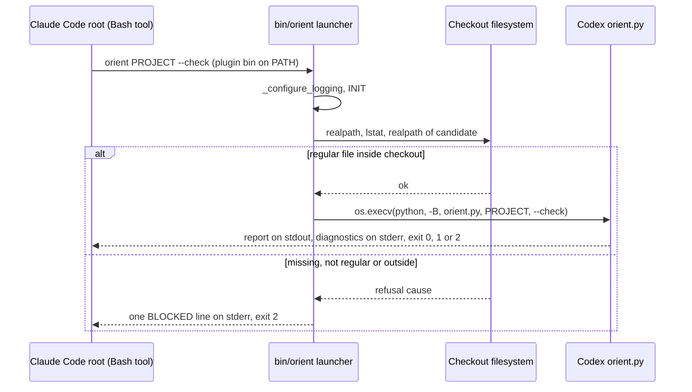
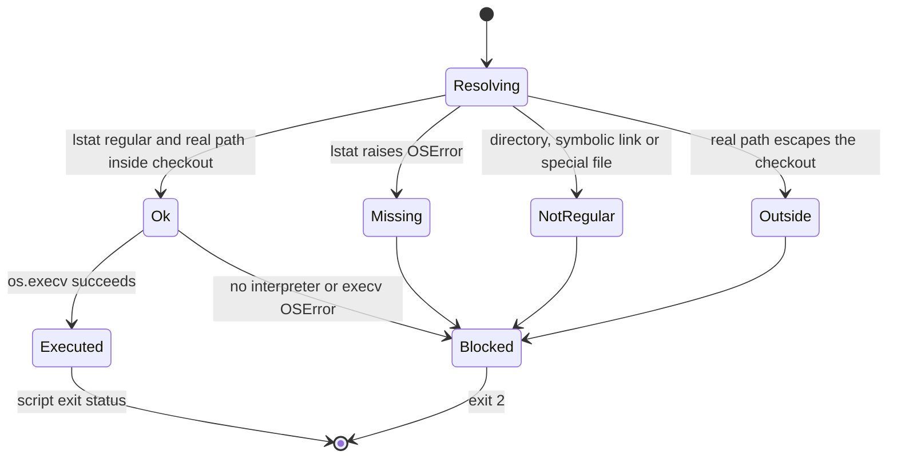

# M37-C2 — Claude consumer PM profile: technical delta plan

Public copy: owner-local worktree and live-probe paths are replaced by `<worktree>` and `<live-probe-root>`; no other byte differs. The run bound the original plan, SHA-256 `d793fd643fe3586c7a947752e6c652a08dcfbafd81e899a6b33f7f70e2464850`, which the owner keeps with the private run evidence.
$START_M37C2_PLAN
PURPOSE: Let Code implement, and independent QA, Review and Finalize verify, the owner-approved port of the C2 consumer PM profile to the Claude package by mechanism H, without the chat history.
SCOPE: Claude package source under `implementations/claude/`, its tests, one new root tripwire, literal version and membership sites in two existing root test modules, the root README version line and CHANGELOG. Codex and neutral owners stay byte-identical.
KEYWORDS: consumer PM profile, in-place reference, bin launchers, os.execv, BLOCKED exit 2, tripwire, membership 64, release 2.1.0, brownfield delta
METHODOLOGY_VERSION: 3.0.1 (neutral SPEC_VERSION of the loaded framework snapshot b8696a2 and of the target). Package identities: framework snapshot methodology-claude 2.0.1 (the methodology this run works under); target baseline methodology-claude 2.0.2 → planned 2.1.0. Wire `methodology-claude/1.0.0`, run-state schema 2, adapter `implementations/claude/adapter.json` (target SHA-256 `90a9b4ccf1e63a1890cb9be4a32c1fd9c61ab594ec265d6b633bb28280dc61ac`, unchanged by this plan).

Run `m37-c2-20261016`; inputIdentity `3fdb643951f7906f948d305847ad6f8bebce48ca0ebdc492984f83008d40321b`; candidateIdentity `571383dd10c254120f4156ffecc306757d4879817cd384228dd8d45347f267e0`; contract `methodology-claude/1.0.0`.

Paths. `T` = the target worktree `<worktree>` (branch `claude/m37-claude-parity`, baseline HEAD `ba44b19e416a4dec08d1b1b6f6e97e13e7ad681b`, tree `d3df07f30db6d1beaf919916add51bc5af1b787b`). `F` = the immutable framework snapshot the root supplied for this run (its absolute path is recorded in the run state and in the evidence home; it is an owner-local scratch path and is deliberately not written into this public plan). Dictated plan path (rule: explicit invocation override, PLAN-101): `examples/pm-project/plans/m37-claude-consumer-profile.md`. Evidence home of this Architect phase: `T/.methodology/evidence/m37-c2-20261016/02-architect/` (untracked, root-owned run evidence).

Authority. Approved specification [m37-claude-consumer-profile](../specs/m37-claude-consumer-profile.md), SHA-256 `d29c38867cb9d1df164a4bae318e3ee12019f3399498af5f5467be8748a429b5`, approved 2026-10-16 by the owner's chat reply «Да, утверждаем H.» to the structured question «Утверждаете спецификацию порта C2 с вариантом H?» (spec front matter). Decision packet [README](../notes/m37-decision-c2-port/README.md) (`156c5771ca3183b55a8f89ef92616d72d11fb7e29a44347e4c248a7385502469`) and [evaluation](../notes/m37-decision-c2-port/evaluation.md) (`4df13fbe59283f601a5236c86014a91fe2af82ddaf926a4930416f16e47c11ae`) are settled data; the architecture is not reopened. Context record [m37-claude-parity](../notes/m37-claude-parity.md) (`e22a6768188b924635aa38395c04b15cd42458a4b3dde971f5a71cf67727fbf7`). Bootstrap RECON: `T/.methodology/evidence/m37-c2-20261016/01-bootstrap/return-corrected.json` (`e865e33c6238ce8762724ea587cf9afd34b6cd659e7e1d17b93abb62cca78a43`), read-only searcher data; every load-bearing fact below was re-measured by this Architect. Integration (merge, push, release, installation) is not granted and stays the owner's separate decision.

Classification. BROWNFIELD: the package has 59 declared members with real source and tests (`implementations/claude/references/package-layout.json`), and the change preserves existing APIs, oracles and pins. projectType: methodology repository with native harness packages (Markdown owners, Python 3.9+ standard-library helpers and pytest tests). taskType: feature port. UI: false (CLI launchers and Markdown carriers only; no web or desktop surface). Autonomy: assigned autonomous Architect phase; routine design choices are collapsed here without a new owner gate (ARCH-302).

Code-surface rules of the target (ARCH-104), from `AGENTS.md`, the package README and existing sources: Python 3.9+ standard library only; pytest with each package's own `pytest.ini`; stdlib `logging` with the bracket encoding `[IMP:n][FUNC][BLOCK] message`; the full semantic-exoskeleton rich contract-authoring profile with paired regions and logical-step blocks (`START_BLOCK_Validation`, `START_BLOCK_BusinessLogic`, `START_BLOCK_ErrorHandling`) as in `implementations/claude/hooks/session_start.py` and `bin/conform`; every new test module carries the full module tag set; a Doxygen map is mandatory (no written prohibition exists); English artifacts; one writer per path. Privacy (root determination 6): this repository is published later, so no new tracked byte may contain an owner-local absolute home path, a user name or an e-mail address; tests use `tmp_path` and paths derived from `__file__`. No markup or logging field is waived: no target file prohibits them.

Constitution adoption (PRIN-101). Read in full with the Read tool from `F`; each body is byte-identical to its copy in `T`:

| Core subject | Path | SHA-256 | Condition |
|---|---|---|---|
| concepts.principles | `concepts/principles.md` | `444ed63a2d6ed31533d7588b804598ef37387bc478cffc1e56aaf7949a296737` | full read, adopted |
| roles.base | `roles/_base.md` | `7178c8d54fb2c545c6022c21191f98cf2cd69c5e433dffce3ada492b51045023` | full read, adopted |
| code.exoskeleton | `code/exoskeleton.md` | `6734869b2480330470e5d927c3aeeef54e881be758c82346f0b665478bdae999` | full read, adopted |
| code.ldd | `code/ldd.md` | `d7f209ba329161f73526413429b7b0f653c48101ce90fefe40964f7e69a33586` | full read, adopted |
| code.doxygen | `code/doxygen.md` | `73cfc67e3205ec3da995e2fdbe3d625875cc6c5bafbcb64ec3df9ab73cbb2af5` | full read, adopted |
| code.tests | `code/tests.md` | `9ab9e75cf1fb606573f1d78ceb0c7ce5ace849fe40f596e9c414b756a5fef2e1` | full read, adopted |

Additional owners read in full: `roles/architect.md` (`44763ab7…8d61`), `protocols/dev-plan.md` (`d8caea77…2d6`), `protocols/graph.md` (`bb33e1b4…c44a`), `protocols/spec-brownfield.md` (`c99ee616…5031`), `process/specification.md` (`ad8cf10c…0d2f`), `protocols/role-returns.md` (`eb2b74ee…b153b`), `code/navigation.md` (`c244a964…e008`), `prompting/brainstorm.md` (`c8e6543a…fa38`), the package `skills/devplan-protocol/SKILL.md`, `references/claude-runtime.md` and `references/handoffs.md` of `F` (2.0.1; the `T` copies differ only in the 2.0.2 version and install wording). Target inputs read in full: the specification, decision packet README and evaluation, context record, Bootstrap return, the Codex carrier `implementations/codex/references/consumer-pm-profile.md`, the eleven Claude skill entries in scope, `agents/searcher.md`, the package README, `references/source-disposition.md`, `tests/test_package_contract.py`, root `tests/test_claude_package.py`; read in the relevant ranges: `tests/test_c1_review_and_routing.py` (lines 1–60, 145–365, 400–458), `implementations/claude/tests/test_session_start.py` (version sites), `test_run_state.py` (lines 160–250, 500–580), `test_workflow.py` (copy and layout checks), `hooks/session_start.py` (lines 1–120), `run_state.py` (constants and `_bindings`), the Codex `test_consumer_pm.py` fixtures, root `tests/conftest.py` fixtures, both Doxyfiles, `bin/conform`, `tools/conformlib/scan.py` (file walk), the Codex `bbd2696` diffs of every routed skill and of `roles/searcher.md`.

$START_DOCUMENT_PLAN
$DOCUMENT_PLAN
SECTION_0 Rationale, evaluation axes and routine design decisions => M37C2_DESIGN
SECTION_1 Draft Code Graph, source registry, slices and patterns => M37C2_GRAPH
SECTION_2 Step-by-step Data Flow => M37C2_FLOW
SECTION_3 Visual Verification => M37C2_VISUAL
SECTION_4 Acceptance Criteria => M37C2_AC
SECTION_5 Delivery Contract and AC5 live probe => M37C2_DELIVERY
SECTION_6 Runtime Commands => M37C2_COMMANDS
SECTION_7 Verification commitments, scope, deficiencies and risks => M37C2_CONTROL
APPENDIX_A Exact texts, sites and test specifications for Code => M37C2_CODE_DETAIL
$END_DOCUMENT_PLAN
$START_CONTRACT
$CONTRACT
PURPOSE: Code can build the five new members and the coupled edits exactly once, and judges can measure AC1–AC7 against fixed expectations.
DESCRIPTION: A delta over baseline `ba44b19`: three launchers, one thin carrier, routing text, one package test module, one root tripwire, release 2.1.0 and membership 64, with Codex, neutral owners and protected Claude members unchanged.
RATIONALE: Decision H keeps one copy of the C2 code; the plan fixes the remaining routine mechanics so that implementation does not reopen the architecture or drift into protected files.
ACCEPTANCE_CRITERIA: AC1–AC7 of the approved specification, verbatim in section 4, each with its threshold, measurement and evidence owner.
$END_CONTRACT
$START_BODY

$START_SECTION_0
## 0 Rationale, evaluation axes and routine design decisions

Purpose: record why each remaining mechanic is chosen. Rationale: the architecture (H) is settled by the owner's approval; what remains are local, reversible implementation choices inside the approved scope. Verification: every choice below reappears as a literal test commitment in section 7.1.

**Consequential-open classification (BRAIN-104/105).** The consequential choice — how the Claude package gains the profile — was taken through the independent packet (two fresh generators, persisted HOLD, distinct evaluator) and collapsed by the owner's approval of this specification; it is settled and not reopened. The choices below are routine: each is local to new files, reversible by one commit, changes no external contract beyond what the specification fixes (BR-4 already fixes the launcher contract), no persistent data, no trust boundary and no dependency. They are therefore excluded from mandatory independent exploration (BRAIN-105, reason: routine local choice within an approved scope), and collapsed here on the axes below without a new gate. No brainstorm packet is requested.

**Evaluation axes (ARCH-305).** E1 exact passthrough of arguments, exit status and streams (source: BR-4, AC2). E2 Python 3.9 and 3.12 behavior (source: BR-6). E3 verifiability by owned process-boundary tests and Doxygen coverage (source: AC2, AC6). E4 zero-context maintainability and drift resistance (source: decision packet criterion C1 single source; evaluation fact 5 on the drifted copied helper). E5 safety of an interrupted writing command such as `markup-migrate --apply` (domain-derived from the Codex carrier's apply contract: per-file atomic replacement, recovery receipts, "investigate before replay"). Axes guide design only; they add no acceptance criterion.

**D1 — how a launcher hands over to the Codex script.**

Scores are reasoned 1–10 estimates, not measurements (uncertainty about ±1): realism and impact higher is better; risk and debt higher is worse; cost higher is cheaper.

| Alternative | Mechanism | Realism | Impact | Risk | Cost | Debt | Basis and uncertainty |
|---|---|---|---|---|---|---|---|
| A. `os.execv(sys.executable, [sys.executable, "-B", sibling, *argv])` after validation | The launcher process becomes the script; stdin, stdout, stderr, terminal, signals and exit status are the script's own | 9 | 9 | 2 | 9 | 2 | Measured: prototype equality of exit/stdout/stderr on Python 3.9.6 and 3.12.13 for orient, codemap and markup-migrate (evidence `design-verification.log`). Limit: POSIX semantics; Windows is outside this in-place macOS/Linux package |
| B. `subprocess.run([...])` without capture, return `returncode` | A child process; parent waits | 8 | 7 | 6 | 7 | 4 | CPython `subprocess.run` kills the child on KeyboardInterrupt (3.9 stdlib `subprocess.py:522-523`, evidence `design-verification.log`): Ctrl-C during `--apply` would SIGKILL the writer after a short grace; a signal death returns a negative code that is not an exit status; one extra process |
| C. In-process `runpy.run_path` with `sys.argv` swap and `sys.dont_write_bytecode` | The script runs inside the launcher interpreter | 4 | 5 | 8 | 6 | 7 | `sys.path[0]` would be `bin/`, so the scripts' sibling `import consumer_files` fails unless the launcher edits `sys.path` (an extra, unapproved change of the import environment); `__main__` and traceback paths differ from a direct call |

Selected A: it maximizes E1 and E5 at the lowest cost; B is rejected for the interrupt and signal-status differences, C for the import-environment change. Reopen if a supported platform without POSIX `execv` semantics is added.

**D2 — file form of the three launchers.** Selected: three self-contained regular files that differ only in two constants (`COMMAND`, `SCRIPT`) and their contract prose, guarded by an AST-equivalence test (E4). Rejected: one shared importable module plus thin wrappers (a 65th member, outside the approved 64-member list); one file plus symbolic links or `argv[0]` dispatch (the specification requires three regular files, and both package oracles refuse symbolic members).

**D3 — sibling validation.** Selected: `os.lstat` must report a regular file (a symbolic link is refused) and `os.path.realpath` of the candidate must lie inside `realpath(<package>/../..)` (E1, BR-4 "not a regular file inside the checkout"). Rejected: `os.path.exists` only (accepts directories and links); checking the sibling in the SessionStart hook (its whole AST is pinned by root `test_session_start_source_bridge_preserves_ast` and BR-3).

**D4 — launcher trace channel.** Selected: an opt-in `METHODOLOGY_LAUNCHER_LOG` level variable that attaches a stderr handler; unset, the launcher prints nothing except a BLOCKED line (E1 stream equality). Rejected: reusing `ORIENT_LOG`/`CODEMAP_LOG`/`MARKUP_MIGRATE_LOG` (those are the Codex scripts' own bindings, LDD-901; mixing launcher lines into them would change the script's stderr); an always-on trace (breaks equality with a direct call).

**D5 — tripwire form.** Selected: a literal `PINS` table of 18 repository-relative paths to `(sha256, reason)` plus a population check of the templates directory, computed from the baseline blobs of `ba44b19` (section A.4). Rejected: a `git diff` against a commit (QA runs on Git-free copies); one hash over the whole tree (cannot name the changed path, which AC3 requires).

**D6 — where the routing assertions live.** `test_package_contract.py` may change only version and membership facts (MAY EDIT note), so the AC4 routing assertions live in the new package module `tests/test_consumer_profile.py`; reference resolution of every `${CLAUDE_PLUGIN_ROOT}` path, including `../codex/` paths, stays with the unchanged `test_package_contract.py::test_skill_entries` and `::test_agent_carriers` and is repeated over the carrier and the searcher in the new module (SPEC_DEFICIENCY M37C2-D5).

**D7 — searcher and codemap.** The searcher keeps exactly Read, Glob and Grep (root determination 1): it navigates an adopted project through its current Doxygen XML map directly (`code/navigation.md`) or consumes a codemap answer the root supplies, and never runs a launcher (SPEC_DEFICIENCY M37C2-D1).

**D8 — Doxygen coverage of extensionless launchers.** Selected: add `bin` to the package Doxyfile `INPUT` and the exact names `orient codemap markup-migrate` to `FILE_PATTERNS`, keeping `EXTENSION_MAPPING = no_extension=Python` (precedent: root Doxyfile `FILE_PATTERNS = *.py conform`). Verified with doxygen 1.17.0 on a scratch copy: exit 0, silent, namespaces `orient`, `codemap`, `markup-migrate` with function locations in `bin/<name>` (evidence `design-verification.log`).

Layer Isolation, Plugin API plus Direct Integration, Backend Tests plus LDD and Headless UI Testing are applied in section 1.
$END_SECTION_0

$START_SECTION_1
## 1 Draft Code Graph

Purpose: define every new or modified entity exactly once, with its BR coverage, and reference unchanged dependencies through the source registry. Rationale: a brownfield delta must name only what changes and prove what it relies on (ARCH-205, GRAPH-302/303). Verification: XML parse, unique identities, ordered fields, resolved local links and declared external references were checked by script (88 definitions, 0 duplicates, 0 dangling links, 0 undeclared external targets, 0 missing `satisfies`, field order correct); the finite visual gate and manual review of the 27 non-Python definitions are in section 3.

```xml
<DraftCodeGraph>
  <M37C2_Claude_Consumer_Profile_Info TYPE="PROJECT_INFO">
    <keywords>Consumer PM profile:9|In-place reference:9|Launcher:8|Tripwire:8|Release 2.1.0:7</keywords>
    <terms>methodology-consumer-pm/1.0.0|methodology-claude 2.1.0|Codex C2 helpers|sibling package|BLOCKED exit 2</terms>
    <annotation>Brownfield delta for decision H (owner-approved specification m37-claude-consumer-profile.md, 2026-10-16): the Claude package references the accepted Codex C2 helpers and seeds in place through a thin carrier, routing and three bin launchers, guarded by a root tripwire. Planned definitions below are design choices; ExistingNodeRef entries cite the source registry of section 1.</annotation>
    <BusinessScenarios>
      <Scenario NAME="OrientAdoptedProject">Claude Code root -&gt; runs orient PROJECT --check through the plugin bin launcher -&gt; receives the Codex orient report and exit status unchanged</Scenario>
      <Scenario NAME="AdoptThroughPmBootstrap">Owner -&gt; grants profile adoption to pm-bootstrap -&gt; only granted seeds from the Codex templates are materialized and the check rows are reported</Scenario>
      <Scenario NAME="MissingSibling">Root on a checkout without the Codex package -&gt; runs a launcher -&gt; one methodology-claude BLOCKED line and exit 2, nothing else runs</Scenario>
      <Scenario NAME="CodexDrift">Maintainer -&gt; changes a pinned Codex file -&gt; the root tripwire fails naming the path until re-pinned with a reason</Scenario>
    </BusinessScenarios>
  </M37C2_Claude_Consumer_Profile_Info>
  <ExistingNodeRef NAME="orient.main" SOURCE="MAP_CODEX"/>
  <ExistingNodeRef NAME="codemap.main" SOURCE="MAP_CODEX"/>
  <ExistingNodeRef NAME="markup_migrate.main" SOURCE="MAP_CODEX"/>
  <ExistingNodeRef NAME="codemap.source_population" SOURCE="MAP_CODEX"/>
  <ExistingNodeRef NAME="consumer_files.identity" SOURCE="MAP_CODEX"/>
  <ExistingNodeRef NAME="run_state._bindings" SOURCE="MAP_CLAUDE"/>
  <ExistingNodeRef NAME="test_package_contract._unresolved_references" SOURCE="MAP_CLAUDE"/>
  <ExistingNodeRef NAME="conftest.repo_root" SOURCE="MAP_ROOT"/>
  <ExistingNodeRef NAME="implementations/codex/references/consumer-pm-profile.md" SOURCE="BASELINE_GIT"/>
  <ExistingNodeRef NAME="implementations/codex/skills/pm/templates/Doxyfile" SOURCE="BASELINE_GIT"/>
  <ExistingNodeRef NAME="implementations/claude/hooks/hooks.json" SOURCE="BASELINE_GIT"/>
  <ExistingNodeRef NAME="implementations/claude/hooks/guard_destructive.py" SOURCE="BASELINE_GIT"/>
  <ExistingNodeRef NAME="implementations/claude/workflows/feature-dev.js" SOURCE="BASELINE_GIT"/>
  <ExistingNodeRef NAME="implementations/claude/adapter.json" SOURCE="BASELINE_GIT"/>
  <ExistingNodeRef NAME="code/navigation.md" SOURCE="BASELINE_GIT"/>
  <claude_bin_orient FILE="implementations/claude/bin/orient" TYPE="LAUNCHER_MODULE" satisfies="BR-1 BR-4 BR-5 BR-6">
    <keywords>Launcher:9|In-place reference:9|BLOCKED:8|Python 3.9:7</keywords>
    <terms>realpath|sibling script|os.execv|-B</terms>
    <annotation>New extensionless regular file, mode 0755, shebang #!/usr/bin/env python3, standard library only, Python 3.9 syntax. Constants COMMAND='orient' and SCRIPT='orient.py' are the only executable difference from the two sibling launchers. Runs &lt;current interpreter&gt; -B &lt;real package&gt;/../codex/skills/pm/scripts/orient.py with argv unchanged; writes nothing to stdout itself.</annotation>
    <launcher_orient_resolve_sibling_FUNC NAME="resolve_sibling" TYPE="VALIDATION" satisfies="BR-4 BR-6">
      <keywords>Sibling resolution:9|Containment:8</keywords>
      <terms>lstat regular file|realpath inside checkout</terms>
      <annotation>Returns (sibling or None, candidate, cause) with cause in ok, missing, not-regular, outside; candidate = normpath(&lt;real package&gt;/../codex/skills/pm/scripts/orient.py); checkout = realpath(&lt;real package&gt;/../..). Emits IMP:7 RESOLVE, then IMP:9 VALIDATION_SUCCESS or IMP:10 VALIDATION_FAILURE.</annotation>
    </launcher_orient_resolve_sibling_FUNC>
    <launcher_orient_configure_logging_FUNC NAME="_configure_logging" TYPE="OBSERVABILITY" satisfies="BR-4">
      <keywords>Opt-in trace:6</keywords>
      <terms>METHODOLOGY_LAUNCHER_LOG|stderr</terms>
      <annotation>Attaches a stderr StreamHandler with format %(message)s only when METHODOLOGY_LAUNCHER_LOG names a level (DEBUG, INFO, WARNING, ERROR, CRITICAL); otherwise the NullHandler keeps the launcher silent.</annotation>
    </launcher_orient_configure_logging_FUNC>
    <launcher_orient_main_FUNC NAME="main" TYPE="PROCESS_HANDOFF" satisfies="BR-1 BR-4 BR-6">
      <keywords>Process handoff:9|Exit status:9</keywords>
      <terms>os.execv|BLOCKED exit 2</terms>
      <annotation>IMP:4 INIT, resolve, then IMP:8 EXEC and os.execv(sys.executable, [sys.executable, '-B', sibling] + argv). A refusal writes exactly one 'methodology-claude BLOCKED: ...' line to stderr and returns 2; an empty sys.executable or an OSError from execv is BLOCKED with exit 2 as well.</annotation>
      <CrossLinks>
        <Link TARGET="launcher_orient_configure_logging_FUNC" TYPE="CALLS_FUNCTION"/>
        <Link TARGET="launcher_orient_resolve_sibling_FUNC" TYPE="CALLS_FUNCTION"/>
        <ExternalLink TARGET="orient.main" SOURCE="MAP_CODEX" TYPE="EXECS_PROCESS"/>
      </CrossLinks>
    </launcher_orient_main_FUNC>
  </claude_bin_orient>
  <claude_bin_codemap FILE="implementations/claude/bin/codemap" TYPE="LAUNCHER_MODULE" satisfies="BR-1 BR-4 BR-5 BR-6">
    <keywords>Launcher:9|In-place reference:9|BLOCKED:8|Python 3.9:7</keywords>
    <terms>realpath|sibling script|os.execv|-B</terms>
    <annotation>New extensionless regular file, mode 0755, shebang #!/usr/bin/env python3, standard library only, Python 3.9 syntax. Constants COMMAND='codemap' and SCRIPT='codemap.py' are the only executable difference from the two sibling launchers. Runs &lt;current interpreter&gt; -B &lt;real package&gt;/../codex/skills/pm/scripts/codemap.py with argv unchanged; writes nothing to stdout itself.</annotation>
    <launcher_codemap_resolve_sibling_FUNC NAME="resolve_sibling" TYPE="VALIDATION" satisfies="BR-4 BR-6">
      <keywords>Sibling resolution:9|Containment:8</keywords>
      <terms>lstat regular file|realpath inside checkout</terms>
      <annotation>Returns (sibling or None, candidate, cause) with cause in ok, missing, not-regular, outside; candidate = normpath(&lt;real package&gt;/../codex/skills/pm/scripts/codemap.py); checkout = realpath(&lt;real package&gt;/../..). Emits IMP:7 RESOLVE, then IMP:9 VALIDATION_SUCCESS or IMP:10 VALIDATION_FAILURE.</annotation>
    </launcher_codemap_resolve_sibling_FUNC>
    <launcher_codemap_configure_logging_FUNC NAME="_configure_logging" TYPE="OBSERVABILITY" satisfies="BR-4">
      <keywords>Opt-in trace:6</keywords>
      <terms>METHODOLOGY_LAUNCHER_LOG|stderr</terms>
      <annotation>Attaches a stderr StreamHandler with format %(message)s only when METHODOLOGY_LAUNCHER_LOG names a level (DEBUG, INFO, WARNING, ERROR, CRITICAL); otherwise the NullHandler keeps the launcher silent.</annotation>
    </launcher_codemap_configure_logging_FUNC>
    <launcher_codemap_main_FUNC NAME="main" TYPE="PROCESS_HANDOFF" satisfies="BR-1 BR-4 BR-6">
      <keywords>Process handoff:9|Exit status:9</keywords>
      <terms>os.execv|BLOCKED exit 2</terms>
      <annotation>IMP:4 INIT, resolve, then IMP:8 EXEC and os.execv(sys.executable, [sys.executable, '-B', sibling] + argv). A refusal writes exactly one 'methodology-claude BLOCKED: ...' line to stderr and returns 2; an empty sys.executable or an OSError from execv is BLOCKED with exit 2 as well.</annotation>
      <CrossLinks>
        <Link TARGET="launcher_codemap_configure_logging_FUNC" TYPE="CALLS_FUNCTION"/>
        <Link TARGET="launcher_codemap_resolve_sibling_FUNC" TYPE="CALLS_FUNCTION"/>
        <ExternalLink TARGET="codemap.main" SOURCE="MAP_CODEX" TYPE="EXECS_PROCESS"/>
      </CrossLinks>
    </launcher_codemap_main_FUNC>
  </claude_bin_codemap>
  <claude_bin_markup_migrate FILE="implementations/claude/bin/markup-migrate" TYPE="LAUNCHER_MODULE" satisfies="BR-1 BR-4 BR-5 BR-6">
    <keywords>Launcher:9|In-place reference:9|BLOCKED:8|Python 3.9:7</keywords>
    <terms>realpath|sibling script|os.execv|-B</terms>
    <annotation>New extensionless regular file, mode 0755, shebang #!/usr/bin/env python3, standard library only, Python 3.9 syntax. Constants COMMAND='markup-migrate' and SCRIPT='markup_migrate.py' are the only executable difference from the two sibling launchers. Runs &lt;current interpreter&gt; -B &lt;real package&gt;/../codex/skills/pm/scripts/markup_migrate.py with argv unchanged; writes nothing to stdout itself.</annotation>
    <launcher_markup_migrate_resolve_sibling_FUNC NAME="resolve_sibling" TYPE="VALIDATION" satisfies="BR-4 BR-6">
      <keywords>Sibling resolution:9|Containment:8</keywords>
      <terms>lstat regular file|realpath inside checkout</terms>
      <annotation>Returns (sibling or None, candidate, cause) with cause in ok, missing, not-regular, outside; candidate = normpath(&lt;real package&gt;/../codex/skills/pm/scripts/markup_migrate.py); checkout = realpath(&lt;real package&gt;/../..). Emits IMP:7 RESOLVE, then IMP:9 VALIDATION_SUCCESS or IMP:10 VALIDATION_FAILURE.</annotation>
    </launcher_markup_migrate_resolve_sibling_FUNC>
    <launcher_markup_migrate_configure_logging_FUNC NAME="_configure_logging" TYPE="OBSERVABILITY" satisfies="BR-4">
      <keywords>Opt-in trace:6</keywords>
      <terms>METHODOLOGY_LAUNCHER_LOG|stderr</terms>
      <annotation>Attaches a stderr StreamHandler with format %(message)s only when METHODOLOGY_LAUNCHER_LOG names a level (DEBUG, INFO, WARNING, ERROR, CRITICAL); otherwise the NullHandler keeps the launcher silent.</annotation>
    </launcher_markup_migrate_configure_logging_FUNC>
    <launcher_markup_migrate_main_FUNC NAME="main" TYPE="PROCESS_HANDOFF" satisfies="BR-1 BR-4 BR-6">
      <keywords>Process handoff:9|Exit status:9</keywords>
      <terms>os.execv|BLOCKED exit 2</terms>
      <annotation>IMP:4 INIT, resolve, then IMP:8 EXEC and os.execv(sys.executable, [sys.executable, '-B', sibling] + argv). A refusal writes exactly one 'methodology-claude BLOCKED: ...' line to stderr and returns 2; an empty sys.executable or an OSError from execv is BLOCKED with exit 2 as well.</annotation>
      <CrossLinks>
        <Link TARGET="launcher_markup_migrate_configure_logging_FUNC" TYPE="CALLS_FUNCTION"/>
        <Link TARGET="launcher_markup_migrate_resolve_sibling_FUNC" TYPE="CALLS_FUNCTION"/>
        <ExternalLink TARGET="markup_migrate.main" SOURCE="MAP_CODEX" TYPE="EXECS_PROCESS"/>
      </CrossLinks>
    </launcher_markup_migrate_main_FUNC>
  </claude_bin_markup_migrate>
  <test_consumer_profile_py FILE="implementations/claude/tests/test_consumer_profile.py" TYPE="NEW_TEST_MODULE" satisfies="BR-1 BR-2 BR-3 BR-4 BR-5 BR-6">
    <keywords>Process boundary:9|Equality oracle:9|Routing:8</keywords>
    <terms>launcher|direct call|owned copy|carrier</terms>
    <annotation>New package test module with the full module tag set; Python 3.9 compatible; runs under /usr/bin/python3 3.9.6 and /opt/homebrew/bin/python3.12; owned tmp_path resources only; doxygen required (no skip).</annotation>
    <cp_show_FUNC NAME="_show" TYPE="TEST_HELPER" satisfies="BR-4">
      <keywords>Test helper:6</keywords>
      <terms>_show</terms>
      <annotation>Print owned IMP:7-10 records before assertions (TST-301).</annotation>
    </cp_show_FUNC>
    <cp_clean_env_FUNC NAME="_clean_env" TYPE="TEST_HELPER" satisfies="BR-4">
      <keywords>Test helper:6</keywords>
      <terms>_clean_env</terms>
      <annotation>Copy os.environ without PYTHONPATH, PYTHONHOME, METHODOLOGY_LAUNCHER_LOG, ORIENT_LOG, CODEMAP_LOG and MARKUP_MIGRATE_LOG, then apply explicit extras.</annotation>
    </cp_clean_env_FUNC>
    <cp_run_FUNC NAME="_run" TYPE="TEST_HELPER" satisfies="BR-4">
      <keywords>Test helper:6</keywords>
      <terms>_run</terms>
      <annotation>subprocess.run with captured text streams; print argv, exit, stdout and stderr; IMP:8 PROCESS record.</annotation>
    </cp_run_FUNC>
    <cp_pair_FUNC NAME="_pair" TYPE="TEST_HELPER" satisfies="BR-4">
      <keywords>Test helper:6</keywords>
      <terms>_pair</terms>
      <annotation>Run [interpreter, PACKAGE/bin/&lt;name&gt;, *args] and [interpreter, '-B', SCRIPTS/&lt;script&gt;, *args] with the same cwd and env; return both CompletedProcess objects.</annotation>
    </cp_pair_FUNC>
    <cp_record_FUNC NAME="_record" TYPE="TEST_HELPER" satisfies="BR-4">
      <keywords>Test helper:6</keywords>
      <terms>_record</terms>
      <annotation>Write one synthetic front-matter record (generated.by claude:test, generated.at 2020-01-01T00:00:00Z).</annotation>
    </cp_record_FUNC>
    <cp_adopted_fixture_FUNC NAME="_adopted_fixture" TYPE="TEST_HELPER" satisfies="BR-4">
      <keywords>Test helper:6</keywords>
      <terms>_adopted_fixture</terms>
      <annotation>Create the adopted single-layer methodology-consumer-pm/1.0.0 fixture (AGENTS, CONVENTIONS, VISION, ROADMAP, HANDOFF, TASKS, Doxyfile, src/).</annotation>
    </cp_adopted_fixture_FUNC>
    <cp_source_fixture_FUNC NAME="_source_fixture" TYPE="TEST_HELPER" satisfies="BR-4">
      <keywords>Test helper:6</keywords>
      <terms>_source_fixture</terms>
      <annotation>Adopted fixture plus src/records.py in current or legacy markup and the Codex Doxyfile template bound to INPUT src and OUTPUT_DIRECTORY map.</annotation>
    </cp_source_fixture_FUNC>
    <cp_build_map_FUNC NAME="_build_map" TYPE="TEST_HELPER" satisfies="BR-4">
      <keywords>Test helper:6</keywords>
      <terms>_build_map</terms>
      <annotation>Run doxygen Doxyfile in the fixture (exit 0, empty streams) and write the .methodology/maps receipt with the read-only Codex helpers codemap.source_population and consumer_files.identity.</annotation>
      <CrossLinks>
        <ExternalLink TARGET="codemap.source_population" SOURCE="MAP_CODEX" TYPE="CALLS_FUNCTION"/>
        <ExternalLink TARGET="consumer_files.identity" SOURCE="MAP_CODEX" TYPE="CALLS_FUNCTION"/>
      </CrossLinks>
    </cp_build_map_FUNC>
    <cp_owned_checkout_FUNC NAME="_owned_checkout" TYPE="TEST_HELPER" satisfies="BR-4">
      <keywords>Test helper:6</keywords>
      <terms>_owned_checkout</terms>
      <annotation>Copy the three launchers (bytes and mode) and the four Codex scripts into tmp_path/checkout/implementations/{claude/bin,codex/skills/pm/scripts}.</annotation>
    </cp_owned_checkout_FUNC>
    <cp_load_launcher_FUNC NAME="_load_launcher" TYPE="TEST_HELPER" satisfies="BR-4">
      <keywords>Test helper:6</keywords>
      <terms>_load_launcher</terms>
      <annotation>Import an owned launcher copy through importlib.machinery.SourceFileLoader without sys.path changes or a sys.modules entry.</annotation>
    </cp_load_launcher_FUNC>
    <cp_references_FUNC NAME="_references" TYPE="TEST_HELPER" satisfies="BR-4">
      <keywords>Test helper:6</keywords>
      <terms>_references</terms>
      <annotation>Return (count, unresolved) for every ${CLAUDE_PLUGIN_ROOT}/... reference and every relative Markdown link of a text.</annotation>
    </cp_references_FUNC>
    <test_launchers_are_regular_executable_and_equivalent_FUNC NAME="test_launchers_are_regular_executable_and_equivalent" TYPE="BEHAVIOR_TEST" satisfies="BR-4 BR-6">
      <keywords>Acceptance test:9</keywords>
      <terms>test launchers are regular executable and equivalent</terms>
      <annotation>Regular non-symlink files, owner-executable, shebang, ast.parse(feature_version=(3, 9)), equal AST after normalizing COMMAND/SCRIPT, SCRIPT values orient.py/codemap.py/markup_migrate.py.</annotation>
      <CrossLinks>
        <Link TARGET="cp_show_FUNC" TYPE="CALLS_FUNCTION"/>
      </CrossLinks>
    </test_launchers_are_regular_executable_and_equivalent_FUNC>
    <test_resolve_sibling_refuses_unusable_siblings_FUNC NAME="test_resolve_sibling_refuses_unusable_siblings" TYPE="BEHAVIOR_TEST" satisfies="BR-4">
      <keywords>Acceptance test:9</keywords>
      <terms>test resolve sibling refuses unusable siblings</terms>
      <annotation>Direct import of owned copies: ok, missing, directory, symbolic link and escaping parent give causes ok, missing, not-regular, not-regular, outside with exactly one owned IMP:10 record per refusal.</annotation>
      <CrossLinks>
        <Link TARGET="cp_owned_checkout_FUNC" TYPE="CALLS_FUNCTION"/>
        <Link TARGET="cp_load_launcher_FUNC" TYPE="CALLS_FUNCTION"/>
        <Link TARGET="cp_show_FUNC" TYPE="CALLS_FUNCTION"/>
        <Link TARGET="launcher_orient_resolve_sibling_FUNC" TYPE="INVOKES"/>
        <Link TARGET="launcher_codemap_resolve_sibling_FUNC" TYPE="INVOKES"/>
        <Link TARGET="launcher_markup_migrate_resolve_sibling_FUNC" TYPE="INVOKES"/>
      </CrossLinks>
    </test_resolve_sibling_refuses_unusable_siblings_FUNC>
    <test_main_reports_blocked_without_running_FUNC NAME="test_main_reports_blocked_without_running" TYPE="BEHAVIOR_TEST" satisfies="BR-4">
      <keywords>Acceptance test:9</keywords>
      <terms>test main reports blocked without running</terms>
      <annotation>In-process main() only on refusal paths: missing sibling, empty sys.executable and an absent interpreter path return 2 with the exact single BLOCKED line on stderr and empty stdout.</annotation>
      <CrossLinks>
        <Link TARGET="cp_owned_checkout_FUNC" TYPE="CALLS_FUNCTION"/>
        <Link TARGET="cp_load_launcher_FUNC" TYPE="CALLS_FUNCTION"/>
        <Link TARGET="cp_show_FUNC" TYPE="CALLS_FUNCTION"/>
        <Link TARGET="launcher_orient_main_FUNC" TYPE="INVOKES_PROCESS"/>
      </CrossLinks>
    </test_main_reports_blocked_without_running_FUNC>
    <test_orient_launcher_equals_direct_call_FUNC NAME="test_orient_launcher_equals_direct_call" TYPE="BEHAVIOR_TEST" satisfies="BR-1 BR-4 BR-5">
      <keywords>Acceptance test:9</keywords>
      <terms>test orient launcher equals direct call</terms>
      <annotation>orient PROJECT, orient PROJECT --check (clean exit 0, CHECK-22 PASS), defective ROADMAP marker exit 1 with CHECK-02 FAIL, --portfolio ROOT ROOT --check exit 0 with two profile lines; launcher equals direct call; fixture bytes unchanged.</annotation>
      <CrossLinks>
        <Link TARGET="cp_adopted_fixture_FUNC" TYPE="CALLS_FUNCTION"/>
        <Link TARGET="cp_pair_FUNC" TYPE="CALLS_FUNCTION"/>
        <Link TARGET="cp_show_FUNC" TYPE="CALLS_FUNCTION"/>
        <Link TARGET="launcher_orient_main_FUNC" TYPE="INVOKES_PROCESS"/>
      </CrossLinks>
    </test_orient_launcher_equals_direct_call_FUNC>
    <test_codemap_launcher_equals_direct_call_on_built_map_FUNC NAME="test_codemap_launcher_equals_direct_call_on_built_map" TYPE="BEHAVIOR_TEST" satisfies="BR-1 BR-4">
      <keywords>Acceptance test:9</keywords>
      <terms>test codemap launcher equals direct call on built map</terms>
      <annotation>Built fixture map with receipt: symbol answer exit 0 with 'source: Doxygen:', file answer exit 0, unknown symbol exit 1 'codemap: not found'; launcher equals direct call.</annotation>
      <CrossLinks>
        <Link TARGET="cp_source_fixture_FUNC" TYPE="CALLS_FUNCTION"/>
        <Link TARGET="cp_build_map_FUNC" TYPE="CALLS_FUNCTION"/>
        <Link TARGET="cp_pair_FUNC" TYPE="CALLS_FUNCTION"/>
        <Link TARGET="cp_show_FUNC" TYPE="CALLS_FUNCTION"/>
        <Link TARGET="launcher_codemap_main_FUNC" TYPE="INVOKES_PROCESS"/>
      </CrossLinks>
    </test_codemap_launcher_equals_direct_call_on_built_map_FUNC>
    <test_markup_migrate_check_equals_direct_call_FUNC NAME="test_markup_migrate_check_equals_direct_call" TYPE="BEHAVIOR_TEST" satisfies="BR-1 BR-4 BR-5">
      <keywords>Acceptance test:9</keywords>
      <terms>test markup migrate check equals direct call</terms>
      <annotation>--check on current markup exit 0 'markup-migrate: up to date'; on legacy markup exit 1 'migration due'; launcher equals direct call; sources unchanged.</annotation>
      <CrossLinks>
        <Link TARGET="cp_source_fixture_FUNC" TYPE="CALLS_FUNCTION"/>
        <Link TARGET="cp_pair_FUNC" TYPE="CALLS_FUNCTION"/>
        <Link TARGET="cp_show_FUNC" TYPE="CALLS_FUNCTION"/>
        <Link TARGET="launcher_markup_migrate_main_FUNC" TYPE="INVOKES_PROCESS"/>
      </CrossLinks>
    </test_markup_migrate_check_equals_direct_call_FUNC>
    <test_arguments_and_exit_status_pass_through_FUNC NAME="test_arguments_and_exit_status_pass_through" TYPE="BEHAVIOR_TEST" satisfies="BR-4">
      <keywords>Acceptance test:9</keywords>
      <terms>test arguments and exit status pass through</terms>
      <annotation>No-argument orient exit 2 from inside an adopted fixture (no cwd default), --help exit 0, an argument with a space and a non-ASCII letter reaches the script; every pair equal for all three launchers.</annotation>
      <CrossLinks>
        <Link TARGET="cp_adopted_fixture_FUNC" TYPE="CALLS_FUNCTION"/>
        <Link TARGET="cp_pair_FUNC" TYPE="CALLS_FUNCTION"/>
        <Link TARGET="cp_show_FUNC" TYPE="CALLS_FUNCTION"/>
        <Link TARGET="launcher_orient_main_FUNC" TYPE="INVOKES_PROCESS"/>
        <Link TARGET="launcher_codemap_main_FUNC" TYPE="INVOKES_PROCESS"/>
        <Link TARGET="launcher_markup_migrate_main_FUNC" TYPE="INVOKES_PROCESS"/>
      </CrossLinks>
    </test_arguments_and_exit_status_pass_through_FUNC>
    <test_missing_sibling_blocks_without_fallback_FUNC NAME="test_missing_sibling_blocks_without_fallback" TYPE="BEHAVIOR_TEST" satisfies="BR-4 BR-5">
      <keywords>Acceptance test:9</keywords>
      <terms>test missing sibling blocks without fallback</terms>
      <annotation>Owned checkout per launcher: missing, directory and outside-link siblings give exit 2, empty stdout and exactly one BLOCKED line naming the candidate; decoy scripts in cwd, PYTHONPATH and PATH never write their markers.</annotation>
      <CrossLinks>
        <Link TARGET="cp_owned_checkout_FUNC" TYPE="CALLS_FUNCTION"/>
        <Link TARGET="cp_clean_env_FUNC" TYPE="CALLS_FUNCTION"/>
        <Link TARGET="cp_run_FUNC" TYPE="CALLS_FUNCTION"/>
        <Link TARGET="cp_show_FUNC" TYPE="CALLS_FUNCTION"/>
        <Link TARGET="launcher_orient_main_FUNC" TYPE="INVOKES_PROCESS"/>
        <Link TARGET="launcher_codemap_main_FUNC" TYPE="INVOKES_PROCESS"/>
        <Link TARGET="launcher_markup_migrate_main_FUNC" TYPE="INVOKES_PROCESS"/>
      </CrossLinks>
    </test_missing_sibling_blocks_without_fallback_FUNC>
    <test_symlinked_launcher_resolves_real_package_FUNC NAME="test_symlinked_launcher_resolves_real_package" TYPE="BEHAVIOR_TEST" satisfies="BR-4">
      <keywords>Acceptance test:9</keywords>
      <terms>test symlinked launcher resolves real package</terms>
      <annotation>A symbolic link to the real launcher equals the direct call; a link to an owned launcher with a missing sibling names the real owned candidate path.</annotation>
      <CrossLinks>
        <Link TARGET="cp_adopted_fixture_FUNC" TYPE="CALLS_FUNCTION"/>
        <Link TARGET="cp_owned_checkout_FUNC" TYPE="CALLS_FUNCTION"/>
        <Link TARGET="cp_run_FUNC" TYPE="CALLS_FUNCTION"/>
        <Link TARGET="cp_pair_FUNC" TYPE="CALLS_FUNCTION"/>
        <Link TARGET="cp_show_FUNC" TYPE="CALLS_FUNCTION"/>
        <Link TARGET="launcher_orient_main_FUNC" TYPE="INVOKES_PROCESS"/>
      </CrossLinks>
    </test_symlinked_launcher_resolves_real_package_FUNC>
    <test_shebang_invocation_equals_direct_call_FUNC NAME="test_shebang_invocation_equals_direct_call" TYPE="BEHAVIOR_TEST" satisfies="BR-4 BR-6">
      <keywords>Acceptance test:9</keywords>
      <terms>test shebang invocation equals direct call</terms>
      <annotation>Executing the launcher file itself (shebang) equals [which('python3'), '-B', script, ...] for orient --check.</annotation>
      <CrossLinks>
        <Link TARGET="cp_adopted_fixture_FUNC" TYPE="CALLS_FUNCTION"/>
        <Link TARGET="cp_clean_env_FUNC" TYPE="CALLS_FUNCTION"/>
        <Link TARGET="cp_run_FUNC" TYPE="CALLS_FUNCTION"/>
        <Link TARGET="cp_show_FUNC" TYPE="CALLS_FUNCTION"/>
        <Link TARGET="launcher_orient_main_FUNC" TYPE="INVOKES_PROCESS"/>
      </CrossLinks>
    </test_shebang_invocation_equals_direct_call_FUNC>
    <test_launcher_trace_is_owned_and_ordered_FUNC NAME="test_launcher_trace_is_owned_and_ordered" TYPE="BEHAVIOR_TEST" satisfies="BR-4">
      <keywords>Acceptance test:9</keywords>
      <terms>test launcher trace is owned and ordered</terms>
      <annotation>METHODOLOGY_LAUNCHER_LOG=INFO: success stderr begins with INIT, RESOLVE, VALIDATION_SUCCESS, EXEC in order with no IMP:10; refusal shows exactly one VALIDATION_FAILURE before the BLOCKED line; unset variable leaves no launcher line.</annotation>
      <CrossLinks>
        <Link TARGET="cp_owned_checkout_FUNC" TYPE="CALLS_FUNCTION"/>
        <Link TARGET="cp_clean_env_FUNC" TYPE="CALLS_FUNCTION"/>
        <Link TARGET="cp_run_FUNC" TYPE="CALLS_FUNCTION"/>
        <Link TARGET="cp_show_FUNC" TYPE="CALLS_FUNCTION"/>
        <Link TARGET="launcher_orient_main_FUNC" TYPE="INVOKES_PROCESS"/>
      </CrossLinks>
    </test_launcher_trace_is_owned_and_ordered_FUNC>
    <test_carrier_states_only_declared_deltas_FUNC NAME="test_carrier_states_only_declared_deltas" TYPE="BEHAVIOR_TEST" satisfies="BR-2 BR-5">
      <keywords>Acceptance test:9</keywords>
      <terms>test carrier states only declared deltas</terms>
      <annotation>Carrier names methodology-consumer-pm/1.0.0, links resolve, five delta headings in order, no CV/CHECK rows of its own, hook recipe JSON parses with one SessionStart command naming bin/orient, $CLAUDE_PROJECT_DIR and || true; Codex carrier keeps 75 CV and 22 CHECK rows.</annotation>
      <CrossLinks>
        <Link TARGET="cp_references_FUNC" TYPE="CALLS_FUNCTION"/>
        <Link TARGET="cp_show_FUNC" TYPE="CALLS_FUNCTION"/>
        <Link TARGET="consumer_pm_profile_md" TYPE="READS_DATA_FROM"/>
        <ExternalLink TARGET="implementations/codex/references/consumer-pm-profile.md" SOURCE="BASELINE_GIT" TYPE="READS_DATA_FROM"/>
      </CrossLinks>
    </test_carrier_states_only_declared_deltas_FUNC>
    <test_routed_entries_name_carrier_and_launchers_FUNC NAME="test_routed_entries_name_carrier_and_launchers" TYPE="BEHAVIOR_TEST" satisfies="BR-2 BR-3 BR-4">
      <keywords>Acceptance test:9</keywords>
      <terms>test routed entries name carrier and launchers</terms>
      <annotation>Nine routed skills name the carrier and bin/orient; pm-bootstrap also names bin/codemap, bin/markup-migrate and the Codex templates and keeps the neutral templates index; searcher names the carrier and bin/codemap with tools exactly Read, Glob, Grep; version lines read 2.1.0; every reference resolves; in-memory removals are refused.</annotation>
      <CrossLinks>
        <Link TARGET="cp_references_FUNC" TYPE="CALLS_FUNCTION"/>
        <Link TARGET="cp_show_FUNC" TYPE="CALLS_FUNCTION"/>
        <Link TARGET="skill_pm_bootstrap_md" TYPE="READS_DATA_FROM"/>
        <Link TARGET="agent_searcher_md" TYPE="READS_DATA_FROM"/>
      </CrossLinks>
    </test_routed_entries_name_carrier_and_launchers_FUNC>
    <test_doxyfile_covers_launchers_FUNC NAME="test_doxyfile_covers_launchers" TYPE="BEHAVIOR_TEST" satisfies="BR-3 BR-6">
      <keywords>Acceptance test:9</keywords>
      <terms>test doxyfile covers launchers</terms>
      <annotation>Package Doxyfile INPUT contains bin and FILE_PATTERNS contains orient, codemap and markup-migrate besides *.py; other assignments unchanged.</annotation>
      <CrossLinks>
        <Link TARGET="cp_show_FUNC" TYPE="CALLS_FUNCTION"/>
        <Link TARGET="claude_doxyfile" TYPE="READS_DATA_FROM"/>
      </CrossLinks>
    </test_doxyfile_covers_launchers_FUNC>
  </test_consumer_profile_py>
  <test_claude_consumer_bridge_py FILE="tests/test_claude_consumer_bridge.py" TYPE="NEW_ROOT_TRIPWIRE" satisfies="BR-1 BR-4">
    <keywords>Tripwire:10|Codex pins:9</keywords>
    <terms>SHA-256|re-pin with reason</terms>
    <annotation>New root test module with the full module tag set and the literal PINS table of Appendix A.4; Python 3.9 compatible.</annotation>
    <bridge_digest_FUNC NAME="_digest" TYPE="TEST_HELPER" satisfies="BR-1">
      <keywords>Identity:7</keywords>
      <terms>sha256</terms>
      <annotation>SHA-256 hex of a file's bytes.</annotation>
    </bridge_digest_FUNC>
    <bridge_bridge_drift_FUNC NAME="_bridge_drift" TYPE="TRIPWIRE" satisfies="BR-1">
      <keywords>Tripwire:10|Drift:9</keywords>
      <terms>pinned path|missing|not regular|changed|unexpected template</terms>
      <annotation>Sorted list of 'path: reason' for each pinned path that is missing, not a regular file or whose SHA-256 differs, plus each template file not pinned or pinned and absent; IMP:9 VALIDATION_SUCCESS or one IMP:10 DRIFT record per finding.</annotation>
      <CrossLinks>
        <Link TARGET="bridge_digest_FUNC" TYPE="CALLS_FUNCTION"/>
        <ExternalLink TARGET="implementations/codex/references/consumer-pm-profile.md" SOURCE="BASELINE_GIT" TYPE="READS_DATA_FROM"/>
      </CrossLinks>
    </bridge_bridge_drift_FUNC>
    <bridge_assert_bridge_FUNC NAME="_assert_bridge" TYPE="TRIPWIRE" satisfies="BR-1">
      <keywords>Failure message:8</keywords>
      <terms>AssertionError names the path</terms>
      <annotation>Raise AssertionError('Codex bridge drift: ' + '; '.join(drift)) when drift is not empty.</annotation>
      <CrossLinks>
        <Link TARGET="bridge_bridge_drift_FUNC" TYPE="CALLS_FUNCTION"/>
      </CrossLinks>
    </bridge_assert_bridge_FUNC>
    <bridge_owned_bridge_copy_FUNC NAME="_owned_bridge_copy" TYPE="TEST_HELPER" satisfies="BR-1">
      <keywords>Owned copy:7</keywords>
      <terms>copy2|templates directory</terms>
      <annotation>Copy the 18 pinned files with shutil.copy2 into tmp_path, preserving relative paths and modes.</annotation>
    </bridge_owned_bridge_copy_FUNC>
    <bridge_show_FUNC NAME="_show" TYPE="TEST_HELPER" satisfies="BR-1">
      <keywords>Visible trace:5</keywords>
      <terms>print</terms>
      <annotation>Print owned IMP:7-10 records before assertions.</annotation>
    </bridge_show_FUNC>
    <test_codex_bridge_pins_hold_FUNC NAME="test_codex_bridge_pins_hold" TYPE="BEHAVIOR_TEST" satisfies="BR-1">
      <keywords>Baseline:9</keywords>
      <terms>18 pins</terms>
      <annotation>Real repository: exactly 18 pins (4 scripts, 13 templates, 1 carrier), drift empty, no ERROR record.</annotation>
      <CrossLinks>
        <Link TARGET="bridge_assert_bridge_FUNC" TYPE="CALLS_FUNCTION"/>
        <Link TARGET="bridge_show_FUNC" TYPE="CALLS_FUNCTION"/>
        <ExternalLink TARGET="conftest.repo_root" SOURCE="MAP_ROOT" TYPE="USES_FIXTURE"/>
      </CrossLinks>
    </test_codex_bridge_pins_hold_FUNC>
    <test_bridge_names_one_byte_changes_FUNC NAME="test_bridge_names_one_byte_changes" TYPE="BEHAVIOR_TEST" satisfies="BR-1">
      <keywords>Discrimination:10</keywords>
      <terms>script|template|carrier|added template|missing file</terms>
      <annotation>Owned copy: one-byte XOR change in orient.py, templates/Doxyfile and the carrier, an added templates/EXTRA.md and a deleted consumer_files.py each yield exactly their own drift entry and an AssertionError naming the path; full bytes and modes restored and drift empty again.</annotation>
      <CrossLinks>
        <Link TARGET="bridge_owned_bridge_copy_FUNC" TYPE="CALLS_FUNCTION"/>
        <Link TARGET="bridge_assert_bridge_FUNC" TYPE="CALLS_FUNCTION"/>
        <Link TARGET="bridge_show_FUNC" TYPE="CALLS_FUNCTION"/>
      </CrossLinks>
    </test_bridge_names_one_byte_changes_FUNC>
    <test_pins_carry_reasons_and_cover_launchers_FUNC NAME="test_pins_carry_reasons_and_cover_launchers" TYPE="BEHAVIOR_TEST" satisfies="BR-1 BR-4">
      <keywords>Coupling:8</keywords>
      <terms>reason|SCRIPT constant</terms>
      <annotation>Every pin has a 64-hex digest and a nonempty reason; the SCRIPT constant of each Claude launcher (read with ast) names a pinned Codex script.</annotation>
      <CrossLinks>
        <Link TARGET="claude_bin_orient" TYPE="READS_DATA_FROM"/>
        <Link TARGET="claude_bin_codemap" TYPE="READS_DATA_FROM"/>
        <Link TARGET="claude_bin_markup_migrate" TYPE="READS_DATA_FROM"/>
      </CrossLinks>
    </test_pins_carry_reasons_and_cover_launchers_FUNC>
  </test_claude_consumer_bridge_py>
  <test_package_contract_py FILE="implementations/claude/tests/test_package_contract.py" TYPE="MODIFIED_FACTS_ONLY" satisfies="BR-2 BR-3">
    <keywords>Package oracle:9</keywords>
    <terms>version|membership</terms>
    <annotation>Only literal facts: version 2.1.0 (lines 163, 193), member count 64 (164), helper count 7 (169) and the LAST_CHANGE line; every other assertion, case and refusal unchanged.</annotation>
    <test_layout_matches_members_FUNC NAME="test_layout_matches_members" TYPE="MODIFIED_TEST" satisfies="BR-3">
      <keywords>Layout:9</keywords>
      <terms>64 members|7 helpers</terms>
      <annotation>Literal 2.0.2 to 2.1.0, 59 to 64, helper 4 to 7.</annotation>
      <CrossLinks>
        <Link TARGET="package_layout_json" TYPE="READS_DATA_FROM"/>
      </CrossLinks>
    </test_layout_matches_members_FUNC>
    <test_manifest_and_adapter_FUNC NAME="test_manifest_and_adapter" TYPE="MODIFIED_TEST" satisfies="BR-2 BR-3">
      <keywords>Manifest:8</keywords>
      <terms>plugin version</terms>
      <annotation>Literal plugin version 2.0.2 to 2.1.0; adapter 71/28/7 assertions unchanged.</annotation>
      <CrossLinks>
        <Link TARGET="plugin_json" TYPE="READS_DATA_FROM"/>
      </CrossLinks>
    </test_manifest_and_adapter_FUNC>
  </test_package_contract_py>
  <test_session_start_py FILE="implementations/claude/tests/test_session_start.py" TYPE="MODIFIED_FACTS_ONLY" satisfies="BR-3">
    <keywords>Hook oracle:8</keywords>
    <terms>version literal</terms>
    <annotation>Version literal 2.0.2 to 2.1.0 at lines 88 (CASES), 244, 255, 357, 368, 503 and 598 plus the LAST_CHANGE line; nothing else.</annotation>
    <test_real_package_binds_and_states_duty_FUNC NAME="test_real_package_binds_and_states_duty" TYPE="MODIFIED_TEST" satisfies="BR-3">
      <keywords>Bound sentence:8</keywords>
      <terms>2.1.0</terms>
      <annotation>Lines 244 (contract example) and 255.</annotation>
      <CrossLinks>
        <Link TARGET="session_start_py" TYPE="INVOKES_PROCESS"/>
      </CrossLinks>
    </test_real_package_binds_and_states_duty_FUNC>
    <test_bad_payload_and_closed_input_still_answer_FUNC NAME="test_bad_payload_and_closed_input_still_answer" TYPE="MODIFIED_TEST" satisfies="BR-3">
      <keywords>Answer:7</keywords>
      <terms>2.1.0</terms>
      <annotation>Lines 357 and 368.</annotation>
      <CrossLinks>
        <Link TARGET="session_start_py" TYPE="INVOKES_PROCESS"/>
      </CrossLinks>
    </test_bad_payload_and_closed_input_still_answer_FUNC>
    <test_package_root_resolution_and_symlink_FUNC NAME="test_package_root_resolution_and_symlink" TYPE="MODIFIED_TEST" satisfies="BR-3">
      <keywords>Facts:7</keywords>
      <terms>package_version</terms>
      <annotation>Line 503.</annotation>
      <CrossLinks>
        <Link TARGET="session_start_py" TYPE="INVOKES_PROCESS"/>
      </CrossLinks>
    </test_package_root_resolution_and_symlink_FUNC>
    <test_hooks_json_command_runs_through_a_shell_FUNC NAME="test_hooks_json_command_runs_through_a_shell" TYPE="MODIFIED_TEST" satisfies="BR-3">
      <keywords>Shell:7</keywords>
      <terms>2.1.0</terms>
      <annotation>Line 598.</annotation>
      <CrossLinks>
        <Link TARGET="session_start_py" TYPE="INVOKES_PROCESS"/>
      </CrossLinks>
    </test_hooks_json_command_runs_through_a_shell_FUNC>
  </test_session_start_py>
  <test_claude_package_py FILE="tests/test_claude_package.py" TYPE="MODIFIED_FACTS_ONLY" satisfies="BR-2 BR-3">
    <keywords>Independent oracle:10</keywords>
    <terms>64 paths|FIXED</terms>
    <annotation>FIXED gains the five rows of Appendix A.3; version selectors at lines 136 and 179; contract metadata lines 8, 16, 26, 37, 40, 41, 115 and 207 state 64 members, 7 helpers and the M37 specification as the expected-list source; refusal cases and canary carriers unchanged.</annotation>
    <package_assembly_FUNC NAME="_package_assembly" TYPE="MODIFIED_TEST_HELPER" satisfies="BR-3">
      <keywords>Assembly:9</keywords>
      <terms>version 2.1.0</terms>
      <annotation>Selectors 2.0.2 to 2.1.0 at lines 136 and 179 only.</annotation>
      <CrossLinks>
        <Link TARGET="package_layout_json" TYPE="READS_DATA_FROM"/>
        <Link TARGET="plugin_json" TYPE="READS_DATA_FROM"/>
      </CrossLinks>
    </package_assembly_FUNC>
    <test_complete_claude_package_FUNC NAME="test_complete_claude_package" TYPE="MODIFIED_TEST" satisfies="BR-2 BR-3">
      <keywords>Population:9</keywords>
      <terms>64/28/6/7</terms>
      <annotation>Line 214: len 64 and helper 7; skill 28, role 6 and the declared sibling set unchanged.</annotation>
      <CrossLinks>
        <Link TARGET="package_assembly_FUNC" TYPE="CALLS_FUNCTION"/>
      </CrossLinks>
    </test_complete_claude_package_FUNC>
  </test_claude_package_py>
  <test_c1_review_and_routing_py FILE="tests/test_c1_review_and_routing.py" TYPE="MODIFIED_FACTS_ONLY" satisfies="BR-2 BR-3">
    <keywords>Algorithm pins:10</keywords>
    <terms>release selector</terms>
    <annotation>Selectors 2.0.2 to 2.1.0 at lines 196, 228, 289, 290 and 421 and the LAST_CHANGE line 18; PINS and the SessionStart original hash unchanged.</annotation>
    <algorithm_identity_FUNC NAME="_algorithm_identity" TYPE="MODIFIED_TEST_HELPER" satisfies="BR-3">
      <keywords>Normalization:9</keywords>
      <terms>PACKAGE_VERSION</terms>
      <annotation>Line 196 selector only.</annotation>
      <CrossLinks>
        <Link TARGET="run_state_py" TYPE="READS_DATA_FROM"/>
      </CrossLinks>
    </algorithm_identity_FUNC>
    <test_release_bridge_keeps_wire_and_helper_algorithms_FUNC NAME="test_release_bridge_keeps_wire_and_helper_algorithms" TYPE="MODIFIED_TEST" satisfies="BR-2 BR-3">
      <keywords>Wire:9</keywords>
      <terms>schema 2|PINS</terms>
      <annotation>Lines 228, 289 and 290.</annotation>
      <CrossLinks>
        <Link TARGET="algorithm_identity_FUNC" TYPE="CALLS_FUNCTION"/>
      </CrossLinks>
    </test_release_bridge_keeps_wire_and_helper_algorithms_FUNC>
    <test_session_start_source_bridge_preserves_ast_FUNC NAME="test_session_start_source_bridge_preserves_ast" TYPE="MODIFIED_TEST" satisfies="BR-3">
      <keywords>Whole AST:9</keywords>
      <terms>original pin</terms>
      <annotation>Line 421 selector only; original pin 4ee9d7d1 unchanged.</annotation>
      <CrossLinks>
        <Link TARGET="session_start_py" TYPE="READS_DATA_FROM"/>
      </CrossLinks>
    </test_session_start_source_bridge_preserves_ast_FUNC>
  </test_c1_review_and_routing_py>
  <session_start_py FILE="implementations/claude/hooks/session_start.py" TYPE="CONSTANT_ONLY_DELTA" satisfies="BR-3">
    <keywords>SessionStart:8</keywords>
    <terms>PACKAGE_VERSION</terms>
    <annotation>Line 59 PACKAGE_VERSION = "2.1.0"; no other byte changes (stale comments retained by root determination 3).</annotation>
  </session_start_py>
  <run_state_py FILE="implementations/claude/skills/feature-dev/scripts/run_state.py" TYPE="CONSTANT_ONLY_DELTA" satisfies="BR-3">
    <keywords>Run state:8</keywords>
    <terms>PACKAGE_VERSION</terms>
    <annotation>Line 112 PACKAGE_VERSION = '2.1.0'; no other byte changes.</annotation>
    <CrossLinks>
      <ExternalLink TARGET="run_state._bindings" SOURCE="MAP_CLAUDE" TYPE="CONSTANT_READ_BY"/>
    </CrossLinks>
  </run_state_py>
  <consumer_pm_profile_md FILE="implementations/claude/references/consumer-pm-profile.md" TYPE="NEW_THIN_CARRIER" satisfies="BR-2 BR-4 BR-5">
    <keywords>Carrier:10|By reference:9</keywords>
    <terms>five deltas|hook recipe</terms>
    <annotation>Identity, by-reference statement and exactly the five Claude-native deltas of Appendix A.1; no CV or CHECK rows; adds no duty and weakens none.</annotation>
    <CrossLinks>
      <ExternalLink TARGET="implementations/codex/references/consumer-pm-profile.md" SOURCE="BASELINE_GIT" TYPE="REFERENCES"/>
      <Link TARGET="claude_bin_orient" TYPE="DOCUMENTS"/>
      <Link TARGET="claude_bin_codemap" TYPE="DOCUMENTS"/>
      <Link TARGET="claude_bin_markup_migrate" TYPE="DOCUMENTS"/>
    </CrossLinks>
  </consumer_pm_profile_md>
  <skill_pm_md FILE="implementations/claude/skills/pm/SKILL.md" TYPE="ROUTED_SKILL_ENTRY" satisfies="BR-2 BR-5">
    <keywords>Routing:8</keywords>
    <terms>consumer profile|launcher</terms>
    <annotation>Add the exact routing text of Appendix A.2; keep every existing owner line and route.</annotation>
    <CrossLinks>
      <Link TARGET="consumer_pm_profile_md" TYPE="ROUTES_TO"/>
      <Link TARGET="claude_bin_orient" TYPE="INVOKES_LAUNCHER"/>
    </CrossLinks>
  </skill_pm_md>
  <skill_pm_bootstrap_md FILE="implementations/claude/skills/pm-bootstrap/SKILL.md" TYPE="ROUTED_SKILL_ENTRY" satisfies="BR-2 BR-4 BR-5">
    <keywords>Routing:8</keywords>
    <terms>consumer profile|launcher</terms>
    <annotation>Add the exact routing text of Appendix A.2; keep every existing owner line and route.</annotation>
    <CrossLinks>
      <Link TARGET="consumer_pm_profile_md" TYPE="ROUTES_TO"/>
      <Link TARGET="claude_bin_orient" TYPE="INVOKES_LAUNCHER"/>
      <Link TARGET="claude_bin_codemap" TYPE="INVOKES_LAUNCHER"/>
      <Link TARGET="claude_bin_markup_migrate" TYPE="INVOKES_LAUNCHER"/>
      <ExternalLink TARGET="implementations/codex/skills/pm/templates/Doxyfile" SOURCE="BASELINE_GIT" TYPE="SEEDS_FROM"/>
    </CrossLinks>
  </skill_pm_bootstrap_md>
  <skill_pm_plan_batch_md FILE="implementations/claude/skills/pm-plan-batch/SKILL.md" TYPE="ROUTED_SKILL_ENTRY" satisfies="BR-2 BR-5">
    <keywords>Routing:8</keywords>
    <terms>consumer profile|launcher</terms>
    <annotation>Add the exact routing text of Appendix A.2; keep every existing owner line and route.</annotation>
    <CrossLinks>
      <Link TARGET="consumer_pm_profile_md" TYPE="ROUTES_TO"/>
      <Link TARGET="claude_bin_orient" TYPE="INVOKES_LAUNCHER"/>
    </CrossLinks>
  </skill_pm_plan_batch_md>
  <skill_pm_run_batch_md FILE="implementations/claude/skills/pm-run-batch/SKILL.md" TYPE="ROUTED_SKILL_ENTRY" satisfies="BR-2 BR-5">
    <keywords>Routing:8</keywords>
    <terms>consumer profile|launcher</terms>
    <annotation>Add the exact routing text of Appendix A.2; keep every existing owner line and route.</annotation>
    <CrossLinks>
      <Link TARGET="consumer_pm_profile_md" TYPE="ROUTES_TO"/>
      <Link TARGET="claude_bin_orient" TYPE="INVOKES_LAUNCHER"/>
    </CrossLinks>
  </skill_pm_run_batch_md>
  <skill_pm_handoff_md FILE="implementations/claude/skills/pm-handoff/SKILL.md" TYPE="ROUTED_SKILL_ENTRY" satisfies="BR-2 BR-5">
    <keywords>Routing:8</keywords>
    <terms>consumer profile|launcher</terms>
    <annotation>Add the exact routing text of Appendix A.2; keep every existing owner line and route.</annotation>
    <CrossLinks>
      <Link TARGET="consumer_pm_profile_md" TYPE="ROUTES_TO"/>
      <Link TARGET="claude_bin_orient" TYPE="INVOKES_LAUNCHER"/>
    </CrossLinks>
  </skill_pm_handoff_md>
  <skill_durable_layer_md FILE="implementations/claude/skills/durable-layer/SKILL.md" TYPE="ROUTED_SKILL_ENTRY" satisfies="BR-2 BR-5">
    <keywords>Routing:8</keywords>
    <terms>consumer profile|launcher</terms>
    <annotation>Add the exact routing text of Appendix A.2; keep every existing owner line and route.</annotation>
    <CrossLinks>
      <Link TARGET="consumer_pm_profile_md" TYPE="ROUTES_TO"/>
      <Link TARGET="claude_bin_orient" TYPE="INVOKES_LAUNCHER"/>
    </CrossLinks>
  </skill_durable_layer_md>
  <skill_roadmap_md FILE="implementations/claude/skills/roadmap/SKILL.md" TYPE="ROUTED_SKILL_ENTRY" satisfies="BR-2 BR-5">
    <keywords>Routing:8</keywords>
    <terms>consumer profile|launcher</terms>
    <annotation>Add the exact routing text of Appendix A.2; keep every existing owner line and route.</annotation>
    <CrossLinks>
      <Link TARGET="consumer_pm_profile_md" TYPE="ROUTES_TO"/>
      <Link TARGET="claude_bin_orient" TYPE="INVOKES_LAUNCHER"/>
    </CrossLinks>
  </skill_roadmap_md>
  <skill_document_protocol_md FILE="implementations/claude/skills/document-protocol/SKILL.md" TYPE="ROUTED_SKILL_ENTRY" satisfies="BR-2 BR-5">
    <keywords>Routing:8</keywords>
    <terms>consumer profile|launcher</terms>
    <annotation>Add the exact routing text of Appendix A.2; keep every existing owner line and route.</annotation>
    <CrossLinks>
      <Link TARGET="consumer_pm_profile_md" TYPE="ROUTES_TO"/>
      <Link TARGET="claude_bin_orient" TYPE="INVOKES_LAUNCHER"/>
    </CrossLinks>
  </skill_document_protocol_md>
  <skill_greenfield_bootstrap_md FILE="implementations/claude/skills/greenfield-bootstrap/SKILL.md" TYPE="ROUTED_SKILL_ENTRY" satisfies="BR-2 BR-5">
    <keywords>Routing:8</keywords>
    <terms>consumer profile|launcher</terms>
    <annotation>Add the exact routing text of Appendix A.2; keep every existing owner line and route.</annotation>
    <CrossLinks>
      <Link TARGET="consumer_pm_profile_md" TYPE="ROUTES_TO"/>
      <Link TARGET="claude_bin_orient" TYPE="INVOKES_LAUNCHER"/>
    </CrossLinks>
  </skill_greenfield_bootstrap_md>
  <skill_semantic_exoskeleton_md FILE="implementations/claude/skills/semantic-exoskeleton/SKILL.md" TYPE="VERSION_SIGNATURE_ONLY" satisfies="BR-3">
    <keywords>Signature:6</keywords>
    <terms>2.1.0</terms>
    <annotation>Line 8 package binding methodology-claude 2.0.2 to 2.1.0 only (root determination 2).</annotation>
  </skill_semantic_exoskeleton_md>
  <skill_devplan_protocol_md FILE="implementations/claude/skills/devplan-protocol/SKILL.md" TYPE="VERSION_SIGNATURE_ONLY" satisfies="BR-3">
    <keywords>Signature:6</keywords>
    <terms>2.1.0</terms>
    <annotation>Line 18 package methodology-claude 2.0.2 to 2.1.0 only; consequential-open paragraph unchanged.</annotation>
  </skill_devplan_protocol_md>
  <agent_searcher_md FILE="implementations/claude/agents/searcher.md" TYPE="ROUTED_ROLE_CARRIER" satisfies="BR-2 BR-3 BR-4">
    <keywords>Navigation:8</keywords>
    <terms>map-first|root-supplied codemap</terms>
    <annotation>One inventory bullet (Appendix A.2); tools stay Read, Glob, Grep; the searcher never runs a launcher.</annotation>
    <CrossLinks>
      <Link TARGET="consumer_pm_profile_md" TYPE="ROUTES_TO"/>
      <ExternalLink TARGET="code/navigation.md" SOURCE="BASELINE_GIT" TYPE="FOLLOWS"/>
    </CrossLinks>
  </agent_searcher_md>
  <package_layout_json FILE="implementations/claude/references/package-layout.json" TYPE="MEMBERSHIP_LAYOUT" satisfies="BR-3">
    <keywords>Membership Layout:6</keywords>
    <terms>version|membership</terms>
    <annotation>Version 2.1.0 and five rows in sorted positions 10, 11, 12, 20 and 54 (zero-based) of 64.</annotation>
    <CrossLinks>
      <Link TARGET="claude_bin_orient" TYPE="DECLARES_MEMBER"/>
      <Link TARGET="claude_bin_codemap" TYPE="DECLARES_MEMBER"/>
      <Link TARGET="claude_bin_markup_migrate" TYPE="DECLARES_MEMBER"/>
      <Link TARGET="consumer_pm_profile_md" TYPE="DECLARES_MEMBER"/>
      <Link TARGET="test_consumer_profile_py" TYPE="DECLARES_MEMBER"/>
    </CrossLinks>
  </package_layout_json>
  <plugin_json FILE="implementations/claude/.claude-plugin/plugin.json" TYPE="MANIFEST" satisfies="BR-3">
    <keywords>Manifest:6</keywords>
    <terms>version|membership</terms>
    <annotation>version 2.0.2 to 2.1.0 only.</annotation>
  </plugin_json>
  <claude_doxyfile FILE="implementations/claude/Doxyfile" TYPE="MAP_CONFIG" satisfies="BR-3 BR-6">
    <keywords>Map Config:6</keywords>
    <terms>documentation</terms>
    <annotation>INPUT adds bin; FILE_PATTERNS adds orient codemap markup-migrate; nothing else.</annotation>
    <CrossLinks>
      <Link TARGET="claude_bin_orient" TYPE="MAPS"/>
      <Link TARGET="claude_bin_codemap" TYPE="MAPS"/>
      <Link TARGET="claude_bin_markup_migrate" TYPE="MAPS"/>
    </CrossLinks>
  </claude_doxyfile>
  <package_readme_md FILE="implementations/claude/README.md" TYPE="DOCUMENTATION" satisfies="BR-2 BR-5">
    <keywords>Documentation:6</keywords>
    <terms>documentation</terms>
    <annotation>Version line, contents rows for bin/ and the carrier, a Consumer PM profile section, launcher checks and limits.</annotation>
    <CrossLinks>
      <Link TARGET="consumer_pm_profile_md" TYPE="LINKS_TO"/>
    </CrossLinks>
  </package_readme_md>
  <claude_runtime_md FILE="implementations/claude/references/claude-runtime.md" TYPE="DOCUMENTATION" satisfies="BR-2 BR-3">
    <keywords>Documentation:6</keywords>
    <terms>documentation</terms>
    <annotation>Title version and two short sentences (Appendix A.2); section 3 role table unchanged.</annotation>
    <CrossLinks>
      <Link TARGET="consumer_pm_profile_md" TYPE="LINKS_TO"/>
    </CrossLinks>
  </claude_runtime_md>
  <adoption_md FILE="implementations/claude/references/adoption.md" TYPE="DOCUMENTATION" satisfies="BR-2 BR-3">
    <keywords>Documentation:6</keywords>
    <terms>documentation</terms>
    <annotation>Title version and one sentence pointing at the carrier; no owner row changes.</annotation>
    <CrossLinks>
      <Link TARGET="consumer_pm_profile_md" TYPE="LINKS_TO"/>
    </CrossLinks>
  </adoption_md>
  <handoffs_md FILE="implementations/claude/references/handoffs.md" TYPE="DOCUMENTATION" satisfies="BR-3">
    <keywords>Documentation:6</keywords>
    <terms>documentation</terms>
    <annotation>Line 56 identity 2.0.2 to 2.1.0 only.</annotation>
  </handoffs_md>
  <source_disposition_md FILE="implementations/claude/references/source-disposition.md" TYPE="DOCUMENTATION" satisfies="BR-1 BR-2">
    <keywords>Documentation:6</keywords>
    <terms>documentation</terms>
    <annotation>Title version, S2 row split (code map query and markup migration by reference; run-review stays outside), converse rows for the five new members, one known-limit sentence.</annotation>
    <CrossLinks>
      <Link TARGET="claude_bin_orient" TYPE="DISPOSES"/>
    </CrossLinks>
  </source_disposition_md>
  <package_test_guide_md FILE="implementations/claude/tests/test_guide.md" TYPE="TEST_GUIDE" satisfies="BR-3 BR-4">
    <keywords>Test Guide:6</keywords>
    <terms>documentation</terms>
    <annotation>Line 25 64-path oracle and a new M37-C2 section mapping AC1-AC7 to tests, probes and owners.</annotation>
    <CrossLinks>
      <Link TARGET="test_consumer_profile_py" TYPE="MAPS_AC"/>
    </CrossLinks>
  </package_test_guide_md>
  <root_readme_md FILE="README.md" TYPE="DOCUMENTATION" satisfies="BR-2">
    <keywords>Documentation:6</keywords>
    <terms>documentation</terms>
    <annotation>Line 176 Claude 2.0.2 to 2.1.0 only; Local use section byte-identical.</annotation>
  </root_readme_md>
  <changelog_md FILE="CHANGELOG.md" TYPE="DOCUMENTATION" satisfies="BR-2">
    <keywords>Documentation:6</keywords>
    <terms>documentation</terms>
    <annotation>New top entry Claude source2.1.0 (Appendix A.2).</annotation>
  </changelog_md>
  <ProjectCrossLinks TYPE="MODULE_INTERACTIONS_OVERVIEW">
    <Link TARGET="skill_pm_bootstrap_md" TYPE="ORIENTS_FLOW"/>
    <Link TARGET="consumer_pm_profile_md" TYPE="ORIENTS_FLOW"/>
    <Link TARGET="claude_bin_orient" TYPE="ORIENTS_FLOW"/>
    <Link TARGET="test_consumer_profile_py" TYPE="ORIENTS_FLOW"/>
    <Link TARGET="test_claude_consumer_bridge_py" TYPE="ORIENTS_FLOW"/>
  </ProjectCrossLinks>
</DraftCodeGraph>
```

**Source registry (GRAPH-303).** Evidence: `T/.methodology/evidence/m37-c2-20261016/02-architect/source-registry.json` (SHA-256 `d12a07fbb0e40f931977ff84ca5e67ccf84fc82cd709ae344d3318bc0d6ff9c3`). Maps were built fresh by this Architect from `git archive ba44b19` (tree `d3df07f3…`) in an Architect-owned scratch copy outside the target, `/opt/homebrew/bin/doxygen Doxyfile`, exit 0 with empty stdout and stderr for all three; copies of each `index.xml` and of the looked-up compounds are under `02-architect/maps/`.

| SOURCE | Map or registry | Index SHA-256 | Lookups used by the graph (file:line from the map) |
|---|---|---|---|
| MAP_CODEX | `implementations/codex/Doxyfile` map | `f6973bb0ce2c81972869b7e2e248296da04d779dc41b04f3195c8ea1689f3607` | `orient.main` orient.py:553; `codemap.main` codemap.py:410; `codemap.source_population` codemap.py:113; `markup_migrate.main` markup_migrate.py:612; `consumer_files.identity` consumer_files.py:207 |
| MAP_CLAUDE | `implementations/claude/Doxyfile` map | `4a07e59ba89af747e2a46594190ace7d343f9ff3564b2edd2472668b7c653a51` | `run_state._bindings` run_state.py:461; `run_state.PACKAGE_VERSION` :112; `session_start.PACKAGE_VERSION` session_start.py:59; `test_package_contract._unresolved_references` :122, `test_layout_matches_members` :154, `test_manifest_and_adapter` :181 |
| MAP_ROOT | root `Doxyfile` map | `23e575b31a3a581aaf1e84f596af0d43fbbbe6f763602682a0b10c9ae515a118` | `conftest.repo_root` tests/conftest.py:178; `test_claude_package._package_assembly` :119, `test_complete_claude_package` :209; `test_c1_review_and_routing._algorithm_identity` :160, `test_release_bridge_keeps_wire_and_helper_algorithms` :224, `test_session_start_source_bridge_preserves_ast` :414 |
| BASELINE_GIT | git objects of commit `ba44b19` (path, blob, SHA-256, mode) | registry file above | Codex carrier, the 13 templates, the four Codex scripts, `hooks.json`, `guard_destructive.py`, `workflows/feature-dev.js`, `adapter.json`, `agents/searcher.md`, `code/navigation.md` (Markdown, JSON and JavaScript are not Doxygen-covered) |

Freshness: the maps were generated at baseline `ba44b19`; `T` had no tracked change against it when read (`git status --short` showed only the untracked `.methodology/`). The `T` copy of `implementations/claude/doxygen_output` was not used (freshness unverified).

**Expected architecture and invariant subgraph (SB-201/203, reconstructed; SPEC_DEFICIENCY M37C2-D8).** Verified current relationships that must survive: `hooks/hooks.json` wires exactly one SessionStart command (`hooks/session_start.py`) and one Bash PreToolUse guard (`guard_destructive.py`); `run_state._bindings` reads the layout and requires layout version equal to `PACKAGE_VERSION` and declared members equal to the actual tree; the root oracle `_package_assembly` compares the tree with an independent expected list and refuses symbolic or unknown members and any sibling other than `{codex, claude}`; the Codex scripts import their sibling `consumer_files` from their own directory and `markup_migrate` reads `../templates/Doxyfile` relative to its own file. Insertion point: new `bin/` launchers at the package boundary, executing the unchanged Codex scripts by their real paths; text routing in entries; no new hook, no change to the binding check.

**Slices.** All UI=false.

| Slice | Purpose | Files (target-relative) | Tests and verification | Depends on |
|---|---|---|---|---|
| S1 LAUNCHERS | Three launchers with full markup and LDD, mapped by Doxygen | `implementations/claude/bin/orient`, `bin/codemap`, `bin/markup-migrate`, `implementations/claude/Doxyfile`, `implementations/claude/tests/test_consumer_profile.py` (launcher tests) | AC2 tests 1–11 and 14 of A.6.1 on 3.9 and 3.12; package map build (AC6) | — |
| S2 CARRIER AND ROUTING | Thin carrier, routed entries, searcher note, reference documents | `implementations/claude/references/consumer-pm-profile.md`, the nine routed `skills/*/SKILL.md`, `agents/searcher.md`, `references/claude-runtime.md`, `references/adoption.md`, `references/source-disposition.md`, `README.md` (package) | AC1 and AC4 tests 12–13 of A.6.1; independent carrier review | S1 (launcher paths must resolve) |
| S3 TRIPWIRE | Root test pinning the 18 Codex files | `tests/test_claude_consumer_bridge.py` | AC3 tests of A.6.2 | S1 (reads launcher `SCRIPT` constants) |
| S4 RELEASE AND MEMBERSHIP | 2.1.0 identity, membership 64, oracles and records of the release | `references/package-layout.json`, `.claude-plugin/plugin.json`, `hooks/session_start.py` and `skills/feature-dev/scripts/run_state.py` (constant only), `references/handoffs.md`, `skills/semantic-exoskeleton/SKILL.md`, `skills/devplan-protocol/SKILL.md`, `tests/test_package_contract.py`, `tests/test_session_start.py`, `tests/test_guide.md` (package), root `tests/test_claude_package.py`, `tests/test_c1_review_and_routing.py`, root `README.md`, `CHANGELOG.md` | Full suites (AC6), scope checks R14 | S1, S2 (members must exist) |
| S5 LIVE (root-owned) | AC5 headless probe on the frozen candidate | none in the target; streams under the evidence home | Section 5.2; QA verifies retained streams | Code SUCCESS |

`tests/test_consumer_profile.py` is one member shared by S1 and S2: S1 creates it with the launcher tests, S2 adds the carrier and routing tests; one writer (Code) owns it.

**Four architectural patterns (ARCH-402–405).** Layer Isolation: the launchers are a process-boundary adapter only; all business logic stays in the unchanged Codex helpers; documents carry routing; there is no UI layer. Plugin API plus Direct Integration: the plugin contract is Claude Code's `bin/` on the Bash PATH and inline `${CLAUDE_PLUGIN_ROOT}` substitution in skill and agent bodies (verified in primary documentation, `primary-doc-facts.txt`); the CLI is explicitly required by the specification (Behavior 2); the launchers' own logic (`resolve_sibling`, `main` refusal branches) is tested directly through an importlib load of owned copies, and the real CLI boundary through child processes; the Codex helpers' business logic stays tested natively by the Codex suite. Backend Tests plus LDD: the launcher trajectory of A.5 is asserted in order through the real stderr channel, and every new test prints its owned IMP:7–10 records before asserting and rejects unexpected ERROR records. Headless UI Testing: not applicable (UI=false; no web or desktop control exists).
$END_SECTION_1

$START_SECTION_2
## 2 Step-by-step Data Flow

Purpose: fix the algorithms and failure behavior that the graph's entities perform. Rationale: the temporal projection must agree with the structure (PLAN-203). Verification: each flow maps to the tests named in brackets; primary and critical failure paths were simulated on the scratch prototype (`design-verification.log`).

**F1 Launcher success (S1).** Input: `argv` after the program name; environment; this file's path.
1. `main(argv)` calls `_configure_logging(os.environ)`: a level name in `METHODOLOGY_LAUNCHER_LOG` attaches one stderr handler (`%(message)s`), otherwise the module keeps only its NullHandler. Logs `[IMP:4][main][INIT] command=orient argc=N`.
2. `resolve_sibling(__file__)`: `package = dirname(dirname(realpath(launcher_file)))`; `checkout = realpath(join(package, "..", ".."))`; `candidate = normpath(join(package, "..", "codex", "skills", "pm", "scripts", SCRIPT))`. Logs `[IMP:7][resolve_sibling][RESOLVE] command=orient`.
3. `os.lstat(candidate)` succeeds, `stat.S_ISREG` is true and `realpath(candidate)` is inside `checkout` (`os.path.commonpath([real, checkout]) == checkout`). Logs `[IMP:9][resolve_sibling][VALIDATION_SUCCESS] command=orient cause=ok`; returns `(candidate, candidate, "ok")`.
4. `main` reads `sys.executable` at call time (non-empty), logs `[IMP:8][main][EXEC] command=orient argc=N`, flushes stdout and stderr, then `os.execv(interpreter, [interpreter, "-B", sibling] + list(argv))`. The process is now the Codex script: its stdout, stderr, stdin, signals and exit status reach the caller unchanged. Output equals `python3 -B <sibling> <argv>` from the same cwd and environment. [tests 4–7, 9–11]

**F2 Launcher refusal (S1).** At step 3 one of: `lstat` raises `OSError` (cause `missing`), the mode is not a regular file, including a symbolic link (cause `not-regular`), or the real path escapes the checkout (cause `outside`). `resolve_sibling` logs exactly one `[IMP:10][resolve_sibling][VALIDATION_FAILURE] command=orient cause=<cause>` and returns `(None, candidate, cause)`. `main` logs `[IMP:9][main][BLOCKED_ANSWER] command=orient exit=2`, then writes exactly one line to stderr, `methodology-claude BLOCKED: orient sibling script <state>: <candidate>` with `<state>` = `missing` / `not a regular file` / `outside the checkout`, and returns 2; `sys.exit(2)`. Nothing is executed and no other location (PATH, cwd, PYTHONPATH, installed copy) is consulted. [tests 2, 3, 8, 9, 11]

**F3 Interpreter or exec failure (S1).** If `sys.executable` is empty: `[IMP:10][main][INTERPRETER_FAILURE] command=orient cause=no-interpreter`, line `methodology-claude BLOCKED: orient has no current interpreter path`, return 2. If `os.execv` raises `OSError`: `[IMP:10][main][EXEC_FAILURE] command=orient kind=<class>`, line `methodology-claude BLOCKED: orient could not start the current interpreter (<class>)`, return 2. [test 3]

**F4 Profile routing at adoption (S2, exercised by AC5).** The owner invokes `/methodology-claude:pm-bootstrap PROJECT` with an adoption grant → the skill (Appendix A.2) reads the Claude carrier and the Codex carrier → seeds only the granted missing leaves from `${CLAUDE_PLUGIN_ROOT}/../codex/skills/pm/templates/` → declares the profile in CONVENTIONS → runs bare `orient PROJECT --check` (plugin `bin/` on the Bash PATH) → reports every printed row; an ungranted overwrite is refused and named as a pending owner decision. Critical failure: a missing sibling Codex package gives the F2 BLOCKED line and exit 2, which the skill reports as unavailable evidence, never PASS.

**F5 Tripwire (S3).** `_bridge_drift(root)`: for each of the 18 pinned paths read bytes; missing or not a regular file → `path: missing`; SHA-256 differs → `path: changed`; then list `implementations/codex/skills/pm/templates/` and report every file not pinned (`path: unexpected template`). Logs `[IMP:7][_bridge_drift][READ] pinned=18`, then one `[IMP:10][_bridge_drift][DRIFT] path=<path> reason=<reason>` per finding or `[IMP:9][_bridge_drift][VALIDATION_SUCCESS] pinned=18 drift=0`. `_assert_bridge` raises `AssertionError("Codex bridge drift: " + "; ".join(drift))`. A legitimate Codex change is accepted only when a reviewer recomputes the hash and edits `PINS` with a new reason (documented in the module rationale). [A.6.2]

**F6 Release and membership coupling (S4).** `package-layout.json` version and rows → `run_state._bindings` (unchanged; reads `PACKAGE_VERSION` 2.1.0) and `session_start._check_layout` (unchanged; reads `PACKAGE_VERSION` 2.1.0) → package oracle `test_layout_matches_members` (64, 7 helpers) → root oracle `_package_assembly` with `FIXED` extended by the five rows (independent expected list taken from the specification) → C1 selectors normalize the constant before the unchanged AST pins. A missed site fails a named assertion; the pins prove that only the constant changed.

**F7 Test fixtures (S1).** Adopted fixture (A.6.1 `_adopted_fixture`) → launcher and direct calls in the same cwd and environment → equality of `(returncode, stdout, stderr)`; map fixture → `doxygen Doxyfile` (exit 0, empty streams) → receipt under `.methodology/maps/` built with the read-only Codex functions `codemap.source_population` and `consumer_files.identity` → codemap answers from the current map (`source: Doxygen:`). Owned checkout → refusal cases → decoy markers stay absent.

Simulated failure paths: missing sibling (F2), symbolic-link sibling and escaping parent (F2), absent interpreter (F3), launcher via symbolic link (F1 resolves the real package), Codex byte change (F5), forgotten version site (F6 assertion fails), doxygen absent (map tests fail, never skip).
$END_SECTION_2

$START_SECTION_3
## 3 Visual Verification

Purpose: give the mechanical and structural projections of section 1 and the temporal projections of section 2. Rationale: the visual gate is active because 88 new or modified component definitions exist and the task is not tests-only (componentNodes 88 ≥ 3, testsOnly false). Verification: the finite lint result is recorded in `02-architect/visual-gate.json`; the flowchart and requirement diagram are generated mechanically from the same data as the XML by `02-architect/graph_gen.py`, so every node and edge corresponds to the XML (RENDER_HALLUCINATION check by construction); the sequence and state diagrams were compared with sections 1 and 2 by hand. No Mermaid renderer is installed on this host, so the diagrams are syntax-reviewed text, not rendered output.

**Mechanical gate.** Command (cwd `T`): `/opt/homebrew/bin/python3.12 -B F/implementations/claude/skills/devplan-protocol/scripts/visual_gate_lint.py T/examples/pm-project/plans/m37-claude-consumer-profile.md --spec T/examples/pm-project/specs/m37-claude-consumer-profile.md` (the `F` and `T` copies of the lint are byte-identical, SHA-256 `73d9f002fe4d371660c5e953d1eca46d71c96f64eaa55bd43cc6d5a1bfaa1994`). Result: exit 0; stdout `VISUAL GATE: PASS (61 node(s), 6 BR(s) covered)`; the stderr trace reports `[IMP:9][_spec_brs][RESULT] declared=0 selected=6 fallback=True` and ends with `[IMP:9][main][RESULT] supported=61 requirements=6`; scannedNodes 61. The run on these final plan bytes is `02-architect/visual-gate-run2.{stdout,stderr,exit}`, summarized with command, cwd and hashes in `02-architect/visual-gate.json`.

Recognizer disclosure (PLAN-304): the lint recognizes only tags ending in `_py`, `_ts`, `_tsx`, `_js`, `_jsx`, `_CLASS`, `_FUNC`, `_METHOD`. Recognized: 61 definitions (the two new and four modified Python test modules with their functions, the two constant-only helper modules and the nine launcher functions). Not recognized and reviewed manually by this Architect for `satisfies` membership, purpose and coverage: 27 definitions — the three extensionless launcher modules (`claude_bin_*`; no file extension exists to suffix, and renaming would manufacture coverage), the carrier, eleven skill entries, the searcher carrier and eleven JSON, config and Markdown members. The specification's BR declarations are written `**BR-1 CODEX:**`, which the lint's declaration pattern does not match, so it falls back to every `BR-n` mention; the spec mentions exactly BR-1 to BR-6, so the declared set is unchanged by the fallback. Manual result: every one of the 88 definitions names only BR-1…BR-6, every BR is satisfied by at least one recognized and one manual definition, no orphan.

**Structural projection (generated from the XML).** Dotted edges are containment, solid edges are the XML links; double-bracket nodes are ExistingNodeRef entries.

```mermaid
flowchart LR
  REF1[["orient.main (MAP_CODEX)"]]
  REF2[["codemap.main (MAP_CODEX)"]]
  REF3[["markup_migrate.main (MAP_CODEX)"]]
  REF4[["codemap.source_population (MAP_CODEX)"]]
  REF5[["consumer_files.identity (MAP_CODEX)"]]
  REF6[["run_state._bindings (MAP_CLAUDE)"]]
  REF7[["test_package_contract._unresolved_references (MAP_CLAUDE)"]]
  REF8[["conftest.repo_root (MAP_ROOT)"]]
  REF9[["implementations/codex/references/consumer-pm-profile.md (BASELINE_GIT)"]]
  REF10[["implementations/codex/skills/pm/templates/Doxyfile (BASELINE_GIT)"]]
  REF11[["implementations/claude/hooks/hooks.json (BASELINE_GIT)"]]
  REF12[["implementations/claude/hooks/guard_destructive.py (BASELINE_GIT)"]]
  REF13[["implementations/claude/workflows/feature-dev.js (BASELINE_GIT)"]]
  REF14[["implementations/claude/adapter.json (BASELINE_GIT)"]]
  REF15[["code/navigation.md (BASELINE_GIT)"]]
  subgraph claude_bin_orient_sg["implementations/claude/bin/orient"]
    claude_bin_orient["claude_bin_orient"]
    launcher_orient_resolve_sibling_FUNC["resolve_sibling"]
    launcher_orient_configure_logging_FUNC["_configure_logging"]
    launcher_orient_main_FUNC["main"]
  end
  subgraph claude_bin_codemap_sg["implementations/claude/bin/codemap"]
    claude_bin_codemap["claude_bin_codemap"]
    launcher_codemap_resolve_sibling_FUNC["resolve_sibling"]
    launcher_codemap_configure_logging_FUNC["_configure_logging"]
    launcher_codemap_main_FUNC["main"]
  end
  subgraph claude_bin_markup_migrate_sg["implementations/claude/bin/markup-migrate"]
    claude_bin_markup_migrate["claude_bin_markup_migrate"]
    launcher_markup_migrate_resolve_sibling_FUNC["resolve_sibling"]
    launcher_markup_migrate_configure_logging_FUNC["_configure_logging"]
    launcher_markup_migrate_main_FUNC["main"]
  end
  subgraph test_consumer_profile_py_sg["implementations/claude/tests/test_consumer_profile.py"]
    test_consumer_profile_py["test_consumer_profile_py"]
    cp_show_FUNC["_show"]
    cp_clean_env_FUNC["_clean_env"]
    cp_run_FUNC["_run"]
    cp_pair_FUNC["_pair"]
    cp_record_FUNC["_record"]
    cp_adopted_fixture_FUNC["_adopted_fixture"]
    cp_source_fixture_FUNC["_source_fixture"]
    cp_build_map_FUNC["_build_map"]
    cp_owned_checkout_FUNC["_owned_checkout"]
    cp_load_launcher_FUNC["_load_launcher"]
    cp_references_FUNC["_references"]
    test_launchers_are_regular_executable_and_equivalent_FUNC["test_launchers_are_regular_executable_and_equivalent"]
    test_resolve_sibling_refuses_unusable_siblings_FUNC["test_resolve_sibling_refuses_unusable_siblings"]
    test_main_reports_blocked_without_running_FUNC["test_main_reports_blocked_without_running"]
    test_orient_launcher_equals_direct_call_FUNC["test_orient_launcher_equals_direct_call"]
    test_codemap_launcher_equals_direct_call_on_built_map_FUNC["test_codemap_launcher_equals_direct_call_on_built_map"]
    test_markup_migrate_check_equals_direct_call_FUNC["test_markup_migrate_check_equals_direct_call"]
    test_arguments_and_exit_status_pass_through_FUNC["test_arguments_and_exit_status_pass_through"]
    test_missing_sibling_blocks_without_fallback_FUNC["test_missing_sibling_blocks_without_fallback"]
    test_symlinked_launcher_resolves_real_package_FUNC["test_symlinked_launcher_resolves_real_package"]
    test_shebang_invocation_equals_direct_call_FUNC["test_shebang_invocation_equals_direct_call"]
    test_launcher_trace_is_owned_and_ordered_FUNC["test_launcher_trace_is_owned_and_ordered"]
    test_carrier_states_only_declared_deltas_FUNC["test_carrier_states_only_declared_deltas"]
    test_routed_entries_name_carrier_and_launchers_FUNC["test_routed_entries_name_carrier_and_launchers"]
    test_doxyfile_covers_launchers_FUNC["test_doxyfile_covers_launchers"]
  end
  subgraph test_claude_consumer_bridge_py_sg["tests/test_claude_consumer_bridge.py"]
    test_claude_consumer_bridge_py["test_claude_consumer_bridge_py"]
    bridge_digest_FUNC["_digest"]
    bridge_bridge_drift_FUNC["_bridge_drift"]
    bridge_assert_bridge_FUNC["_assert_bridge"]
    bridge_owned_bridge_copy_FUNC["_owned_bridge_copy"]
    bridge_show_FUNC["_show"]
    test_codex_bridge_pins_hold_FUNC["test_codex_bridge_pins_hold"]
    test_bridge_names_one_byte_changes_FUNC["test_bridge_names_one_byte_changes"]
    test_pins_carry_reasons_and_cover_launchers_FUNC["test_pins_carry_reasons_and_cover_launchers"]
  end
  subgraph test_package_contract_py_sg["implementations/claude/tests/test_package_contract.py"]
    test_package_contract_py["test_package_contract_py"]
    test_layout_matches_members_FUNC["test_layout_matches_members"]
    test_manifest_and_adapter_FUNC["test_manifest_and_adapter"]
  end
  subgraph test_session_start_py_sg["implementations/claude/tests/test_session_start.py"]
    test_session_start_py["test_session_start_py"]
    test_real_package_binds_and_states_duty_FUNC["test_real_package_binds_and_states_duty"]
    test_bad_payload_and_closed_input_still_answer_FUNC["test_bad_payload_and_closed_input_still_answer"]
    test_package_root_resolution_and_symlink_FUNC["test_package_root_resolution_and_symlink"]
    test_hooks_json_command_runs_through_a_shell_FUNC["test_hooks_json_command_runs_through_a_shell"]
  end
  subgraph test_claude_package_py_sg["tests/test_claude_package.py"]
    test_claude_package_py["test_claude_package_py"]
    package_assembly_FUNC["_package_assembly"]
    test_complete_claude_package_FUNC["test_complete_claude_package"]
  end
  subgraph test_c1_review_and_routing_py_sg["tests/test_c1_review_and_routing.py"]
    test_c1_review_and_routing_py["test_c1_review_and_routing_py"]
    algorithm_identity_FUNC["_algorithm_identity"]
    test_release_bridge_keeps_wire_and_helper_algorithms_FUNC["test_release_bridge_keeps_wire_and_helper_algorithms"]
    test_session_start_source_bridge_preserves_ast_FUNC["test_session_start_source_bridge_preserves_ast"]
  end
  session_start_py["implementations/claude/hooks/session_start.py"]
  run_state_py["implementations/claude/skills/feature-dev/scripts/run_state.py"]
  consumer_pm_profile_md["implementations/claude/references/consumer-pm-profile.md"]
  skill_pm_md["implementations/claude/skills/pm/SKILL.md"]
  skill_pm_bootstrap_md["implementations/claude/skills/pm-bootstrap/SKILL.md"]
  skill_pm_plan_batch_md["implementations/claude/skills/pm-plan-batch/SKILL.md"]
  skill_pm_run_batch_md["implementations/claude/skills/pm-run-batch/SKILL.md"]
  skill_pm_handoff_md["implementations/claude/skills/pm-handoff/SKILL.md"]
  skill_durable_layer_md["implementations/claude/skills/durable-layer/SKILL.md"]
  skill_roadmap_md["implementations/claude/skills/roadmap/SKILL.md"]
  skill_document_protocol_md["implementations/claude/skills/document-protocol/SKILL.md"]
  skill_greenfield_bootstrap_md["implementations/claude/skills/greenfield-bootstrap/SKILL.md"]
  skill_semantic_exoskeleton_md["implementations/claude/skills/semantic-exoskeleton/SKILL.md"]
  skill_devplan_protocol_md["implementations/claude/skills/devplan-protocol/SKILL.md"]
  agent_searcher_md["implementations/claude/agents/searcher.md"]
  package_layout_json["implementations/claude/references/package-layout.json"]
  plugin_json["implementations/claude/.claude-plugin/plugin.json"]
  claude_doxyfile["implementations/claude/Doxyfile"]
  package_readme_md["implementations/claude/README.md"]
  claude_runtime_md["implementations/claude/references/claude-runtime.md"]
  adoption_md["implementations/claude/references/adoption.md"]
  handoffs_md["implementations/claude/references/handoffs.md"]
  source_disposition_md["implementations/claude/references/source-disposition.md"]
  package_test_guide_md["implementations/claude/tests/test_guide.md"]
  root_readme_md["README.md"]
  changelog_md["CHANGELOG.md"]
  claude_bin_orient -.-|contains| launcher_orient_resolve_sibling_FUNC
  claude_bin_orient -.-|contains| launcher_orient_configure_logging_FUNC
  claude_bin_orient -.-|contains| launcher_orient_main_FUNC
  launcher_orient_main_FUNC -->|CALLS_FUNCTION| launcher_orient_configure_logging_FUNC
  launcher_orient_main_FUNC -->|CALLS_FUNCTION| launcher_orient_resolve_sibling_FUNC
  launcher_orient_main_FUNC -->|EXECS_PROCESS| REF1
  claude_bin_codemap -.-|contains| launcher_codemap_resolve_sibling_FUNC
  claude_bin_codemap -.-|contains| launcher_codemap_configure_logging_FUNC
  claude_bin_codemap -.-|contains| launcher_codemap_main_FUNC
  launcher_codemap_main_FUNC -->|CALLS_FUNCTION| launcher_codemap_configure_logging_FUNC
  launcher_codemap_main_FUNC -->|CALLS_FUNCTION| launcher_codemap_resolve_sibling_FUNC
  launcher_codemap_main_FUNC -->|EXECS_PROCESS| REF2
  claude_bin_markup_migrate -.-|contains| launcher_markup_migrate_resolve_sibling_FUNC
  claude_bin_markup_migrate -.-|contains| launcher_markup_migrate_configure_logging_FUNC
  claude_bin_markup_migrate -.-|contains| launcher_markup_migrate_main_FUNC
  launcher_markup_migrate_main_FUNC -->|CALLS_FUNCTION| launcher_markup_migrate_configure_logging_FUNC
  launcher_markup_migrate_main_FUNC -->|CALLS_FUNCTION| launcher_markup_migrate_resolve_sibling_FUNC
  launcher_markup_migrate_main_FUNC -->|EXECS_PROCESS| REF3
  test_consumer_profile_py -.-|contains| cp_show_FUNC
  test_consumer_profile_py -.-|contains| cp_clean_env_FUNC
  test_consumer_profile_py -.-|contains| cp_run_FUNC
  test_consumer_profile_py -.-|contains| cp_pair_FUNC
  test_consumer_profile_py -.-|contains| cp_record_FUNC
  test_consumer_profile_py -.-|contains| cp_adopted_fixture_FUNC
  test_consumer_profile_py -.-|contains| cp_source_fixture_FUNC
  test_consumer_profile_py -.-|contains| cp_build_map_FUNC
  cp_build_map_FUNC -->|CALLS_FUNCTION| REF4
  cp_build_map_FUNC -->|CALLS_FUNCTION| REF5
  test_consumer_profile_py -.-|contains| cp_owned_checkout_FUNC
  test_consumer_profile_py -.-|contains| cp_load_launcher_FUNC
  test_consumer_profile_py -.-|contains| cp_references_FUNC
  test_consumer_profile_py -.-|contains| test_launchers_are_regular_executable_and_equivalent_FUNC
  test_launchers_are_regular_executable_and_equivalent_FUNC -->|CALLS_FUNCTION| cp_show_FUNC
  test_consumer_profile_py -.-|contains| test_resolve_sibling_refuses_unusable_siblings_FUNC
  test_resolve_sibling_refuses_unusable_siblings_FUNC -->|CALLS_FUNCTION| cp_owned_checkout_FUNC
  test_resolve_sibling_refuses_unusable_siblings_FUNC -->|CALLS_FUNCTION| cp_load_launcher_FUNC
  test_resolve_sibling_refuses_unusable_siblings_FUNC -->|CALLS_FUNCTION| cp_show_FUNC
  test_resolve_sibling_refuses_unusable_siblings_FUNC -->|INVOKES| launcher_orient_resolve_sibling_FUNC
  test_resolve_sibling_refuses_unusable_siblings_FUNC -->|INVOKES| launcher_codemap_resolve_sibling_FUNC
  test_resolve_sibling_refuses_unusable_siblings_FUNC -->|INVOKES| launcher_markup_migrate_resolve_sibling_FUNC
  test_consumer_profile_py -.-|contains| test_main_reports_blocked_without_running_FUNC
  test_main_reports_blocked_without_running_FUNC -->|CALLS_FUNCTION| cp_owned_checkout_FUNC
  test_main_reports_blocked_without_running_FUNC -->|CALLS_FUNCTION| cp_load_launcher_FUNC
  test_main_reports_blocked_without_running_FUNC -->|CALLS_FUNCTION| cp_show_FUNC
  test_main_reports_blocked_without_running_FUNC -->|INVOKES_PROCESS| launcher_orient_main_FUNC
  test_consumer_profile_py -.-|contains| test_orient_launcher_equals_direct_call_FUNC
  test_orient_launcher_equals_direct_call_FUNC -->|CALLS_FUNCTION| cp_adopted_fixture_FUNC
  test_orient_launcher_equals_direct_call_FUNC -->|CALLS_FUNCTION| cp_pair_FUNC
  test_orient_launcher_equals_direct_call_FUNC -->|CALLS_FUNCTION| cp_show_FUNC
  test_orient_launcher_equals_direct_call_FUNC -->|INVOKES_PROCESS| launcher_orient_main_FUNC
  test_consumer_profile_py -.-|contains| test_codemap_launcher_equals_direct_call_on_built_map_FUNC
  test_codemap_launcher_equals_direct_call_on_built_map_FUNC -->|CALLS_FUNCTION| cp_source_fixture_FUNC
  test_codemap_launcher_equals_direct_call_on_built_map_FUNC -->|CALLS_FUNCTION| cp_build_map_FUNC
  test_codemap_launcher_equals_direct_call_on_built_map_FUNC -->|CALLS_FUNCTION| cp_pair_FUNC
  test_codemap_launcher_equals_direct_call_on_built_map_FUNC -->|CALLS_FUNCTION| cp_show_FUNC
  test_codemap_launcher_equals_direct_call_on_built_map_FUNC -->|INVOKES_PROCESS| launcher_codemap_main_FUNC
  test_consumer_profile_py -.-|contains| test_markup_migrate_check_equals_direct_call_FUNC
  test_markup_migrate_check_equals_direct_call_FUNC -->|CALLS_FUNCTION| cp_source_fixture_FUNC
  test_markup_migrate_check_equals_direct_call_FUNC -->|CALLS_FUNCTION| cp_pair_FUNC
  test_markup_migrate_check_equals_direct_call_FUNC -->|CALLS_FUNCTION| cp_show_FUNC
  test_markup_migrate_check_equals_direct_call_FUNC -->|INVOKES_PROCESS| launcher_markup_migrate_main_FUNC
  test_consumer_profile_py -.-|contains| test_arguments_and_exit_status_pass_through_FUNC
  test_arguments_and_exit_status_pass_through_FUNC -->|CALLS_FUNCTION| cp_adopted_fixture_FUNC
  test_arguments_and_exit_status_pass_through_FUNC -->|CALLS_FUNCTION| cp_pair_FUNC
  test_arguments_and_exit_status_pass_through_FUNC -->|CALLS_FUNCTION| cp_show_FUNC
  test_arguments_and_exit_status_pass_through_FUNC -->|INVOKES_PROCESS| launcher_orient_main_FUNC
  test_arguments_and_exit_status_pass_through_FUNC -->|INVOKES_PROCESS| launcher_codemap_main_FUNC
  test_arguments_and_exit_status_pass_through_FUNC -->|INVOKES_PROCESS| launcher_markup_migrate_main_FUNC
  test_consumer_profile_py -.-|contains| test_missing_sibling_blocks_without_fallback_FUNC
  test_missing_sibling_blocks_without_fallback_FUNC -->|CALLS_FUNCTION| cp_owned_checkout_FUNC
  test_missing_sibling_blocks_without_fallback_FUNC -->|CALLS_FUNCTION| cp_clean_env_FUNC
  test_missing_sibling_blocks_without_fallback_FUNC -->|CALLS_FUNCTION| cp_run_FUNC
  test_missing_sibling_blocks_without_fallback_FUNC -->|CALLS_FUNCTION| cp_show_FUNC
  test_missing_sibling_blocks_without_fallback_FUNC -->|INVOKES_PROCESS| launcher_orient_main_FUNC
  test_missing_sibling_blocks_without_fallback_FUNC -->|INVOKES_PROCESS| launcher_codemap_main_FUNC
  test_missing_sibling_blocks_without_fallback_FUNC -->|INVOKES_PROCESS| launcher_markup_migrate_main_FUNC
  test_consumer_profile_py -.-|contains| test_symlinked_launcher_resolves_real_package_FUNC
  test_symlinked_launcher_resolves_real_package_FUNC -->|CALLS_FUNCTION| cp_adopted_fixture_FUNC
  test_symlinked_launcher_resolves_real_package_FUNC -->|CALLS_FUNCTION| cp_owned_checkout_FUNC
  test_symlinked_launcher_resolves_real_package_FUNC -->|CALLS_FUNCTION| cp_run_FUNC
  test_symlinked_launcher_resolves_real_package_FUNC -->|CALLS_FUNCTION| cp_pair_FUNC
  test_symlinked_launcher_resolves_real_package_FUNC -->|CALLS_FUNCTION| cp_show_FUNC
  test_symlinked_launcher_resolves_real_package_FUNC -->|INVOKES_PROCESS| launcher_orient_main_FUNC
  test_consumer_profile_py -.-|contains| test_shebang_invocation_equals_direct_call_FUNC
  test_shebang_invocation_equals_direct_call_FUNC -->|CALLS_FUNCTION| cp_adopted_fixture_FUNC
  test_shebang_invocation_equals_direct_call_FUNC -->|CALLS_FUNCTION| cp_clean_env_FUNC
  test_shebang_invocation_equals_direct_call_FUNC -->|CALLS_FUNCTION| cp_run_FUNC
  test_shebang_invocation_equals_direct_call_FUNC -->|CALLS_FUNCTION| cp_show_FUNC
  test_shebang_invocation_equals_direct_call_FUNC -->|INVOKES_PROCESS| launcher_orient_main_FUNC
  test_consumer_profile_py -.-|contains| test_launcher_trace_is_owned_and_ordered_FUNC
  test_launcher_trace_is_owned_and_ordered_FUNC -->|CALLS_FUNCTION| cp_owned_checkout_FUNC
  test_launcher_trace_is_owned_and_ordered_FUNC -->|CALLS_FUNCTION| cp_clean_env_FUNC
  test_launcher_trace_is_owned_and_ordered_FUNC -->|CALLS_FUNCTION| cp_run_FUNC
  test_launcher_trace_is_owned_and_ordered_FUNC -->|CALLS_FUNCTION| cp_show_FUNC
  test_launcher_trace_is_owned_and_ordered_FUNC -->|INVOKES_PROCESS| launcher_orient_main_FUNC
  test_consumer_profile_py -.-|contains| test_carrier_states_only_declared_deltas_FUNC
  test_carrier_states_only_declared_deltas_FUNC -->|CALLS_FUNCTION| cp_references_FUNC
  test_carrier_states_only_declared_deltas_FUNC -->|CALLS_FUNCTION| cp_show_FUNC
  test_carrier_states_only_declared_deltas_FUNC -->|READS_DATA_FROM| consumer_pm_profile_md
  test_carrier_states_only_declared_deltas_FUNC -->|READS_DATA_FROM| REF9
  test_consumer_profile_py -.-|contains| test_routed_entries_name_carrier_and_launchers_FUNC
  test_routed_entries_name_carrier_and_launchers_FUNC -->|CALLS_FUNCTION| cp_references_FUNC
  test_routed_entries_name_carrier_and_launchers_FUNC -->|CALLS_FUNCTION| cp_show_FUNC
  test_routed_entries_name_carrier_and_launchers_FUNC -->|READS_DATA_FROM| skill_pm_bootstrap_md
  test_routed_entries_name_carrier_and_launchers_FUNC -->|READS_DATA_FROM| agent_searcher_md
  test_consumer_profile_py -.-|contains| test_doxyfile_covers_launchers_FUNC
  test_doxyfile_covers_launchers_FUNC -->|CALLS_FUNCTION| cp_show_FUNC
  test_doxyfile_covers_launchers_FUNC -->|READS_DATA_FROM| claude_doxyfile
  test_claude_consumer_bridge_py -.-|contains| bridge_digest_FUNC
  test_claude_consumer_bridge_py -.-|contains| bridge_bridge_drift_FUNC
  bridge_bridge_drift_FUNC -->|CALLS_FUNCTION| bridge_digest_FUNC
  bridge_bridge_drift_FUNC -->|READS_DATA_FROM| REF9
  test_claude_consumer_bridge_py -.-|contains| bridge_assert_bridge_FUNC
  bridge_assert_bridge_FUNC -->|CALLS_FUNCTION| bridge_bridge_drift_FUNC
  test_claude_consumer_bridge_py -.-|contains| bridge_owned_bridge_copy_FUNC
  test_claude_consumer_bridge_py -.-|contains| bridge_show_FUNC
  test_claude_consumer_bridge_py -.-|contains| test_codex_bridge_pins_hold_FUNC
  test_codex_bridge_pins_hold_FUNC -->|CALLS_FUNCTION| bridge_assert_bridge_FUNC
  test_codex_bridge_pins_hold_FUNC -->|CALLS_FUNCTION| bridge_show_FUNC
  test_codex_bridge_pins_hold_FUNC -->|USES_FIXTURE| REF8
  test_claude_consumer_bridge_py -.-|contains| test_bridge_names_one_byte_changes_FUNC
  test_bridge_names_one_byte_changes_FUNC -->|CALLS_FUNCTION| bridge_owned_bridge_copy_FUNC
  test_bridge_names_one_byte_changes_FUNC -->|CALLS_FUNCTION| bridge_assert_bridge_FUNC
  test_bridge_names_one_byte_changes_FUNC -->|CALLS_FUNCTION| bridge_show_FUNC
  test_claude_consumer_bridge_py -.-|contains| test_pins_carry_reasons_and_cover_launchers_FUNC
  test_pins_carry_reasons_and_cover_launchers_FUNC -->|READS_DATA_FROM| claude_bin_orient
  test_pins_carry_reasons_and_cover_launchers_FUNC -->|READS_DATA_FROM| claude_bin_codemap
  test_pins_carry_reasons_and_cover_launchers_FUNC -->|READS_DATA_FROM| claude_bin_markup_migrate
  test_package_contract_py -.-|contains| test_layout_matches_members_FUNC
  test_layout_matches_members_FUNC -->|READS_DATA_FROM| package_layout_json
  test_package_contract_py -.-|contains| test_manifest_and_adapter_FUNC
  test_manifest_and_adapter_FUNC -->|READS_DATA_FROM| plugin_json
  test_session_start_py -.-|contains| test_real_package_binds_and_states_duty_FUNC
  test_real_package_binds_and_states_duty_FUNC -->|INVOKES_PROCESS| session_start_py
  test_session_start_py -.-|contains| test_bad_payload_and_closed_input_still_answer_FUNC
  test_bad_payload_and_closed_input_still_answer_FUNC -->|INVOKES_PROCESS| session_start_py
  test_session_start_py -.-|contains| test_package_root_resolution_and_symlink_FUNC
  test_package_root_resolution_and_symlink_FUNC -->|INVOKES_PROCESS| session_start_py
  test_session_start_py -.-|contains| test_hooks_json_command_runs_through_a_shell_FUNC
  test_hooks_json_command_runs_through_a_shell_FUNC -->|INVOKES_PROCESS| session_start_py
  test_claude_package_py -.-|contains| package_assembly_FUNC
  package_assembly_FUNC -->|READS_DATA_FROM| package_layout_json
  package_assembly_FUNC -->|READS_DATA_FROM| plugin_json
  test_claude_package_py -.-|contains| test_complete_claude_package_FUNC
  test_complete_claude_package_FUNC -->|CALLS_FUNCTION| package_assembly_FUNC
  test_c1_review_and_routing_py -.-|contains| algorithm_identity_FUNC
  algorithm_identity_FUNC -->|READS_DATA_FROM| run_state_py
  test_c1_review_and_routing_py -.-|contains| test_release_bridge_keeps_wire_and_helper_algorithms_FUNC
  test_release_bridge_keeps_wire_and_helper_algorithms_FUNC -->|CALLS_FUNCTION| algorithm_identity_FUNC
  test_c1_review_and_routing_py -.-|contains| test_session_start_source_bridge_preserves_ast_FUNC
  test_session_start_source_bridge_preserves_ast_FUNC -->|READS_DATA_FROM| session_start_py
  run_state_py -->|CONSTANT_READ_BY| REF6
  consumer_pm_profile_md -->|REFERENCES| REF9
  consumer_pm_profile_md -->|DOCUMENTS| claude_bin_orient
  consumer_pm_profile_md -->|DOCUMENTS| claude_bin_codemap
  consumer_pm_profile_md -->|DOCUMENTS| claude_bin_markup_migrate
  skill_pm_md -->|ROUTES_TO| consumer_pm_profile_md
  skill_pm_md -->|INVOKES_LAUNCHER| claude_bin_orient
  skill_pm_bootstrap_md -->|ROUTES_TO| consumer_pm_profile_md
  skill_pm_bootstrap_md -->|INVOKES_LAUNCHER| claude_bin_orient
  skill_pm_bootstrap_md -->|INVOKES_LAUNCHER| claude_bin_codemap
  skill_pm_bootstrap_md -->|INVOKES_LAUNCHER| claude_bin_markup_migrate
  skill_pm_bootstrap_md -->|SEEDS_FROM| REF10
  skill_pm_plan_batch_md -->|ROUTES_TO| consumer_pm_profile_md
  skill_pm_plan_batch_md -->|INVOKES_LAUNCHER| claude_bin_orient
  skill_pm_run_batch_md -->|ROUTES_TO| consumer_pm_profile_md
  skill_pm_run_batch_md -->|INVOKES_LAUNCHER| claude_bin_orient
  skill_pm_handoff_md -->|ROUTES_TO| consumer_pm_profile_md
  skill_pm_handoff_md -->|INVOKES_LAUNCHER| claude_bin_orient
  skill_durable_layer_md -->|ROUTES_TO| consumer_pm_profile_md
  skill_durable_layer_md -->|INVOKES_LAUNCHER| claude_bin_orient
  skill_roadmap_md -->|ROUTES_TO| consumer_pm_profile_md
  skill_roadmap_md -->|INVOKES_LAUNCHER| claude_bin_orient
  skill_document_protocol_md -->|ROUTES_TO| consumer_pm_profile_md
  skill_document_protocol_md -->|INVOKES_LAUNCHER| claude_bin_orient
  skill_greenfield_bootstrap_md -->|ROUTES_TO| consumer_pm_profile_md
  skill_greenfield_bootstrap_md -->|INVOKES_LAUNCHER| claude_bin_orient
  agent_searcher_md -->|ROUTES_TO| consumer_pm_profile_md
  agent_searcher_md -->|FOLLOWS| REF15
  package_layout_json -->|DECLARES_MEMBER| claude_bin_orient
  package_layout_json -->|DECLARES_MEMBER| claude_bin_codemap
  package_layout_json -->|DECLARES_MEMBER| claude_bin_markup_migrate
  package_layout_json -->|DECLARES_MEMBER| consumer_pm_profile_md
  package_layout_json -->|DECLARES_MEMBER| test_consumer_profile_py
  claude_doxyfile -->|MAPS| claude_bin_orient
  claude_doxyfile -->|MAPS| claude_bin_codemap
  claude_doxyfile -->|MAPS| claude_bin_markup_migrate
  package_readme_md -->|LINKS_TO| consumer_pm_profile_md
  claude_runtime_md -->|LINKS_TO| consumer_pm_profile_md
  adoption_md -->|LINKS_TO| consumer_pm_profile_md
  source_disposition_md -->|DISPOSES| claude_bin_orient
  package_test_guide_md -->|MAPS_AC| test_consumer_profile_py
```

**Traceability (generated from `satisfies`).**


**Primary scenario sequence (from F1/F2).**



**Sibling resolution states (an entity with four outcomes).**



Not applicable: erDiagram (no database schema), classDiagram (no class hierarchy; launchers and tests are module functions).
$END_SECTION_3

$START_SECTION_4
## 4 Acceptance Criteria

Purpose: preserve every approved criterion with its threshold, measurement, population and evidence owner. Rationale: the plan adds no tighter acceptance; thresholds below are the specification's own words made measurable. Verification: QA measures each row on one frozen candidate; quantitative rows report the measured number against the threshold (TST-702).

Business requirements BR-1…BR-6 are the specification's (verbatim there); their checks: BR-1 R14b and the tripwire; BR-2 R14c/e; BR-3 R14c/d/f and the unchanged pins; BR-4 and BR-6 the A.6.1 tests on both interpreters; BR-5 scope R14a, tests confined to `tmp_path`, live probe manifests.

| AC (verbatim from the specification) | Threshold attached to the criterion | Measurement, population and evidence |
|---|---|---|
| **AC1 CARRIER:** An independent review confirms: the Claude carrier adds no duty and removes none relative to the Codex carrier and the neutral owners; every reference resolves; the deltas listed in Behavior 1 are the only differences. | Independent reviewer finds 0 added and 0 removed duties; 0 unresolved references; exactly the five Behavior 1 deltas (invocation, AskUserQuestion consent, explicit `model`, no package hook, optional per-project hook recipe) and no other difference | QA and Review read the carrier (A.1) against the Codex carrier and the owners it names (source→final and final→source); `test_carrier_states_only_declared_deltas` gives the mechanical part (headings, links, no own CV/CHECK rows, recipe shape). Evidence: review notes plus the test stream |
| **AC2 LAUNCHERS:** Owned process-boundary tests on synthetic fixtures run each real launcher as a subprocess: `orient PROJECT` and `orient PROJECT --check` on an adopted fixture: clean case exit 0, a defective case reports its row and non-zero; `orient --portfolio` with explicit roots; `codemap PROJECT TARGET` on a built fixture map; `markup-migrate PROJECT --check`. Output and exit equal a direct `python3 -B` call of the Codex script with the same arguments. A missing sibling in an owned copy gives exit 2 and the BLOCKED line, and nothing else runs. A symlink to a launcher still resolves the real package. All of this runs on Python 3.9 and 3.12. | Every compared pair has equal `(exit, stdout, stderr)`; clean `--check` exit 0 with `CHECK-22 PASS`; defect exit 1 with `CHECK-02 FAIL`; portfolio exit 0 with exactly 2 `profile: methodology-consumer-pm/1.0.0` lines; codemap symbol exit 0 with a `source: Doxygen:` line; migrate `--check` exit 0 `markup-migrate: up to date` (legacy form exit 1); missing sibling: exit 2, stdout empty, stderr exactly one line starting `methodology-claude BLOCKED: `, 0 decoy markers; symlink pair equal; 0 failed, 0 skipped tests in `test_consumer_profile.py` under `/usr/bin/python3` (3.9.6) and under `/opt/homebrew/bin/python3.12` (3.12.13) | Commands R2 and R3; population: all tests of A.6.1; the stream shows each interpreter's version line; evidence: both full streams |
| **AC3 TRIPWIRE:** The root test passes on the baseline Codex bytes. It fails, naming the path, for a one-byte change in each of a script, a template and the carrier in owned copies. | 18 pins (4 scripts, 13 templates, 1 carrier) equal the baseline blobs; drift is empty on the real tree; each of the 3 one-byte mutations yields exactly 1 drift entry and an AssertionError naming that path; 0 failed tests | Command R4; tests of A.6.2; evidence: stream |
| **AC4 ROUTING:** The package contract test asserts that the routed skills name the carrier and the launchers, and that every `${CLAUDE_PLUGIN_ROOT}` reference, including the `../codex/` ones, resolves. | 9 of 9 routed skills name `${CLAUDE_PLUGIN_ROOT}/references/consumer-pm-profile.md` and `${CLAUDE_PLUGIN_ROOT}/bin/orient`; `pm-bootstrap` also names `bin/codemap`, `bin/markup-migrate` and `../codex/skills/pm/templates/`; the searcher names the carrier and `bin/codemap` with tools exactly Read, Glob, Grep; 0 unresolved references in all skills, agents and the carrier | `test_routed_entries_name_carrier_and_launchers` (new module, interpretation M37C2-D5) plus unchanged `test_package_contract.py::test_skill_entries` and `::test_agent_carriers`; commands R2, R5 |
| **AC5 LIVE:** A fresh headless Claude session is run with the M37 probe argv, Bash allowed only for the launchers, and the candidate copy loaded in place. Under an explicit fixture grant on a fictional new project, it adopts the profile through `pm-bootstrap`: it materializes only granted seeds from the Codex templates, declares the profile, runs bare `orient --check` on the project and reports the actual rows. An existing-project control keeps original files and links and refuses an ungranted overwrite. Streams and before/after trees are retained. | Observations N1–N9 and E1–E5 of section 5.2 all hold on the retained streams and manifests | Root runs R17 between Code SUCCESS and QA (M37C2-D4); QA verifies the retained files; until then AC5 is NOT_RUN, never PASS |
| **AC6 REGRESSION:** The following all pass, with `implementations/codex/**` byte-identical to the baseline: full root, Claude package and Codex package suites on `/opt/homebrew/bin/python3.12`; the three adapters; `bin/conform self` with a public-hygiene deny list; `claude plugin validate`, with only the name warning; silent Doxygen builds for root and the Claude package, with the new Python entities in XML. | 0 failed and 0 errors in each of the three suites on 3.12 (counts measured, not quotas); 3 adapters exit 0; self exit 0 with no FAIL row; validate exit 0 with no warning other than the name advisory (zero warnings also passes, M37C2-D9); both doxygen runs exit 0 with empty stdout and stderr; XML contains namespaces `orient`, `codemap`, `markup-migrate` (members `resolve_sibling`, `_configure_logging`, `main` located in `bin/<name>`), `test_consumer_profile` and, in the root map, `test_claude_consumer_bridge`; `git diff ba44b19 -- implementations/codex` and the untracked list under it are empty | Commands R5, R7–R13, R14b |
| **AC7 FLOW:** feature-dev runs with: independent QA covering all eight scans; whole Review; separately assigned Finalize. The result note and current records are reconciled afterwards. Integration remains the owner's separate decision. | 8 of 8 named scans accounted with real evidence; Review SUCCESS on the same candidate; Finalize SUCCESS; records reconciled by the root | Root and independent roles; no inner role claims it |
$END_SECTION_4

$START_SECTION_5
## 5 Delivery Contract and AC5 live probe

Purpose: name every real sink and the evidence that it received the output. Rationale: the launchers cross a process boundary and the live probe crosses a session boundary, so captured logs are insufficient (TST-901). Verification: real child processes, real files, real XML and real session streams.

### 5.1 Sinks

| Surface | Real sink and mechanism | Required real evidence |
|---|---|---|
| Launcher answer | The caller's stdout, stderr and exit status, delivered by `os.execv` into the Codex script process | Child-process equality tests (R2, R3) under both interpreters; shebang execution test |
| BLOCKED answer | The caller's stderr, one line, exit 2 | Owned-checkout child processes (test 8) with empty stdout and absent decoy markers |
| Launcher trace | stderr only when `METHODOLOGY_LAUNCHER_LOG` names a level | Test 11 reads the real stderr of a child process; full log audit of that stream (LDD-801) |
| Plugin PATH | Claude Code puts the loaded plugin's `bin/` on the Bash tool PATH (primary documentation, `primary-doc-facts.txt` item 1; root U1 probe, decision README) | AC5 stream: a Bash tool call `orient …` whose tool result is the orient report |
| Consumer files written by pm-bootstrap | The fixture project directory | Before/after manifests (path, SHA-256, mode) per case |
| Code map | `implementations/claude/doxygen_output/xml/` and root `doxygen_output/xml/` (ignored, rebuilt) on the actor's Git-free copy | R12 exit and empty streams; R13 namespace and member locations |
| Tripwire | pytest process exit and assertion text | R4 stream naming the mutated path |
| Per-project SessionStart hook | Documented only; nothing installs it in this task (BR-5) | N/A by design: no consumer project is touched; the carrier test checks the recipe shape |

No network endpoint, service, container, database or production log sink exists in this change; infra-dod is N/A by absence of any such deliverable, not by waiver.

### 5.2 AC5 live probe (root-owned; between Code SUCCESS and QA)

Inner roles cannot start another agent session, so the root runs this probe on the frozen Code candidate (root determination 4). Prerequisites: accepted Code SUCCESS; `/opt/homebrew/bin/claude --version` (2.1.285 observed today) and `claude auth status` showing a logged-in account (record the exit code only, never credentials); `/opt/homebrew/bin/doxygen` is not needed by the probe.

Layout (all fictional, root-owned, outside `T`): `LIVE=<live-probe-root>` (fresh and absent before the probe).
1. Candidate copy: `mkdir -p "$LIVE" && rsync -a --exclude .git --exclude .methodology --exclude doxygen_output --exclude __pycache__ --exclude .pytest_cache --exclude .test_counter.json T/ "$LIVE/candidate/"`; manifest `cd "$LIVE/candidate" && find . -type f -print0 | sort -z | xargs -0 shasum -a 256 > "$LIVE/candidate.before.sha256"` and `find . -type f -perm -u+x | sort > "$LIVE/candidate.before.exec"`.
2. New-project case `"$LIVE/cases/new-project/"` with exactly one file `BRIEF.md`:

```text
# Lumen Tasks — fictional product brief

Lumen Tasks is a fictional single-user task list for the terminal. First value: a person adds a task and sees it again after a restart. This brief is test data for a methodology probe; it approves nothing.
```

3. Existing-project case `"$LIVE/cases/existing-project/"` with exactly these files:
   - `AGENTS.md`: `# Lumen Notes — agent entry` / blank / `Rule L1: never rename files under src/.` / `Read VISION.md before any change.`
   - `VISION.md`: `# Lumen Notes vision` / blank / `Goal: notes survive a restart of the program.`
   - `README.md`: `# Lumen Notes` / blank / `See the [vision](VISION.md) and the [agent entry](AGENTS.md).`
   - `src/app.py`: `def add(notes, text):` / `    return notes + [text]`
   (each line ends with a newline; "/" separates lines here).
4. Before manifests per case: `find . -type f -print0 | sort -z | xargs -0 shasum -a 256` plus `find . -type f -exec stat -f '%Lp %N' {} +`.
5. Prompt files (stdin). New project:

```text
/methodology-claude:pm-bootstrap .

Fixture grant (fictional test data for the M37 AC5 probe, 2026-10-16; it authorizes nothing outside this directory and no product decision): adopt the consumer PM profile methodology-consumer-pm/1.0.0 for this new project, whose brief is BRIEF.md. You may create exactly these missing files from the profile seeds: AGENTS.md, CONVENTIONS.md, VISION.md, ROADMAP.md, HANDOFF.md, TASKS.md and Doxyfile. Do not create any other file or directory, and do not modify or delete BRIEF.md. No git, no Doxygen build, no commit. AskUserQuestion is unavailable in this headless run, so this message is the complete owner grant for the fixture; leave every further owner decision pending in your report.
```

Existing project:

```text
/methodology-claude:pm-bootstrap .

Fixture grant (fictional test data for the M37 AC5 probe, 2026-10-16; it authorizes nothing outside this directory and no product decision): adopt the consumer PM profile methodology-consumer-pm/1.0.0 for this existing project. You may create exactly these missing files from the profile seeds: CONVENTIONS.md, ROADMAP.md, HANDOFF.md and TASKS.md. AGENTS.md, VISION.md, README.md and src/app.py already exist: you may not overwrite, edit, move or delete them; if the adoption would need a change to one of them, do not make it and name it as a pending owner decision. Do not create any other file or directory. No git, no Doxygen build, no commit. AskUserQuestion is unavailable in this headless run, so this message is the complete owner grant for the fixture; leave every further owner decision pending in your report.
```

The prompts deliberately do not mention `orient`, the templates or the carrier: running the check and finding the seeds must come from the routed `pm-bootstrap` entry.

6. Argv (per case; cwd = the case directory; the M37 probe argv of the context record plus `Bash` limited to the three launchers):

```sh
env -i HOME="$HOME" USER="$USER" PATH=/opt/homebrew/bin:/usr/bin:/bin LANG=en_US.UTF-8 \
  /opt/homebrew/bin/claude --print --restricted --strict-mcp-config --setting-sources '' --no-session-persistence \
  --permission-mode dontAsk --tools Read,Glob,Grep,Agent,Skill,Write,Edit,Bash \
  --allowedTools Read Glob Grep Agent Skill 'Write(./**)' 'Edit(./**)' 'Bash(orient *)' 'Bash(codemap *)' 'Bash(markup-migrate *)' \
  --plugin-dir "$LIVE/candidate/implementations/claude" --add-dir "$LIVE/candidate" \
  --output-format stream-json --verbose < PROMPT_FILE > CASE.stream.jsonl 2> CASE.stderr.txt; echo $? > CASE.exit.txt
```

Rule syntax `Bash(orient *)` is the documented prefix form (`primary-doc-facts.txt` item 3). Under this PATH `python3` is `/usr/bin/python3` 3.9.6 (no `/opt/homebrew/bin/python3` exists), so the launchers run on 3.9 in the probe (BR-6). If the stream shows that the slash command was not expanded (no pm-bootstrap skill content in the first user message), the run is an invalid probe, not a product verdict: record it, recreate fresh fixtures and rerun once with the prompt as the final positional argument; keep both records.

7. After each run: after manifests of the case and of `"$LIVE/candidate"` (same commands).

Expected observations, new project: N1 the `system/init` event lists plugin `methodology-claude` with path `"$LIVE/candidate/implementations/claude"` and no `plugin_errors`; record the model. N2 (informative, not required by AC5) when the stream carries the SessionStart `hook_response` event, its output states `methodology-claude 2.1.0 bound in place`; its absence is recorded as a limitation, since N1 already shows the in-place binding. N3 the pm-bootstrap entry content is present (slash command expanded). N4 Read calls reach `references/consumer-pm-profile.md`, the Codex carrier and files under `implementations/codex/skills/pm/templates/` of the candidate. N5 the after manifest differs from the before manifest by exactly the added granted files (a subset of the seven names; any extra path, directory or a changed `BRIEF.md` fails). N6 `CONVENTIONS.md` front matter has `profile: methodology-consumer-pm/1.0.0`. N7 at least one Bash call whose command starts with `orient ` and contains `--check`, with a tool result containing the `CHECK-01` … `CHECK-22` rows; no Bash command other than the three launchers ran (denied attempts are listed from `permission_denials`). N8 the final result reports the rows consistently with that tool result: no row reported PASS that the tool printed FAIL or UNAVAILABLE. N9 the candidate copy manifests before and after are equal.

Expected observations, existing project: E1 `AGENTS.md`, `VISION.md`, `README.md` and `src/app.py` bytes and modes are unchanged, including both README links. E2 only granted new files appear (a subset of CONVENTIONS, ROADMAP, HANDOFF and TASKS). E3 the final report names any needed change to an existing file (for example the profile line in `AGENTS.md`) as a pending owner decision, and no ungranted overwrite happened. E4 a bare `orient … --check` ran and its rows are reported as printed. E5 N1 and N9 hold for this run as well (N2 informative as above).

Storage (root): `T/.methodology/evidence/m37-c2-20261016/<nn>-live/` with `argv.txt`, `env-names.txt`, `claude-version.txt`, `auth-status-exit.txt`, both prompt files, `new-project.stream.jsonl`, `.stderr.txt`, `.exit.txt`, `existing-project.*` likewise, the four case manifests (before/after per case) and the candidate manifests, plus SHA-256 of every stored file. The streams may contain owner-local paths: they stay in this untracked evidence home and are never copied into tracked files; public records cite hashes only. QA then verifies N1–N9 and E1–E5 from these files and reports AC5 PASS, FAIL or BLOCKED with the exact observation.
$END_SECTION_5

$START_SECTION_6
## 6 Runtime Commands

Purpose: exact, reproducible commands for Code, QA, Debug, Review and Finalize. Rationale: judges must not write inside `T`, and plan commands carry no fixed output sink inside the target (handoffs). Verification: each actor records argv, cwd, exit, complete stdout and stderr in its own evidence location; a command is NOT_RUN until executed.

Symbols: `OWN` = a fresh absent directory owned by the acting phase outside `T` (writers: under `/private/tmp`; judges: under their granted scratch root `<scratch>/m37-c2-20261016/<nn>-<phase>/`). `COPY` = `OWN/copy`. Streams go where the actor's grant says (writers: the run evidence home; judges: their scratch). Suites, maps and conform run on `COPY`, never on `T`: the root counter hook, Doxygen output and caches would otherwise write inside the target. Use the commands verbatim (ROLE-402).

| Id | Check | Pass condition |
|---|---|---|
| R0 | Environment for every row | `PYTHONDONTWRITEBYTECODE=1`; PATH keeps `node` v24 (for `test_workflow.py`) and has `/opt/homebrew/bin` (doxygen 1.17.0, claude 2.1.285) |
| R1 | Complete Git-free candidate copy | rsync exit 0; the population diff prints nothing; the three launchers show mode 755 |
| R2 | New package tests, Python 3.12 | 0 failed, 0 skipped; the first test prints `3.12.13` |
| R3 | New package tests, Python 3.9 | 0 failed, 0 skipped; prints `3.9.6` (the interpreter's urllib3 NotOpenSSLWarning is environmental) |
| R4 | Root tripwire | 0 failed (3.12); the 3.9 run is informative for BR-6 |
| R5 | Full Claude package suite, 3.12 | 0 failed (baseline 526 passed plus the new tests) |
| R6 | Claude package suite, 3.9 (informative) | Baseline 526 passed on 3.9; any new failure is a finding |
| R7 | Full root suite, 3.12 | 0 failed (baseline 600 passed plus 3). On 3.9 the known interpreter-bound `test_release_bridge_keeps_wire_and_helper_algorithms` failure is outside AC6 |
| R8 | Full Codex package suite, 3.12 | 0 failed (baseline 146 passed) |
| R9 | Three adapters | Each exit 0 |
| R10 | Public hygiene | Exit 0 and no FAIL row; `PUBLIC_HYGIENE_LIST` is the root-supplied task-local deny list outside `T` (owner-local paths, organization and consumer project names, as in the 2.0.2 check); never print its contents. The scan reads every UTF-8 file regardless of extension (`tools/conformlib/scan.py` `iter_text_files`), so the launchers are covered |
| R11 | Plugin validation | Exit 0; "Validation passed", or "passed with warnings" whose only warning is the name advisory |
| R12 | Maps, as the final Code check after tests and documents | Both runs exit 0 with empty stdout and stderr |
| R13 | New entities in XML | Namespaces `orient`, `codemap`, `markup-migrate` list `resolve_sibling`, `_configure_logging`, `main` in `bin/<name>`; `test_consumer_profile` and, in the root map, `test_claude_consumer_bridge` list their functions; the own `Purpose` paragraphs are present in each compound |
| R14 | Scope and protection (read-only git on `T`) | a: no path outside MAY EDIT (7.2); b: no change under `implementations/codex`; c: no change in protected paths; d: exactly the two `PACKAGE_VERSION` lines changed in the two helpers; e: root README changes only the Claude version line; f: the 7.2 script prints five `EQUAL` lines |
| R15 | Whitespace | No output |
| R16 | Visual gate (Architect) | Exit 0 and scanned ≥ 1 (section 3) |
| R17 | AC5 live probe (root) | Section 5.2, N1–N9 and E1–E5 |
| — | Dependency install, run/health, typecheck, lint | N/A: standard library only, no service, no configured type checker or linter; grammar compatibility is asserted by `ast.parse(..., feature_version=(3, 9))` in test 1 and by the 3.9 run; no incidental tooling installation |

Literal commands (`T`, `F`, `OWN`, `PUBLIC_HYGIENE_LIST` and `<expression>` are substituted by the actor; zsh or bash):

```sh
# R0
export PYTHONDONTWRITEBYTECODE=1
export PATH="/opt/homebrew/bin:$PATH"
# R1
mkdir -p OWN && rsync -a --exclude .git --exclude .methodology --exclude doxygen_output --exclude __pycache__ --exclude .pytest_cache --exclude .test_counter.json T/ OWN/copy/
diff <(cd T && git ls-files -c -o --exclude-standard | grep -v '^\.methodology/' | sort) <(cd OWN/copy && find . -type f | sed 's#^\./##' | sort)
stat -f '%Lp %N' OWN/copy/implementations/claude/bin/orient OWN/copy/implementations/claude/bin/codemap OWN/copy/implementations/claude/bin/markup-migrate
# R2 (cwd OWN/copy)
/opt/homebrew/bin/python3.12 -B -m pytest -c implementations/claude/pytest.ini implementations/claude/tests/test_consumer_profile.py -p no:cacheprovider -s -v --basetemp OWN/bt-cp312
# R3 (cwd OWN/copy)
/usr/bin/python3 -B -m pytest -c implementations/claude/pytest.ini implementations/claude/tests/test_consumer_profile.py -p no:cacheprovider -s -v --basetemp OWN/bt-cp39
# R4 (cwd OWN/copy)
/opt/homebrew/bin/python3.12 -B -m pytest tests/test_claude_consumer_bridge.py -p no:cacheprovider -s -v --basetemp OWN/bt-bridge
/usr/bin/python3 -B -m pytest tests/test_claude_consumer_bridge.py -p no:cacheprovider -s -v --basetemp OWN/bt-bridge39
# R5 (cwd OWN/copy)
/opt/homebrew/bin/python3.12 -B -m pytest -c implementations/claude/pytest.ini implementations/claude/tests -p no:cacheprovider -s -v --basetemp OWN/bt-claude
# R6 (cwd OWN/copy)
/usr/bin/python3 -B -m pytest -c implementations/claude/pytest.ini implementations/claude/tests -p no:cacheprovider -s -v --basetemp OWN/bt-claude39
# R7 (cwd OWN/copy)
/opt/homebrew/bin/python3.12 -B -m pytest tests -p no:cacheprovider -s -v --basetemp OWN/bt-root
# R8 (cwd OWN/copy)
/opt/homebrew/bin/python3.12 -B -m pytest -c implementations/codex/pytest.ini implementations/codex/tests -p no:cacheprovider -s -v --basetemp OWN/bt-codex
# R9 (cwd OWN/copy)
/opt/homebrew/bin/python3.12 -B bin/conform adapter examples/adapter.example.json --json
/opt/homebrew/bin/python3.12 -B bin/conform adapter implementations/codex/adapter.json --json
/opt/homebrew/bin/python3.12 -B bin/conform adapter implementations/claude/adapter.json --json
# R10 (cwd OWN/copy)
/opt/homebrew/bin/python3.12 -B bin/conform self --deny-list PUBLIC_HYGIENE_LIST --json
# R11
/opt/homebrew/bin/claude plugin validate OWN/copy/implementations/claude
# R12
(cd OWN/copy/implementations/claude && /opt/homebrew/bin/doxygen Doxyfile)
(cd OWN/copy && /opt/homebrew/bin/doxygen Doxyfile)
# R13 (cwd OWN/copy)
/opt/homebrew/bin/python3.12 -B -c "import sys,xml.etree.ElementTree as E;x=sys.argv[1];r=E.parse(x+'/index.xml').getroot();n={c.findtext('name'):c.get('refid') for c in r.findall('compound') if c.get('kind')=='namespace'};[print(k,[(m.findtext('name'),m.find('location').get('file'),m.find('location').get('line')) for m in E.parse(x+'/'+n[k]+'.xml').getroot().iter('memberdef') if m.get('kind')=='function']) for k in sys.argv[2:]]" implementations/claude/doxygen_output/xml orient codemap markup-migrate test_consumer_profile
/opt/homebrew/bin/python3.12 -B -c "import sys,xml.etree.ElementTree as E;x=sys.argv[1];r=E.parse(x+'/index.xml').getroot();n={c.findtext('name'):c.get('refid') for c in r.findall('compound') if c.get('kind')=='namespace'};[print(k,[(m.findtext('name'),m.find('location').get('file'),m.find('location').get('line')) for m in E.parse(x+'/'+n[k]+'.xml').getroot().iter('memberdef') if m.get('kind')=='function']) for k in sys.argv[2:]]" doxygen_output/xml test_claude_consumer_bridge
grep -c 'Purpose:' implementations/claude/doxygen_output/xml/namespaceorient.xml implementations/claude/doxygen_output/xml/namespacecodemap.xml implementations/claude/doxygen_output/xml/namespacemarkup-migrate.xml
# R14 (read-only on T)
git -C T status --porcelain -uall | awk '{print $2}' | grep -v -E '<expression>'
git -C T diff --stat ba44b19 -- implementations/codex
git -C T status --porcelain -uall -- implementations/codex
git -C T diff ba44b19 -- implementations/claude/hooks/hooks.json implementations/claude/hooks/guard_destructive.py implementations/claude/workflows FORMAT.md SPEC_VERSION bin tools runtime examples/flow-contract
git -C T diff -U0 ba44b19 -- implementations/claude/hooks/session_start.py implementations/claude/skills/feature-dev/scripts/run_state.py
git -C T diff -U0 ba44b19 -- README.md
/opt/homebrew/bin/python3.12 -B OWN/assert_counts.py T
# R15
git -C T diff --check ba44b19
grep -nE '[[:space:]]+$' T/implementations/claude/bin/orient T/implementations/claude/bin/codemap T/implementations/claude/bin/markup-migrate T/implementations/claude/references/consumer-pm-profile.md T/implementations/claude/tests/test_consumer_profile.py T/tests/test_claude_consumer_bridge.py
# R16 (cwd T)
/opt/homebrew/bin/python3.12 -B F/implementations/claude/skills/devplan-protocol/scripts/visual_gate_lint.py T/examples/pm-project/plans/m37-claude-consumer-profile.md --spec T/examples/pm-project/specs/m37-claude-consumer-profile.md
```

`OWN/assert_counts.py` is the R14f script of section 7.2, saved by the actor in its own directory. Neutral-owner protection beyond R14c: `git -C T diff --name-only ba44b19` must list only paths matched by the MAY EDIT expression.
$END_SECTION_6

$START_SECTION_7
## 7 Verification commitments, scope, deficiencies and risks

### 7.1 Literal verification commitments (PLAN-403)

Token → real production symbol or operation → claimed outcome. Code must keep these exact test names; QA verifies each name exists and exercises the stated operation.

1. `test_launchers_are_regular_executable_and_equivalent` → bytes, modes and AST of `bin/orient`, `bin/codemap`, `bin/markup-migrate` → regular, owner-executable, shebang `#!/usr/bin/env python3`, 3.9 grammar, equal AST after normalizing `COMMAND` and `SCRIPT`.
2. `test_resolve_sibling_refuses_unusable_siblings` → `resolve_sibling` of owned copies of each launcher → causes ok, missing, not-regular (directory and symbolic link), outside; exactly one owned IMP:10 per refusal.
3. `test_main_reports_blocked_without_running` → `main` refusal and failure branches in process → return 2 and the exact BLOCKED line; the success branch is never called in process.
4. `test_orient_launcher_equals_direct_call` → real `bin/orient` child vs `python3 -B orient.py` → equal triples; 0 clean, 1 defect, portfolio 0.
5. `test_codemap_launcher_equals_direct_call_on_built_map` → real `bin/codemap` on a real doxygen map with receipt → equal triples; map-sourced answer, not-found exit 1.
6. `test_markup_migrate_check_equals_direct_call` → real `bin/markup-migrate --check` → equal triples; 0 current, 1 legacy; sources unchanged.
7. `test_arguments_and_exit_status_pass_through` → all three launchers → equal triples for no argument, `--help`, a spaced non-ASCII argument.
8. `test_missing_sibling_blocks_without_fallback` → all three launchers in owned checkouts → exit 2, one BLOCKED line, no decoy marker.
9. `test_symlinked_launcher_resolves_real_package` → symbolic links to the real and to an owned launcher → equal triple; BLOCKED names the real owned candidate.
10. `test_shebang_invocation_equals_direct_call` → direct execution of `bin/orient` → equal to `[which('python3'), '-B', orient.py, …]`.
11. `test_launcher_trace_is_owned_and_ordered` → real stderr with `METHODOLOGY_LAUNCHER_LOG=INFO` → ordered INIT, RESOLVE, VALIDATION_SUCCESS, EXEC; refusal order; silence when unset.
12. `test_carrier_states_only_declared_deltas` → `references/consumer-pm-profile.md` → AC1 mechanical part.
13. `test_routed_entries_name_carrier_and_launchers` → nine skills, searcher, version lines → AC4.
14. `test_doxyfile_covers_launchers` → package Doxyfile → `bin` in INPUT and the three names in FILE_PATTERNS.
15. `test_codex_bridge_pins_hold`, `test_bridge_names_one_byte_changes`, `test_pins_carry_reasons_and_cover_launchers` → 18 Codex files and the launchers' `SCRIPT` constants → AC3.
16. Existing oracles after the literal updates: `test_layout_matches_members` (64, 7 helpers), `test_complete_claude_package` and `test_claude_package_refusals` (64-path list), `test_release_bridge_keeps_wire_and_helper_algorithms` and `test_session_start_source_bridge_preserves_ast` (unchanged pins), `test_session_start.py` (2.1.0 answers).
17. R12/R13 → real Doxygen XML → new entities with own contracts. R17 → real headless sessions → N1–N9, E1–E5.

### 7.2 Scope (verbatim from the specification) and Code's share

MAY EDIT (create or modify):
- `implementations/claude/bin/{orient,codemap,markup-migrate}`;
- `implementations/claude/references/{consumer-pm-profile.md,package-layout.json,claude-runtime.md,adoption.md,handoffs.md,source-disposition.md}`;
- `implementations/claude/skills/{pm,pm-bootstrap,pm-plan-batch,pm-run-batch,pm-handoff,durable-layer,roadmap,document-protocol,greenfield-bootstrap,semantic-exoskeleton,devplan-protocol}/SKILL.md`;
- `implementations/claude/agents/searcher.md`;
- `implementations/claude/{README.md,.claude-plugin/plugin.json,Doxyfile}`;
- `implementations/claude/hooks/session_start.py` and `implementations/claude/skills/feature-dev/scripts/run_state.py` (version constant only);
- `implementations/claude/tests/{test_consumer_profile.py,test_package_contract.py,test_session_start.py,test_run_state.py,test_guide.md}` (new module, plus exact version and membership facts in the existing ones);
- root `tests/{test_claude_consumer_bridge.py,test_claude_package.py,test_c1_review_and_routing.py}` (new tripwire, membership list and version selectors);
- root `README.md` version line and `CHANGELOG.md`;
- the plan, run evidence and the maintainer records under `examples/pm-project/`.

DO NOT TOUCH:
- everything else, in particular `implementations/codex/**`, the neutral subjects, `bin/`, `tools/`, `runtime/`, `FORMAT.md` and `SPEC_VERSION`;
- `implementations/claude/hooks/hooks.json`, `implementations/claude/hooks/guard_destructive.py` and `implementations/claude/workflows/**`;
- the other skills and agents, `examples/flow-contract/**`;
- consumer projects, user and plugin settings.

Code's share inside MAY EDIT: every path above except `examples/pm-project/**` (the plan is the Architect's; run evidence belongs to each phase's own home; the maintainer records are reconciled by the root after Finalize, AC7) and except `implementations/claude/tests/test_run_state.py`, which has no coupled literal (M37C2-D11) and stays unchanged unless a full-suite failure proves a version or membership literal there. Code also writes only its own evidence under `T/.methodology/evidence/m37-c2-20261016/<nn>-code/` and its copies outside `T`.

Stop conditions for Code (the specification's "Stop and ask when", verbatim in substance): stop and return BLOCKED with the evidence, without working around it, when a change outside MAY EDIT is needed; when any Codex byte, neutral owner, FORMAT, registry, schema, role, run-state or SessionStart algorithm, `hooks.json` or the Workflow would change; when a consumer project or a user setting would be edited; when the C2 helpers prove to need a Claude-specific code change; or when required proof is unavailable (for example `doxygen` or one of the two interpreters is missing). A design detail of this plan that proves wrong inside MAY EDIT is a recorded deviation, not a stop.

Deviations (SP-303): Code's return lists every reinterpretation, narrowing or replacement explicitly, including the received interpretations M37C2-D1 to M37C2-D16 of 7.3 as applied, or states `(none)` for anything beyond them.

MAY EDIT expression for R14a (paths of `git status --porcelain -uall`, second field):

```text
^(\.methodology/|examples/pm-project/|README\.md$|CHANGELOG\.md$|implementations/claude/bin/(orient|codemap|markup-migrate)$|implementations/claude/references/(consumer-pm-profile\.md|package-layout\.json|claude-runtime\.md|adoption\.md|handoffs\.md|source-disposition\.md)$|implementations/claude/skills/(pm|pm-bootstrap|pm-plan-batch|pm-run-batch|pm-handoff|durable-layer|roadmap|document-protocol|greenfield-bootstrap|semantic-exoskeleton|devplan-protocol)/SKILL\.md$|implementations/claude/agents/searcher\.md$|implementations/claude/(README\.md|\.claude-plugin/plugin\.json|Doxyfile)$|implementations/claude/hooks/session_start\.py$|implementations/claude/skills/feature-dev/scripts/run_state\.py$|implementations/claude/tests/(test_consumer_profile\.py|test_package_contract\.py|test_session_start\.py|test_run_state\.py|test_guide\.md)$|tests/(test_claude_consumer_bridge\.py|test_claude_package\.py|test_c1_review_and_routing\.py)$)
```

Command: `git -C T status --porcelain -uall | awk '{print $2}' | grep -v -E '<expression>'` must print nothing.

Assertion-preservation script for R14f (read-only; run with `/opt/homebrew/bin/python3.12 -B`):

```python
import ast, subprocess, sys
T = sys.argv[1]
FILES = ["implementations/claude/tests/test_package_contract.py", "implementations/claude/tests/test_session_start.py",
         "implementations/claude/tests/test_run_state.py", "tests/test_claude_package.py", "tests/test_c1_review_and_routing.py"]
def counts(text):
    tree = ast.parse(text)
    asserts = sum(isinstance(n, ast.Assert) for n in ast.walk(tree))
    raises = sum(isinstance(n, ast.Attribute) and n.attr == "raises" for n in ast.walk(tree))
    return asserts, raises
for path in FILES:
    base = subprocess.run(["git", "-C", T, "show", "ba44b19:" + path], capture_output=True, text=True, check=True).stdout
    with open(T + "/" + path, encoding="utf-8") as handle:
        cand = handle.read()
    print(path, counts(base), counts(cand), "EQUAL" if counts(base) == counts(cand) else "DIFFERENT")
```

Expected: five lines ending in `EQUAL`.

### 7.3 Specification deficiencies and interpretations (transported verbatim to Code, SP-302)

SPEC_DEFICIENCY M37C2-D1 (searcher codemap routing): Behavior 3 routes "agents/searcher.md (owned codemap navigation)", while the searcher's tools are pinned to Read, Glob, Grep by `agents/searcher.md:5`, `tests/test_package_contract.py:66` and `references/claude-runtime.md` section 3 (judge hard limit). Affected: Behavior 3, AC4. Chosen interpretation (root determination 1): the tool list does not change; the searcher navigates an adopted consumer project through its current Doxygen XML map directly (`code/navigation.md`) or consumes a codemap answer the root supplies, and never runs a launcher. Rationale: keeps the hard read-only limit and its oracle; the Codex searcher line is an optional navigation route, not a tool grant.

SPEC_DEFICIENCY M37C2-D2 (semantic-exoskeleton in Behavior 3): Codex `bbd2696` changed one line of its semantic-exoskeleton skill, the package binding signature (`methodology-codex2.1.0` → `2.2.0`), verified with `git show bbd2696 -- implementations/codex/skills/semantic-exoskeleton/SKILL.md`. Affected: Behavior 3. Chosen interpretation (root determination 2): the Claude edit is the factual package signature line only (`methodology-claude 2.1.0`), no profile routing. Rationale: mirrors the Codex change exactly.

SPEC_DEFICIENCY M37C2-D3 (stale text outside scope): `implementations/claude/examples/smoke-spec.md:25` (59 files, 4 helpers), root `tests/test_guide.md` lines 68, 750, 760 and 785 (Claude 59-member and old-source facts), stale comments in `hooks/session_start.py` (lines 22, 236, 420) and `skills/feature-dev/scripts/run_state.py` (lines 11, 39 and its invariants), and `implementations/claude/tests/test_run_state.py:510` remain. Affected: documentation accuracy only. Chosen interpretation (root determination 3): out of Code scope; the root corrects them later as a separate lightweight documentation change; recorded as a known limitation. The two helpers change only `PACKAGE_VERSION`.

SPEC_DEFICIENCY M37C2-D4 (AC5 is root-owned): an inner role cannot start another agent session. Chosen interpretation (root determination 4): the root runs section 5.2 between Code SUCCESS and QA; QA verifies the retained streams. Rationale: the only actor with session authority runs it; QA independence is preserved.

SPEC_DEFICIENCY M37C2-D5 (AC4 test home): AC4 names "the package contract test", while MAY EDIT limits `test_package_contract.py` to version and membership facts. Chosen interpretation: routing-name assertions live in the new package module `tests/test_consumer_profile.py`; the unchanged `test_package_contract.py::test_skill_entries` and `::test_agent_carriers` keep resolving every `${CLAUDE_PLUGIN_ROOT}` reference, `../codex/` ones included (their resolver joins the path to the package root and checks existence). Rationale: satisfies both AC4 and the scope purpose.

SPEC_DEFICIENCY M37C2-D6 (Doxygen of extensionless launchers): AC6 requires the new Python entities in XML, but the package Doxyfile has `INPUT` without `bin` and `FILE_PATTERNS = *.py`. Chosen interpretation: add `bin` to INPUT and `orient codemap markup-migrate` to FILE_PATTERNS (Doxyfile is in MAY EDIT); verified with doxygen 1.17.0 (silent, three namespaces). The root Doxyfile does not cover `implementations/`, so the launchers appear only in the package map; the root map covers the new root tripwire.

SPEC_DEFICIENCY M37C2-D7 (command form in Behavior 1): `python3 -B ${CLAUDE_PLUGIN_ROOT}/../codex/skills/pm/scripts/<cmd>.py` uses a placeholder and the script names differ from the command names (`markup-migrate` → `markup_migrate.py`). Chosen interpretation: the carrier lists the three explicit forms (A.1).

SPEC_DEFICIENCY M37C2-D8 (brownfield form sections absent): the specification has no Expected Architecture diagram, no Always do / Ask first / Never do lists and no separate Delivery / Live Probe section (`protocols/spec-brownfield.md` form). Chosen interpretation: the invariant subgraph is reconstructed from verified code in section 1, the boundaries from Stop and ask when, BR-1…BR-6 and DO NOT TOUCH, and the live probe in section 5.2; no human input is needed because the decision packet and the approved text fix every authority question.

SPEC_DEFICIENCY M37C2-D9 (validate warning): AC6 expects `claude plugin validate` "with only the name warning"; the installed CLI 2.1.285 passes the baseline package with no warning, while 2.1.299 prints the name advisory. Chosen interpretation: pass = exit 0 and no warning other than the name advisory; zero warnings passes.

SPEC_DEFICIENCY M37C2-D10 (routing names for documentation entries): Codex `bbd2696` added no script name to roadmap, document-protocol or greenfield-bootstrap, but AC4 requires routed skills to name "the carrier and the launchers". Chosen interpretation: each of the nine routed skills names the carrier and `${CLAUDE_PLUGIN_ROOT}/bin/orient` (the profile's own orient check, CV-65 of the Codex carrier, adds no duty); `pm-bootstrap` names all three launchers and the templates.

SPEC_DEFICIENCY M37C2-D11 (`test_run_state.py` in MAY EDIT): the run-state tests take the version and member count from the layout (`test_layout_driven_count_and_identity`, lines 553–578); `git grep` finds no 2.0.2 or 59 literal. Chosen interpretation: no planned edit; touch it only if R5 proves a coupled literal, and then only that literal.

SPEC_DEFICIENCY M37C2-D12 (maintainer records in MAY EDIT): Code does not edit `examples/pm-project/**`; the root reconciles records after Finalize (AC7).

SPEC_DEFICIENCY M37C2-D13 (publication canaries): the root oracle's canary carrier list stays unchanged (scope purpose "membership list and version selectors"); privacy coverage of the new text files comes from `bin/conform self`, whose walk reads every UTF-8 file regardless of extension (R10).

SPEC_DEFICIENCY M37C2-D14 (module metadata in edited tests): existing test modules whose contract prose states the changed version or membership (for example "59 paths") get those facts and their LAST_CHANGE line updated (EXO-501/601, "membership facts"); helper sources keep their stale comments (M37C2-D3).

SPEC_DEFICIENCY M37C2-D15 (tripwire population): besides the 18 pins, the tripwire reports a file added to the Codex templates directory, because `pm-bootstrap` seeds from that directory; this is within "a Codex change therefore fails until a reviewer re-pins it".

SPEC_DEFICIENCY M37C2-D16 (hook recipe form): Behavior 4 fixes the hook's purpose but not its JSON. Chosen form (A.1 delta 5), from primary documentation: matcher `startup|resume|clear|compact`, shell command with the quoted absolute launcher, `"$CLAUDE_PROJECT_DIR"`, `|| true` so the report reaches the context (SessionStart stdout is added only on exit 0, and a SessionStart hook cannot block), timeout 60, written only to `.claude/settings.local.json` after an ignore check.

Human-dependent choices: none. specBlocked: false.

### 7.4 Risks and limits

- The Claude package now depends at runtime on the sibling Codex package of the same checkout; a checkout without it gives BLOCKED for the profile commands only (decision H, accepted).
- Claude Code documentation states that claude.ai and Cowork do not install a plugin with a top-level `bin/` directory; this package is supported only loaded in place by Claude Code, so no supported route is lost; the README states it.
- The plugin `bin/` PATH behavior was observed on Claude Code 2.1.285 (root U1 probe) and is documented; a later CLI change would surface in AC5 and in the explicit `python3 -B` fallback form.
- `python3` resolves to `/usr/bin/python3` 3.9.6 on the probe PATH; the launchers and the Codex scripts must therefore stay 3.9-compatible (BR-6 tests).
- `os.execv` relies on POSIX process replacement; Windows is not a supported platform of this package.
- Map tests need `doxygen`; its absence fails the tests (no skip), as in the Codex suite.
- Live-probe observations are single fresh runs on fictional data with one model family; they show behavior, not statistical reliability.
- Live streams can contain owner-local paths; they remain private evidence.
- The root suite on Python 3.9 has one known interpreter-bound failure outside this task.
$END_SECTION_7

$START_APPENDIX_A
## Appendix A — exact texts, sites and test specifications for Code

### A.1 Carrier `implementations/claude/references/consumer-pm-profile.md` (complete text)

````markdown
# Consumer PM profile for Claude Code — methodology-claude 2.1.0

Identity: `methodology-consumer-pm/1.0.0`, opt-in only, carried by reference. The Claude package does not copy the profile. Its complete statement — adoption and homes, operational forms and routes, the 13 seeds, the command contracts and supported input, the deliberately held capacities, the 75 source duties and the 22 checker rows — is the Codex carrier [consumer-pm-profile.md](../../codex/references/consumer-pm-profile.md) (`${CLAUDE_PLUGIN_ROOT}/../codex/references/consumer-pm-profile.md`). Read it in full whenever a target adopts or uses the profile. The scripts and seeds are the accepted Codex C2 files under `${CLAUDE_PLUGIN_ROOT}/../codex/skills/pm/`; where the Codex carrier writes `PACKAGE/skills/pm/`, the Claude package means that directory. Wire `methodology-claude/1.0.0`, run-state schema 2 and the six roles are unchanged.

This file adds no duty and weakens none. It states only the five Claude Code deltas below. Where it and the Codex carrier or a neutral owner seem to differ, the Codex carrier and the neutral owners win and the difference is a package defect. The profile needs the complete checkout: the package is loaded in place ([runtime](claude-runtime.md)), and a missing sibling Codex package is BLOCKED, never replaced by another copy.

## Claude Code deltas

### 1. Invocation

While the package is loaded in place, its `bin/` directory is on the Bash tool's PATH, so the three commands run by bare name:

| Bare command | Same file | Runs |
|---|---|---|
| `orient PROJECT [--check]`; `orient --portfolio ROOT [ROOT ...] [--roots-file FILE] [--check]` | `${CLAUDE_PLUGIN_ROOT}/bin/orient` | `python3 -B ${CLAUDE_PLUGIN_ROOT}/../codex/skills/pm/scripts/orient.py` |
| `codemap PROJECT TARGET` | `${CLAUDE_PLUGIN_ROOT}/bin/codemap` | `python3 -B ${CLAUDE_PLUGIN_ROOT}/../codex/skills/pm/scripts/codemap.py` |
| `markup-migrate PROJECT [--check \| --apply] [--file REL ...] [--python EXEC ...] [--approval-record FILE] [--receipt-dir DIR]` | `${CLAUDE_PLUGIN_ROOT}/bin/markup-migrate` | `python3 -B ${CLAUDE_PLUGIN_ROOT}/../codex/skills/pm/scripts/markup_migrate.py` |

A launcher resolves its own real path, then the package root, then the sibling script. It runs that script with the current interpreter and `-B`, passes every argument unchanged, adds no default project and no option, and leaves the script's own streams and exit status to the caller. When the sibling is missing, not a regular file or outside the checkout, it prints one `methodology-claude BLOCKED:` line naming the expected path to stderr and exits 2; it never searches PATH, the working directory or an installed copy. The explicit `python3 -B` forms are the same contract when the plugin's `bin/` is not on PATH. Launchers run only in roles that have Bash; the read-only searcher has none and navigates through the current Doxygen map or a codemap answer its parent supplies. `markup-migrate --apply` writes into the consumer project and runs only by the root or an assigned writer under the Codex carrier's apply conditions, never by a judge. `METHODOLOGY_LAUNCHER_LOG`, set to a level name, shows the launcher's own trace on stderr; `ORIENT_LOG`, `CODEMAP_LOG` and `MARKUP_MIGRATE_LOG` keep their Codex meaning.

### 2. Consent

Profile adoption, seed materialization, migration of existing records, a markup-migration apply and the optional per-project hook each need the owner's exact grant, asked with AskUserQuestion and recorded verbatim with the date, the artifact and the scope (runtime section 5). An explicit chat approval counts only where AskUserQuestion is genuinely unavailable, such as a headless print session, and is recorded verbatim. A template, a fixture grant, a worker's message or a structured record never authenticates consent.

### 3. Delegation model

Every delegation the root makes under the profile passes `model` explicitly, chosen by the task's hardest step under `policies/models.md` (runtime section 3). The requested model is recorded; the observed model only when the host exposes it.

### 4. No package hook

The package adds no hook for the profile. `hooks/hooks.json` keeps exactly its SessionStart binding check and its Bash guard, and nothing in the package registers a PATH entry beyond the plugin's own `bin/`, changes a user or plugin setting, or edits a consumer project.

### 5. Optional per-project SessionStart hook

Only under an explicit per-project grant (delta 2), `pm-bootstrap` may add a machine-local SessionStart command to the consumer's `.claude/settings.local.json` that runs the absolute `orient` launcher on `$CLAUDE_PROJECT_DIR`. Merge it into the existing settings without changing other keys. Before writing, confirm that the file is ignored by the project's version control (`git check-ignore -q .claude/settings.local.json`); otherwise add an ignore rule only under its own grant. `<checkout>` stands for the absolute path of the complete methodology checkout on that machine; never write it into a tracked file. Nothing in this repository installs the hook, and deleting the entry removes it.

```json
{
  "hooks": {
    "SessionStart": [
      {
        "matcher": "startup|resume|clear|compact",
        "hooks": [
          {
            "type": "command",
            "command": "\"<checkout>/implementations/claude/bin/orient\" \"$CLAUDE_PROJECT_DIR\" || true",
            "timeout": 60
          }
        ]
      }
    ]
  }
}
```

A SessionStart hook cannot stop a session. `|| true` keeps the exit status 0, so the orient report reaches the session context even when the project is not assessable; an unavailable result is read as such, never as PASS.
````

### A.2 Routing and documentation edits (exact text; keep every existing line unless stated)

Placement rule for the nine routed skills: add the paragraph as a new paragraph after the `Limits:` list. Where a `Consequential-open duty:` paragraph follows `Limits:` (`pm`), insert before it and keep that paragraph byte-identical (root `test_consequential_owner_and_call_sites` reads it). `pm-bootstrap` gets its block between the `Route:` list and `Limits:`. Do not add the carrier to the unconditional `Owners — read in full before acting:` lists: projects that do not adopt the profile keep their current route. Keep `${CLAUDE_PLUGIN_ROOT}/references/claude-runtime.md` and every existing owner line.

**`skills/pm/SKILL.md`**

```text
Consumer PM profile: for a target that explicitly adopts `methodology-consumer-pm/1.0.0` (its CONVENTIONS front matter declares the profile, or the owner grants its adoption), read `${CLAUDE_PLUGIN_ROOT}/references/consumer-pm-profile.md` and the Codex carrier it names in full, and route onboarding to pm-bootstrap, a proposed packet to pm-plan-batch, an exact approved packet to pm-run-batch and closure to pm-handoff. Orient such a target at entry with `orient PROJECT` and close with `orient PROJECT --check`, both through the launcher `${CLAUDE_PLUGIN_ROOT}/bin/orient` (bare `orient` while the package is loaded in place). Ordinary short work stays bounded; a project that does not adopt the profile keeps the route above.
```

**`skills/pm-bootstrap/SKILL.md`** (between `Route:` and `Limits:`)

```text
Consumer PM profile adoption — only when the owner's grant selects `methodology-consumer-pm/1.0.0`; otherwise the route above with the five neutral forms applies unchanged:
1. Read `${CLAUDE_PLUGIN_ROOT}/references/consumer-pm-profile.md` and the Codex carrier it names in full. Authenticate the exact adoption and materialization scope (which seeds, which homes, which existing records may change) before any effect.
2. Seed from the 13 profile templates at `${CLAUDE_PLUGIN_ROOT}/../codex/skills/pm/templates/` instead of the five neutral forms, and only the granted missing applicable leaves. Never overwrite, move or delete an existing record without an exact granted migration; if the adoption would need such a change, leave the file as it is and name the change as a pending owner decision.
3. Declare the profile in the CONVENTIONS front matter with the actual homes, actor and clock. Bind the Doxyfile INPUT to the real sources and tests; a Doxygen build and its receipt under `.methodology/maps/` need their own resource grant.
4. Run `orient PROJECT --check` through the launcher `${CLAUDE_PLUGIN_ROOT}/bin/orient` (bare `orient` while the package is loaded in place) and report every row exactly as printed; keep each failed or unavailable row with its owner in HANDOFF under the owner block. After a granted map build, `${CLAUDE_PLUGIN_ROOT}/bin/codemap PROJECT TARGET` answers navigation questions. `${CLAUDE_PLUGIN_ROOT}/bin/markup-migrate PROJECT` previews a markup migration; `--apply` runs only under the apply conditions of the Codex carrier, with an AskUserQuestion-authenticated approval record.
5. Offer the carrier's optional per-project SessionStart hook only under its own explicit per-project grant.
```

**`skills/pm-plan-batch/SKILL.md`**

```text
Consumer PM profile: for an explicitly adopted `methodology-consumer-pm/1.0.0` target, read `${CLAUDE_PLUGIN_ROOT}/references/consumer-pm-profile.md` and the Codex carrier it names in full. The packet uses the profile's TASKS form and S/M/L classes, and `orient PROJECT --check` through the launcher `${CLAUDE_PLUGIN_ROOT}/bin/orient` reports its structural rows before the batch gate. Structural rows never authenticate consent.
```

**`skills/pm-run-batch/SKILL.md`**

```text
Consumer PM profile: for an explicitly adopted `methodology-consumer-pm/1.0.0` target, read `${CLAUDE_PLUGIN_ROOT}/references/consumer-pm-profile.md` and the Codex carrier it names in full. Authenticate the exact packet, task and specification grant before effects, activate the packet and rewrite HANDOFF together, and run `orient PROJECT --check` through the launcher `${CLAUDE_PLUGIN_ROOT}/bin/orient` before activation and before the result decision. A fictional probe quotes its fixture-local grant and never stands in for the consumer's batch or result gate.
```

**`skills/pm-handoff/SKILL.md`**

```text
Consumer PM profile: for an adopted `methodology-consumer-pm/1.0.0` target, read `${CLAUDE_PLUGIN_ROOT}/references/consumer-pm-profile.md` and the Codex carrier it names in full. HANDOFF keeps the headings Blocked on the owner, State, Queue and Traps exactly once and in that order, and the orient check of step 5 is `orient PROJECT --check` through the launcher `${CLAUDE_PLUGIN_ROOT}/bin/orient` (bare `orient` while the package is loaded in place). Fix only granted defects; name every other failed or unavailable row with its rule under the owner block.
```

**`skills/durable-layer/SKILL.md`**

```text
Consumer PM profile: for an explicitly adopted `methodology-consumer-pm/1.0.0` target, read `${CLAUDE_PLUGIN_ROOT}/references/consumer-pm-profile.md` and the Codex carrier it names, the actual declared homes, packet and baton, and orient at entry with `orient PROJECT` through the launcher `${CLAUDE_PLUGIN_ROOT}/bin/orient`. pm-handoff owns granted closure. Never impose the profile on maintainer records.
```

**`skills/roadmap/SKILL.md`**

```text
Consumer PM profile: for an explicitly adopted `methodology-consumer-pm/1.0.0` target, read `${CLAUDE_PLUGIN_ROOT}/references/consumer-pm-profile.md` and the Codex carrier it names; apply its actual homes, stable ids, the single `<<< WE ARE HERE` marker, the matching Mermaid diagram, the inclusive budgets and the held reasons. `orient PROJECT --check` through the launcher `${CLAUDE_PLUGIN_ROOT}/bin/orient` reports the structural route rows. Existing project declarations win.
```

**`skills/document-protocol/SKILL.md`**

```text
Consumer PM profile: the selected seeds at `${CLAUDE_PLUGIN_ROOT}/../codex/skills/pm/templates/` and the profile metadata compose the full document and specification owners above. Read `${CLAUDE_PLUGIN_ROOT}/references/consumer-pm-profile.md` and the Codex carrier it names, and preserve actual record homes and richer paired technical forms. Templates never supply consent. `orient PROJECT --check` through the launcher `${CLAUDE_PLUGIN_ROOT}/bin/orient` reports structural rows only, not meaning.
```

**`skills/greenfield-bootstrap/SKILL.md`**

```text
Consumer PM profile: explicit consumer onboarding uses pm-bootstrap even for an existing project; a missing preferred record alone never means greenfield. Read `${CLAUDE_PLUGIN_ROOT}/references/consumer-pm-profile.md`, preserve existing homes and links and authenticate the exact adoption; after adoption, `orient PROJECT --check` through the launcher `${CLAUDE_PLUGIN_ROOT}/bin/orient` reports the rows.
```

**`agents/searcher.md`** — append as the last bullet of `## Inventory duties`; the frontmatter and `## Boundaries` stay unchanged:

```text
- For a target that adopts `methodology-consumer-pm/1.0.0` (`${CLAUDE_PLUGIN_ROOT}/references/consumer-pm-profile.md`), navigate its own code through the current Doxygen XML map directly — index first, then only the relevant compounds, each entity's own fields and location (`code/navigation.md`) — or use a `${CLAUDE_PLUGIN_ROOT}/bin/codemap` answer the parent supplies. You have no Bash and never run a launcher; a missing, stale or receipt-less map is reported as such with its attributed source fallback, and you ask the parent for a refresh.
```

**`skills/semantic-exoskeleton/SKILL.md`** line 8: `methodology-claude 2.0.2` → `methodology-claude 2.1.0`; nothing else.

**`skills/devplan-protocol/SKILL.md`** line 18: `package methodology-claude 2.0.2` → `package methodology-claude 2.1.0`; nothing else (the consequential-open paragraph stays byte-identical).

**`references/claude-runtime.md`**: line 1 `methodology-claude 2.0.2` → `methodology-claude 2.1.0`. Append to the end of section 2 (after the paragraph that starts "Required reading follows"):

```text
A target that explicitly adopts the consumer PM profile `methodology-consumer-pm/1.0.0` is oriented at entry with `orient PROJECT` and checked at closure with `orient PROJECT --check` through the package's `bin/` launchers, which run the sibling Codex C2 helpers in place; see [consumer PM profile](consumer-pm-profile.md). A missing sibling Codex package is BLOCKED.
```

Insert after the section 9 table, before "With hooks disabled":

```text
The consumer PM profile adds no package hook; its optional per-project SessionStart recipe lives in [consumer PM profile](consumer-pm-profile.md) and is installed only under a per-project grant.
```

Section 3 (role table, searcher Read, Glob, Grep) is unchanged.

**`references/adoption.md`**: line 1 `methodology-claude 2.0.2` → `methodology-claude 2.1.0`. After the paragraph that starts "Reading an owner assigns no role.", add:

```text
The opt-in consumer PM profile `methodology-consumer-pm/1.0.0` is carried by reference in [consumer-pm-profile.md](consumer-pm-profile.md); it composes the owners below and changes no row.
```

**`references/handoffs.md`** line 56: `methodology-claude` 2.0.2 → 2.1.0; nothing else.

**`references/source-disposition.md`**: line 1 `methodology-claude 1.0.0` → `methodology-claude 2.1.0`. Replace the S2 row "Code-map query, markup migration, run-review scripts | outside | …" with two rows:

```text
| S2 | Code-map query and markup migration scripts | superseded | Carried by reference: the accepted Codex C2 helpers `implementations/codex/skills/pm/scripts/codemap.py`, `markup_migrate.py`, `orient.py` and `consumer_files.py` and the 13 seeds run in place through `bin/codemap`, `bin/markup-migrate` and `bin/orient`; no Claude copy (M37 decision H, [carrier](consumer-pm-profile.md)). |
| S2 | Run-review script | outside | Deferred by the earlier owner decision; not part of this package. |
```

Add to the converse table, after the `skills/devplan-protocol/scripts/visual_gate_lint.py` row:

```text
| `bin/orient`, `bin/codemap`, `bin/markup-migrate` | New in 2.1.0 (M37): launchers that run the sibling Codex C2 helpers in place with `-B`; BLOCKED when the sibling is missing. |
| `references/consumer-pm-profile.md` | New in 2.1.0 (M37): thin by-reference carrier over the Codex consumer PM profile. |
| `tests/test_consumer_profile.py` | New in 2.1.0 (M37): launcher process-boundary, carrier and routing tests. |
```

Append to `## Known limits`:

```text
From 2.1.0 the consumer PM profile depends at runtime on the sibling Codex package of the same checkout. The root test `tests/test_claude_consumer_bridge.py` pins the SHA-256 of the 18 Codex files it uses, so a change there fails until a reviewer re-pins it with a reason.
```

**`README.md` (package)**: line 3 `Native Claude Code package 2.0.2` → `Native Claude Code package 2.1.0`. In the "What it contains" table add after the `hooks/` row:

```text
| `bin/` | `orient`, `codemap`, `markup-migrate`: launchers of the opt-in consumer PM profile. They run the sibling Codex C2 helpers in place and report BLOCKED when the sibling is missing. |
```

and append `, [consumer PM profile](references/consumer-pm-profile.md)` to the link list of the `adapter.json`, `references/` row. Insert before `## Checks`:

```text
## Consumer PM profile

A project that explicitly adopts `methodology-consumer-pm/1.0.0` uses the same profile as the Codex package, by reference: the [carrier](references/consumer-pm-profile.md) states the Claude deltas and points at the Codex carrier, seeds and helpers. While the package is loaded in place, `orient`, `codemap` and `markup-migrate` run by bare name in the Bash tool. Adoption is an owner-granted `pm-bootstrap` step; nothing in this package changes a consumer project, a user setting or the global PATH.
```

In `## Checks` add to the shell block:

```text
python3 -m pytest -c implementations/claude/pytest.ini implementations/claude/tests/test_consumer_profile.py -p no:cacheprovider -s -v
python3 -m pytest tests/test_claude_consumer_bridge.py -p no:cacheprovider -q
```

and after it: `Run the launcher tests under both the system Python 3.9 and Python 3.12.` Append to `## Limits`:

```text
The consumer PM profile needs the sibling Codex package of the same checkout; a missing sibling is BLOCKED. Claude Code documentation states that claude.ai and Cowork do not install a plugin with a top-level `bin/` directory; this package is a Claude Code in-place package only.
```

**Root `README.md`** line 176: `Claude **2.0.2**` → `Claude **2.1.0**`; nothing else (the Local use section stays byte-identical).

**`CHANGELOG.md`**: insert directly after the `# Changelog` heading and its blank line:

```text
## Claude source2.1.0 (neutral3.0.1 unchanged)

- Carry the opt-in consumer PM profile `methodology-consumer-pm/1.0.0` by reference to the accepted Codex C2 helpers and seeds (owner decision H, M37): a thin carrier `references/consumer-pm-profile.md`, routing in pm, pm-bootstrap, pm-plan-batch, pm-run-batch, pm-handoff, durable-layer, roadmap, document-protocol, greenfield-bootstrap and the searcher, and three `bin/` launchers (`orient`, `codemap`, `markup-migrate`) that run the sibling Codex scripts in place with `-B`, pass arguments and exit status unchanged and report `methodology-claude BLOCKED:` with exit 2 when the sibling is missing.
- A root tripwire pins the SHA-256 of the 18 Codex files the Claude package depends on. Membership 59 → 64 (three helpers, one documentation carrier, one test); 28 skills, six roles, wire, schema, hooks and helper algorithms are unchanged; Codex is unchanged. No consumer project, user setting or global PATH changes; the optional per-project SessionStart hook is documented, never installed.

```

### A.3 Version and membership sites (verified by `git grep` at `ba44b19`)

Every site below was located with `git grep -n "2\.0\.2"` and a whole-word search for `59` at baseline `ba44b19`; line numbers are baseline lines. Change exactly these; a site that is missed fails a named assertion (F6).

Version 2.0.2 → 2.1.0 in sources and documents:

| File | Line | Change |
|---|---|---|
| `implementations/claude/.claude-plugin/plugin.json` | 3 | `"version": "2.1.0"` |
| `implementations/claude/references/package-layout.json` | 3 | `"version": "2.1.0"` plus the five rows below |
| `implementations/claude/hooks/session_start.py` | 59 | `PACKAGE_VERSION = "2.1.0"` (only byte change in the file) |
| `implementations/claude/skills/feature-dev/scripts/run_state.py` | 112 | `PACKAGE_VERSION = '2.1.0'` (only byte change in the file) |
| `implementations/claude/README.md` | 3 | package 2.1.0 (A.2) |
| `implementations/claude/references/claude-runtime.md` | 1 | title 2.1.0 |
| `implementations/claude/references/adoption.md` | 1 | title 2.1.0 |
| `implementations/claude/references/handoffs.md` | 56 | `methodology-claude` 2.1.0 |
| `implementations/claude/Doxyfile` | 9, 10 | `INPUT                  = bin hooks skills/feature-dev/scripts skills/devplan-protocol/scripts tests` and `FILE_PATTERNS          = *.py orient codemap markup-migrate` (keep the column alignment; every other line unchanged) |
| `implementations/claude/skills/semantic-exoskeleton/SKILL.md` | 8 | package binding 2.1.0 |
| `implementations/claude/skills/devplan-protocol/SKILL.md` | 18 | package 2.1.0 |
| `README.md` | 176 | `Claude **2.1.0**` |
| `CHANGELOG.md` | 2–3 | new entry (A.2) |

Version assertion sites (2.0.2 → 2.1.0 unless noted):

| File | Lines | Exact change |
|---|---|---|
| `implementations/claude/tests/test_package_contract.py` | 163, 193 | the literal `"2.0.2"` in the layout tuple and in the plugin version comparison |
| `implementations/claude/tests/test_session_start.py` | 88, 244, 255, 357, 368, 503, 598 | the literal `2.0.2` in: CASES `wrong_layout_version` expected message; the `@io` example of `test_real_package_binds_and_states_duty`; its `sentence`; the two `startswith` checks of `test_bad_payload_and_closed_input_still_answer`; `facts["package_version"]` in `test_package_root_resolution_and_symlink`; the `startswith` check of `test_hooks_json_command_runs_through_a_shell` |
| `tests/test_claude_package.py` | 136, 179 | `layout.get("version") != "2.1.0"`, `plugin.get("version") != "2.1.0"` |
| `tests/test_c1_review_and_routing.py` | 196 | `assignments[0].value.value == "2.1.0"` |
| `tests/test_c1_review_and_routing.py` | 228 | `("claude", "2.1.0")` |
| `tests/test_c1_review_and_routing.py` | 289 | `text.replace("PACKAGE_VERSION = '2.1.0'", "PACKAGE_VERSION = '1.0.0'", 1)` |
| `tests/test_c1_review_and_routing.py` | 290 | `text.replace("PACKAGE_VERSION = '2.1.0'", "PACKAGE_VERSION = '2.1.0'\nPACKAGE_VERSION = '2.1.0'", 1)` (all three literals) |
| `tests/test_c1_review_and_routing.py` | 421 | `assignments[0].value.value == "2.1.0"` |

`PINS` (line 48) and the SessionStart original hash `4ee9d7d15655f3a05622ecf0902f0afb8a9b2e9b84d95fc5819b54c2298c1e25` (line 440) stay unchanged: the selectors normalize the constant before hashing, so a constant-only change keeps both pins; any other executable change breaks them.

Membership 59 → 64 and helpers 4 → 7:

| File | Lines | Exact change |
|---|---|---|
| `implementations/claude/tests/test_package_contract.py` | 164 | `== 64` |
| `implementations/claude/tests/test_package_contract.py` | 169 | `sum(k == "helper" for k in kinds.values()) == 7` |
| `tests/test_claude_package.py` | 67–78 | add to `FIXED`: `"bin/codemap": "helper"`, `"bin/markup-migrate": "helper"`, `"bin/orient": "helper"`, `"references/consumer-pm-profile.md": "documentation"`, `"tests/test_consumer_profile.py": "test"` |
| `tests/test_claude_package.py` | 214 | `len(declared) == 64 … kinds.count("helper") == 7` (skill 28, role 6 unchanged) |
| `implementations/claude/tests/test_guide.md` | 25 | `independent 59-path oracle` → `independent 64-path oracle` |

Contract metadata of edited modules (M37C2-D14):

| File | Line | New text |
|---|---|---|
| `tests/test_claude_package.py` | 8–9 | `## @input Current complete canonical source and isolated owned copies; the M37 specification's 64-path list as the` / `##   independent expected input.` |
| `tests/test_claude_package.py` | 13 | append `; examples/pm-project/specs/m37-claude-consumer-profile.md Behavior 6` |
| `tests/test_claude_package.py` | 16 | `## - The 64 expected paths come from the approved specification, never from the observed layout file.` |
| `tests/test_claude_package.py` | 26 | `## LAST_CHANGE: [2.1.0 - M37 consumer-profile membership 64 (three bin launchers, carrier, package test) and Claude 2.1.0 selectors; earlier 2.0.0 - M30 exact current release/census coupling; all prior cases/assertions/refusals retained.]` |
| `tests/test_claude_package.py` | 37 | `… → 64 members, 28 skills, 6 roles, 7 helpers.` |
| `tests/test_claude_package.py` | 40, 41 | `64 paths`, `◇ 64-path/profile match` |
| `tests/test_claude_package.py` | 115, 207 | `the 64 declared relative paths`; `the exact 64/28/6/7 population` |
| `implementations/claude/tests/test_package_contract.py` | 26 | `## LAST_CHANGE: [2.1.0 - M37 Claude 2.1.0 identity and membership 64 with 7 helpers; earlier 2.0.0 - M30 exact current release/census coupling; all prior cases/assertions/refusals retained.]` |
| `implementations/claude/tests/test_session_start.py` | 21 | `## LAST_CHANGE: [2.1.0 - M37 Claude 2.1.0 identity literals; earlier 2.0.0 - M30 exact current release/census coupling; all prior cases/assertions/refusals retained.]` |
| `tests/test_c1_review_and_routing.py` | 18 | prefix the existing value with `2.2.0 - M37 Claude 2.1.0 release selectors; earlier` so it reads `[2.2.0 - M37 Claude 2.1.0 release selectors; earlier2.1.0 - M37 Claude 2.0.2 release selectors …` (rest unchanged) |

`references/package-layout.json` gains these rows at their sorted positions (zero-based index in the 64-row list): 10 `{"path": "bin/codemap", "kind": "helper"}`, 11 `{"path": "bin/markup-migrate", "kind": "helper"}`, 12 `{"path": "bin/orient", "kind": "helper"}`, 20 `{"path": "references/consumer-pm-profile.md", "kind": "documentation"}`, 54 `{"path": "tests/test_consumer_profile.py", "kind": "test"}`. Resulting kinds: skill 28, test 8, helper 7, documentation 6, role 6, config 2, and one each of plugin-manifest, adapter, example, hook-config, layout, test-guide, workflow. `roles` and the other rows are unchanged; keep the existing two-space JSON indentation and trailing newline.

Not changed (verified): `implementations/claude/tests/test_run_state.py` (count and version come from the layout); `run_state.py` has no member literal; skill count 28 and role count 6 everywhere; the Codex `== 73` selector.

### A.4 Tripwire pins (SHA-256 of the `ba44b19` blobs, all mode 100644)

Computed by this Architect with `git -C T show ba44b19:<path> | shasum -a 256` (independent of the working tree; the working tree was identical, and `implementations/codex` has zero diff lines against `b8696a2`). Use this literal table in `tests/test_claude_consumer_bridge.py`; the reason string is required by `test_pins_carry_reasons_and_cover_launchers`.

```python
BASELINE = "M37 baseline ba44b19: accepted C2 bytes"
PINS = {
    "implementations/codex/references/consumer-pm-profile.md": ("14adb7b06e045b670acececdd88bdd0fc3c3bd079b779e6374e8a9e41d0bde41", BASELINE),
    "implementations/codex/skills/pm/scripts/codemap.py": ("9d08a9558fa4e88df6f9dc086a6873455c031aee15ecc3d7f584fb17ac63fc6e", BASELINE),
    "implementations/codex/skills/pm/scripts/consumer_files.py": ("a86d3b963e49f9b63c5380ceb19a998f7e91457a6e54c331732f8a781e03ff84", BASELINE),
    "implementations/codex/skills/pm/scripts/markup_migrate.py": ("887b809c466384211caf52ea1027b8fd6ea090eecca4a2beee277302ac066768", BASELINE),
    "implementations/codex/skills/pm/scripts/orient.py": ("46b3afc8b1dd2dd853c415b880ffa21597004d36ef7468ba3feee13c550fe7b4", BASELINE),
    "implementations/codex/skills/pm/templates/AGENTS.md": ("ab8e982bde7c5aade18ae4cae15413f608237a77585ebad6c8a05013a8003813", BASELINE),
    "implementations/codex/skills/pm/templates/CLAUDE.md": ("ac9f6111cd1acb033ed7efd621201ecb09ca2d0efb9990f91d484434ac535c19", BASELINE),
    "implementations/codex/skills/pm/templates/CONVENTIONS.md": ("8a24140f39ae7d9c40fe1f67db102af373366d549c09a476ad696630a8582ab2", BASELINE),
    "implementations/codex/skills/pm/templates/DEC.md": ("fc14ad594074c6f86181d62606e45c1d12d68db1d3d2c65e78788adbd1096b3b", BASELINE),
    "implementations/codex/skills/pm/templates/Doxyfile": ("236ab63eb8b18a9f414cad55990ea5b5c2bb7ec5ad41bc7da1e5df2f8f97e701", BASELINE),
    "implementations/codex/skills/pm/templates/HANDOFF.md": ("8e5de36d2a10767142e7217d28e895c984ceed4c2383e93e33dce6265a90dcdf", BASELINE),
    "implementations/codex/skills/pm/templates/OPEN_QUESTIONS.md": ("38bb6f81d353f7160fafb583fb7b2b0760196ade56a13e96b5a88b3b45861bd4", BASELINE),
    "implementations/codex/skills/pm/templates/RECON.md": ("b1dfa12b50bf16178553341c82f5b42d5a2c8d82267e3f1230747e0f846c8475", BASELINE),
    "implementations/codex/skills/pm/templates/ROADMAP.md": ("029f71bb4df7441a122a3129df33cac9dec63cc226b2a53465122d636d0ee239", BASELINE),
    "implementations/codex/skills/pm/templates/SPEC.md": ("64da4e52d14a53b8821b4874ddd891e8308d7b5c4a6a61243ba76e5ec9fe918e", BASELINE),
    "implementations/codex/skills/pm/templates/TASKS.md": ("53011409e023a115cfbfccd699f49b8adaf0a0505657ad401f08fecad7e44925", BASELINE),
    "implementations/codex/skills/pm/templates/VISION.md": ("49dfbb295449970760fc3f6048467b3da69cdd036f0aa03f321bfafd196d3576", BASELINE),
    "implementations/codex/skills/pm/templates/gitignore": ("e17139c6b1096277073d8b0e80cad1e87f7f8b46c031b24ccef10efdd92029e1", BASELINE),
}
TEMPLATE_DIR = "implementations/codex/skills/pm/templates"
```

Re-pin procedure (state it in the module `@rationale`): a reviewer who accepts a Codex change recomputes the SHA-256 of the changed file, replaces its digest and replaces `BASELINE` for that entry by a dated reason that names the Codex change and the Claude-side check performed (for example the re-run of R2/R3); the test never computes its own expectations from the live tree.

### A.5 Launcher source design

Files: `implementations/claude/bin/orient`, `bin/codemap`, `bin/markup-migrate`; regular files, mode 0755 (`chmod 755`), UTF-8, LF line endings, no extension, Python 3.9 syntax, standard library only (`logging`, `os`, `stat`, `sys`). First line `#!/usr/bin/env python3`, then the module contract, then imports and the three function regions, then the `__main__` guard. The three files are identical except the values of `COMMAND` and `SCRIPT` and the command-specific words of the contract (purpose, usecases, GREP_SUMMARY, modulemap qualified names, links target):

| File | `COMMAND` | `SCRIPT` | Qualified name prefix in modulemap |
|---|---|---|---|
| `bin/orient` | `"orient"` | `"orient.py"` | `orient.` |
| `bin/codemap` | `"codemap"` | `"codemap.py"` | `codemap.` |
| `bin/markup-migrate` | `"markup-migrate"` | `"markup_migrate.py"` | `markup-migrate.` (Doxygen names the namespace after the file) |

Module contract (all fields required; text for `orient`, adapt the command words for the other two):

- region line: `# region MODULE_CONTRACT [DOMAIN(9): ConsumerPM, Launcher; CONCEPT(9): InPlaceReference, BlockedNotDegraded; TECH(7): Python, os.execv]`
- `## @modulecontract`
- `## @purpose` Let a Claude Code session run the Codex C2 `orient` helper of the same checkout by bare name, with the helper's own arguments, streams and exit status, and refuse plainly when that helper is missing.
- `## @scope` Real-path resolution of the sibling Codex script, its validation and the process handoff; no orientation logic, no fallback location, no default argument.
- `## @input` Command-line arguments after the program name; environment variable `METHODOLOGY_LAUNCHER_LOG` (optional level name); this file's own path.
- `## @output` On success the process becomes the current interpreter running `-B` on the checkout's `implementations/codex/skills/pm/scripts/orient.py` with the same arguments; its stdout, stderr and exit status are the script's. On refusal exactly one methodology-claude BLOCKED line on stderr, nothing on stdout, exit status 2.
- `## @links [USES_API(9): os.execv; USES_API(8): os.path.realpath, os.lstat, stat.S_ISREG, os.path.commonpath; USES_API(6): logging; READS_DATA_FROM(9): ../codex/skills/pm/scripts/orient.py relative to the package root; READS_DATA_FROM(5): environment METHODOLOGY_LAUNCHER_LOG]`
- `## @links_to_spec examples/pm-project/specs/m37-claude-consumer-profile.md Behavior 2, BR-1, BR-4, BR-6, AC2`
- `## @invariants` (one bullet per line): the sibling is resolved only from this file's real path; arguments pass unchanged and in order, the only added interpreter option is `-B`; the launcher writes nothing to stdout; its trace reaches stderr only when `METHODOLOGY_LAUNCHER_LOG` names a level; a missing, non-regular or escaping sibling is BLOCKED with exit 2 and nothing runs; Python 3.9 syntax and the standard library only.
- `## @rationale` Q/A: why replace the process with `os.execv` (exit status, signals, stdin and terminal stay the script's own; `subprocess.run` would kill the child on Ctrl-C and turn a signal death into a negative code); why `-B` (keeps the pinned Codex directory free of bytecode caches, BR-1); why no fallback (another copy may differ from the pinned bytes; a stopped command is recoverable, a silently different one is not).
- `## @changes` / `## LAST_CHANGE: [2.1.0 - Initial M37 launcher of the Codex C2 orient helper.]`
- `## @modulemap` three lines: `FUNC 5[Attach the opt-in stderr trace handler] => orient._configure_logging`, `FUNC 9[Resolve and validate the sibling script inside the checkout] => orient.resolve_sibling`, `FUNC 9[Hand the process to the sibling script or answer BLOCKED] => orient.main`
- `## @usecases` three lines: `[main]: Claude Code root with the plugin bin on PATH -> orient PROJECT --check -> the Codex orient report and exit status`; `[main]: Root on a checkout without the Codex package -> orient PROJECT -> one BLOCKED line, exit 2`; `[resolve_sibling]: Test on an owned copy -> missing, non-regular or escaping sibling -> refusal cause without execution`
- `## @GREP_SUMMARY Claude Code launcher, orient, consumer PM profile, in-place reference, Codex C2 helper, realpath, os.execv, -B, BLOCKED exit 2, no fallback`
- `## @STRUCTURE ▶ argv → ⊕ realpath(__file__) → ◇ sibling regular ∧ inside checkout ? → 〈⚡ execv(python -B sibling argv) : ⟦BLOCKED line⟧ → ⎋ 2〉`
- `def _module_contract():` / `    pass` / `# endregion MODULE_CONTRACT` (Doxygen metadata anchor after the last descriptive fields, EXO-1201).

Contract prose and comments use no HTML-shaped angle brackets (EXO-401): write placeholders as words or inside 〈 〉. The angle-bracket placeholders in this appendix (`<COMMAND>`, `<state>`, `<candidate>`, `<class>`) are plan notation for runtime values, not text to copy into comments.

Module globals after the imports: `logger = logging.getLogger("methodology_claude.launcher")` with `logger.addHandler(logging.NullHandler())`; `COMMAND`, `SCRIPT`; `LOG_ENV = "METHODOLOGY_LAUNCHER_LOG"`; `BLOCKED_PREFIX = "methodology-claude BLOCKED: "`; `LEVELS = ("DEBUG", "INFO", "WARNING", "ERROR", "CRITICAL")`.

Functions (each in its own `# region FUNC_<name> [...]` with `@purpose`, `@uses`, rich `@io` — inputs with ranges, outputs, side effects, guarantees, errors, example — and `@complexity`; paired logical-step blocks):

1. `_configure_logging(environ)` → `bool`. Block Validation: `level = environ.get(LOG_ENV, "")`; if `level not in LEVELS` return `False`. Block BusinessLogic: attach one `logging.StreamHandler(sys.stderr)` with `logging.Formatter("%(message)s")`, `logger.setLevel(level)`, `logger.propagate = False`, log `[IMP:5][_configure_logging][TRACE_ON] level=<level>` at INFO, return `True`.
2. `resolve_sibling(launcher_file)` → `(sibling or None, candidate, cause)`. Block Resolution: `package = os.path.dirname(os.path.dirname(os.path.realpath(launcher_file)))`; `checkout = os.path.realpath(os.path.join(package, os.pardir, os.pardir))`; `candidate = os.path.normpath(os.path.join(package, os.pardir, "codex", "skills", "pm", "scripts", SCRIPT))`; log `[IMP:7][resolve_sibling][RESOLVE] command=<COMMAND>`. Block Validation: `os.lstat(candidate)`; on `OSError` → cause `missing`; if not `stat.S_ISREG(mode)` → cause `not-regular`; if `os.path.commonpath([os.path.realpath(candidate), checkout]) != checkout` → cause `outside`. Block ErrorHandling: for a refusal log exactly one `[IMP:10][resolve_sibling][VALIDATION_FAILURE] command=<COMMAND> cause=<cause>` at ERROR (add ` kind=<OSError class>` for `missing`) and return `(None, candidate, cause)`. Block Result: log `[IMP:9][resolve_sibling][VALIDATION_SUCCESS] command=<COMMAND> cause=ok` at INFO and return `(candidate, candidate, "ok")`. Never log argument values; the candidate path appears only in the BLOCKED answer line.
3. `main(argv)` → `int` (returns only on refusal). Block Validation: `_configure_logging(os.environ)`; log `[IMP:4][main][INIT] command=<COMMAND> argc=<len(argv)>`; `sibling, candidate, cause = resolve_sibling(__file__)`. Block ErrorHandling (refusal): log `[IMP:9][main][BLOCKED_ANSWER] command=<COMMAND> exit=2`, then write exactly one line to `sys.stderr` — `BLOCKED_PREFIX + "<COMMAND> sibling script <state>: <candidate>\n"` with `<state>` `missing`, `not a regular file` or `outside the checkout` — flush and return 2 (with the trace enabled the BLOCKED line is the last stderr line). Read `interpreter = sys.executable` here (at call time); if empty: log `[IMP:10][main][INTERPRETER_FAILURE] command=<COMMAND> cause=no-interpreter`, write `BLOCKED_PREFIX + "<COMMAND> has no current interpreter path\n"`, return 2. Block BusinessLogic: log `[IMP:8][main][EXEC] command=<COMMAND> argc=<n>`, flush `sys.stdout` and `sys.stderr`, `os.execv(interpreter, [interpreter, "-B", sibling] + list(argv))`. Nested Block ErrorHandling: on `OSError` log `[IMP:10][main][EXEC_FAILURE] command=<COMMAND> kind=<class>`, write `BLOCKED_PREFIX + "<COMMAND> could not start the current interpreter (<class>)\n"`, return 2.

Guard: `if __name__ == "__main__": sys.exit(main(sys.argv[1:]))`.

Levels: IMP:4–9 at INFO, IMP:10 at ERROR (LDD-501). With `METHODOLOGY_LAUNCHER_LOG` unset no launcher line is written on success, so stdout and stderr equal a direct call; on refusal stderr holds exactly the one BLOCKED line.

### A.6 New test modules

Both modules: full module tag set (EXO-501, TST-305) — `@purpose`, `@scope`, `@input`, `@output`, `@links`, `@links_to_spec` (the M37 specification and its AC ids), `@invariants` (isolation in `tmp_path`, source read-only, determinism, fixed expectations never derived from observed output), `@rationale` Q/A (why process-boundary equality, why owned copies, why no skip when doxygen is missing), `@changes` with `LAST_CHANGE: [2.1.0 - Initial M37 …]`, `@modulemap` listing every test and helper with qualified names, `@usecases` mapping each AC to its tests (actor → action → goal), `@GREP_SUMMARY`, `@STRUCTURE`, then the `_module_contract` anchor; every function in its own region with a rich contract and paired logical-step blocks; `LOGGER = logging.getLogger(__name__)`; each test prints its owned IMP:7–10 records and the relevant child-process argv, exit, stdout and stderr before asserting, rejects every unexpected ERROR record, and a deliberate failure case asserts exactly its own expected ERROR records (TST-301/302/303). Python 3.9 syntax; `pathlib`, `subprocess`, `shutil`, `stat`, `ast`, `json`, `importlib.machinery`, `importlib.util`, `logging`, `os`, `sys`, `pytest` only; no `sys.path` changes; no file written outside `tmp_path`; paths derived from `__file__`.

#### A.6.1 `implementations/claude/tests/test_consumer_profile.py`

Constants: `PACKAGE = pathlib.Path(__file__).resolve().parents[1]`; `CODEX = PACKAGE.parent / "codex"`; `SCRIPTS = CODEX / "skills/pm/scripts"`; `TEMPLATES = CODEX / "skills/pm/templates"`; `LAUNCHERS = {"orient": "orient.py", "codemap": "codemap.py", "markup-migrate": "markup_migrate.py"}`; `ROUTED = ("pm", "pm-bootstrap", "pm-plan-batch", "pm-run-batch", "pm-handoff", "durable-layer", "roadmap", "document-protocol", "greenfield-bootstrap")`; `CARRIER = "${CLAUDE_PLUGIN_ROOT}/references/consumer-pm-profile.md"`; `BLOCKED_PREFIX = "methodology-claude BLOCKED: "`; `PROFILE = "methodology-consumer-pm/1.0.0"`.

Helpers (graph `cp_*_FUNC`):
- `_show(records)`: print the module's own records containing `[IMP:7]`…`[IMP:10]`.
- `_clean_env(extra=None)`: `os.environ` copy without `PYTHONPATH`, `PYTHONHOME`, `METHODOLOGY_LAUNCHER_LOG`, `ORIENT_LOG`, `CODEMAP_LOG`, `MARKUP_MIGRATE_LOG`, then `extra` applied.
- `_run(argv, cwd, env)`: `subprocess.run(argv, cwd=str(cwd), env=env, stdout=PIPE, stderr=PIPE, universal_newlines=True)`; log `[IMP:8][_run][PROCESS] exit=<n>`; print argv, exit, stdout and stderr; return the result.
- `_pair(interpreter, name, args, cwd)`: return `(_run([interpreter, str(PACKAGE / "bin" / name), *args], cwd, env), _run([interpreter, "-B", str(SCRIPTS / LAUNCHERS[name]), *args], cwd, env))` with the same `_clean_env()`; callers assert `(a.returncode, a.stdout, a.stderr) == (b.returncode, b.stdout, b.stderr)`.
- `_record(root, generated, name, kind, body, extra=None)`: front-matter record writer exactly as Codex `test_consumer_pm.record` (fields `type`, `title`, `generated`, `status: current`, values JSON-encoded).
- `_adopted_fixture(root)`: exactly the Codex `test_consumer_pm.fixture` population (AGENTS.md, CONVENTIONS.md with `profile: methodology-consumer-pm/1.0.0`, `conventions_version: 1.0.0`, `mode: single-layer`, `layer: .`, VISION, ROADMAP with one `<<< WE ARE HERE` marker, a Mermaid block and `## Deferred on purpose`, HANDOFF with the four headings, TASKS with batch B-001 and T-001, Doxyfile `INPUT = src` known-empty, `src/`), with `generated.by` `claude:test` and `generated.at` `2020-01-01T00:00:00Z`.
- `_source_fixture(root, old=False)`: `_adopted_fixture(root)` plus the Codex template Doxyfile rewritten exactly as Codex `test_consumer_pm.source_fixture` does (`INPUT = src`, `OUTPUT_DIRECTORY = map`), and the same literal `src/records.py` (current form, or with `## @GREP_SUMMARY`/`## @STRUCTURE` moved to legacy `# GREP_SUMMARY:`/`# STRUCTURE:` lines when `old=True`) and `src/support.py` (`VALUE = 11`). Read the template from `TEMPLATES / "Doxyfile"` (read only).
- `_build_map(root, monkeypatch)`: `subprocess.run(["doxygen", "Doxyfile"], cwd=root, …)`; assert exit 0 and empty stdout and stderr; write `.methodology/maps/build-001.stdout`, `.stderr`, `build-001.json` and `current.json` with the receipt shape of Codex `test_consumer_pm.build_map` (config path and SHA-256, `sources` from `codemap.source_population(root)`, index path and SHA-256, build argv, cwd, exit, start and end times, environment names, stream paths). Load `consumer_files` then `codemap` read-only with `importlib.util.spec_from_file_location(name, SCRIPTS / (name + ".py"))`, registering them through `monkeypatch.setitem(sys.modules, name, module)` and `monkeypatch.setattr(sys, "dont_write_bytecode", True)` before loading, so nothing is written under the Codex directory and the registration is undone.
- `_owned_checkout(base)`: create `base/checkout/implementations/claude/bin/` with byte copies of the three launchers (`shutil.copy2`, mode 0o755 asserted) and `base/checkout/implementations/codex/skills/pm/scripts/` with copies of the four Codex scripts; return the checkout root.
- `_load_launcher(path, name)`: `loader = importlib.machinery.SourceFileLoader(name, str(path))`; `spec = importlib.util.spec_from_loader(name, loader)`; `module = importlib.util.module_from_spec(spec)`; `loader.exec_module(module)`; no `sys.modules` entry; only owned copies are loaded (never the real `bin/` files).
- `_references(text, base)`: count and list unresolved `${CLAUDE_PLUGIN_ROOT}/<path>` references (pattern `\$\{CLAUDE_PLUGIN_ROOT\}/([A-Za-z0-9_./-]+)`, trailing dots stripped, resolved against `PACKAGE`, existence required) and relative Markdown links `](target)` without a scheme or `#`-only target, resolved against `base`.

Tests (names are commitments, section 7.1):
1. `test_launchers_are_regular_executable_and_equivalent`: for each launcher, `os.lstat` is a regular file and not a link, `st_mode & 0o100` is set, the first line is `#!/usr/bin/env python3`, `ast.parse(text, feature_version=(3, 9))` succeeds; after replacing the values of the module-level assignments `COMMAND` and `SCRIPT` by a fixed placeholder, `ast.dump` of the three trees is identical; the `SCRIPT` values are exactly `orient.py`, `codemap.py`, `markup_migrate.py`; print `sys.version` first (interpreter evidence for AC2).
2. `test_resolve_sibling_refuses_unusable_siblings`: per launcher, an owned checkout; direct `resolve_sibling(<owned launcher path>)` returns cause `ok` with the owned sibling path; then, each case in a fresh owned checkout: sibling removed → `missing`; sibling replaced by a directory → `not-regular`; sibling replaced by a symbolic link to the copied regular file of another script inside the checkout → `not-regular`; `implementations/codex` replaced by a symbolic link to a directory outside the checkout that holds the scripts → `outside`. Each refusal returns `None` and the expected absolute candidate and produces exactly one ERROR record `[IMP:10][resolve_sibling][VALIDATION_FAILURE] command=<command> cause=<cause>…` from logger `methodology_claude.launcher`; `ok` produces none.
3. `test_main_reports_blocked_without_running`: on owned copies only, with `METHODOLOGY_LAUNCHER_LOG` removed (`monkeypatch.delenv`), `capsys`: (a) missing sibling → `main([])` returns 2, captured stdout empty, and captured stderr contains exactly one line starting with `BLOCKED_PREFIX`, equal to `BLOCKED_PREFIX + "orient sibling script missing: " + candidate`; (b) sibling present, `monkeypatch.setattr(sys, "executable", "")` → 2 and that single BLOCKED line equals `BLOCKED_PREFIX + "orient has no current interpreter path"`; (c) sibling present, `sys.executable` set to `str(tmp_path / "absent-interpreter")` after asserting that path does not exist → 2, the single BLOCKED line starts with `BLOCKED_PREFIX + "orient could not start the current interpreter ("`, and exactly one ERROR record `[IMP:10][main][EXEC_FAILURE]` exists. Never call `main` when both sibling and interpreter are valid.
4. `test_orient_launcher_equals_direct_call`: `_adopted_fixture(tmp_path / "project")` and `(tmp_path / "second")`; record all fixture bytes; pairs with `sys.executable` from cwd `tmp_path`: `[root]` (exit 0), `[root, "--check"]` (exit 0, stdout contains `CHECK-22 PASS` and no line containing ` FAIL `), `["--portfolio", root, second, "--check"]` (exit 0, exactly two lines equal to `profile: methodology-consumer-pm/1.0.0`); then remove `` `<<< WE ARE HERE` `` from ROADMAP and pair `[root, "--check"]` (exit 1, a line starting `CHECK-02 FAIL`), restore; every pair equal; fixture bytes unchanged at the end.
5. `test_codemap_launcher_equals_direct_call_on_built_map`: `_source_fixture`, `_build_map`; pairs `[root, "summarize"]` (exit 0, stdout lines include `symbol: records.summarize` and one starting `source: Doxygen:`), `[root, "src/records.py"]` (exit 0, `file: src/records.py`), `[root, "nosuchsymbol"]` (exit 1, stdout `codemap: not found\n`); every pair equal. `shutil.which("doxygen")` must not be `None` (assert, never skip).
6. `test_markup_migrate_check_equals_direct_call`: `_source_fixture(root)` pair `[root, "--check"]` → exit 0 and stdout ends with `markup-migrate: up to date\n`; `_source_fixture(other, old=True)` pair `[other, "--check"]` → exit 1 and a line `markup-migrate: migration due: 1 files`; pairs equal; `src/` bytes unchanged.
7. `test_arguments_and_exit_status_pass_through`: for each launcher: pair `[]` with cwd inside an adopted fixture (exit 2 for all three — no cwd default), pair `["--help"]` (exit 0), pair `[str(tmp_path / "dir with space ü")]` (same exit for launcher and direct call, nonzero); every pair equal.
8. `test_missing_sibling_blocks_without_fallback`: for each launcher, three owned checkouts (sibling missing; sibling a directory; `implementations/codex` an outside link). Decoys: `tmp_path/cwd/<script>` and `tmp_path/pp/<script>` (Python files that write `tmp_path/marker-<place>` when executed) and `tmp_path/pathbin/<command>` plus `tmp_path/pathbin/<script>` (executable `#!/bin/sh` scripts writing a marker). Run `[sys.executable, <owned launcher>, "x"]` with cwd `tmp_path/cwd`, env `_clean_env({"PYTHONPATH": str(tmp_path / "pp"), "PATH": str(tmp_path / "pathbin") + os.pathsep + os.environ["PATH"]})`: exit 2, stdout empty, stderr is exactly one line `BLOCKED_PREFIX + "<command> sibling script <state>: <candidate>\n"` with the real owned candidate, and no marker file exists.
9. `test_symlinked_launcher_resolves_real_package`: `tmp_path/links/orient` → symbolic link to `PACKAGE/bin/orient`; `_run([sys.executable, link, root, "--check"])` equals the direct call; a link to an owned launcher whose sibling is missing answers BLOCKED naming the owned checkout's candidate (not a path under `tmp_path/links`).
10. `test_shebang_invocation_equals_direct_call`: `python = shutil.which("python3", path=env["PATH"])` must not be `None`; `_run([str(PACKAGE / "bin/orient"), root, "--check"])` equals `_run([python, "-B", str(SCRIPTS / "orient.py"), root, "--check"])`.
11. `test_launcher_trace_is_owned_and_ordered`: env `_clean_env({"METHODOLOGY_LAUNCHER_LOG": "INFO"})`; `[sys.executable, PACKAGE/"bin/orient", "--help"]` exit 0, the launcher lines at the start of stderr are, in order, `[IMP:5][_configure_logging][TRACE_ON] level=INFO`, `[IMP:4][main][INIT] command=orient argc=1`, `[IMP:7][resolve_sibling][RESOLVE] command=orient`, `[IMP:9][resolve_sibling][VALIDATION_SUCCESS] command=orient cause=ok`, `[IMP:8][main][EXEC] command=orient argc=1`, with no `[IMP:10]`; an owned launcher with a missing sibling gives `…RESOLVE…`, exactly one `[IMP:10][resolve_sibling][VALIDATION_FAILURE] command=orient cause=missing kind=FileNotFoundError`, `[IMP:9][main][BLOCKED_ANSWER] command=orient exit=2`, then the BLOCKED line; with the variable unset the success stderr contains no `[IMP:` launcher line. Read the whole stderr of each run (LDD-801).
12. `test_carrier_states_only_declared_deltas`: carrier text outside code fences has exactly the headings `# Consumer PM profile for Claude Code — methodology-claude 2.1.0`, `## Claude Code deltas`, `### 1. Invocation`, `### 2. Consent`, `### 3. Delegation model`, `### 4. No package hook`, `### 5. Optional per-project SessionStart hook` in this order; contains `methodology-consumer-pm/1.0.0`, `../../codex/references/consumer-pm-profile.md`, the three `${CLAUDE_PLUGIN_ROOT}/bin/<command>` paths, `AskUserQuestion`, `model`, `.claude/settings.local.json`; contains no `| CV-` and no `| CHECK-`; `_references` reports 0 unresolved; the single `json` fence parses, has exactly one `SessionStart` entry with one command hook whose command contains `implementations/claude/bin/orient`, `$CLAUDE_PROJECT_DIR` and ends with `|| true`; the Codex carrier still has 75 `| CV-n |` rows and 22 `| CHECK-nn |` rows; contrary in-memory controls (a sixth `### 6.` heading, a pasted `| CV-1 |` row) fail the same predicate.
13. `test_routed_entries_name_carrier_and_launchers`: every `ROUTED` body contains `CARRIER` and `${CLAUDE_PLUGIN_ROOT}/bin/orient` and `methodology-consumer-pm/1.0.0`; `pm-bootstrap` also contains `${CLAUDE_PLUGIN_ROOT}/bin/codemap`, `${CLAUDE_PLUGIN_ROOT}/bin/markup-migrate`, `${CLAUDE_PLUGIN_ROOT}/../codex/skills/pm/templates/` and still `${CLAUDE_PLUGIN_ROOT}/../../documents/templates/INDEX.md`; `agents/searcher.md` contains `CARRIER` and `${CLAUDE_PLUGIN_ROOT}/bin/codemap` and its frontmatter `tools` is exactly `Read, Glob, Grep`; `semantic-exoskeleton` and `devplan-protocol` contain `methodology-claude 2.1.0` and no `2.0.2`; `_references` reports 0 unresolved for all 28 skill bodies, the six agents, the carrier and `references/claude-runtime.md`; in-memory controls: removing `CARRIER` from one routed body and changing one `../codex/` reference to a missing file are both refused by the same predicates.
14. `test_doxyfile_covers_launchers`: parse the package Doxyfile assignments (`NAME = value` lines, continuation not used there): `INPUT` tokens equal `bin hooks skills/feature-dev/scripts skills/devplan-protocol/scripts tests`, `FILE_PATTERNS` tokens equal `*.py orient codemap markup-migrate`, `EXTENSION_MAPPING` is `no_extension=Python`.

#### A.6.2 `tests/test_claude_consumer_bridge.py` (root)

Constants: `PINS` and `TEMPLATE_DIR` of A.4; `LAUNCHER_DIR = "implementations/claude/bin"`; `SCRIPT_DIR = "implementations/codex/skills/pm/scripts"`.

Helpers: `_digest(path)` (SHA-256 hex); `_bridge_drift(root)` (F5; returns the sorted list of `"<path>: missing"`, `"<path>: changed"`, `"<path>: unexpected template"`; trace `[IMP:7][_bridge_drift][READ] pinned=18`, one `[IMP:10][_bridge_drift][DRIFT] path=<path> reason=<reason>` per finding, or `[IMP:9][_bridge_drift][VALIDATION_SUCCESS] pinned=18 drift=0`); `_assert_bridge(root)` (raises `AssertionError("Codex bridge drift: " + "; ".join(drift))`); `_owned_bridge_copy(root, base)` (copies the 18 pinned files and nothing else with `shutil.copy2`, preserving relative paths); `_show(records)`.

Tests:
1. `test_codex_bridge_pins_hold(repo_root, caplog)`: `len(PINS) == 18`, 4 under `SCRIPT_DIR`, 13 under `TEMPLATE_DIR`, 1 carrier; `_assert_bridge(repo_root)` passes; the success record appears once and no ERROR record exists.
2. `test_bridge_names_one_byte_changes(tmp_path, repo_root, caplog)`: owned copy; drift empty; for each of `implementations/codex/skills/pm/scripts/orient.py`, `implementations/codex/skills/pm/templates/Doxyfile` and `implementations/codex/references/consumer-pm-profile.md`: flip one byte (`data[len(data) // 2] ^= 0x01`), assert `_bridge_drift == ["<path>: changed"]`, assert `_assert_bridge` raises and its message contains the path, assert exactly one ERROR record naming that path, then restore the original bytes and mode (`shutil.copystat` or saved mode) and assert drift is empty again; then an added `templates/EXTRA.md` gives exactly `["implementations/codex/skills/pm/templates/EXTRA.md: unexpected template"]` and a removed `consumer_files.py` gives exactly its `missing` entry, each restored afterwards.
3. `test_pins_carry_reasons_and_cover_launchers(repo_root)`: every digest is 64 lowercase hex characters and every reason is a nonempty string; for each launcher file under `LAUNCHER_DIR`, `ast.parse` its text and take the module-level `SCRIPT` constant; `SCRIPT_DIR + "/" + SCRIPT` is a key of `PINS`.

### A.7 Package test guide section

Append this section at the end of `implementations/claude/tests/test_guide.md` (and change line 25 as in A.3):

````markdown
## M37-C2 consumer PM profile (Claude source 2.1.0)

Specification: [m37-claude-consumer-profile](../../../examples/pm-project/specs/m37-claude-consumer-profile.md); plan: [m37-claude-consumer-profile](../../../examples/pm-project/plans/m37-claude-consumer-profile.md). Members 64 (28 skills, 6 roles, 7 helpers) over neutral 3.0.1; wire `methodology-claude/1.0.0`, schema 2 and helper algorithms unchanged. Python profile: rich contract-authoring with paired regions and logical-step blocks; launcher and test logs use `[IMP:n][FUNC][BLOCK]`. Fixtures are synthetic and owned (`tmp_path`); the launcher tests run real child processes and need `doxygen` on PATH (missing doxygen fails, never skips).

Commands (from a complete Git-free copy of the candidate, `PYTHONDONTWRITEBYTECODE=1`, basetemp outside the copy):

```sh
/opt/homebrew/bin/python3.12 -B -m pytest -c implementations/claude/pytest.ini implementations/claude/tests/test_consumer_profile.py -p no:cacheprovider -s -v --basetemp OWNED_ABSENT_DIR
/usr/bin/python3 -B -m pytest -c implementations/claude/pytest.ini implementations/claude/tests/test_consumer_profile.py -p no:cacheprovider -s -v --basetemp OWNED_ABSENT_DIR
/opt/homebrew/bin/python3.12 -B -m pytest tests/test_claude_consumer_bridge.py -p no:cacheprovider -s -v --basetemp OWNED_ABSENT_DIR
```

| AC | Checks and fixed expectation | Owner and limit |
|---|---|---|
| AC1 Carrier | `test_consumer_profile.py::test_carrier_states_only_declared_deltas`: identity, exactly five delta headings, links resolve, no own CV or CHECK rows, hook recipe shape | Independent source-to-final and final-to-source review against the Codex carrier and the neutral owners (QA, Review); the test is structural only |
| AC2 Launchers | `test_launchers_are_regular_executable_and_equivalent`, `test_resolve_sibling_refuses_unusable_siblings`, `test_main_reports_blocked_without_running`, `test_orient_launcher_equals_direct_call`, `test_codemap_launcher_equals_direct_call_on_built_map`, `test_markup_migrate_check_equals_direct_call`, `test_arguments_and_exit_status_pass_through`, `test_missing_sibling_blocks_without_fallback`, `test_symlinked_launcher_resolves_real_package`, `test_shebang_invocation_equals_direct_call`, `test_launcher_trace_is_owned_and_ordered`: launcher and direct `python3 -B` call give equal exit, stdout and stderr; clean check 0, defect 1 with its row, portfolio 0; missing sibling exit 2 with one BLOCKED line and no fallback | Run on Python 3.9 and 3.12; real processes on synthetic fixtures |
| AC3 Tripwire | root `tests/test_claude_consumer_bridge.py`: `test_codex_bridge_pins_hold`, `test_bridge_names_one_byte_changes`, `test_pins_carry_reasons_and_cover_launchers` | A Codex change fails until a reviewer re-pins it with a reason |
| AC4 Routing | `test_routed_entries_name_carrier_and_launchers`; unchanged `test_package_contract.py::test_skill_entries` and `::test_agent_carriers` resolve every `${CLAUDE_PLUGIN_ROOT}` reference | Finite text predicates, not meaning |
| AC5 Live | Root-owned headless Claude probe of the plan's section 5.2; QA verifies the retained streams and manifests | Not a pytest test; NOT_RUN until the root runs it |
| AC6 Regression | Full root, Claude and Codex suites on Python 3.12; three adapters; `bin/conform self` with the public-hygiene deny list; `claude plugin validate`; silent root and package Doxygen builds with the new entities in XML | Measured in phase evidence, not quotas |
| AC7 Flow | Independent QA with the eight scans, whole Review, assigned Finalize | Root |
````
$END_APPENDIX_A
$END_BODY
$START_LINKS
IMPLEMENTS: M37C2_SPEC of the approved specification
IMPACTS: Claude package 2.1.0 (membership 64)
REQUIRES: decision packet m37-decision-c2-port (settled H); Bootstrap evidence 01-bootstrap
$END_LINKS
$END_M37C2_PLAN
