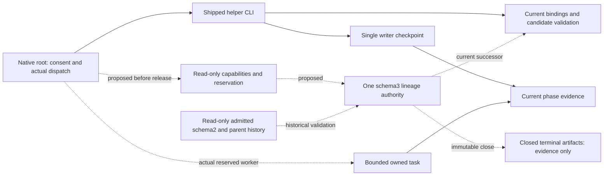

# Bounded terminal continuation and earlier verification

<!-- $START_CHANGE_SPEC -->
PURPOSE: Support bounded history-preserving Codex continuation and prevent late discovery of unsupported execution paths.
SCOPE: A+B as one bounded Codex change; В–Д as existing-rule clarifications with explicit deferred-adapter compatibility. No implementation grant.
KEYWORDS: continuation, cumulative budget, historical import, preflight, risky premise, failure transitions, product progress
<!-- $START_DOCUMENT_PLAN -->
$DOCUMENT_PLAN
SECTION_CHANGE:
GOAL [Bounded continuation with compatible delivery] => GOAL_CONT
SECTION_VALIDATION:
KEY_RESULT [Source correspondence and specification readiness] => RECEIPT_CONT
<!-- $END_DOCUMENT_PLAN -->

<!-- $START_SECTION_CHANGE -->
<!-- $START_ARTIFACT_GOAL_CONT -->
## Bounded continuation and compatible delivery
TYPE: GOAL
KEYWORDS: lineage, history, preflight, compatibility
<!-- $START_CONTRACT -->
PURPOSE: Deliver the bounded behavior while preserving current obligations.
DESCRIPTION: Historical read validation, one operational authority and compatible cross-harness delivery.
RATIONALE: The motivating continuation is blocked by a real native capability gap.
ACCEPTANCE_CRITERIA: AC-CONT-1 through AC-CONT-12 below.
<!-- $END_CONTRACT -->
<!-- $START_BODY -->
**Done when:** the selected Codex helper and real parent path support history-preserving continuation, all AC-CONT rows have current evidence, В–Д are reflected in existing owners, transfer instructions are complete, and the result accurately distinguishes an isolated checked candidate from compatibility-held integration.

**Stop and ask when:** a new authority/storage service, wider legacy population, changed role-return wire/default cap, sibling executable change, profile/installation change, unrelated orchestration redesign or extra consumer resource grant is needed. Required unavailable evidence blocks its dependent claim. Matching prior preparation/launch approval is reused; this draft is not implementation permission.

## Context / Input RECON

Brownfield framework change at source baseline `388c94495d86a771da6fa5e8514249976dc8c8a1`; documentation checkpoint `5b499d2`. [Measured RECON](../notes/RECON_2026-11-03_bounded-continuation.md), source manifest, fresh completeness challenge and reconciled delta are controlling evidence alongside the original owner messages. Root's [drafting choice](../notes/bounded-continuation-decision/decision.md) follows two independently generated originals, a saved unranked HOLD and a distinct evaluation; it is a proposed design for owner review, not an owner-approved architecture or runtime result.

Actual producer/consumers: `run_state.initialize/validate_state/advance/save/main`, native parent instructions in feature-dev/runtime/handoffs, current tests and package metadata. Existing schema2 is strict, cap<=4, initialization starts0, terminal advance refuses, and record-refusal diagnostics can change a terminal file. Current operational bindings pin the full package/neutral/spec/plan/candidate. The motivating real Codex3.2/schema2 terminal is BLOCKED/code, native0/0, while its identified parent record carries cumulative4/4. Its completed terminal Code is not an interrupted free entry. Historical import must not use ordinary current binding validation or rewrite old locks.

Named baseline regression population: complete root `tests/`, Codex `implementations/codex/tests/`, and unchanged sibling package regressions on their supported source. Especially `tests/test_c1_review_and_routing.py::test_release_bridge_keeps_wire_and_helper_algorithms`, `tests/test_codex_package.py`, `tests/test_f2_interfaces.py`, and package `test_run_state.py`, `test_adoption.py`, `test_native_contract.py`. Actual counts are measured during implementation; historical counts are not perpetual quotas. No suite, helper/probe or new native behavior was executed during preparation.

Addition: one current schema3 operational authority per causal lineage, with historical read validation, bounded owner extensions, pre-dispatch accounting and explicit recovery; earlier capability/premise verification and relevant failure/route clarifications.

## What we add

### Persistent contract and compatibility

New Codex operations use a strictly versioned schema3 operational checkpoint. The proposed package is Codex5.0.0 because the newly initialized persistent format changes incompatibly. Default repair allowance remains4, zero remains valid, and canonical role-return wire `methodology-codex/2.0.0` remains unchanged. The persistent-schema identifier is separate from the role-return contract identifier; a schema change must not rewrite producer return enums/fields. Exact serialization fields and module split belong to Architect under this separation.

Schema2 is a historical input, not a parallel dispatchable authority in the new package. Existing active schema2 runs continue only with their original complete bound package, or through a separately supported migration; this slice supplies no transparent active-run migration. It never rewrites those files or silently substitutes a new framework for old locked inputs. Schema1 and arbitrary sidecars remain unsupported/read-only.

The supported historical bridge admits Codex3.2/schema2 plus its identified parent aggregate record, current Codex4.0/schema2 terminal records whose causal accounting is complete, and this schema3 contract's own closed terminal artifacts. A provenance indication of external accounting requires the admitted parent bridge. It validates actual versions/structure, causal identity, source digests, scope, chronology and overlap: parent totals already containing native spend are not summed again. The motivating pair yields inherited spent4/ceiling4 and retains native0/0 as a historical local-allowance interpretation. Missing/conflicting/incomplete or ambiguous overlap refuses. Unknown historical cost remains unknown; hashes do not authenticate historical human consent.

The parent authenticates human action/scope/provenance. The helper validates the supported record/binding structure and finite limits; a nonempty approval string or worker flag cannot authenticate permission. Added grants retain GATE-1209: each extra entry allowance is a plain integer1..20 and the corresponding extra cost ceiling is within USD0..1000; defaults1/0 describe the offered question, never automatic consent. Reject bool/negative/nonintegral entries, nonfinite/out-of-range costs and wrong/reused scope; maintain separate cost units and explicit unknowns without inventing a cost engine.

### One authority, enrollment and immutable history

Use one deterministic canonical lineage checkpoint under the target's existing `.methodology` footprint and one authoritative parent writer. Its identity binds the admitted causal root and target/storage domain, not merely a new run name. Supported init/continue/record/reserve callers must recognize enrollment: a new run/lineage label or schema2 export cannot create a second allowance for the same admitted causal chain. Human causal classification remains parent judgment; this is not adversarial semantic identity detection.

The checkpoint holds aggregate original allowance/spend, individual grants and consumption, active successor/input/candidate, entry reservations, scoped retry episodes and immutable history references together. An export/snapshot/report cannot authorize dispatch. Duplicate/sibling creation and grant reuse are prevented through supported operations within that single writer/storage domain. Copies, old executables, manual edits and independent hosts are outside hard enforcement; no distributed lock service is introduced.

Imported native/parent predecessors remain byte-identical at their original paths on every success/refusal, including ordinary supported CLI diagnostics. New schema3 run terminals are published as immutable terminal artifacts; the mutable lineage checkpoint references them and may later select a successor. This distinction does not permit rewriting a closed run artifact. Interrupted snapshot publication may leave an unreferenced snapshot but cannot mint authority; unresolved enrollment/publication blocks release. Exact path layout and publication mechanics are planned and tested by Architect.

### Supported reentry and accounting

Every row requires explicit matching continuation reason/authority, reconciled amended inputs/scope, observed effects and actual current phase predicates. A terminal name alone authorizes nothing.

| Terminal predecessor | Supported new entry, subject to actual evidence |
|---|---|
| SPEC_BLOCKED | Bootstrap or Architect after required input/scope resolution; perform real missing work. |
| VISUAL_GATE_FAIL | Architect after the plan/visual cause is addressed under matching scope. |
| BLOCKED or ERROR | Earliest incomplete applicable phase after the missing prerequisite or uncertain completion is resolved. |
| ESCALATED | Eligible verification without another repair, or counted Code/Debug repair under remaining/extended allowance. |
| ESCALATED_FINALIZE | Current Finalize if no source repair and its prerequisites hold; source repair instead returns through counted producer, full QA and affected Review. |
| SUCCESS | Explicit same-cause amendment/renewed verification under its matching grant; a new feature and integration-only action use their own ordinary authority. |

RUNNING predecessor, unsupported status/phase combination, missing actual phase evidence or unresolved unknown effects refuses. Authentic same unfinished already charged worker recovery is distinct from a completed terminal entry; a completed BLOCKED return cannot be relabeled interrupted to gain free work. Code needs a current approved plan/scope; QA needs eligible actual artifacts; Review requires current independent QA, and Finalize current QA plus affected Review. No fake prior SUCCESS or automatic unchanged Bootstrap repetition.

No-repair verification needs no positive repair extension. A new repair uses reconciled remaining allowance when available; after exhaustion it needs a supported finite owner extension. A new Code phase repairing the inherited cause is charged like Debug before dispatch. Its failed/BLOCKED result retains that charge; a later new Debug is another entry, while recovery of the same interrupted reserved entry is not charged twice. QA remains eligible after the last repair, but another required source change refuses at the cap. Current source changes invalidate prior QA and affected Review; old accepted fields are historical evidence, not current green flags.

Before release: assess actual capabilities and prerequisites; reconcile current identity/authority/allowance and existing reservation; checkpoint charge, grant consumption, entry/successor identity and unique dispatch reservation together; read back and revalidate; only then release the named worker. Accept output/completion under the same reservation, with observed worker/session, effects, costs and evidence before another dispatch. The helper does not launch agents or authenticate their independence.

A missing release stamp is not evidence of nonrelease. After interruption, investigate the actual worker/artifact/sink: known unlaunched work may use the same reservation; known completed work follows current validated recovery; unknown completion blocks replay. Corrupt/missing/rollback authority blocks dependent work, never reconstructs a fresh wallet. Promise process-interruption recovery with a retained complete checkpoint and conservative investigation, not atomic worker launch, exactly-once transport or unproved power-loss durability.

Preserve response-correction/extraction/transport/test-session episode identities, caps, spent turns/costs and closure links separately from Debug spend. Unfinished/exhausted episodes do not reset on a renamed successor. A genuine new phase attempt/session may open a new episode only within the owning unit's scope rules, with an explicit relationship to old history. Response correction remains at most one per phase attempt; unsupported extraction/transport retries remain unsupported.

### Earlier verification and В–Д wording

B: add a read-only capability assessment through the shipped helper, naming actual package/state versions, supported historical profiles, operations, budget-extension and recovery semantics/limits. It must be usable without creating a run or modifying inspected state. Before dependent construction/run spend, root compares required transitions and import/accounting/recovery semantics to the actual helper/version and evidence. Unsupported requirements block only dependent work; declared support is not runtime qualification.

Proposed additive neutral duties, within their existing sections and without rewriting old norms:

- `checks/preflight.md`: add PREFLIGHT-204 for checking required helper lifecycle/import/extension/recovery capabilities before relying on them; record actual support versus unavailable proof in the existing assessment.
- `protocols/dev-plan.md`: add PLAN-405 for a material uncertain premise that could invalidate substantial dependent construction: identify a minimal real check, expected outcome and rejection/replan condition; sequence it before that construction under actual authority/resources. Missing permission or mechanism holds its dependent work, not a new preparation project. Routine/settled/pure local choices do not acquire mandatory spikes.
- `code/tests.md`: add TST-1003 scoped to resource lifecycles and observations claiming completeness: select applicable early-consumer-exit, partial/malformed/mismatched-result, timeout and unconditional cleanup controls; justify false triggers and observe real resource/response outcomes. Preserve direct logic and actual-boundary requirements; no universal every-case matrix or ninth scan.
- `process/lifecycle.md`: add LIFE-108 for reassessing material growth of blocking preparation dependencies before adding another preparation packet: compare necessary guarantees, possible consolidation and next observable product result/exit. Reuse TASKS/ROADMAP/HANDOFF, existing autonomous authority and separate result decisions; no fixed stage-count threshold or extra routine gate.

These are explicit additive duties supporting the owner's selected direction: propose neutral4.1.0 under FMT-24, not a version-free wording claim. Existing norm meanings, gates and exceptions remain unchanged. If final wording changes an existing meaning instead of adding duties, it must be revised before approval or returned for the corresponding version/scope decision, not silently relabeled PATCH.

## Business Requirements

- **BR-1 — compatibility:** preserve role-return wire, roles/phases/scans, default4/valid0, permission boundaries, independent current verification, unaffected helpers and baseline tests. Explicit proposed exceptions: Codex new persistent schema3/package5.0, new operations and legacy historical bridge; exact affected Codex whole-AST/package assertions; additive neutral duties/version4.1. No sibling executable or old active-state migration exception is included.
- **BR-2 — history and accounting:** one authoritative enrolled causal lineage imports admitted native/parent history without mutation/reset/double-count, preserves failures and resource/retry units, and rejects conflicting provenance.
- **BR-3 — authorized bounded entry:** authentic scoped continuation and finite grants govern all new repairs, including Code; one pre-dispatch reservation/charge, exhaustion refusal and eligible no-repair verification.
- **BR-4 — recovery:** supported process interruption preserves charge/identity, prevents completed replay and holds unknown effects; immutable terminal artifacts stay separate from mutable lineage control.
- **BR-5 — current verification:** reentry requires real current input/plan/candidate/phase predicates; changed source renews QA/affected Review/Finalize without forged inherited success.
- **BR-6 — early capability and premise checks:** B/PREFLIGHT-204 and В/PLAN-405 expose unsupported or disproved dependencies before substantial reliance, using existing records/authority.
- **BR-7 — meaningful failure checks:** Г/TST-1003 selects actual lifecycle/completeness counterexamples and observes cleanup/negative outcomes.
- **BR-8 — product route:** Д/LIFE-108 reassesses growing preparation chains against a concrete product exit, preserving scope and history without inventing a gate/register.
- **BR-9 — bounded cross-harness delivery:** provide source-backed Claude/DSH transfer instructions, preserve their code here and hold shared main integration until separate ordinary-operation compatibility is accepted on the exact candidate.
- **BR-10 — honest delivery:** prove direct logic, shipped CLI and real parent reservation/release on owned inert resources; retain unknown/deferred limits and separately approved source integration, installation and consumer execution.

LLM/PI: no model/provider API call is added. Agent instruction/probe inputs remain untrusted data; fake approvals, embedded instructions or worker counter fields cannot change parent authority, budgets or protected flags. A discriminating forged-authority control is required; no external PI catalog/provider is introduced.

## Boundaries

Always: keep existing user grants and foreign work; exact source/old input identities; one writer/authority; full current evidence after repairs; all actual errors/history; declared isolation/host limits and source correspondence.
Ask first: actual scope/constraint/version-policy conflict, new module beyond the allowed paths, broader importer, wire change or stronger durability/global authority; result integration/installation/consumer actions need their own missing grant. Do not re-ask the already authorized preparation/launch or delegated local design details.
Never: patch installed caches, rewrite old locks or predecessors, refund/rename repair spend, auto-reopen a terminal, treat native0 as aggregate0, count missing telemetry as zero, reuse completed dispatch, blindly replay unknown effects, reset unfinished retries, silently repin or weaken guards, edit sibling executable packages, or merge shared neutral before compatibility closure.

## Expected Architecture

Observed current relationships from the helper/runtime/source tests; these are baseline evidence, not an owner-frozen graph. Proposed boundaries below become binding only if this specification is approved. Architect supplies the detailed DraftCodeGraph and compares its invariant edges/meaning before Code.

Invariant: parent owns human authority/dispatch; helper enforces structural/current identity and accounting guards; historical artifacts/worker outputs never become control; current QA/Review/Finalize and role wire remain. No second scheduler, distributed store, automatic migration or extra software role. Snapshot publication/enrollment/release errors preserve the single-authority invariant.

## Scope

All paths are repository-relative. This is the future implementation boundary, not authorization to edit them now.

MAY EDIT:
- `implementations/codex/skills/feature-dev/scripts/run_state.py` — schema3/helper/CLI/current binding/legacy dispatch refusals and deterministic authority path.
- `implementations/codex/skills/feature-dev/scripts/continuation.py` (new, optional split) — only the admitted historical bridge and lineage/reservation mechanics; no separate authority.
- `implementations/codex/tests/test_run_state.py`, `implementations/codex/tests/test_adoption.py`, `implementations/codex/tests/test_native_contract.py`, `implementations/codex/tests/test_continuation.py` (new), `implementations/codex/tests/test_guide.md` — preserve old case meanings, add schema/bridge/reservation/real-path/refusal/episode coverage and exact current metadata.
- `implementations/codex/skills/feature-dev/SKILL.md`, `implementations/codex/skills/pm/SKILL.md`, `implementations/codex/skills/devplan-protocol/SKILL.md`, `implementations/codex/references/codex-runtime.md`, `implementations/codex/references/adoption.md`, `implementations/codex/references/handoffs.md`, `implementations/codex/README.md` — actual parent/capability/reservation/reentry guidance and truthful version/support limits.
- `implementations/codex/.codex-plugin/plugin.json`, `implementations/codex/adapter.json`, `implementations/codex/references/package-layout.json` — exact Codex5.0/neutral4.1 binding and complete independently verified member population; keep default parameter4 and existing capability registry.
- `checks/preflight.md`, `protocols/dev-plan.md`, `code/tests.md`, `process/lifecycle.md` — only the four additive duties above; `SPEC_VERSION`, root `CHANGELOG.md` — neutral4.1 and honest compatibility-held source status.
- `tests/test_c1_review_and_routing.py`, `tests/test_codex_package.py`, `tests/test_f2_interfaces.py`, `tests/test_guide.md` — exact affected Codex schema/algorithm/version/member consumer exceptions, additive-owner contrary controls and meaningful retained old-regression oracles; no blanket normalizer expansion. Claude AST/default/wire protections remain.
- `README.md`, `examples/adapter.example.json`, `tests/test_skeleton.py`, `tests/test_first_layer.py`, `tests/test_ldd_testing_protocols.py`, `tests/test_code_core_protocols.py` — only actual neutral/Codex current release identity claims and their exact guarding assertions; preserve historical records, norm semantics, corpus/role/registry constraints and all unrelated test logic.
- `tests/test_claude_package.py`, `tests/test_dsh_package.py` — shared neutral release selectors only; native component version/member selector updates require the separately accepted external-agent compatibility receipt for that exact source. These are shared root release consumers, not permission to change sibling implementations or their protected algorithms. Coupled `tests/test_c1_review_and_routing.py` Claude release-selector literals follow the same condition, retaining unchanged normalized algorithm/default/wire and mutation protections.
- `tests/probe_bounded_continuation.py` (new) — owned inert real CLI/artifact/reservation probe, no provider/Engine/product calls or worker scheduler; native-parent evidence remains separately required.
- `examples/pm-project/plans/bounded-continuation.md` (new future Architect plan), the task result/receipt/packet/transfer notes and affected `examples/pm-project/TASKS.md`, `examples/pm-project/ROADMAP.md`, `examples/pm-project/HANDOFF.md` — exact task evidence and continuation. VISION only if actual owner direction changes, otherwise untouched.

DO NOT TOUCH:
- All `implementations/claude/**`, `implementations/dsh/**` executable/package/configuration bytes in this task; future agents supply their separately scoped compatibility/ports.
- This approved specification during Code (only parent-owned matching input amendment may change it), old plans/specs, accepted decision bodies, failed runs, all consumer source/state/evidence and installed user profiles/snapshots; read/copy motivating metadata only into explicitly owned private probe scratch without modifying originals.
- Unrelated root tools/bin/test algorithms, FORMAT/adapter schema/capability and parameter registries, role-return schema/enums, roles/scan count, original default cap or global host configuration.
- Ignored generated XML as source: configured root/Codex maps must be rebuilt and inspected, never committed. Existing Doxyfiles remain configured; new optional helper/test paths are inside their current covered directories.

The full Codex AST pin is an explicit affected exception, not permission to weaken algorithm protection globally. Replace only its obsolete full-Codex-algorithm equality with independently reviewed approved-delta/unchanged-boundary and mutation controls retaining default/wire/Claude/unrelated guarantees. The source addendum is complemented by the exact release-consumer list above: current neutral/README/example-adapter selectors change, while historical LAST_CHANGE/provenance strings are not globally replaced. Never merely compute a new hash and call it compatible.

## Acceptance Criteria

| ID | Required observation and pass condition |
|---|---|
| **AC-CONT-1** | Current new init creates only the selected schema3 authority with default4/valid0; role wire unchanged. Supported ordinary/continuation callers consult it; old schema2 is historical-only and active rebinding refuses. Old unrelated regression meanings persist with only BR-1's named exceptions. |
| **AC-CONT-2 (REAL-SHAPE)** | Read the actual identified3.2 terminal plus parent metadata from private read-only inputs, copy only to owned private scratch, and prove aggregate4/ceiling4 with native0 retained as local history. Missing/conflicting/ambiguous overlap, wrong profile/source/causal identity refuses; originals bytes/modes remain unchanged. Include current4.0 and own schema3 closed artifacts; no schema1/general-sidecar acceptance. |
| **AC-CONT-3** | Every supported success/refusal/malformed-input/ordinary-record diagnostic path preserves imported and closed terminal bytes. Snapshot/enrollment interruption cannot create a second authority or allowance. Reusing admitted causal input under a renamed run/lineage refuses within declared storage domain; exports cannot dispatch. |
| **AC-CONT-4** | Matrix covers every listed terminal and invalid pairing with real predicate checks; no-repair QA at exhaustion needs no positive grant, remaining allowance works, and causal Code repair precharges once. Motivating completed BLOCKED/code never receives free interrupted recovery. |
| **AC-CONT-5** | Finite grant range/type/scope/identity/cost checks, spent-before-release, failed/BLOCKED retention, duplicate/sibling use, completed replay and cap exhaustion are discriminated. Grant authenticity remains parent judgment; forged worker approval/counter input cannot override it. |
| **AC-CONT-6** | Inject process interruption before checkpoint, after charge/before possible release, after uncertain release and after completion. Known outcomes reconcile without double charge; absent stamp alone never proves no release; unknown/corrupt/rollback/candidate-drift holds. No exactly-once/power-loss/global-clone claim. |
| **AC-CONT-7** | All four retry units retain history/used scope/costs; unfinished/exhausted episode cannot reset via successor; a legitimate new episode is explicitly linked. Changed candidate invalidates current QA/affected Review and returns through actual required predicates before Finalize. |
| **AC-CONT-8 (REAL-PATH)** | Actual shipped capability CLI is read-only over files/state/Git and reports real supported operations/profiles/limits. A parent needing an unsupported transition stops before dependent construction/release or run creation; independent safe work continues. Actual positive and unsupported-version paths produce documented stdout/stderr/exits. |
| **AC-CONT-9** | Four additive owner duties preserve old bodies/conditions and source tests discriminate their removal. Bounded fresh native cases demonstrate risky-premise check before dependent construction, relevant cleanup/malformed-result test selection and preparation-chain route review without new gate/register. These are bounded behavior observations, not universal efficacy claims. |
| **AC-CONT-10** | On the isolated candidate, full Codex and applicable affected-root regressions, independent cumulative review, source scope, exact AST/member exceptions and configured root/Codex XML/entity/source fidelity pass on owned Git-free copies. Full common/sibling regression on the final combined compatible source remains owed under AC-CONT-12; an intentional shared-version mismatch is reported as that held dependency, never skipped or PASS. No overall completed acceptance is claimed before the combined requirement closes. |
| **AC-CONT-11 (delivery)** | Real helper CLI/checkpoint plus a fresh native parent reservation/readback/actual owned inert-worker dispatch records session identity, precharge before release, known completion and exhaustion refusal. Script/mock-only evidence does not prove the native parent path; any missing native proof remains unfulfilled. |
| **AC-CONT-12 (rollout)** | Transfer briefs name exact selected contract/version, helper/caller/pin changes and separate compatibility versus continuation evidence. Shared main integration remains held until separately authorized Claude/DSH compatibility contributions and ordinary-operation checks plus the full common/sibling regressions pass against the exact combined neutral4.1 candidate. No sibling code/config/install/consumer writes occur here; branch-only checked source is not called integrated or deployed. |

## Delivery / Live Probe

Environment: explicitly owned private, complete Git-free source copy with the actual Python3.12 interpreter; configured Doxygen/pytest prerequisites must be available. No credential, network/provider/Engine or product environment is needed. Real legacy metadata paths are private input arguments, not tracked fixtures or defaults. Their absence blocks AC-CONT-2, not synthetic acceptance.

Future command interface to implement and document (NOT RUN): `python3.12 tests/probe_bounded_continuation.py --workspace OWNED_ABSENT_ROOT --legacy-native PRIVATE_NATIVE_JSON --legacy-parent PRIVATE_PARENT_JSON`. It invokes the actual copied shipped helper CLI, captures argv/stdout/stderr/exits, compares source/predessor bytes and persisted reservation/accounting, and exits0 only on the declared positive/negative cases. Use local logical locators in public receipts; complete private streams stay in the owned evidence home.

Separately, the root uses the new helper's documented capability/continue/reservation operations and actual native collaboration tool to dispatch one inert worker into the owned target only after the accepted charge/reservation is read back. Collect real parent/worker session locators, before/after state, marker outcome and refusal evidence. This is an expressly scoped future implementation acceptance probe, not permission to launch now or to run Jeni. Helper command spellings/internal API are fixed in the later plan before Code; no nonexistent current command is claimed.

Final regression commands from the Git-free copy: `PYTHONDONTWRITEBYTECODE=1 python3.12 -m pytest tests -p no:cacheprovider -s -v --basetemp OWNED_ABSENT_ROOT_TESTS`; package equivalent uses `-c implementations/codex/pytest.ini implementations/codex/tests` and its distinct owned basetemp. Root and Codex `doxygen Doxyfile` run in their own cwd after tests; verify configured covered XML and all own entity/source associations. Normal full tests use actual fixtures; private deny-list self/publication scan, if required for delivery, uses the owner-provided private list and stays unavailable if not supplied. Never fabricate it from synthetic unit fixtures.

Validation is partitioned by the known external dependency, not weakened: isolated Codex/affected-root evidence can establish a checked partial candidate; the full common/sibling command and any compatibility-dependent rows remain explicit NOT RUN/BLOCKED or actual retained failures until external compatible contributions exist. This does not waive full renewed independent QA or permit overall Finalize/SUCCESS before required combined evidence. A planned missing sibling contribution is an environment/authority dependency, not permission for local sibling repair or repeated counted Debug.

Before shared integration, external-agent receipts and the final combined source must pass the full common/sibling regressions and ordinary sibling init/validation/native binding checks. Their exact native commands come from the agents' approved plans; this session cannot invent or run their future acceptance. Missing receipts hold AC-CONT-12 integration and keep live canonical versions unchanged.

## Risk Notes / Deficiencies and interpretations

A's preference is narrow, based on a judged smaller authority-selection surface; it is not measured time/cost superiority. It introduces a major native state boundary and external compatibility delivery dependency. If concrete planning requires unrelated redesign or demonstrates a materially smaller complete B proof, return an explicit spec amendment rather than silently switching or repeating brainstorm by default.

SPEC_DEFICIENCY: none unresolved in the proposed design at this draft stage; future proof is NOT RUN, and shared integration has the explicit external prerequisite above. Architect must still independently validate the full spec and actual source before planning. Any future deficiency/interpretation block must travel verbatim to Code with full MAY EDIT/DO NOT TOUCH and Code Deviations; no approved spec is rewritten during repair.

<!-- $END_BODY -->
<!-- $START_LINKS -->
IMPLEMENTS: (none)
IMPACTS: RECEIPT_CONT
REQUIRES: (none)
<!-- $END_LINKS -->
<!-- $END_ARTIFACT_GOAL_CONT -->
<!-- $END_SECTION_CHANGE -->

<!-- $START_SECTION_VALIDATION -->
<!-- $START_ARTIFACT_RECEIPT_CONT -->
## Source correspondence and readiness receipt
TYPE: KEY_RESULT
KEYWORDS: brownfield, correspondence, authority, validation
<!-- $START_CONTRACT -->
PURPOSE: Establish readiness of this exact proposed specification.
DESCRIPTION: Original-source and reverse requirement mapping, questions, checks and honest pending authority.
RATIONALE: A filled document or launch permission is not an approved or implemented capability.
ACCEPTANCE_CRITERIA: Complete source mapping and independent review with no hidden human decision or unavailable proof represented as passed.
<!-- $END_CONTRACT -->
<!-- $START_BODY -->
Spec status/authority: DRAFT for owner review, implementation not approved. Preparation, named independent packet and root proposed selection are authentic; the human has not selected schema3 or accepted its release tradeoff yet. Separate concrete-result decision remains owed.

Author: root PM. Validator: distinct `/root/continuation_completeness`, independent nonsoftware source/document review. [Original conditional review](../notes/bounded-continuation-spec-review.md) is preserved; root accepted its exact release-consumer scope finding, reread the original guards and corrected MAY EDIT/source correspondence. [Final bounded delta](../notes/bounded-continuation-spec-review-delta.md) found no remaining blocker for owner review. No original verdict was rewritten to green. Profile: complete brownfield form and document protocol; detailed module split/serialization/commands remain Architect-owned. Original source baseline and source hashes remain unchanged; runtime/adoption/core content previously read is reused only at those same identities.

RECON question trace: Q-SCOPE resolved by original owner clarification → BR-9, Scope, AC-CONT-12. Q-LEGACY observed native0/root4 → BR-2/3, AC-CONT-2/4/5. Q-REPRESENTATION → original A/B, saved HOLD, independent evaluation and proposed A selection → persistent/enrollment/reentry sections, BR-1–5, AC-CONT-1–7/11. Q-ROLLOUT → A coordinated hold → BR-9/10 and AC-CONT-12. Q-DURABILITY bounds → BR-4, AC-CONT-6/11. Current choices are resolved for the proposed draft, not human-approved or executed. No other current spec-affecting fork is concealed.

### Brownfield source correspondence (SP-205)

| Original obligation/source population | Exact retained location or authorized disposition |
|---|---|
| Original owner A+B one limited change, В–Д existing rules; preparation first/no implementation | Scope/BR-1/6–10, four additive duties, draft authority; no Code started |
| Owner delegates Claude/DSH to their agents | BR-9, DO NOT TOUCH, AC-CONT-12, transfer brief; ordinary compatibility prerequisite retained rather than silent sibling edits |
| STATE-101–105/201–206 identity, one writer, preserved evidence/costs | historical/current split, one authority and immutable terminal publication; BR-2/4/5, AC-CONT-2/3/6/7/11 |
| STATE-301–305 default4/plain types/pre-entry causal spend/no reset/QA after last; GATE-1209 bounded entry/cost grant | grant/accounting sections, BR-1/3, AC-CONT-1/4/5; consent remains parent judgment |
| STATE-401–404 separate retry scopes/unknown effect; STATE-501–605 current input/candidate and safe recovery; STATE-701–703 terminal/result decisions | reentry/reservation/retry sections, BR-4/5/10, AC-CONT-3–7/11/12 |
| Actual3.2 root/native pair and current helper limitations | named admitted bridge, aggregate4/native0, completed Code distinction, historical validation and diagnostic immutability; AC-CONT-2–6 |
| Existing PREFLIGHT-101/102/201/203, PLAN-203/404, TST-304/901/1001/1002, LIFE-107 and lightweight PM accepted direction | BR-6–8, additive PREFLIGHT-204/PLAN-405/TST-1003/LIFE-108; AC-CONT-8/9; no new registry/scan/ordinary gate |
| Independent completeness CR1–4 and delta | retry scopes, supported no-repair/reentry, single-domain limit and shared-neutral hold → AC-CONT-3/4/6/7/12 |
| Actual shared neutral release consumers: root README/example adapter; skeleton/first-layer/LDD/core tests; conditional sibling root package guards | exact identity-only MAY EDIT entries, preserved historical strings and external accepted-receipt condition; AC-CONT-10/12 |
| Actual strict Codex AST/schema/package guards and closed metadata membership | BR-1 exceptions, exact MAY EDIT tests/metadata and independent mutation/old-regression retention; AC-CONT-1/10 |
| FMT-23/24/25; sibling hard pins and canonical in-place binding records | explicit native5.0/neutral4.1 proposed semantics, unchanged old installed versions and before-main compatibility hold; AC-CONT-12 |
| TST real logic/actual-shape/real channel; Doxygen configuration and full source/XML association | AC-CONT-2/8/10/11, actual owned copy/CLI/native parent/live evidence and configured maps |
| A/B/HOLD/evaluation | proposed A, credible rejected B/reopening conditions and explicit outside dependency; no scoring-as-proof or phantom owner approval |

Reverse check: BR-1–5 derive from original A plus STATE and actual metadata; BR-6–8 from selected B/В–Д and existing owners with explicit additive-duty interpretation; BR-9/10 from scope clarification, source compatibility and real-delivery obligations. Schema3/native5.0/neutral4.1 and closed-terminal snapshot distinction are the explicit proposed design, requiring this specification's owner review, not inherited approval.

Considered-source exclusions: Jeni A1 topology/PG/descriptor/inspection implementation and actual host qualification stay consumer work; no causal Darwin claim. C3/M30 deferred execution, whole historical cost audit, arbitrary old schema import, automation/scheduler/distributed authority, external OS/library research and installed profile changes are outside this bounded source change. No external dependency/image/API identifier is introduced; actual local interpreter/Doxygen command presence was observed, no build/version efficacy claimed.

Numeric/enumeration sweep: default4 and valid0 preserved; grant1..20/USD0..1000 and one response correction retain owning ranges; four retry units and all seven terminal outcomes are represented; AC-CONT-1..12 and BR-1..10 have unique IDs and attached conditions; proposed version domains (neutral4.1/native5.0/persistent3/rolewire2.0) are distinct. Existing file/skill/member/test counts must be newly measured, not silently kept or globally replaced.

Verification promises: real probe token `tests/probe_bounded_continuation.py` → actual helper CLI/persisted state/refusal → declared accounting/history outcomes; native dispatch requires actual tool/session evidence separately. Existing tests/source-hash scans are not runtime support or full privacy proof. Exact future commands/fixtures/preconditions are in Delivery and the Architect plan; every behavior/probe remains NOT RUN until implementation acceptance.

Readiness: READY FOR OWNER REVIEW as a DRAFT. Independent source/document review and its bounded delta are complete; root document/ID/link/source-identity/whitespace and bounded home-path/email hygiene checks passed. The reviewed body identity is in the original delta; this closure changes only receipt/status evidence, not the selected requirements or scope. Full private deny-list publication proof remains unavailable and is not claimed. The approved source scope is still preparation only. No spec/Code/QA/Finalize/probe/integration result is fabricated. Private raw original brief/review are retained in the ignored task evidence home; tracked projections redact only local home paths, with original byte identities preserved.

<!-- $END_BODY -->
<!-- $START_LINKS -->
IMPLEMENTS: GOAL_CONT
IMPACTS: (none)
REQUIRES: GOAL_CONT
<!-- $END_LINKS -->
<!-- $END_ARTIFACT_RECEIPT_CONT -->
<!-- $END_SECTION_VALIDATION -->

<!-- $END_CHANGE_SPEC -->
