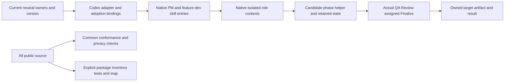

# M19 first native Codex implementation specification

Status: HISTORICAL TECHNICAL SPECIFICATION. Retained at its original code-metadata target for the Codex package contract. Past approval and integration records are private context and unavailable here. Historical MAY EDIT/DO NOT TOUCH and approval clauses below explain the original technical scope; they grant no current implementation, integration, installation or publication authority.

$START_M19_SPEC
PURPOSE: Port and reconcile existing legacy native workflow package into implementations/codex/ with current neutral rules and one actual source-loaded native smoke.
$START_DOCUMENT_PLAN
$DOCUMENT_PLAN
GOAL Complete first bounded Codex source package and safe repository boundary => M19_PACKAGE
USE_CASE Native roles execute an approved small owned task through candidate rules => M19_SMOKE
USE_CASE Invalid identities/scan returns/grants/budgets are refused without widening authority => M19_REFUSALS
$END_DOCUMENT_PLAN
$START_CONTRACT
$CONTRACT
PURPOSE: Make one reviewable local Codex implementation of the adopted neutral methodology.
RATIONALE: Existing installed1.0.0 has real maintainer runs but incompatible scan/budget/core/map contracts and no co-located package boundary or current candidate smoke proof.
ACCEPTANCE_CRITERIA: AC-M19-1..10, exact allowed paths/purposes and retained source/role/artifact evidence below.
$END_CONTRACT
$START_BODY

## 1. Context and input

Historical neutral baseline0.20.0 followed the M17/M18 readiness checkpoint. Technical input population: 38 native carrier/helper/reference files, including 23 skills, six roles and two helpers, with no shipped installer/adapter/tests/current bundle in that baseline. Historical source/cache identity and full-read evidence are unavailable in this public tree. They are not fresh export results or complete-transfer/licensing proof. Retained package duties and source/context limits are described in the current [package disposition](../../../implementations/codex/references/source-disposition.md).

Before: no implementations package; recursive Markdown collection would treat native SKILL cards as neutral, and FMT-26 disallows a co-located adapter. Legacy six-ordinal QA and positive-only Debug allowance contradict current owners. After: one Codex source package, complete pointwise adapter/own checks/map/current-source adoption and genuine native execution proof. Generalized plugin distribution, automatic installed-cache discovery, license/publication and other engines remain outside.

## 2. Intended behavior and exact boundary decisions

### Typed package namespace and version

Preserve the existing71neutral paths/67drafts/4stubs and28capabilities/sevenparameters. Native documents under implementations/ have their own declared package format, inventory and tests, separate from neutral discovery. Ordinary Markdown elsewhere still follows FMT-1; no arbitrary root formatting exemption. All intended public files, including the complete package, remain in privacy/publication traversal. Do not change SKIPPED_WALK_DIRS or introduce scanner omissions.

Exact proposed exceptions to unchanged normative meaning/line retention for code approval:
- FMT-1: add only the typed implementation-package namespace to neutral membership separation, with own package validation and all-public-file coverage; retain root README/CHANGELOG and tests/examples exceptions.
- FMT-26: permit an adapter owned by a harness implementation package in this repository as well as a separate harness repository; preserve single-JSON/pointwise contract.
- REPO-102: replace its unconditional root-exemption wording only with an explicit prohibition on arbitrary root exemptions and a reference to this FORMAT-defined typed-package boundary. Preserve current maintainer-state homes/examples exception and all other entry duties.

Approval of this specification explicitly authorizes these three exact-purpose amendments; preparation does not apply them. All other original norm ids/forces/meanings/full lines remain. FMT-23 stays unchanged and requires neutral1.0.0 for the meaning change; it does not certify stable cards, all-source completion or distribution maturity. Measure final norms/anchors/calls after authoring rather than guess. Update only actual version/classification consumers and paired negative inputs. Example adapter retains all modes/mechanisms/coverage except current version.

### Package and source-loaded profile

Package root implementations/codex/, name methodology-codex, proposed package2.0.0. Retain23entry topics/six software role carriers and the two actual helper paths, with per-source disposition rather than blind copy. The new public plugin identifier differs from the private legacy identifier; both exact source identities are retained privately, and no installed-package replacement is authorized. Package references current neutral owners by actual resolved adapter/content; do not copy a second competing constitution or re-author protected neutral role/flow/model/scan rules. Required local package members include compatibility .codex-plugin/plugin.json, README.md, adapter.json, references/{codex-runtime.md,handoffs.md,adoption.md,package-layout.json,source-disposition.md}, skills/<the23measuredtopics>/SKILL.md, six roles, the two helpers, tests/test_guide.md, actual package tests and Doxyfile. Historical source-manifest/validation prose is qualified provenance, not current PASS; preserve privately or replace with truthful disposition, sanitize private locators/owner bindings, invent no license.

Adapter at package root resolves spec_root ../../ from its own directory, not caller cwd. Via paths are package-relative. Existing schema bytes/fields/modes/overrides remain pinned; package/current adapter prose states the prospective location profile without editing historical schema description. Account all71neutral files,28capabilities/sevenparameters through meaningful per-owner adoption, actual host mechanism/fallback and scope. A universal reference list or substring table is not sufficient evidence. Package inventory independently accounts every real published package path, including its own manifest/tests/map config; unknown sibling packages or undeclared/missing members fail package assembly checks. Neutral exclusion is not a promise commonconform validates native package semantics: run both common and explicit package checks.

Supported first profile: complete co-located checkout, explicit candidate source loading by the native parent and isolated roles. Required core is exactly principles, roles/_base, exoskeleton, LDD, Doxygen and tests, plus assigned role/task protocols/current target instructions/runtime/adapter. Read full current content; complete supplied injection can suffice, hashes cannot prove reading. Resolve identities at start/resume and block missing/stub/truncated/stale required content. No automatic recursive full-history read. Missing declared dependency/capability/independent context is BLOCKED, never silently fall back to installed1.0.0. Detached cached/offline standalone installation is unsupported in this first profile; preflight explains absent neutral binding and withholds dependent execution. No global install/update/activation, marketplace, hooks, MCP, provider or model-setting changes.

### Current native contracts and persisted state

Candidate entry/roles/skills load the current owners for PM record homes/TASKS, Orient/preflight/audit/conditional safety, exact core, current code markup/LDD, mandatory map unless explicit host prohibition, graph references/full DOMAIN, grant/scope/model inheritance and separately assigned Architect Finalize. Original specialized topic triggers remain narrow; learning/measurement is not activated by packaging analyzer, and missing stub duties remain explicit limits.

Candidate run_state schema2 binds actual framework/package/adapter/neutral/spec identities, target, owner grant provenance, transitions and contained real artifacts. Parent still owns human-authority/content judgments, filesystem grants and single state writer. Reject stale/mismatched identities before dependent advance with preserved state/history. Old schema1/six-ordinal records are read-only historical inputs; unsupported resume rejects with actionable reason, no implicit migration/new-run reset.

All eight named ids must equal checks/qa-scans registry bidirectionally: green-test-trap, quantitative-ac, semantic-trace, infra-dod, side-effect-channel, secret-leak, real-path-shape, discriminating-test. Every row has actual applicability/status/reason/evidence; required FAIL/BLOCKED/missing/extra/ordinal rows prevent PASS. Preflight checks precede trusted suite; runtime/stream checks follow evidence-producing operations. Keep authentic old records separate from new vocabulary.

Debug cap uses nonnegative integral values including0, rejects bool/negative/fractional/invalid values; default4. Code, QA and accepted Review defects share one cumulative pre-entry charge; QA visits/retry/test-session units stay separate, no refunds/reset. Exhausted allowance stops with retained findings/history. Above-default extensions need an exact bounded actual owner grant and supported mechanism; if unavailable, block explicitly. Null/malformed response retry remains separately bounded, with unknown consequential effects investigated before replay. Terminal refusal and late-Finalize escalation remain. State helper guards structure/order, not truth, role independence, sandbox or consent.

Visual helper retains actual suffix-supported bounded mechanical coverage; unsupported carriers/full XML/Mermaid/semantic fidelity need their declared independent checks. Do not change shared graph schema or disguise unsupported nodes. New owned helper/test modules and authored control flow require current own metadata/exoskeleton/LDD; new branch failure and successful-validation traces must not borrow wrapper logs.

## 3. Business requirements

- BR-1: Preserve all accepted neutral/software interfaces, source/history/foreign ownership and fixed controls except the three explicit boundary meanings and necessary current factual consumers; no new shared role/phase/scan/model/capability/parameter/schema enum.
- BR-2: Separate neutral membership from the complete typed Codex package while scanning every intended public member and validating both populations independently.
- BR-3: Port every measured legacy input by explicit retained/adapted/omitted disposition; map current full owner duties and converse package claims with real adapter/host mechanisms, read limits and privacy/provenance qualifications.
- BR-4: Execute candidate-native phases with current core/protocol/record/readiness/safety/map/QA ownership, complete eight-named verdicts, bounded state identity/resume/Debug/refusal semantics.
- BR-5: Prove behavior with actual common/package checks, own configured map, current command/file/process evidence and one useful real native smoke; no old-cache, marker-only, phase-simulation or token-table substitute.
- BR-6: Deliver an exact local committed, independently reviewed all-member source/result/evidence; M20 result integration remains separate, installation/publication/learning remain ungranted.

## 4. Expected architecture

This is a measured author proposal, not an owner-frozen implementation graph.

Select co-located reference/direct-loading profile and package-local checks/map. Reject blanket legacy copy, renamed-neutral SKILL cards and scanner exclusion. Defer detached installed/offline distribution rather than assert untested discovery. Existing common source/path/schema contracts are reused. Root installed maintainer workflow may construct this package; the actual acceptance smoke must use the newly authored package paths and helpers.

## 5. Exact implementation scope

MAY EDIT after exact code approval:
- FORMAT.md and AGENTS.md: only FMT-1/FMT-26/REPO-102 boundary purposes above; runtime/adapters.md: matching co-location/profile/own-validation prose/anchors. Keep runtime/adapter.schema.json byte-identical, including its description.
- tools/conformlib/markdown.py: neutral-only implementations classification; keep shared skipped walk/publication behavior. No other common engine module requires change; a discovered additional coupling needs exact scope disposition.
- README.md, CHANGELOG.md, SPEC_VERSION, examples/adapter.example.json: actual boundary/package discovery/release and version-only example adapter reconciliation.
- Existing independent neutral-readers tests/test_skeleton.py, test_adapter.py, test_report.py, test_coder_role.py, test_debugger_role.py, test_reviewer_role.py, test_searcher_role.py, test_ldd_testing_protocols.py: precise namespace-aware independent oracles and necessary version/current facts, retaining assertions/helpers/control meanings.
- tests/test_first_layer.py, test_code_core_protocols.py, test_format.py, test_f2_interfaces.py, test_scan.py, test_guide.md: exact current release/FORMAT/classification support and paired affected mutants plus new meaningful namespace/privacy coverage. Existing fixed scenarios/conditions/pins/refusals/restoration populations remain; no protectedpin refresh to get green. If a specific assertion's expected factual value changes, document its corresponding preserved failure/equivalent meaning.
- New tests/test_codex_package.py: independent complete package assembly/unknown-member/profile/path checks; do not import the production neutral classifier as the oracle.
- implementations/codex/**: only the declared package roles/23skills/two helpers/runtime/adapter/inventory/provenance README/native compatibility metadata/tests/guide/Doxyfile/examples/smoke inputs. Every new path/purpose is fixed in the Architect plan before Code; no installer/daemon/MCP/hook/provider/marketplace/neutral bundle or unrelated engine. Package README explicitly states supported co-location/source-load profile and unsupported detached installation.
- examples/pm-project current four state homes, notes/m19-codex-{recon,result}.md, plans/m19-codex-package.md and M20 acceptance only after actual decision: root-only grant/state/result/evidence reconciliation. This approved spec stays byte-frozen; new scope decisions stay outside it.

DO NOT TOUCH all other paths: original legacy/cache/source repositories/global preferences, four remaining process stubs, all protected shared code/role/phase/state/return/gate/QA/model/graph policies, capability/parameter registries, runtime/adapter.schema.json, primary forms/index, old evidence/spec/result histories, common scanner/bin/API, rootDoxyfile/pytest.ini/tests/conftest.py and their fixed pins. No private/home paths or source snapshots become public. Foreign image/ignored checkout remain untouched. Preserve existing native budgets; no historical restart.

## 6. Acceptance criteria

| Criterion | Required observable operation and contrary control |
|---|---|
| AC-M19-1 Boundary | Shipped neutral reader and independent oracles retain exactly71/67/4 while actual native SKILL/role/package docs use own format; malformed ordinary root Markdown still fails. Independent package inventory rejects undeclared/missing path and unknown sibling package. |
| AC-M19-2 Full public coverage | Complete committed/current/raw/guarded/extracted population includes every package Markdown/JSON/Python/extensionless/nested test/config member. Actual fixed-deny scans/canaries still discriminate; no SKIPPED_WALK_DIRS/deny-list omission. All old privacy/refusal/restoration controls remain. |
| AC-M19-3 Pointwise adoption | Full38-input source→package and converse dispositions plus per-current-owner full meaning/read/core/role/protocol/capability/parameter proof; complete71/28/7 adapter at current1.0.0. Real relocated co-located tree/othercwd works; missing/stale core/binding/via blocks; detached-cache dependency reports unsupported/BLOCKED. Structural reference token checks alone insufficient. |
| AC-M19-4 Native contracts | Full independent semantic reader confirms all eight exact scan names/trigger timing/structured findings, map/core/record/Finalize authority and current markup/protocol boundaries; genuine false-trigger N/A allowed, missing required check or false grant fails. Original23specialized entry topics/six role allocations accounted, no optional measurement activation. |
| AC-M19-5 State and repair | Actual candidate helper CLI/process/artifact tests cover zero/default/bool/negative/fractional/exact owner extension disposition, Code/QA/Review defect routes, once-per-entry cumulative spend, retries distinct, exhausted/terminal/old-schema/identity/malformed/refusal histories. Eight named missing/extra/ordinal/FAIL/BLOCKED verdicts refuse; unchanged valid route succeeds. Do not engineer a live failure to spend Debug. |
| AC-M19-6 Meaningful tests/maps | Entire existing common suite plus actual package suite passes with no weakened/removed/skipped required controls. Current root and package Doxygen commands/own source/config/full XML field/continuation/location readback pass silently where configured. Package code cannot claim old root-map coverage. Native/helper real entry and actual supported artifact family checks supplement unit fixtures. |
| AC-M19-7 Real candidate smoke | One harmless owned target runs candidate entry→actual native Bootstrap/Architect/Code/fresh independent QA/Review/separately assigned Finalize, with full required current content/identity/grant/role inputs. All8named rows, actual sink/CLI/test/map/log/result evidence; no installed1.0.0 execution substituted. Helpful artifact properties below discriminate; no marker-only test or model-effect claim. |
| AC-M19-8 Resume/authority | One deliberate real phase-boundary checkpoint/resume of that same smoke verifies candidate/spec/adapter/neutral identities and keeps spent units/history; no new run reset. Controlled fake-grant/old-framework/missing-binding refusal tests produce no dependent target writes or authority widening. Hash/read receipts are identity evidence, not mental-reading/sandbox proof. |
| AC-M19-9 Preservation/version | Only three explicitly amended normative meanings/lines; every other original norm id/force/fullline and fixed pin/case population preserved. Neutral1.0.0/package2.0.0/schema2 actual facts and counts are measured. Original38source/cache bytes/modes/old native reports unchanged; licensing/private warnings/read limits retained. |
| AC-M19-10 Final delivery | Independent source/case/nativeQA/cumulative Review/assignedFinalize and root closure deliver exact local committed whole artifact, named result/current-state/HANDOFF and private actual receipts/seal; matching M20 decision not inferred. Required unavailable proof is BLOCKED, not N/A or deferred accepted coverage. |

## 7. Concrete real smoke and delivery

The approval scope includes one nested smoke task in an owned fresh temporary target: author a small Python CLI that reads the candidate's actual package-layout JSON and declared real package files, writes a deterministic JSON inventory report to the supplied owned output path and prints a concise result. Report contains sorted declared paths, actual byte sizes/SHA256 and derived file/skill/role/helper counts; include actual manifest in inventory according to its declared self-identity convention, never a circular asserted self-hash. Expected outputs are independently derived from actual candidate input bytes, not duplicated constants in the implementation. Reject malformed layout, absent declared file and unsafe escaping paths with exit2 and no partial accepted report. No remote service/API or foreign project writes.

Target scope is its CLI/tests/guide/adopted project-record roles/Doxyfile/native evidence; exact new target paths and parent grant/spec identity are persisted before launch. Root creates only this owned fixture. Nested spec approval is the authentic M19 approval explicitly covering this named smoke, not fictional consent fields and not another mandatory human gate. Native QA cannot edit target code. The smoke ends with a reviewable local artifact and phase evidence; no target main merge, installation or publication. A naturally found implementation defect follows the same recorded bounded Debug route; maximum default4, no restart.

Package uses only declared local Python/standard-library helper dependencies plus existing permitted check/map tools; measure supported host/tool versions and unavailable prerequisites before promising PASS. Parent tools are the execution mechanism, not a new API-backed engine or background daemon. Actual smoke can assess a pure local profile with infra-dod false-trigger N/A; real CLI/file/process/map channels still require real delivery proof. Real-path-shape consumes the actual candidate artifacts; discriminating-test reasons once per AC row without mutating the candidate.

Commands fixed by the approved plan/guide, with actual cwd/argv/streams/exits/source/config/counter identities:
- Common complete canonical source: existing bin/conform self with unchanged private deny list, existing example adapter and actual implementations/codex/adapter.json, current full pytest tests with fresh owned basetemp and visible LDD, flow_contract_probe finite cases, root doxygen Doxyfile.
- Package: python3 -m pytest implementations/codex/tests with fresh owned basetemp/explicit path/import bindings; package-local doxygen Doxyfile from implementations/codex, substantive own-source XML readback; each shipped helper's actual CLI valid/refusal cases.
- Smoke: root explicitly loads candidate PM/feature-dev/runtime and assigned role/protocol files, calls the candidate phase helper, uses native isolated role tools and runs the target's actual CLI/tests/map. Full prompt/output identities and source-derived sink readback retained; no synthetic phase ledger replaces role execution.
- Final committed delivery: unchanged strict guard before extraction, all-member byte/numeric-mode/type/path/private-public identities, actual common/package/smoke evidence tied to the final artifact. Any repair renews affected independent/source/runtime evidence under retained budget.

## 8. Risks and resolved interpretations

Source/cache equality proves measured bytes only; no invented Git origin or license. Current reference adapter validation alone cannot establish every rule executed. Explicit-source native success does not establish automatic plugin discovery or installed/offline portability. Existing host capabilities/default model/grants win; instruction-level permissions are not hard sandboxing. Publication/install/update/activation, legal redistribution assertions, hooks, other runtimes, knowledge/learning/improvement programs and completion of the four remaining stubs remain outside.

SPEC_DEFICIENCY_M19_1: FMT-1/FMT-26/REPO-102 conflict with selected package topology. Resolve only by the exact three amendments stated above upon owner approval, preserving full public scan and FMT-23 MAJOR. Carry unchanged to Architect/Code; no implicit waiver.
SPEC_DEFICIENCY_M19_2: Installed six-ordinal/positive-only/configured-only/root-Finalize package contradicts current neutral contracts. Reconcile candidate wrappers/helpers with current eight-named/zero/causal-entry/core/map/assigned-Finalize owners; do not alter the protected neutral owners or old state/history.
SPEC_DEFICIENCY_M19_3: A cached standalone plugin cannot rely on ../../ pointing to this source. Scope first acceptance to co-located explicit loading; unavailable neutral binding blocks dependent work. Detached install/automatic discovery needs a later matching binding/test/action decision, not a silent fallback or mandatory bundle now.
SPEC_DEFICIENCY_M19_4: Legacy historical validation/provenance metadata is not current package proof or redistribution rights. Keep full actual source disposition/private identity history and hold publication/install assertions; use real candidate checks/smoke instead of relabeling old results.

All four blocks travel verbatim into plan/Code deviations. A needed additional neutral engine/schema/role/phase/path/purpose change, unavailable required native proof or exhausted allowance stops with its exact reason; no stealth scope expansion or fresh-budget restart. Result integration is M20, separate from this exact implementation grant.
$END_BODY
$END_M19_SPEC
