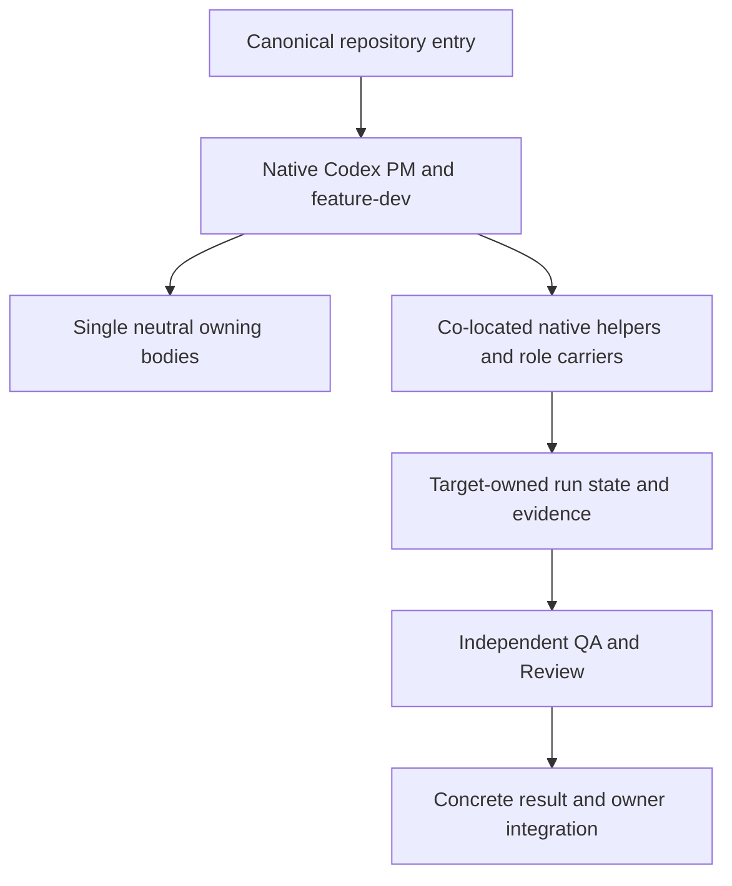

$START_DOC_M27_COVERAGE
# M27 self-contained methodology coverage contract

**PURPOSE:** Define the owner's accepted non-regression outcome and the evidence needed before implementation and activation.
**SCOPE:** Framework-wide method ownership and its native Codex adaptation; preparation only in this checkpoint.
**KEYWORDS:** single source of truth, functional parity, source accounting, autonomous development, native loading

$START_DOCUMENT_PLAN
- GOAL Consolidate all applicable current in-house development methodology => M27-GOAL
- CONTRACT Define coverage and compatibility obligations => M27-CONTRACT
- USE_CASE Verify an independent complete development cycle => M27-PROBE
- DECISION Separate preparation, exact implementation scope and activation => M27-GATES
$END_DOCUMENT_PLAN

$START_SECTION_CONTRACT
$START_ARTIFACT_COVERAGE
**TYPE:** PRINCIPLE
**KEYWORDS:** parity, source ownership, input population
$START_CONTRACT
**PURPOSE:** Make the canonical repository and Codex package sufficient for the owner's current development methodology.
**DESCRIPTION:** The owner requires coverage at least equal to the currently used in-house skills and plugins, consolidated in one maintained repository, with no necessary external in-house methodology connection. This is the accepted outcome; matching skill names alone is not acceptance evidence.
**RATIONALE:** A source handover without operational parity or actual source binding leaves competing constitutions and hidden dependencies.
**ACCEPTANCE_CRITERIA:** Every applicable baseline duty has a verified current owner, a native invocation or mechanism where owed, and applicable behavioral evidence. No unexplained missing, partial or unverified applicable row may be called complete.
$END_CONTRACT
$START_BODY

## Baseline and source accounting

Input: [measured reconnaissance](../notes/RECON_2026-10-13_self-contained-coverage.md). Baseline the actual installed native PM package (S1), current project-methodology package (S2), current prompting-methodology package and its referenced bodies/templates (S3), and applicable owner loading/working defaults (S4). Inventory supplementary in-house development entrypoints as applicability inputs; do not silently absorb another engine's runtime or start it. The historical source-accounting decisions remain; the excluded obsolete repository is not reopened for exhaustive mining.

Store private source locations, names, source hashes and lane receipts outside tracked public source. The checked public matrix uses source IDs, duty descriptions, exact destination paths, evidence references and status. A disposition is FULL, PARTIAL, MISSING, UNVERIFIED or explicitly inapplicable with source-backed reason. A deferred activation is a separate axis: it does not discharge missing capacity. Current sources are comparison inputs; the completed repository becomes the maintained authority rather than an import dependency.

## Requirements

- **BR-1 Compatibility:** Preserve neutral/package boundaries, current role/return/run-state contracts, owner grants, failure history and README Local use. Any actual semantic or interface change must be explicitly specified and versioned before Code; do not weaken a checker or silently waive a protected requirement.
- **BR-2 Coverage:** Account for actual source files and duties, producers and consumers, triggers, templates, helper commands, checks, hooks and ordinary error/refusal paths. Verify both source-to-destination completeness and the converse purpose of new mechanisms. Do not infer parity from counts or labels.
- **BR-3 PM operability:** Cover startup/orientation, measured recon, greenfield/brownfield specifications, bounded batch planning and execution, decision provenance, task/route tracking, handoff, maps and result integration. Port required executable checks and safeguards into native supported mechanisms; prose alone is not equivalent to an executable guard.
- **BR-4 Autonomous flow:** Preserve native Bootstrap → Architect → Code → fresh independent QA → independent Review → separately assigned Architect Finalize. Code/QA/Review findings route through counted Debug and renewed checks. Root owns state and integration; failed/held history, finite budgets, input identity and same-run resume survive interruption. No outside in-house flow or cached constitution supplies a missing phase.
- **BR-5 Prompting:** Cover applicable GRACE, proposal/selection, structured markup, decomposition, verification, agent design, output contracts and actual-target evaluation. Existing detailed neutral bodies may be reused; connect the right native triggers and carriers. Preserve DRAFT/NOT_RUN until actual required evaluation passes.
- **BR-6 Experience and analysis:** Preserve available analysis/candidate-handling capacity and source-backed evidence where the baseline supplies it. Lightweight error recording remains current practice. Consolidating a capability does not launch systematic learning, improvement measurement, experiments, monitoring or automatic rule promotion.
- **BR-7 Self-sufficiency:** Applicable native entries, role carriers, protocols, templates and helpers resolve within this complete repository. Missing/stale sources refuse dependent work; never silently fall back to an older installed copy. Built-in host tools, model service and documented general-purpose runtime dependencies remain environment requirements, not external in-house methodology sources.
- **BR-8 Activation:** Prepare source-bound entry, loader/preference changes and a fresh-session verification method. Identify the exact superseded in-house connections and preserve unrelated settings. Do not report a changed active catalogue from a file edit or this existing chat. Global activation needs its matching concrete owner decision and live source-binding proof.

## Expected architecture

Neutral methods own the common duties; Codex owns its actual host binding and executable mechanisms. Avoid another copied constitution. A required incomplete neutral owner must be completed or given an accurately specified applicability boundary by its governing authority, not hidden behind a wrapper.

## Preparation scope and held implementation

M27 MAY EDIT only this contract, the reconnaissance/synthesis note, its public duty matrix `notes/m27-coverage-matrix.json`, and the four current PM records. Source packages, neutral norms, checkers, tests, guards, versions and user configuration are read-only in M27. The root alone writes those records; independent lanes write private read-only findings.

After measured source accounting, prepare exact bounded implementation slices with named paths, interfaces, ACs, commands and probes. Architect/Code, native consumer execution, loader changes, main integration and public visibility are not implied by this preparation artifact. Existing explicit matching future approvals count; no repeated approval of this already accepted outcome is needed.

## Completion proof for the eventual implementation

- **AC-COVERAGE:** The frozen source population and converse inventory are complete; every applicable duty is FULL with observable proof and no unexplained external in-house dependency. Disposition reasons are independently reviewed.
- **AC-BEHAVIOR:** Required PM checks, safeguards, prompt outputs and analysis interfaces have meaningful real positive and refusal controls through their shipped native invocation. Applicable old failures are retained as regression inputs rather than copied as desired behavior.
- **AC-FLOW:** A fresh canonical-source native run completes the authorized useful task through the real roles, independent checks and Finalize; an actual failure/repair route and same-run interruption/resume prove history, scope and budget retention. Simulated helper state alone does not meet this criterion.
- **AC-ISOLATION:** The supported loading profile is exercised with superseded in-house methodologies unavailable, within an isolated owned environment. Actual loaded sources, target output, logs and current input identities are checked; missing host prerequisites remain explicit.
- **AC-REGRESSION:** Applicable root/package, adapter/privacy, map and contract checks pass on the changed identity; whole README Local use, foreign state and unrelated settings are preserved. Select checks by actual invariants, not implementation-mirroring assertions.
- **AC-ACTIVATION:** After owner-authorized rollout, a fresh native session proves canonical methodology binding and no old in-house fallback. Preserve a recoverable prior configuration and current authorizations. Public visibility remains a separate decision.

## Risks and decisions

Host-native safety enforcement may differ from the source hook; equivalent prevention and real refusal evidence are required before claiming parity. Source descriptions can contradict their actual helper; retain the finding and port the corrected invariant. Completing coverage is not a model-effectiveness claim. A single sequential development stream remains the initial validation profile; multiple concurrent feature writers are not introduced by this task.

$END_BODY
$START_LINKS
**IMPLEMENTS:** M27-GOAL
**REQUIRES:** M27-GATES
$END_LINKS
$END_ARTIFACT_COVERAGE
$END_SECTION_CONTRACT
$END_DOC_M27_COVERAGE
