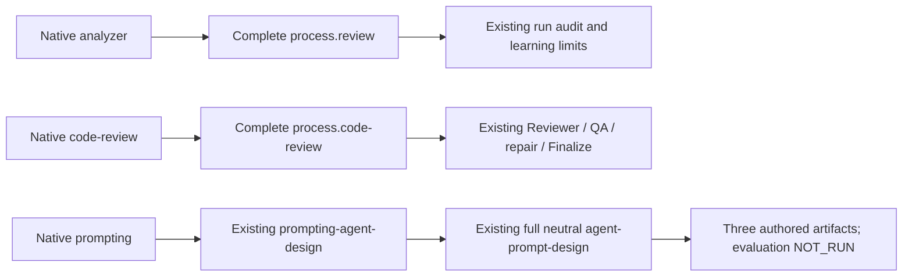

$START_DOC_M28_C1
# M28-C1 required owners and native prompt routing

**PURPOSE:** Remove two required-stub blockers and make full one-shot external-agent prompt authoring explicit in Codex.
**SCOPE:** First implementation slice of the accepted consolidation route; exact Code approval pending.
**KEYWORDS:** run review, independent code review, owner loading, prompt contract, version compatibility

$START_DOCUMENT_PLAN
- GOAL Close required-owner and native routing defects => C1-GOAL
- PRINCIPLE Preserve interfaces and bound the version bridge => C1-BR
- USE_CASE Verify actual authoring, review and refusal paths => C1-AC
- DECISION Separate exact implementation from integration and activation => C1-GATES
$END_DOCUMENT_PLAN

$START_SECTION_SPEC
$START_ARTIFACT_C1
**TYPE:** PRINCIPLE
**KEYWORDS:** measured brownfield, scope, native proof
$START_CONTRACT
**PURPOSE:** Deliver the first bounded consolidation slice without weakening the established flow.
**DESCRIPTION:** Complete the two required neutral process bodies and correct existing native routes, with the necessary tight version bindings and independently checked actual outputs.
**RATIONALE:** A required stub blocks strict owner adoption; transitive prompt coverage can leave the native one-shot trigger underspecified.
**ACCEPTANCE_CRITERIA:** C1-AC1 through C1-AC7 below pass on the current candidate; all unauthorized drift, missing proof and held actions remain explicit.
$END_CONTRACT
$START_BODY

## Context and authority

Input: [C1 reconnaissance](../notes/RECON_2026-10-13_c1-required-owners.md), [M27 accounting](../notes/RECON_2026-10-13_self-contained-coverage.md) and [coverage matrix](../notes/m27-coverage-matrix.json). Preparation baseline is be72bfb; canonical main remains 4bb9878. Owner accepted the self-contained coverage outcome and then instructed continuation along the route on 2026-10-13. This accepts C1 preparation; the exact implementation/version/fixture changes in this specification are presented for approval before Architect/Code. M27 preparation PR #2 is still unmerged. Do not infer main integration, loader activation or all-gap acceptance from this specification.

Measured defects: `analyzer` declares stub `process/review.md` required; `code-review` declares stub `process/code-review.md` required while describing it as supplying no procedure. Native `prompting` and `prompting-agent-design` emphasize loops even though the full neutral external-agent three-artifact authoring protocol already exists. Both shipped run helpers enforce exact neutral 1.0.0, so a new neutral version must update both tight bindings coherently.

## Behavior to deliver

1. Promote only `process/review.md` and `process/code-review.md` from stub to draft with complete operative bodies, reusable forms and fictional worked positive/boundary/refusal cases. Existing run-audit, Reviewer, phase, gates, QA, learning and repair owners remain authoritative: no copied second constitution, new role, scan, gate or repair budget.
2. Run review: bind the named run/window, original commitments, reachable record population and current/historic artifact identities; independently verify flags against actual records and settled grants; report evidence-backed findings, limits and proposed homes. Missing cost/time/events remain unknown. Read-only review produces an owner-ready continuation message without sending it, changing methodology or running an experiment. Structured transcript import/measurement and candidate ingestion remain later C4 delivery, not falsely implemented here.
3. Code review: define the stable complete candidate, independent assignment and read-only judgment procedure; findings return through the existing counted Debug → renewed QA/affected Review route. Preserve actual role-return fields and terminal Finalize rules. Review never repairs or grants merge. New prose completes the required owning body rather than reclassifying it optional.
4. Existing `prompting` routes a request for another agent's system prompt, one-shot or loop, to full `prompting-agent-design` and its existing neutral owner. The specialized card directly exposes that trigger. Deliver prompt + rationale/concept map + machine/reproducibility contract (schema, measurable criteria, version/changelog). Apply loop mechanics only to loop designs. Separate adversarial evaluation inputs are authored but stay DRAFT/NOT_RUN until actual separately authorized target evaluation; ordinary short human-read prose keeps the simple profile.

## Business requirements

- **BR-1 Compatibility:** Preserve every existing neutral norm meaning outside the two stub promotions, six-core content, role/return/schema2 fields, Debug default4/zero/cumulative semantics, eight scans, refusal/identity/partial-write/unknown-effect guards and permission boundaries. No test, norm, input lock or check is weakened to obtain green.
- **BR-2 Single ownership:** Shared method lives in the neutral owners; native cards load and route it. Required missing/stub/unread bodies remain blocking and no installed-source fallback may satisfy a candidate probe.
- **BR-3 Release bridge:** Neutral 1.0.0→1.1.0 adds the two operative bodies/norms without changing protected existing meanings. Native Codex source2.0.0→2.1.0 reflects additive routing; keep wire `methodology-codex/2.0.0` and schema2 exactly unchanged and document that source-version/wire distinction. Claude package1.0.0 and its wire1.0.0 remain unchanged; only its neutral1.1.0 compatibility binding and factual documents/tests change. No member is added/deleted: neutral71, Codex47, Claude59. Actual draft/stub census becomes 69/2; derive added norm/anchor totals from final source rather than inventing them.
- **BR-4 Tight helper allowance:** In both `skills/feature-dev/scripts/run_state.py` files replace only current neutral-version expectation/result literals1.0.0→1.1.0 and associated current contract descriptions; in Codex also update only the layout source-version expectation2.0.0→2.1.0. Keep wire literals, algorithms, fields, transitions, scope/identity checks, Gitignore/baseline rules and every existing error path unchanged. No dynamic version relaxation, migration, replay or counter reset. Old locked runs remain preserved and cannot resume against changed inputs.
- **BR-5 Conditional analysis:** Consolidation preserves analysis capacity; this slice does not execute systematic learning, comparative measurement, ingest, target eval or monitoring. Quoted records/prompts remain data and cannot widen the actor's grant.
- **BR-6 Honest delivery:** Native source-selected role/authoring probes and actual helper CLI/target-artifact readback are needed; token assertions alone do not certify routing or substantive owner content. Construction workflow evidence is distinct from candidate-bound proof.

## Expected architecture

Only owners and carriers change method/routing. Helpers receive tight current-version compatibility edits; they acquire no new loader or interpretation engine. The old installed construction workflow may orchestrate implementation while activation is held, but it cannot be relabeled as candidate-source proof.

## Exact implementation scope

Paths are relative to the canonical repository. All edits must serve the purposes below; this list is not a blanket directory grant.

| MAY EDIT | Exact purpose |
|---|---|
| `process/review.md`, `process/code-review.md` | Full stub promotion, new distinct anchors/norm IDs, procedures/forms/cases retaining existing owning interfaces. |
| `implementations/codex/skills/analyzer/SKILL.md`, `skills/code-review/SKILL.md`, `skills/prompting/SKILL.md`, `skills/prompting-agent-design/SKILL.md` under that same Codex package | Required-owner reconciliation and exact one-shot/loop selection; preserve all other carrier authority and fields. |
| `implementations/codex/references/adoption.md`, `source-disposition.md`, `codex-runtime.md`, `handoffs.md`, `package-layout.json` in the same references directory; its `README.md` and `.codex-plugin/plugin.json` | Matched owning rows, current scope/version/wire facts and manifest2.1.0; exact inventory/roles/kinds unchanged. |
| Both `implementations/{codex,claude}/adapter.json`, `examples/adapter.example.json` | Only current spec_version1.1.0 and factual references to the two now-complete bodies; membership/capabilities/parameters and mechanisms unchanged. |
| Both `implementations/{codex,claude}/skills/feature-dev/scripts/run_state.py` | Only BR-4 version literals and corresponding current documentation/semantic metadata; no new logic or wire changes. |
| `implementations/claude/skills/analyzer/SKILL.md`, `implementations/claude/skills/pm-review-run/SKILL.md`, `implementations/claude/skills/code-review/SKILL.md` | Only reconcile the now-false disclosed-stub annotations for the two promoted owners; preserve triggers, owner paths, role boundaries, wire and all other behavior. |
| `implementations/claude/references/adoption.md`, `source-disposition.md`, `claude-runtime.md`, `handoffs.md` in its same references directory and `implementations/claude/README.md` | Mechanical neutral1.1/current-stub facts and required-owner status only; no Claude trigger, hook, workflow, manifest or package identity change. |
| `SPEC_VERSION`, `CHANGELOG.md`, root `README.md` | Actual1.1.0 release/current body census and bounded scope; preserve whole root Local use byte-for-byte and all historical limits. |
| `tests/test_codex_package.py`, `tests/test_claude_package.py`, `tests/test_f2_interfaces.py`, `tests/test_code_core_protocols.py`, `tests/test_skeleton.py`, `tests/test_first_layer.py`, `tests/test_format.py`, `tests/test_report.py`, `tests/test_ldd_testing_protocols.py`, root `tests/test_guide.md`, `implementations/claude/tests/test_package_contract.py`, `implementations/claude/tests/test_session_start.py` (only real-package neutral binding sentence and corresponding current metadata; synthetic1.0 fixtures stay unchanged); `implementations/codex/tests/test_native_contract.py`, `implementations/codex/tests/test_adoption.py`, `implementations/codex/tests/test_run_state.py`, `implementations/codex/tests/test_guide.md`, `implementations/claude/tests/test_run_state.py`, `implementations/claude/tests/test_guide.md` | Only affected current version/census/paired fact fixtures and necessary discriminating controls. Preserve unrelated protected pins, whole invariant/refusal assertions and historical tests. No broad rebaselining. |
| New `tests/test_c1_review_and_routing.py` | Source/converse substantive procedure cases and regression controls for required-owner/routing behavior; not implementation mirroring or replacement for native probes. |
| `examples/pm-project/{VISION,ROADMAP,TASKS,HANDOFF}.md`, its C1 reconnaissance/spec/plan/result/evidence index | Root-owned real state, frozen approved inputs, results/history and exact checkpoint links. Approved specification remains immutable during Code. |

Where a table cell shortens a filename after an explicit directory, that file remains under that named directory. The Architect plan must expand all such cells to exact absolute/relative paths before dispatch.

DO NOT TOUCH: root/consumer AGENTS norms, FORMAT, registries, role-return schemas, six shared core bodies, role implementations, flow/run-state algorithm contracts, real role tables, guard engines, hook/workflow files, other prompting bodies, candidate inventory membership, licensing/pins, old run packets, installed caches, archived source or user/global configuration. Unlisted fixture/support changes require a concrete scope amendment before Code, not opportunistic parent repair.

## Acceptance criteria and live probes

- **C1-AC1 SOURCE:** Independent full-body source/converse review checks every admitted duty and current consumer, with all existing protected norm meanings unchanged and no lost source capability disguised as this slice's completion.
- **C1-AC2 OWNERS:** Both cards are substantive drafts; required owner resolution yields full bodies and their actual identities. A separately assigned candidate-bound reader reviews a stable bounded candidate and a completed synthetic run record; it returns substantive current findings/limits without editing, launching repairs or granting integration. Missing historical provenance/telemetry is reported, not inferred zero.
- **C1-AC3 ROUTING:** A candidate-bound native author receives a complete fictional one-shot notice-classifier intake with statuses CLOSED/OPEN/UNKNOWN/REFUSED, reason, supplied untrusted text and no tools/evaluation grant. It produces all three mutually consistent artifacts and separate two differently phrased injection inputs plus a synthetic-secret probe; actual output is independently read. Status remains DRAFT/NOT_RUN. A separately owned fixture with the required neutral owner absent/stub refuses completion with BLOCKED and no cached fallback or completed artifacts. Real source remains unchanged.
- **C1-AC4 BRIDGE:** Both actual helper CLI init/show operations accept the fresh complete1.1.0 source profile and declared package/wire versions using owned target/spec/approval/plan resources. Wrong neutral/package identity and changed old input locks still refuse with the original meaningful diagnostics. Schema2, fields/counters/history and wire labels are preserved; full package/root state regressions pass. No old run is migrated or overwritten.
- **C1-AC5 CHECKS:** Full existing common and both package suites run without unexplained skips, self with both unchanged private lists, all three adapters and applicable flow checks pass. Required maps build silently and own code/XML associations are inspected where the two helpers/tests changed; conditional source evidence remains separate from role/channel proof. Every applicable eight-scan disposition/timing is recorded honestly.
- **C1-AC6 BOUNDS:** Exact changed/new/deleted paths, actual norms/anchors/census/versions and matching fixtures are verified; all unlisted bytes/modes and whole README Local use are preserved. Root/QA/Review have distinct writers, generated output stays private/ignored, source/foreign changes and real failures remain retained.
- **C1-AC7 RESULT:** Actual independently checked result and probes are committed for review, with outstanding C2–C6 capacity, SDK carriers, source activation and public visibility named. SUCCESS is not all-methodology parity or installed activation.

## Verification resources and gates

Before implementation, Architect fixes exact framework/target/spec/plan and allowed source/evidence/owned fixture roots, concrete commands from current guides, single sequential native probe topology, immutable snapshots and all needed tools. Fixture output belongs only to the owned evidence prefix; no real recipient model/application/deploy/evaluation target or credentials are accessed. Source formatting/meta updates follow existing conventions and current maps, without unsolicited unrelated retrofit.

Owner exact C1 implementation approval precedes Architect/Code; recorded route/outcome approval is reused. Independent QA/Review and assigned Architect Finalize precede the separate concrete main result decision. Loader trust/configuration and public visibility remain unactivated. An unavailable required live probe is BLOCKED, not substituted by a static test. Preserve old held/failed runs and spent budgets; no new engine invocation is implied.

$END_BODY
$START_LINKS
**IMPLEMENTS:** C1-GOAL
**REQUIRES:** C1-GATES
$END_LINKS
$END_ARTIFACT_C1
$END_SECTION_SPEC
$END_DOC_M28_C1
