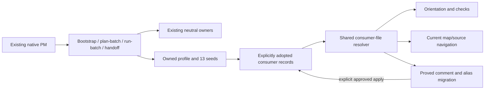

$START_DOC_M28_C2
# M28-C2 self-contained native consumer PM profile

**PURPOSE:** Let the Codex package bootstrap, orient, check, navigate and safely migrate a consumer project without external in-house methodology.
**SCOPE:** Exact approved second consolidation slice; Code authorized by the recorded owner decision.
**KEYWORDS:** explicit adoption, PM records, batch, code map, safe migration, exact source bridge

$START_DOCUMENT_PLAN
**SECTION_SPEC:**
- GOAL Enable self-contained native consumer project management => C2_GOAL
- PRINCIPLE Bound the consumer profile, tools, protected interfaces and actual proof => C2_SPEC
$END_DOCUMENT_PLAN
$START_SECTION_SPEC
$START_ARTIFACT_C2_GOAL
**TYPE:** GOAL
**KEYWORDS:** self-contained consumer PM, explicit adoption, useful operational proof
$START_CONTRACT
**PURPOSE:** Make native project management usable from the canonical package without external in-house methodology.
**DESCRIPTION:** A native custodian adopts the bounded profile, materializes actual records, checks their state, navigates real code maps and performs only explicitly authorized proved migrations.
**RATIONALE:** These measured operational gaps remain after completed C1 owner/routing closure.
**ACCEPTANCE_CRITERIA:** C2-AC1–8 provide current independently checked behavior and commit-for-review proof; integration and installed activation keep their matching decisions.
$END_CONTRACT
$START_BODY
The intended result is the explicit native consumer capability described by C2_SPEC, not implicit adoption by existing projects or all-methodology completion. Preserve richer existing neutral owners and authentic consumer authority; the source75 duties/22 checklist rows receive named compatibility/applicability dispositions. C3/C4 capacity and C5/C6 integration proof remain later. This goal does not itself grant Code.
$END_BODY
$START_LINKS
**IMPLEMENTS:** (none)
**IMPACTS:** C2_SPEC
**REQUIRES:** C2_RECON in [C2 reconnaissance](../notes/RECON_2026-10-13_c2-consumer-profile.md)
$END_LINKS
$END_ARTIFACT_C2_GOAL
$START_ARTIFACT_C2_SPEC
**TYPE:** PRINCIPLE
**KEYWORDS:** native profile, strict file coverage, safe apply, source binding, actual delivery
$START_CONTRACT
**PURPOSE:** Close the measured C2 operational gaps through a bounded native profile and tools.
**DESCRIPTION:** Add explicit consumer seeds/entries and shared file-based commands while preserving neutral and native execution contracts.
**RATIONALE:** Existing prose cannot replace shipped checking/navigation/migration mechanisms, and the original tools contain measured false-green/corruption defects.
**ACCEPTANCE_CRITERIA:** C2-AC1–8 pass on the final judged candidate, with held capacities and original failures retained.
$END_CONTRACT
$START_BODY

## Context and authority

Input: [C2 reconnaissance](../notes/RECON_2026-10-13_c2-consumer-profile.md), [exact delivery contract](../notes/m28-c2-delivery-contract.json), [M27 route](m27-self-contained-coverage.md). Baseline8d984ed follows owner-approved C1 merge4a718d7 and checked factual closure. Actual neutral1.1/Codex source2.1/wire2.0/schema2, Codex47/23skills/6roles/2helpers and Claude59/source1.0 remain current during preparation.

Owner requested merge and route continuation on 2026-10-13. This grants C2 reconnaissance/specification, not the new files/version/binding edits below. Exact C2 approval precedes Architect/Code. Original C1/M27 specs, plans, matrix, failed/held history and exhausted C1 counter remain preserved. A new approved C2 feature is not a restart of C1 repairs.

## Behavior and native profile

1. Supply opt-in profile `methodology-consumer-pm/1.0.0`. Account every75 source CV duty and22 checklist row against its existing neutral owner, native form/check and current applicability/limit. Separate native consent/model bindings from source1.4.0; retain a read-only recognized legacy-dialect path without silently adopting or rewriting it. No extra neutral subject or FORMAT exemption.
2. Declare single/layered role homes, writer ownership, common provenance, accepted decision immutability, task class/status/outcome/stops and exact gate scope. Defaults:600 lines for the five declared always-read consumer records,150 handoff lines/two date-led State items,300 characters per route step/25,000 per route. These are profile-local values. Preserve overflow evidence instead of deleting it. Generated metadata uses the actual actor/clock/channel; templates and fixture facts never grant approval.
3. Package13 seed resources: AGENTS, optional interoperable CLAUDE, CONVENTIONS, VISION, ROADMAP, HANDOFF, TASKS, DEC, SPEC, RECON, OPEN_QUESTIONS, Doxyfile and gitignore. Materialized forms compose the richer existing owners. Do not overwrite existing records/.gitignore or accepted decision bodies; preserve original homes and inbound links before an explicitly authorized migration. CLAUDE availability does not make it required in a Codex-only profile. CONVENTIONS declares the adopted profile and actual overrides; it is not a second copied neutral constitution.
4. Add four explicit native entries: pm-bootstrap for genuine new or existing-profile onboarding; pm-plan-batch for bounded proposed tasks; pm-run-batch for the actually approved packet with exact feature-dev scope; pm-handoff for statuses/evidence/decisions/current baton/check/authorized closure. Existing clear matching consent counts; no mandatory unsupported structured question or fixed model/provider setting. An M task needs an exact covered specification and existing independent flow; unsupported scope returns a blocker rather than inventing approval.
5. Ship read-only `orient`/`orient --check` plus explicit multi-project portfolio invocation, `codemap` file/symbol queries, and `markup_migrate` dry-run/check/explicit apply. Real commands are `python3 -B <package>/skills/pm/scripts/<command>.py <owned-project> ...`; no PATH/plugin/hook installation. Orient's portfolio takes explicit bounded roots or an explicit roots file; it does not discover unrelated projects through old host registries.
6. One shared `consumer_files.py` supplies supported metadata/path/config/coverage reading to all three commands. Resolve actual reset/append assignments, quoted paths, comments/continuations, recursion, file patterns, exclusions and symlink policy consistently. Native seeded Doxyfile syntax must be fully supported. Unresolved variables/includes/unsupported constructs, missing/unreadable/invalid input or unknown coverage produce explicit unavailable/refusal status, never an empty successful population. Do not promise all Doxygen/YAML grammar; document the supported subset and preserve unknown extra project metadata without treating it as consent.

## Business requirements

- **BR-1 COMPATIBILITY/AUTHORITY:** Preserve owner precedence, authentic existing chat grants, two result/spec decisions, readonly analysis, one writer and foreign state. User-owned declared profiles win over defaults. No auto-commit/merge/installation/provider/network/ingest/consumer-code action from a checker or template.
- **BR-2 CORE:** All neutral bytes, FORMAT/registries/roles/phases/gates/returns/schema2/wire labels/Debug default4/zero/cumulative and old input/unknown-effect/refusal guards remain unchanged. No broad rewrite of existing code markup or scope widening. Whole root README Local use stays byte-identical.
- **BR-3 RELEASE:** Codex source2.1→2.2, exactly26 added members and73 total,27 skills/six roles/six helpers; neutral1.1 and complete Claude package remain unchanged. Layout/plugin/independent expected inventory/current facts update together. No new member kind/schema/role. Both old and new locked runs retain history; changed source locks refuse, never migrate/reset.
- **BR-4 TIGHT BINDING:** Existing Codex run_state.py changes ONLY `_bindings` source-version2.1→2.2 and exact member47→73 constants plus corresponding current metadata. No algorithm/API/transition/control/error-path change. The C1 fixed baseline AST pins stay fixed; add only precise normalization of the newly authorized member constant/current source signature, preserving mutant rejection and original five bridge sites. No dynamic inventory relaxation or new-version healing.
- **BR-5 ORIENT:** Individually preserve/check all applicable source rows, including real nested provenance, current marker/headings/budgets/task fields/active handoff freshness/DEC reservations and scalar/inline/block-list amendment targets. Fix the measured missing-target false PASS. Metadata checks are structural evidence; authentic human authority/accepted-body immutability remains independently judged. Fake/future/malformed required provenance and unreadable-only coverage cannot PASS.
- **BR-6 MAP:** Actual file population/config and current own XML/entity/location/paragraphs control map answers. Lifecycle `in progress` does not imply a current complete answer. Missing/stale/broken/excluded/ambiguous inputs disclose actual reason and source fallback or refusal; by-name call relationships are labelled finite/static, never a dynamic resolved graph. No Doxygen/model/source execution from codemap. Doxygen build is separately authorized output generation.
- **BR-7 MIGRATION:** Dry-run is default; check distinguishes clean/due/unavailable. Apply needs exact target/file scope and recorded parent authority; a worker flag cannot authenticate owner consent. Preserve literals/non-comment tokens, AST per every promised installed interpreter, tags/continuations/newline modes and unknown/custom aliases. Fix same-line alias offsets and validate actual effective Doxyfile after transformation. Verify all proofs and current original bytes/modes/regular-file/contained symlink-safe paths before any write. One failed proof prevents all writes. Atomic per-file replacement and rechecks are required; a later unavoidable filesystem failure reports actual completed/unwritten/unknown effects and preserves recovery data, never false all-or-nothing SUCCESS or blind replay. No implicit Git/build/profile adoption.
- **BR-8 LIMITS:** C3 automatic safeguards/trust and C4 ledger/import/SDK capacity stay explicit later work. C2 reports local candidate statuses; a required missing ledger comparison is unavailable, not PASS/no-history and never old-source fallback. Routine learning/evaluation/monitoring stays dormant. C5 fresh whole-flow autonomous/resume proof and C6 loader handover are not certified by C2 fixtures.

## Expected architecture

Three CLI modules share one configuration/population contract; roles and feature-dev engine are reused. Typed package assembly and independent inventory remain distinct from neutral validation. Architect expands commands/resource roots and performs the existing visual gate before Code; design graph is not generated XML evidence.

## Exact scope

The [delivery contract](../notes/m28-c2-delivery-contract.json) freezes all26 new members and32 eligible existing paths. No undeclared tracked fixture/support file may be added; the four new test modules create explicit synthetic owned temporary fixtures. Each existing edit must serve only the following purpose:

| Existing path group (fully enumerated in contract) | Exact purpose |
|---|---|
| Codex manifest/layout/README/adapter and adoption/disposition/runtime/handoffs | Source2.2/exact73 inventory, explicit consumer routes/commands and honest held capacities; preserve wire/schema/kinds/roles/profile-root. |
| Codex pm/greenfield-bootstrap/durable-layer/roadmap/document-protocol | Route actual selected profile/batch/onboarding/closure; keep genuine-greenfield classification and short-task behavior. |
| Codex semantic-exoskeleton and Searcher carrier | Factual package signature and optional owned current codemap navigation; no core/role authority change. |
| Codex feature-dev run_state.py | Exactly BR-4 two binding constants/current metadata only. |
| Codex Doxyfile | Add actual new PM-helper coverage, no unrelated alias/config change or hidden fixture coverage loss. |
| Existing Codex adoption/native-contract/run-state tests and guide; listed root tests/guide | Exact paired version/member/skill/helper facts, current semantic metadata and necessary discriminators; preserve all unrelated pins/assertions/history. Source tests are evidence to port, not an excuse to replace stronger native checks. |
| Root README/CHANGELOG | Bounded native2.2 description with exact Local use preservation; no neutral version bump. |
| Actual current4, C2 recon/spec/contract/result/evidence | Root-only durable state and proof; approved spec immutable inside Code. |

DO NOT TOUCH: root/consumer AGENTS norms, neutral71 bodies/templates/FORMAT/SPEC_VERSION/registries/schema/check engines, six core, native role set/flow/guard/hook/workflow, all Claude files, source1.4 originals/installed caches/global settings/credential/provider configuration, original M27 matrix and C1 approved inputs/failures/budgets. Framework maintenance remains under its existing examples exception; no adoption/migration of its actual documents. Searcher carrier change grants neither a new role nor new parallel feature writers.

## Acceptance criteria and actual probes

- **C2-AC1 ACCOUNTING:** Independent full source/converse review accounts75 CV duties/22 checklist rows, all13 resources/four PM triggers and complete producer/consumer paths. Actual dialect/authority adaptations and C3/C4 limits are explicit; no lost capacity hidden by rename or deferral.
- **C2-AC2 PROFILE:** A source-selected native bootstrap/onboarding actor produces useful filled consumer records from a bounded fictional product brief, without old own sources. An arriving independent reader recovers goal/current/next/grants/limits through actual homes. Separate existing-project control with absent preferred filename preserves original content/history/links and refuses ungranted overwrite/migration. The actual framework remains untouched.
- **C2-AC3 BATCH/CLOSURE:** Candidate-native entries produce a proposed packet, execute only the explicitly probe-authorized harmless S record task and refuse an uncovered M/Code request; handoff reflects real artifacts/grants/failed/held rows and four actual headings. Actual probe grant is the approved C2 fixture scope, not fabricated consumer-product consent. No synthetic Gate A/B becomes owner main approval. Static forms alone do not prove routing.
- **C2-AC4 CHECKER:** Actual owned CLI/import controls cover selected-profile positive/idle/single/layered/portfolio, malformed/fake/future metadata, missing/duplicate markers, wrong headings, budgets at/beyond threshold, incomplete task/grant fields, old active handoff, DEC reservation/supersession and every amended_by scalar/inline/block-list target. Legacy undeclared/unsupported profile is reported without coercion. Current original logs/argv/exits/readback and all retained negative populations are inspected.
- **C2-AC5 POPULATION/MAP:** Checker/map/migrator independently agree on actual sources for reset/append/quotes/comments/continuations/recursion/exclusion/symlink controls; the source omission mutant is discriminated. Real silent Doxygen builds on owned software fixture feed actual codemap file/symbol/ambiguous/nested/async/alias/current/broken/stale/in-progress answers. Inspect own rich paragraphs and current source/config/location identities; never borrow another entity's fields or promote fallback/partial answer to full.
- **C2-AC6 SAFE APPLY:** Real dry/check/apply/idempotence on owned copied old-markup software fixture; compare printed changes, complete before/after bytes/modes, Python tokens and per-interpreter AST. Test triple-quoted comment-shaped text, missing anchor, multiple same-line/custom/reset aliases, CRLF, failed parse/proof, external/symlink targets, changed bytes between plan/apply and late-write failure. Failed preflight leaves all files untouched; partial failure retains honest exact effects and original recovery evidence. After approved safe apply, rebuild real map and independently read its retained content. Original source/package/foreign resources unchanged.
- **C2-AC7 REGRESSION/BOUNDS:** Full common/both package suites, unchanged both privacy lists, three adapters and applicable flow checks; all eight named QA scans with trigger-based dispositions. Native73 members/27skills/6helpers/6roles, neutral71/1.1 unchanged and Claude59 unchanged; fixed pin/schema/control guard mutants still refuse. Three final maps on complete owned copies build silently with per-file own code/XML associations and protected source/modes/Local use proof. New own code gets complete existing rich contracts/LDD; existing binding constant edits stay edit-local with no unsolicited retrofit.
- **C2-AC8 DELIVERY:** Current independent QA → whole Review → assigned Architect Finalize, actual scopes/logs/maps/probes, root result/current4 closure and independent metadata audit precede commit-for-review. Retain original source findings and all failed attempts. Deliver concrete bounded result; main integration, automatic hooks, SDK/import/candidates, autonomous C5 proof, global installation and C6 activation remain separate.

## Resource and risk contract

Construction uses an immutable complete co-located copy of integrated canonical baseline Codex2.1/neutral1.1, with its actual schema2 helper and current eight-scan/Review return contracts. Pin all271 source bytes/modes, actual package path, source/wire/schema and carrier/core identities. This construction FRAMEWORK is separate from mutable target W and every complete2.2 candidate/probe snapshot. Fresh approved C2 runId/target/spec/plan/input locks, parent-owned state/receipts and its budget are separate from preserved C1 manual ledger/spent4/4; source changes never mutate FRAMEWORK, migrate input locks or refund old spend. Before role dispatch, verify real baseline2.1 init/show/refusals and actual source adoption with producing commands/identities. Baseline construction proof cannot satisfy candidate2.2 probes or C5 consumer autonomy. No installed source/provider/loader change is performed.

Architect fixes actual package/framework/target/spec/plan, interpreter executables, protected source snapshot, exact one-writer allowed paths, owned no-Git fixture roots and logs/maps before dispatch. Use Python3.9 supported floor and actual authoring3.12 where promised; missing required interpreter/build/evidence blocks its obligation rather than silently narrowing proof. No extra install/provider/account/service/network requirement is introduced. Native probes are sequential; multiple feature writers remain excluded.

CLI status/shape contracts and precise supported input syntax are frozen in the Architect plan/guide before Code, preserving source0/1/2 meanings where applicable and explicit safe unavailable semantics. Non-repository fixture exceptions need the actual filesystem baseline; Git observations use existing safe canonical mechanisms without source-hook/global-registry dependencies. Doxygen template choices derive from actual declared source, never guessed directories or a timestamp-only complete-map assertion.

Every prospective native check above is NOT_RUN in preparation. Exact owner C2 approval starts feature-dev; separate result consent precedes main merge. Any scope expansion, neutral norm/API/schema/guard change or extra member requires a concrete amendment. No duplicated approval for already granted C1 integration or consolidation outcome.

$END_BODY
$START_LINKS
**IMPLEMENTS:** C2_GOAL
**IMPACTS:** (none)
**REQUIRES:** C2_RECON in [C2 reconnaissance](../notes/RECON_2026-10-13_c2-consumer-profile.md)
$END_LINKS
$END_ARTIFACT_C2_SPEC
$END_SECTION_SPEC
$END_DOC_M28_C2
