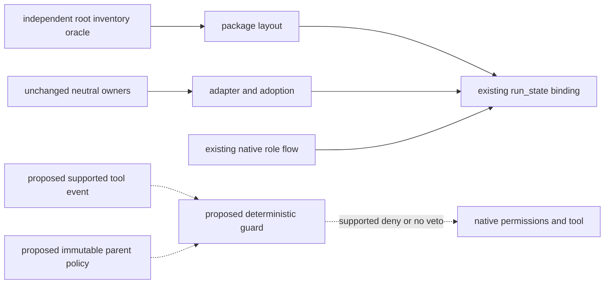

# Change specification: authority-aware safeguards and native hook source

Checkpoint: M28-C3. Status: draft, proposed staged source scope; Code not approved.
Input: [C3 reconnaissance](../notes/m28-c3-recon.md), [original coverage contract](m27-self-contained-coverage.md).
Approval: pending exact owner decision accepting the partial stage and listed residuals. Integration is separate.
$START_C3_SPEC
PURPOSE: Add self-contained executable safeguards while preserving authentic scope and honest coverage.
SCOPE: Codex source-only guard/kernel, opt-in native hook binding and owned deterministic probes; native trust/model execution remains a later concrete decision.
KEYWORDS: safeguards, scope, native hooks, source binding, partial coverage
$START_DOCUMENT_PLAN
$DOCUMENT_PLAN
GOAL Deliver bounded executable safeguard capacity => GOAL_C3
$END_DOCUMENT_PLAN
$START_SECTION_CHANGE
$START_ARTIFACT_GOAL_C3
TYPE: GOAL
KEYWORDS: authority, guard, compatibility, native limitations
$START_CONTRACT
$CONTRACT
PURPOSE: Reject recognized unsafe or ungranted effects before supported tool execution.
DESCRIPTION: Package a deterministic guard and synchronous native binding, keeping explicit policy authority and limitations.
RATIONALE: Current Codex source has prose/manual checks without a shipped executable mechanism.
ACCEPTANCE_CRITERIA: AC1–AC8 below. Source-stage verification is distinct from native AC7 and eventual full coverage.
$END_CONTRACT
$START_BODY
**Done when:**
- Source stage: guard, binding, full scoped regressions/maps and independent QA/Review/Finalize pass AC1–AC6/AC8; delivery reports PARTIAL capacity, not whole C3/M27 completion.
- Native prevention: AC7 additionally passes under its separately approved exact runtime/trust grant. Source-only green checks fulfill none of AC7.
**Stop and ask when:**
- Authentic identity, tool interception, policy authority or effective path cannot support the promised claim; report BLOCKED for missing proof rather than guess.
- Code needs another path/purpose, protected algorithm/schema, dependency, installed/global setting, trust action, model run or permanent loading change.

## Context / Input RECON

Baseline bafec417 has neutral1.1, Codex2.2/package73/skill27/helper6/role6 and Claude1.0/package59. Current C2's597/146/526 suites are historical baseline receipts, not new guard evidence. The regression population is the complete existing root/Codex/Claude suites at this baseline, not a perpetual numeric quota. Current producers are package manifest/layout, adapter/adoption/runtime, pinned package assembly and run-state source binding; current consumers include explicit source loading, PM commands and existing role returns. The guard inserts before supported native tool effects; it does not replace feature-dev, permissions, run-state or the neutral safety owner.

## What we add

Four new package members: hooks/guard_destructive.py (helper), hooks/hooks.json (config), references/safeguards.md (documentation), tests/test_guard.py (test). Proposed source2.3.0 has77 members/27skills/sevenhelpers/sixroles. No new skill, role, dependency or launcher. The standalone real entrypoint is `python3 -B implementations/codex/hooks/guard_destructive.py --policy POLICY --policy-sha256 POLICY_SHA --handler-sha256 HANDLER_SHA`, receiving exactly one bounded UTF8 event object on stdin. Default maximum input is65536 bytes; exceeding it rejects. Policy is an explicitly supplied parent-owned read-only regular file outside all worker write roots; missing/unbound/malformed policy refuses instead of inferring permissive defaults. No automatic policy generation or installation.

Policy path alone is not authority. The parent must authenticate policy/handler bytes and pin their SHA256 values in the trusted invocation, with the native definition separately pinned by actual reviewed host trust or a source-stage parent invocation receipt. Before any decision, validate the supplied policy digest and current handler digest; missing, changed or unproven binding refuses. No worker environment/tool_input selects policy or hashes. Policy, handler, native definition and their resolved entry parents are protected outside every allowed effect root; replacement, links, changed type/mode/path or unknown provenance withhold readiness. No circular definition selfhash is embedded.

Policy binds a single session-wide profile, canonical source/protected metadata roots, exact allowed effect paths/resources, explicitly owned scratch/evidence roots and authentic grant reference. It cannot be expanded by event arguments, environment values supplied by a worker, model text or classifier output. Exact policy grammar, resource identities and typed decisions are specified by Architect inside this contract; ambiguous security-relevant fields fail closed in the handler. Session-wide read-only profile applies to every intercepted actor; it does not impersonate authenticated per-subagent QA. A writable profile preserves exact parent-granted path/effect boundaries. Neither profile can grant escalation, approval, native trust or secret-store access.

The classifier returns deny for ungranted/unknown effects and handles recognized rm/find/Git/SQL risks with resource/state/authority context. An allow classification means no added hook veto, never host permission or owner approval. It must not emit native permissionDecision allow, rewrite arguments or approve PermissionRequest. Native refusal uses the supported PreToolUse deny envelope or exit2/stderr; ordinary permitted events produce exit0 without an approval decision. Diagnostic reasons use fixed error classes and safe field names, without raw commands, paths, patches, secret material or fingerprints. Deliberate handler input/probe/parse errors become explicit denial; host launch/timeout/trust errors remain externally unproven and cannot be advertised fail closed.

## Business Requirements

BR-1: Neutral1.1/wire2.0/schema2, existing role/phase/return/Debug/retry algorithms, PM CLI signatures/defaults and Claude's complete59 members remain unchanged. Retain all baseline regression cases and discrimination. Only exact current-source version/member constants, inventory oracles/kinds and coupled prose/comments change for source2.3/77; historical measurements and input locks remain historical.
BR-2: Only declared, explicitly bound parent-authenticated policy/handler/definition identity has guard authority; validate pinned digests and protected containment before decisions. No global scratch/cache exemptions, inferred role identity, silent policy fallback or worker-created approval.
BR-3: Recognized intercepted source/Git/secret/resource mutations outside the grant reject, including readonly original source and actual Git metadata home, rather than prompting a judge to bypass its role. Every patch path and addressed Git store counts; unresolved links/cwd/store/effect reject.
BR-4: Parse shell chains, redirects, assignments/cwd, quoted paths, heredoc ownership and bounded nested shell commands conservatively. Unsupported expansion/interpreter/substitution/control-flow semantics deny, never silently allow. No command is executed merely to discover its effects; read-only resource/state probes are bounded and their failures deny. SQL scripts/pipes/interpreters lacking actual resource-bound classification are unsupported.
BR-5: Owned authorized ordinary edits/checks and explicitly granted regeneration remain possible. Positive controls must exercise the same decision path as refusals. Evidence ownership and regenerability are separate; foreign ignored/cache/temp work remains protected.
BR-6: Native binding is synchronous PreToolUse, explicit opt-in policy and hash-specific host trust. No automatic trust/install/session-start side effects or fallback to older installed sources. Supported native ABI remains a hypothesis until actual AC7.
BR-7: Keep S2.tool.guard/S2.QA/S1-OP-7 partial/unverified as applicable until their actual proof; document unhooked continuation, identity and callback-fault limits. This stage is not full confinement, C5 autonomy, C6 activation or M27 completion.
LLM/PI: No model call is added in the source stage. Hook event/model text is adversarial data; it cannot alter policy or authorize effects. The future native probe is separately granted, not a new model client in this package.

## Boundaries

Always do: complete current source adoption, exact scope/one-writer discipline, preserved history, meaningful contrary controls, real entrypoint proof, independent judges and full current source maps.
Ask first: changed scope/algorithm/schema/engine, full native/trust/account run or installation; actual result integration. Already granted actions need no repeated gate.
Never do: inspect user credential/config/transcript stores, copy auth settings, use real production resources, waive errors, automatically trust/approve, repair donors, invoke another engine, reset spent C1/C2 budgets or claim unchanged Git from status alone.

## Expected Architecture

Measured current edges: adapter resolves neutral through ../../; manifest/layout describe package; run_state binds exact package/neutral identity; runtime assigns existing roles and checks returned artifacts. Root package assembly independently checks complete inventory. These are protected by the existing approved C1/C2 contracts, not a newly owner-frozen drawing.

Proposed insertion is host pre-tool invocation of Guard. No reverse edge lets Guard edit policy/state/source. Architect's DraftCodeGraph and Visual Verification retain the solid invariant subgraph and compare insertion meaning before Code. This draft proposes the dotted edges; owner approval has not happened.

## Scope

MAY EDIT, exactly these new package paths:
- implementations/codex/hooks/guard_destructive.py — bounded deterministic policy/parser/native entrypoint, no model or installation.
- implementations/codex/hooks/hooks.json — synchronous PreToolUse binding; missing policy refuses, no async/approval/trust automation.
- implementations/codex/references/safeguards.md — full policy/interface/commands/limits/opt-in and criterion-to-proof account.
- implementations/codex/tests/test_guard.py — owned fixture, real standalone process and discriminating source-stage controls; no native model execution.

MAY EDIT, exactly these existing paths and purposes:
- implementations/codex/.codex-plugin/plugin.json —2.3.0 and hook source declaration only, retain name/skills/interface.
- implementations/codex/Doxyfile — include hooks in existing source map; no weakening exclusions/documentation checks.
- implementations/codex/adapter.json — exact pre-tool capability mechanism/fallback describing conditional hook plus current host permissions; no registry/parameter/file ownership changes.
- implementations/codex/README.md — current composition, safeguard commands/limits and held native activation.
- implementations/codex/references/adoption.md — precise supported guard adoption, source2.3 census and unchanged neutral binding.
- implementations/codex/references/codex-runtime.md — conditional guard route/limits and current composition; role/flow algorithms unchanged.
- implementations/codex/references/handoffs.md — current source identity and held guard proof only; wire/schema/counters unchanged.
- implementations/codex/references/package-layout.json — exact77-member sorted inventory/kinds and source2.3, no new kind or embedded selfhash.
- implementations/codex/references/source-disposition.md — source-to-duty and converse safeguard accounting, retained defects/partial proof.
- implementations/codex/references/consumer-pm-profile.md — exact current source census/guard cross-reference only;75 duties/22 checks/13 templates and CLI grammar unchanged.
- implementations/codex/skills/semantic-exoskeleton/SKILL.md — source2.3 binding label only; neutral stamp1.1 and rules unchanged.
- implementations/codex/skills/feature-dev/scripts/run_state.py — only current package version/member constants and edit-local explanatory metadata; algorithms/KINDS/wire/schema/guards unchanged.
- implementations/codex/tests/test_adoption.py — exact current member count and edit-local metadata only; all refusal controls retained.
- implementations/codex/tests/test_native_contract.py — exact current source/member/helper checks and edit-local metadata only; independent guards retained.
- implementations/codex/tests/test_run_state.py — exact current corpus explanatory metadata only; cases/algorithm expectations unchanged.
- implementations/codex/tests/test_guide.md — new criteria/commands/limitations and current census, retained historical tables.
- tests/test_codex_package.py — independently enumerated four new members/kinds, current version77 oracle and edit-local metadata; all previous boundary controls retained.
- README.md — current source/census and safeguard capability/limits; retain complete Local use section.
- CHANGELOG.md — bounded Codex2.3 source entry, neutral version remains1.1.0.

Parent-only project paths:
- examples/pm-project/plans/m28-c3-safeguards.md — assigned Architect technical plan after approval, never overwrite C1/C2 plans.
- examples/pm-project/notes/m28-c3-recon.md; examples/pm-project/specs/m28-c3-safeguards.md — authoritative input frozen at approval; later amendment via matching decision.
- examples/pm-project/notes/m28-c3-result.md — honest source/native criterion outcomes, failures/remaining proof and authentic result gate.
- examples/pm-project/VISION.md; examples/pm-project/ROADMAP.md; examples/pm-project/TASKS.md; examples/pm-project/HANDOFF.md — root current state reconciliation.

DO NOT TOUCH: all paths not listed above; especially implementations/claude/**, neutral owners/SPEC_VERSION/FORMAT/registries/schema/checker algorithms, C1/C2 plans/specs/results/input locks/evidence, other Codex roles/cards/helpers/tests/templates, user settings/caches/credentials/trust and clean permanent main. All older map mismatches remain outside this scope. Ignored run-owned evidence/map/test resources require explicit assigned outside-source directories; generated output is never authored as source.

## Acceptance Criteria

AC1 Authority/shape: real entrypoint denies absent/invalid policy, duplicate or malformed security fields, unknown tool/shape, oversized input and worker attempts to supply role/roots/approval. Safe synthetic secret inputs produce no payload/path/fingerprint leak. Every allow control binds actual immutable policy/handler/definition identities. Changed bytes/type/mode/path, unpinned or worker-chosen hashes, replace/link attempts and environment fallbacks refuse; read-only path alone cannot pass.
AC2 Effects: owned fixtures distinguish granted versus foreign rm/find/cache, explicit Git-dir/work-tree, dirty source/index/untracked/ignored state, force/ref/config/object mutation, unresolved links/parents/spaced paths, redirects/patch multi-path and SQL/heredoc ownership. Protected original source/Git reject in readonly policy; permitted owned scratch without .git works. Unknown shell effects/probe failure deny. No destructive production operation is executed.
AC3 REAL-PATH/REAL-SHAPE: `python3 -B implementations/codex/hooks/guard_destructive.py --policy POLICY --policy-sha256 POLICY_SHA --handler-sha256 HANDLER_SHA` with stdin events executes actual handler processes. Inspect exit, parsed denial/no-veto output and safe stderr; use real committed hooks/manifest/layout/adapter and real owned temporary repository/candidate copies. JSON fixtures are labelled synthetic, never native.
AC4 Regression: run complete root, Codex and Claude suites under actual documented Python prerequisites; preserve all existing cases and exact census-only exceptions. Run self with both unchanged private deny lists and all three adapters on a complete public-source copy. No required skips or error-as-success. Compare protected source algorithms independently beyond equal test totals.
AC5 Scope/maps: complete before/after byte/type/mode/path inventories, every write/purpose and graph invariant comparison; all other baseline files remain exact. Regenerate actual root/Codex/Claude maps from their real Doxyfiles using owned outputs; inspect changed guard/test entities/contracts and meaningful references. Report pre-existing map defects separately, never claim status proves Git-object purity.
AC6 Native binding source: actual hooks/manifest are parseable, synchronous, contained and invoke the current guard; no `|| true`, automatic grant, rewrite, async or trust bypass. Missing policy is explicit deny at handler; stopped/untrusted/missing/runtime-failed hooks do not earn guarded-session readiness. Documentation maps every supported/proposed/unverified/unsupported channel.
AC7 NATIVE, UNFULFILLED/HELD: separately approved disposable runtime/trust probe must capture actual events and actual unchanged/changed benign sentinels for Bash/apply_patch/nested calls and claimed channels, positive authorized mutation and denied foreign/readonly mutation. Independently compare original source and the Git metadata population actually claimed. Probe identity/continuation/fault gaps without turning bypass into successful prevention. Standalone AC3 fulfills none of this criterion. Unsupported prevention stays BLOCKED, never N/A or PASS.
AC8 Closure: independent QA with existing scans, whole-result Review and assigned Architect Finalize judge the same current candidate; root records source-stage partial and every unmet native duty, authentic approvals and recoverable private evidence. No install/publication/main merge occurs without matching decisions.

## Delivery / Live Probe

Current proposed Code grant is source plus deterministic local processes only. Sink: owned fixture files and handler stdout/stderr; no accounts/network/provider/database deployment. Commands: AC3 plus `python3 -m pytest -c implementations/codex/pytest.ini implementations/codex/tests/test_guard.py -p no:cacheprovider -s -v --basetemp OWNED_GUARD_ROOT`; full documented suites/adapters/self/maps follow AC4/5. Interpreter and paths must be measured in the technical plan; no placeholder command counts as execution. Retain full exact argv/cwd/streams/exits/source/policy identities in run-owned private evidence.

AC7 is TEST_DEFERRED, prerequisite: reviewed actual guard/binding/policy byte hashes and exact separate owner-approved disposable host/account/trust/sentinel scope. The concrete native command/configuration is prepared after these files exist and vetted before that decision; this spec authorizes none and intentionally supplies no speculative approval bypass. Reason: current grant is preparation and future hook definition/account consumer has not been verified. Criterion AC7 and complete C3 behavioral closure remain unfulfilled. Permanent activation stays C6. Source-stage result must be useful and reviewable without pretending this deferral is native success.

## Risk Notes

Shell parsing is incomplete by nature; deny unknown effects rather than execute probes that mutate. Path resolution has races; no OS confinement claim. A shared session policy cannot independently authenticate QA/Coder. Hook load/trust/fault/unintercepted continuation can bypass a veto; whole safety cannot rely on a handler alone. Conservative classification may refuse useful complex commands; use concrete scoped amendment rather than broad exemptions. Code and native proof remain two stages, with full coverage owed.

## Deficiencies / interpretations

SPEC_DEFICIENCY_C3_NATIVE: M27 requires executable and actual behavioral safeguards, while available hook evidence lacks authenticated per-tool role identity and complete interception/fault confinement. Proposed choice: implement the bounded source stage as PARTIAL; preserve AC7 and full duty-level proof as unfulfilled. Rationale: useful executable capacity can be delivered without falsely claiming the platform closes these gaps. Owner approval must name this partial disposition; otherwise Code is SPEC_BLOCKED. Carry this entire block and complete scope verbatim to Code. No approved original duty is waived.
SPEC_DEFICIENCY_C3_DONOR: The donor guard diagnostic permits copied/linked Git scratch while its QA source forbids shared Git metadata. Choice: use the corrected .git-free owned-scratch invariant and negative regression; do not port the unsafe allowed test as truth. Rationale: preserve original source/Git read-only duty rather than the contradictory message. Carry this entire block and scope verbatim to Code.
Code Deviations are pending: later enumerate all interpretations/narrowings/replacements or explicit none; draft does not assert implementation compliance.
$END_BODY
$START_LINKS
IMPLEMENTS: (none)
IMPACTS: (none)
REQUIRES: (none)
$END_LINKS
$END_ARTIFACT_GOAL_C3
$END_SECTION_CHANGE
$END_C3_SPEC
