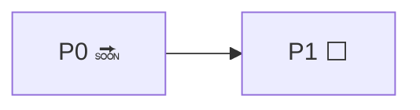

# Roadmap — <product>

**Goal:** <the vision's goal in one sentence>. **We are there when:** <the observable criterion>.
**Step ids:** `P<n>` for phases; never renumbered. Statuses: ✅ done · 🔜 current · ⬜ ahead · ⏸ deferred on purpose.
The current step carries the position marker; decisions live in `docs/decisions/`, not here.

## Track <A> — <name>

- [ ] **P0.** 🔜 <result, not activity> — exit: <criterion> `<<< WE ARE HERE`
- [ ] **P1.** ⬜ <result> — exit: <criterion>

<Why this order, where it is not obvious.>

## Deferred on purpose

- ⏸ <what> — <why deferred; return condition>

## Diagram

