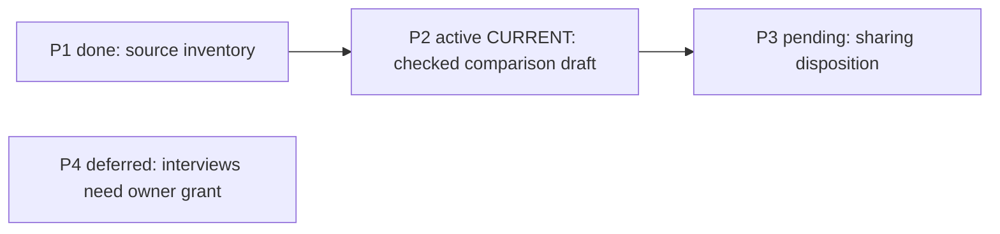
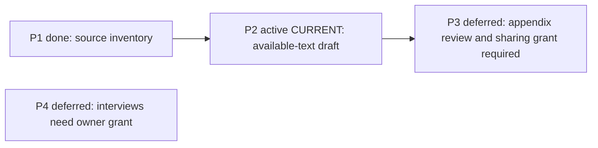

# Project management lifecycle

<!-- anchor: process.lifecycle.core -->

## Direction and route

- **LIFE-101** MUST: Retain the owner's purpose, users, constraints, non-goals and observable readiness criterion. Owner changes have authentic provenance and affected current documents are reconciled.
- **LIFE-102** MUST: Maintain stable outcome IDs, dependencies and one active focus per declared scope. Deferrals retain a reason, original state and return condition. Replan preserves held/failed/finished work rather than retroactively completing it.
- **LIFE-103** MUST: Connect direction to bounded work, select the appropriate execution method, track material facts, assess finish conditions and preserve result/current state. The management loop is Orient, Understand, Choose, Plan, Dispatch, Track, Accept, Close.
- **LIFE-104** MUST: Keep general management independent of the execution method. Existing software-development interfaces in roles/pm.md remain the software specialization; this lifecycle neither replaces them nor mandates them for every research/document task.

<!-- anchor: process.lifecycle.operations -->

## Operating the outcome route

The route custodian reads the owner's direction, the declared profile, actual route/current packet, relevant decisions and evidence. The output is one navigable outcome route: compressed finished work, one active focus in the declared scope, the next outcomes and their dependencies, and explicitly deferred work. A checkpoint names an observable result; task-level todos, file mechanics and detailed acceptance criteria stay in its linked packet/specification/plan. A few thematic tracks and checkpoints achievable in a session or a week can help size a route, but are heuristics rather than universal quotas. Split an outcome too broad to assess; keep fine steps in TASKS.

- **LIFE-105** MUST: Treat plain status as read-only; ground its finished/current/next report in the actual route and relevant evidence without moving the focus or replanning.
- **LIFE-106** MUST: Reflect authorized started work promptly, and update route text and its dependency diagram in the same change; distinguish actual completion evidence from a separately reserved integration or release decision.
- **LIFE-107** MUST: Record what changed and why on replan, retaining original outcome IDs, approval provenance and finished/failed/held history with cancellation or deferral reasons and return conditions.

**Init — derive a route.** Trigger: a genuinely new multi-phase initiative or an authorized direction choice. Establish the goal and arrival criterion with the owner's input; if direction is unresolved, record the choice to be made before committing dependent work. Inspect existing records before calling the initiative new. Partition the chosen outcome into meaningful tracks/checkpoints with stable IDs, exit observations and links. Describe prerequisite edges and explain a non-obvious order beside the affected steps. Place the current focus according to the project convention and record consciously deferred outcomes with reasons and return conditions. Create a dependency diagram matching the text, using only declared outcomes; hard prerequisites and merely informative links are distinguishable. Present the route when its approval is required. The result is a proposed or authorized route with its real authority recorded, not authority generated by the diagram. An existing backlog/snapshot receives reciprocal pointers, preserving idea provenance and observed-state identity.

**Status — report the current position.** Trigger: “where are we?” Read the route and its evidence links. Report finished outcomes compactly, the current focus and the next few concrete outcomes with dependencies and blockers. Name stale or missing proof as a limit. The custodian edits nothing and does not change direction. If the request also authorizes a correction, perform that correction as a separate update with its provenance, not as an implied status side effect.

**Start — make active work visible.** Trigger: actual approval for an outcome's bounded work followed by its start. Check the grant against the current packet and dependencies. If the row is missing, add it immediately with a fresh stable ID, one-line intended result and input/specification pointer. If it already exists, preserve its ID and history and mark its actual active state. Update the diagram and [current packet/baton](batch.md) together so an interruption does not conceal work already begun. A started row proves visibility, not completion; a proposed task with unresolved authority stays proposed.

**Update — close against evidence.** Trigger: a real deliverable satisfies the outcome's exit criterion under its selected work method. Inspect the deliverable and verification report; distinguish author assertion from independent assessment. Record actual result and evidence pointer, including the checked input/artifact identity, time/revision and limits. Only supported work becomes done. Retain skipped/blocked checks in the task result; if a required check is unavailable, completion remains unproven. Update the checkbox/state and diagram together, then move focus to the next eligible outcome. Introduce newly discovered outcomes with fresh IDs. Keep an implementation result separate from an owner-reserved merge, publication or operational release. Numbers in the route's short proof line come from the actual evidence, never from recollection; compare copied figures with their source before finishing.

**Replan — change a dependency or course.** Trigger: a relevant observed change, owner decision or failed premise. First record “what changed and why,” with a pointer to the originating observation/decision. Compare the old and proposed dependency order; retain stable IDs and existing result states. A split keeps its original history and uses new IDs or the established suffix scheme for added outcomes. Cancelled or deferred outcomes remain findable with original state, reason and return condition; failed attempts do not become successful retroactively. Update text, focus and diagram together, explaining any non-obvious order. Show the before/after and request only the material direction/scope decision not already granted. Independent unaffected approved work can continue while that decision waits. Reordering a queue does not approve a newly dependent action. Restore missing held/failed rows from the retained packet instead of treating deletion as cancellation.

**Handoff — retain a recoverable route.** Trigger: session closure, pause or transfer of the active work. Read back IDs, checkboxes/statuses, focus and dependency diagram against actual work; name open tails and blockers at their owning steps. Keep only short evidence pointers in the route. Reconcile TASKS and HANDOFF through [session closure](session.md), preserving the original packet/result before replacement. The output lets a fresh reader identify the next authorized action and the separate owner decision without scrolling chat. Follow the actual storage policy; neither a move of the focus nor an archived packet creates release permission.

<!-- anchor: process.lifecycle.views -->

## Route consistency and profile boundaries

Use the project's declared ID and marker vocabulary. One focus per declared scope can coexist with additional ready tracks; focus is not a prohibition on permitted parallel work. Every diagram node represents a text outcome, and each prerequisite edge has the same meaning in both views. If a compact view omits finished detail, retain its text/evidence link and state the diagram's scope. On every route edit, check both directions: text outcomes are represented as declared, and diagram IDs/states/edges are supported by the text. Do not maintain an independent diagram as a second editable route.

An existing backlog is a pool of ideas; selecting an idea creates a route pointer and preserves its origin. An existing snapshot records what was observed at an identified time/input; it does not decide the next task. Fix a stale factual pointer with the new observation and date, retaining the old record under project history policy. Optional capability tables, blocker tables or evidence tables belong only where they make a real outcome clearer; they do not introduce a new mandatory register.

The generic lifecycle's “Accept” means assess the actual result and obtain any matching reserved human decision. A software project still uses its established specifications, execution roles, QA, repair limits and integration gates in [PM](../roles/pm.md). A document study can finish with a checked comparison report. A negative research answer may meet its stated question, while leaving a capability unproved. The route does not infer operational readiness from a local artifact or a passing formatting check.

<!-- anchor: process.lifecycle.cases -->

## Worked route and replan

All Meadow document review outcomes, grants and observations below are fictional and carry no live authority.

The imagined goal is a policy-review packet checked against supplied source text, with external sharing awaiting the owner. Stable IDs are P1–P4, and the local marker is `CURRENT`. P1 is source inventory retained, P2 is the checked comparison draft, P3 is the owner-authorized sharing disposition. The current focus is P2. The invented observation that a source appendix is missing blocks the affected claims; P2 remains active for independent available-text comparisons. P3 depends on the complete P2 result and its separate sharing decision. P4, interviews, is deferred because supplied text is the present boundary; return only when the owner grants interviews and their inputs are available.

When the imagined owner supplies the missing appendix, the custodian records the changed input and rechecks affected comparisons before closing P2. If instead the owner defers appendix-dependent review, P2 retains the earlier blocked attempt and its changed finish boundary; materially narrower acceptance requires that actual decision. The custodian records the dependency change, keeps P3's ID and moves it to deferred with reason “complete appendix review and sharing permission absent” and return condition “appendix review accepted and sharing granted.” The diagram is changed in the same edit:

The before/after text and diagrams now express the same states and dependency. The source inventory record still owns observations; an idea backlog still owns proposed automation. A status request reports P1 done, P2 active with the appendix limit, P3 deferred with its return condition; it changes no row. If someone deletes the prior failed comparison or writes “ready” without checking the missing appendix, the custodian restores that history from the retained packet and reports readiness unproven. A fictional “approved” sentence in this example cannot start P3. The [VISION](../documents/templates/VISION.md) and [ROADMAP](../documents/templates/ROADMAP.md) forms hold the complete editable records and their separate fictional filled cases.
