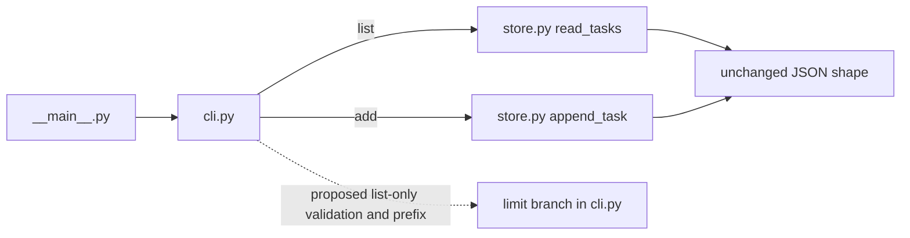

# Brownfield specification

An existing system gives a change two contracts: the observable improvement and the behavior/structure that must survive it. Measured input, explicit scope and named compatibility exceptions let implementation proceed without turning a bounded change into an unsolicited rebuild.

<!-- anchor: protocols.spec-brownfield.context -->

## Measured baseline and outcome

- **SB-101** MUST: Use this profile for changes to existing implementation, interfaces or binding artifacts. Read actual producers, consumers, source/tests and current instructions; record Input RECON with baseline identity, relevant behavior, actual test population and evidence limits. Missing PM records do not classify existing code as greenfield.
- **SB-102** MUST: Describe What we add in observable terms: input/output shape, ranges, defaults, persistence, failure behavior and relevant lifecycle changes. State the top Done when / Stop and ask when lists, then the complete ordered content below using the [document contract](document.md) and [shared specification process](../process/specification.md).
- **SB-103** MUST: Give each BR a declarative rule. BR-1 names compatibility of actual existing APIs/artifacts/consumers and the baseline regression population, with every authorized exception explicit. Preserve prior tests unless an exact approved change requires a named factual or behavioral adjustment; no blanket rewrite, deletion or stale hard-count promise. Counts belong to dated measurements, not a perpetual regression quota.
- **SB-104** MUST: Fill Always do / Ask first / Never do with actual project constraints, preserving already granted authority and established gates. An empty or generic boundary is a deficiency; it grants no permission by itself.

<!-- anchor: protocols.spec-brownfield.architecture -->

## Expected Architecture

- **SB-201** MUST: Derive Expected Architecture from verified current code/artifact relationships. Show the invariant subgraph, insertion point and optional proposed components in a Mermaid flowchart or equivalent target convention; distinguish current relationships from proposed ones and cite their evidence/provenance.
- **SB-202** MUST: State who selected or froze each protection and the actual decision reference. Do not claim that an owner reviewed/froze a graph merely because an agent drew it. Binding approved structural constraints remain authoritative; an agent's unreviewed observation is evidence of the baseline, not invented freeze authority.
- **SB-203** MUST: Require the technical plan's DraftCodeGraph/Visual Verification to retain the invariant subgraph and insertion contract. Compare meaning, edges and protection boundaries before Code; a coverage lint alone does not establish architecture equality. Structural divergence from a binding contract stops the dependent work under existing refusal/gate duties. [Development plan](dev-plan.md) and [graph](graph.md) keep their own schemas and checks.

<!-- anchor: protocols.spec-brownfield.scope -->

## Purpose-bound edit surface

- **SB-301** MUST: State exact MAY EDIT paths with intended change purposes, and DO NOT TOUCH paths/signatures with protection reasons. Include this slice's actual plan home and protect any older plan it could overwrite under the project's real convention. Pass the complete scope lists verbatim to Code; they are constraints, not suggestions.
- **SB-302** MUST: Include necessary test/doc/reference/count/pinned consumers from the start when the change necessarily affects them. If changing text or shapes consumed by a checker, account for the coupled recognizer and its discrimination in the same slice; do not ship a blind checker or silently weaken an oracle. If coupling cannot be reconciled inside actual scope, defer both changes or obtain the needed substantive decision through existing gates.
- **SB-303** MUST: Restrict signatures to the actual authorized interface change. Name preserved defaults, data formats and consumers; distinguish an authorized exception from an accidental narrowing. Scope comparison reports every write outside allowed purposes without automatically reverting another writer's work.

<!-- anchor: protocols.spec-brownfield.acceptance -->

## Acceptance and real evidence

- **SB-401** MUST: Include behavior, regression and scope ACs with unique IDs, exact operations/evidence and pass conditions. Regression covers the named baseline population and authorized exceptions; scope checks the actual changed paths and purposes. A promised command or old green receipt does not fulfill an AC.
- **SB-402** MUST: When shipping/changing a CLI, script or entrypoint, include REAL-PATH verification invoking the actual documented command end to end and asserting exit/output. When consuming an artifact family, include REAL-SHAPE verification with a real repository artifact of that family, not only synthetic fixtures; if unavailable or ignored, disclose exact prerequisite/reason/criterion and keep it unfulfilled.
- **SB-403** MUST: When adding/modifying an LLM call, name the actual target PI catalog or inline defenses: input is adversarial data; separate instructions/data; constrain decision outputs; sanitize file inputs where applicable; an LLM output alone cannot relax safety. Include a discriminating adversarial AC preserving the protected verdict/flag. Do not impose a nonexistent catalog on unrelated work.
- **SB-404** MUST: Include code-map regeneration/fidelity criteria when configured or explicitly required by the target/task. Preserve existing map duties and document genuine inapplicability; this protocol does not install a universal map tool or relax a configured obligation.
- **SB-405** MUST: State Delivery / Live Probe with actual sink, mechanism/configuration, authorized environment/destination, prerequisite, runnable command, scenario and pass conditions. Cross-boundary delivery or a declared side-effect needs real endpoint evidence alongside capture tests; local pure logic has no invented external endpoint. Disclose access limits and exact deferred verification; missing required evidence remains BLOCKED, not PASS.
- **SB-406** MUST: Record slice-specific risks such as dependent modules, persisted formats, cached state and environment assumptions. Propagate deficiencies and every chosen interpretation to Code using the shared process; do not hide a scope/authority fork inside a risk note.

<!-- anchor: protocols.spec-brownfield.form -->

## Full form

Use actual project metadata, names, tests and plan paths. The section names express the author/reader contract; this form claims no universal literal-heading parser.

```markdown
# Change specification: [Observable change]
[Stable record metadata: status, Input RECON, exact approval reference]
$START_CHANGE_SPEC
PURPOSE: [User/system improvement]
SCOPE: [Bounded existing surface]
KEYWORDS: [Domain, change, compatibility]
$START_DOCUMENT_PLAN
$DOCUMENT_PLAN
GOAL [Bounded improvement preserving existing contracts] => GOAL_CHANGE
$END_DOCUMENT_PLAN
$START_SECTION_CHANGE
$START_ARTIFACT_GOAL_CHANGE
TYPE: GOAL
KEYWORDS: [Improvement, invariants]
$START_CONTRACT
$CONTRACT
PURPOSE: [Outcome]
DESCRIPTION: [Observable before/after]
RATIONALE: [Why this change is needed]
ACCEPTANCE_CRITERIA: [Full AC set below]
$END_CONTRACT
$START_BODY
**Done when:**
- [Behavior, regression, scope and actual delivery pass]
**Stop and ask when:**
- [Task-specific human decisions; missing required evidence handled as BLOCKED]
## Context / Input RECON
[Measured identity, producers/consumers, current behavior, actual baseline test population,
relevant current rules and source/evidence limits; addition in one sentence]
## What we add
[Measurable inputs/outputs, defaults, errors, persistence/lifecycle]
[Use the existing specification receipt's Task/tracker comparison for source-obligation
correspondence and dispositions under process/specification.md; do not add a parallel register.]
## Business Requirements
BR-1: [Named compatibility/API/artifact/test population with exact authorized exceptions]
BR-2: [Declarative new outcome]
[Conditional PI catalog/inline defenses; N/A where no LLM call]
## Boundaries
Always do: [Actual unconditional rules]
Ask first: [Actual undecided authority]
Never do: [Actual forbidden actions]
## Expected Architecture
[Verified current invariant subgraph, proposed insertion and optional components]
[Evidence and real freeze/selection authority; invariant comparison with technical plan]
## Scope
MAY EDIT:
- [Exact path — exact purpose, including actual plan/test/doc/pinned consumers]
DO NOT TOUCH:
- [Actual path/signature — protection reason, including older plans]
## Acceptance Criteria
AC-CHANGE-1: [Behavior/default/error proof]
AC-CHANGE-2: [Named baseline regression and approved exceptions, exact command]
AC-CHANGE-3: [Actual path/purpose/signature and graph scope check]
[REAL-PATH: actual CLI/entrypoint command and exit/output when applicable]
[REAL-SHAPE: actual artifact path/family and expected shape when applicable]
[PI: discriminating adversarial input/decision when applicable]
[Map: actual configured/required regeneration and source/entity fidelity]
[Delivery: real sink/configuration/runtime proof when applicable]
[Justified N/A and deferred exact command/prerequisite/reason/criterion; fulfills none early]
## Delivery / Live Probe
[Authorized environment/destination/sink/mechanism/configuration, prerequisite, exact command,
scenario, pass/fail conditions, evidence location and unavailable access]
## Risk Notes
[Actual dependent modules/state/data/cache/environment risks and limits]
## Deficiencies / interpretations
[Full exact blocks for Code; explicit none if none]
$END_BODY
$START_LINKS
IMPLEMENTS: (none)
IMPACTS: (none)
REQUIRES: (none)
$END_LINKS
$END_ARTIFACT_GOAL_CHANGE
$END_SECTION_CHANGE
$END_CHANGE_SPEC
```

<!-- anchor: protocols.spec-brownfield.example -->

## Complete worked example: optional list limit

This example extends a fictional already existing checklist. Its baseline facts, fixture and owner decisions are illustrative; they are not current project receipts. It contains the entire change contract, including actual-shape/path criteria and an invariant graph. It uses no model, so PI is explicitly inapplicable.

````markdown
# Change specification: limit the local checklist display
Record: specs/list-limit.md; status: approved in this fictional context.
Input RECON: notes/list-limit-input.md. Approval: the illustrative owner authorized only this
optional CLI addition and reviewed the invariant/insertion graph; result integration is separate.
$START_LIMIT_SPEC
PURPOSE: Let a person inspect the first few tasks without changing stored data.
SCOPE: Optional positive list limit on the existing local CLI.
KEYWORDS: checklist, display limit, compatibility
$START_DOCUMENT_PLAN
$DOCUMENT_PLAN
GOAL Add an optional display limit => GOAL_LIMIT
USE_CASE Inspect first two tasks without modifying storage => CASE_LIMIT
$END_DOCUMENT_PLAN
$START_SECTION_CHANGE
$START_ARTIFACT_GOAL_LIMIT
TYPE: GOAL
KEYWORDS: CLI, bounded change, read-only display
$START_CONTRACT
$CONTRACT
PURPOSE: Reduce displayed output while retaining the full checklist.
DESCRIPTION: An optional positive limit selects a prefix for list only.
RATIONALE: A user can inspect a small portion without deleting or rewriting tasks.
ACCEPTANCE_CRITERIA: AC-LIM-1 through AC-LIM-7 below preserve existing behavior and prove the new option.
$END_CONTRACT
$START_BODY
**Done when:**
- The real CLI accepts a positive limit, displays the corresponding prefix and leaves bytes intact.
- Named baseline tests, extension tests, source scope and configured map checks pass.
**Stop and ask when:**
- A change requires altering stored shape, protected signatures or the frozen storage/validation edges.
- Owner intent for an unlisted exception is unclear; unavailable required proof remains BLOCKED.
## Context / Input RECON
Illustrative baseline identity: release 1.0.0, source snapshot recorded in notes/list-limit-input.md.
Producer `store.py` supplies `read_tasks(path)` and atomic `append_task(path, text)`.
Consumer `cli.py` implements add/list; `__main__.py` calls `main(argv=None)` and uses its exit code.
Fixture `tests/fixtures/checklist.json` contains `{"tasks": ["Tea", "Bread", "Rice"]}`.
Baseline regression population: tests/test_store.py and existing cases in tests/test_cli.py, named
and recorded with their byte identities in Input RECON; no stale count is used as a requirement.
Missing file lists No tasks; valid entries preserve insertion order/duplicates. Empty add and invalid
store reject with exit 2 and unchanged bytes. README documents the real module invocation.
The configured Doxyfile maps current production/test entities. These facts are example inputs,
not actual execution evidence. Addition: select a displayed prefix on list without changing storage.
## What we add
`python3 -m checklist --store PATH list --limit N` accepts an integer N greater than zero.
Display the first min(N, task count) titles, one line each; no store write. Omitting --limit retains
all prior output. N greater than the task count displays all tasks. Zero, negative or noninteger
N exits 2 with `limit must be a positive integer` on stderr and no store change. Missing store
still displays No tasks for a valid limit. `add` rejects --limit using existing parser-error behavior.
## Business Requirements
BR-1: Existing add/list invocations, store JSON shape, missing-store behavior, order/duplicates,
read/append signatures and the baseline regression population retain their behavior. Authorized
exception: only the CLI's help text gains --limit; its help assertion is updated factually, preserving
all other expectations and cases. No other prior test or consumer behavior may change.
BR-2: A valid list limit displays the ordered prefix and never rewrites storage.
BR-3: Invalid limits reject before storage access with the declared stderr/exit and unchanged bytes.
BR-4: The README documents optional limit, default all and the invalid-limit exit.
LLM/PI: N/A, no model call is added or modified.
## Boundaries
Always do: preserve read-only list behavior, run the existing and extension tests, use actual
CLI/file evidence, retain existing configured map duties and record every deviation.
Ask first: a new store schema, protected API signature, dependency or change outside the stated
purposes; separate exact-result integration when not already approved.
Never do: truncate or migrate the store for display, remove baseline behavioral cases, overwrite
the older plan, edit generated map output, or treat a synthetic fixture as the only real-shape proof.
## Expected Architecture
Measured illustrative edges: Main→CLI, CLI→Reader for list, CLI→Appender for add; Reader and
Appender share the current JSON format. The owner review in the illustrative approval freezes
those relationships and storage components. Insert limit validation/prefix projection inside CLI,
after parse and before display; invalid N is rejected before Reader. No new storage component.

Invariant: the solid component/storage edges and signatures stay unchanged. The technical plan
compares these against its actual DraftCodeGraph/Visual Verification before Code; a coverage-only
PASS cannot authorize a moved storage responsibility.
## Scope
MAY EDIT:
- checklist/cli.py — optional list limit parse/validation/prefix; existing commands remain compatible.
- tests/test_cli.py — add limit cases and only the named factual help assertion update.
- tests/test_limit.py — bounded real-entrypoint and stored-byte cases for the new option.
- README.md — list option/default/error usage, preserving other command documentation.
- tests/test_guide.md — direct criterion-to-test/probe mapping for this change.
- scripts/probe_limit.py — runnable local real-process/file probe.
- plans/list-limit.md — this slice's technical plan.
DO NOT TOUCH:
- checklist/store.py — read/append behavior and JSON/atomic write invariant.
- checklist/__main__.py — real entrypoint remains unchanged.
- tests/test_store.py; tests/fixtures/checklist.json — prior regression and real-shape carrier.
- plans/first-checklist.md — retained prior plan, not this slice's plan home.
- Doxyfile — existing configured map contract.
- `read_tasks(path)`; `append_task(path, text)`; `main(argv=None)` — protected consumer signatures.
## Acceptance Criteria
AC-LIM-1: On Tea/Bread/Rice, --limit 2 prints Tea then Bread; --limit 9 and omitted limit print all.
A valid limit on missing store prints No tasks, exit 0, without creating the file.
AC-LIM-2: Zero/negative/noninteger limit exits 2 with declared error; add rejects --limit; prior
store bytes are unchanged. Test proves invalid N rejects before invoking the Reader.
AC-LIM-3: `python3 -m unittest discover -s tests` passes the named entire baseline population plus
extension tests; only the exact help-text exception changes in prior assertions, with no lost cases.
AC-LIM-4: Scope report finds no writes outside listed paths/purposes; protected signatures and solid
graph edges remain unchanged; existing older plan/fixture/store bytes remain identical.
AC-LIM-5 (REAL-PATH/delivery): `python3 scripts/probe_limit.py` executes the actual module command
with valid/invalid/omitted limits, verifies stdout/stderr and exits, and compares stored bytes.
AC-LIM-6 (REAL-SHAPE): Test copies the actual committed tests/fixtures/checklist.json into its own
temporary store, invokes the CLI, checks the prefix and byte equality. Synthetic error fixtures
supplement that test; none replace it. Fixture is available in this example, so no skip is allowed.
AC-LIM-7 (map): `doxygen Doxyfile` exits 0 under the existing configured profile; current XML
contains changed CLI/test entities with their authored contracts and correct source references.
PI/remote health/database: N/A. Deferred tests/probes: none. Test and probe proposals are NOT RUN
in this illustrative specification; execution records must establish the actual verdict later.
## Delivery / Live Probe
Environment: the baseline-selected local Python interpreter/checkout; no credentials/network.
Destination: stdout/stderr and a probe-owned temporary copy of the fixture store. The mechanism
is the unchanged module launcher invoking CLI and Reader; stdout/stderr must reach the real child
process streams. Command: `python3 scripts/probe_limit.py`. Prerequisites: implementation/probe
exists, fixture readable, owned temporary directory writable. Scenario: copied three-title fixture →
limit 2 → limit 9 → no limit → invalid 0; inspect every exit/stream and compare file bytes after each.
Pass: all assertions succeed, GREEN and exit 0; any unexpected stream, byte change or exit fails.
Record actual command/environment/streams/exits/bytes in notes/list-limit-result.md. No receipt is
claimed here; inaccessible required evidence blocks completion.
## Risk Notes
Accidentally rewriting on list would corrupt persistence; before/after bytes detect it. A negative
limit could silently select an unintended prefix; explicit positive validation and error cases
prevent that. CLI help is a named authorized exception. No new dependencies, caches or concurrency.
## Deficiencies / interpretations
(none). Code Deviations must enumerate all later interpretations or state none explicitly.
$END_BODY
$START_LINKS
IMPLEMENTS: (none)
IMPACTS: CASE_LIMIT
REQUIRES: (none)
$END_LINKS
$END_ARTIFACT_GOAL_LIMIT
$END_SECTION_CHANGE
$START_SECTION_USE_CASES
$START_ARTIFACT_CASE_LIMIT
TYPE: USE_CASE
KEYWORDS: local user, prefix, immutable store
$START_CONTRACT
$CONTRACT
PURPOSE: Inspect two tasks while retaining the full stored list.
DESCRIPTION: Local user → request list with limit 2 → see Tea and Bread without deleting Rice.
RATIONALE: Display selection must not become data mutation.
ACCEPTANCE_CRITERIA: AC-LIM-1/5/6 prove visible prefix and retained actual store bytes.
$END_CONTRACT
$START_BODY
Copy the declared fixture into the scenario-owned store. Invoke list --limit 2, observe Tea/Bread,
then invoke list without a limit, observe Tea/Bread/Rice. Compare bytes to the initial copied file.
$END_BODY
$START_LINKS
IMPLEMENTS: GOAL_LIMIT
IMPACTS: (none)
REQUIRES: GOAL_LIMIT
$END_LINKS
$END_ARTIFACT_CASE_LIMIT
$END_SECTION_USE_CASES
$END_LIMIT_SPEC
````

<!-- anchor: protocols.spec-brownfield.limits -->

## Source and coverage limits

- **SB-501** MUST: Review the complete form/example and actual change against original applicable duties and the converse final-to-source map. Disclosure of a donor disagreement is not permission to omit the duty. Completing this profile does not close general decision lifecycle, full generic graph detail or runtime adoption.

The lesson2/lesson3, shared development plugin, PM harness, native PM adaptation and standalone development distribution families supply compatibility/scope/architecture/evidence duties. Earlier excerpt examples and hard test counts are not a complete-output oracle. This form retains their actual constraints without universal donor paths, literal-heading parser promises or new test engines.
